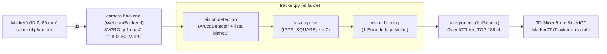
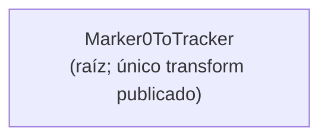
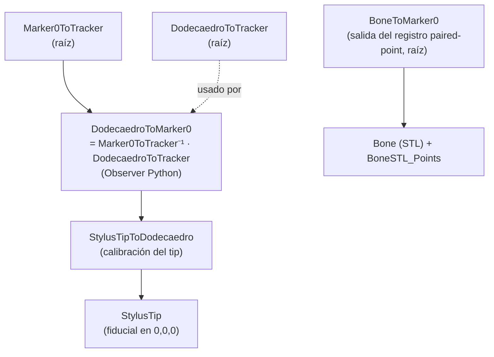
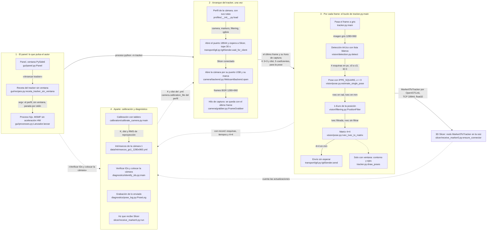
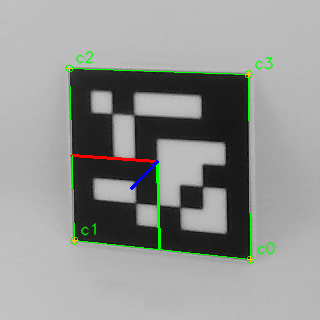

# ARCHITECTURE.md — Sistema de Navegación Quirúrgica (PoyectoNavegacion)

> **Qué es este documento (MVD 1 de 3):** describe **el sistema tal como es** hoy —
> topología, componentes, flujo de datos y convenciones. Es un documento **vivo**:
> se lee ANTES de tocar código y se actualiza cuando la arquitectura cambia.
> El *porqué* de las decisiones vive en `DECISIONS.md`; las *reglas y el estado
> operativo* viven en `CONTEXT.md`.
>
> _Última actualización: 2026-10-28 (§6: meta 005 · Agente de consulta para el equipo y buzón de peticiones, fase 4 · El aviso de peticiones en `direccion` y el circuito completo: entran en el árbol `peticiones\` y `equipo\`, con `equipo\peticiones_pendientes.ps1`, que `direccion` corre al arrancar). Antes, 2026-10-28 (§6: meta 005, fase 3 · La guía `docs/EQUIPO.md` y la instalación guiada: `docs\` gana `EQUIPO.md`). Antes, 2026-10-28 (§6: meta 005, fase 2 · El agente `consulta` y su skill de peticiones: `.claude\` gana el agente `consulta` y la skill `peticion`; `peticiones\` y `equipo\` entran en el árbol en la fase 4). Antes, 2026-10-26 (§6: meta 004 · Cómo funciona el tracker, fase 4 · Lectura con el autor y cierre de la meta: la meta cierra con 0 dudas en §9.2 y §9.4; §9 y el código no cambian). Antes, 2026-10-26 (índice, §9.2, §9.4 y §9.5: meta 004 · Cómo funciona el tracker, fase 3 · La explicación y el glosario: la detección → pose en 11 pasos, el glosario de los logs y la tabla de la fuente de cada número; el código no cambia). Antes, 2026-10-26 (§3.7: meta 004 · Cómo funciona el tracker, fase 2c · «Comprobar escala con regla» sin congelarse y con vista previa fluida: `calibration/check_scale.py` detecta la vista previa a la mitad y en otro hilo y repinta durante la medida)._
> _Antes, 2026-10-26 (§3.7 y §9.1: meta 004 · Cómo funciona el tracker, fase 2b · «Verificar IDs y colocar la cámara» marca la cámara en verde y se quita «Probar cámara»: `status.chequeo_camara_tras_receta` pone el semáforo «Cámara» al terminar «Verificar IDs» y el panel ya no tiene el botón de la sonda corta). Antes, 2026-10-26 (§6 y §9.3: meta 004 · Cómo funciona el tracker, fase 2 · El ejemplo resuelto con un frame real: `diagnostics/explain_pose.py` sigue el frame 480 de gs1 desde las esquinas hasta la 4×4, el bloque generado y la figura `docs/img/004/marker0_gs1_frame_00480.png`; `tests/test_explain_pose.py` lo repite sobre los 6 frames guardados). Antes, 2026-10-26 (índice nuevo; §2, §6 y §9 nueva: meta 004, fase 1 · El mapa del proyecto: §9.1 con el mapa en Mermaid de archivo por caja y lo que pasa por cada flecha, de izquierda a derecha, su imagen SVG exportada con `diagnostics/export_map.py` (P9) y la prueba de fidelidad `tests/test_como_funciona.py`; §9.2, §9.4 y §9.5 se escriben en la fase 3)._
> _Antes, 2026-10-25 (§3.2, §3.5, §3.6, §3.7 y §6: meta 003, fase 8c · Cierre de la meta: el modo sin ventana va al ritmo de la cámara (~89–90 fps) y es el del botón principal del panel; el envío sale en ráfagas al tic de Windows y Slicer recibe como mucho ~65 Hz, techo de Slicer (fase 8b, R2; B54); `receive_marker0.py` da los intervalos y acepta otro nodo; `diagnostics/igtl_rate.py`; `tracker.py` 395 líneas). Antes, 2026-10-25 (§3.7: meta 003, fase 8a · Un botón por modo en el panel, sin cámara: «Arrancar tracker» lanza el tracker sin ventana y «Arrancar tracker con ventana» el de siempre; «Verificar IDs y colocar la cámara» reemplaza a «Verificar IDs» y a «Vista previa»; `identify_ids` lee por `FrameGrabber` y dibuja la cruz y los fps de la cámara también con detección; la verificación en vivo, al empezar la sesión de la 8b).
> Antes, 2026-10-25 (§3.2 y §3.7: meta 003, fase 7b · Botones de tracker sin ventana y de vista previa para posicionar las cámaras, sin cámara: `tracker --stop-stdin`; el panel gana «Vista previa (colocar la cámara)», «Arrancar tracker sin ventana» y «Detener tracker», y detiene el tracker sin ventana por la entrada estándar; `identify_ids` con `--timeout` obligatorio, `--no-detect` y cierre en un `finally`; la verificación en vivo está pendiente). Antes, 2026-10-25 (§3.1, §3.2, §3.5 y §6: meta 003, fase 7 · Subir los fps con ventana, cerrada: la captura en un hilo con el último frame (`camera/grabber.py`), el envío sin esperar (0.02 ms en vivo) y la espera a Slicer con tope y aborto; ADR-028. Los perfiles gs1/gs2 siguen pidiendo 90 fps: pedir 60 dio 29, la cámara no tiene modo de 60 a 1280×960 MJPG; `clarify.md` P11). Antes, 2026-10-24 (§3.2, §3.7 y §6: meta 003, fase 6 · Dónde se va el tiempo por frame: `tracker --timing <json>` cronometra cada etapa del bucle con `diagnostics.pose_log.Stopwatch`, apagado por defecto; `diagnostics/measure_window.py` cronometra la ventana sin cámara). Antes, 2026-10-24 (§2, §3, §4, §6 y notas en §5, §7 y §8: meta 003, fase 5 · Documentación del paso 1: la topología, los componentes y la cadena se describen con la estructura nueva (`camera`, `vision`, `transport`, `profiles`, `gui`, `calibration`, `diagnostics`, `slicer`; `tracker.py` solo el bucle) y solo Marker0; lo del dodecaedro, la Femto y el contexto doctor queda como referencia archivada).
> Antes, 2026-10-24 (§6: meta 003, fase 4 · El tracker en piezas: `vision\` (detección, pose, 1-Euro, `MarkerTracker`) y `transport\` (`IgtlSender`); `tracker.py` queda solo con el bucle; la suite niega la cámara real y el servidor pyigtl). Antes, 2026-10-23 (§6: meta 003, fase 3 · La estructura nueva y el archivo: el código pasa de `codigo\iter4\` a paquetes por responsabilidad bajo `codigo\` (`camera`, `calibration`, `diagnostics`, `gui`, `profiles`, `data`; `tracker.py` suelto), se lanza con `python -m` y las rutas de un perfil son relativas a `codigo\` (ADR-027); el dodecaedro, la Femto y los perfiles viejos van a `codigo\historico\iter4\`; §3 y §4 se ponen al día en la fase 5). Antes, 2026-10-23 (§3.3, §4 y §6: meta 003, fase 2 · La cadena solo con Marker0: los perfiles gs1 y gs2 ya no definen `rigid_bodies`, el tracker publica solo `Marker0ToTracker` (ADR-026), `gui/estado.py` no exige la geometría si el perfil no la define, `codigo/slicer/receive_marker0.py` nuevo y el manual del dodecaedro en `documentos/historico/`). Antes, 2026-10-23 (§6: meta 003, fase 1 · Línea base de Marker0: `pose_log.py`, opciones de grabación del tracker y replay de Marker0). Antes, 2026-10-23 (§3.1, §3.3, §6 y §8: meta 002, fase 6 · Comparación contra P02 y archivo de los perfiles viejos: `tracker_config_doctor.yaml` y `globalshutter.yml` pasan a `iter4/data/historico/`; el tracker no cambió). 
> Antes, 2026-10-23 (§3.4, §3.7 y §6: meta 002, fase 5 · Calibración de la cámara 2: `intrinsecos_gs2_1280x960.yml`; la ventana de calibración del panel en tres pasos, `gui/calibracion.py` y `data/tablero_calibracion.yaml`; `comprobar_escala.py` juzga por medias y recalcula con `--desde-json`). Antes, 2026-10-22 (§3.4, §3.7 y §6: meta 002, fase 4: `calibrar_camara.py` reescrito y `comprobar_escala.py` nuevo; el `.yml` de intrínsecos de cada cámara y su veredicto; `intrinsecos_gs1_1280x960.yml`). Antes, 2026-10-22 (§6: meta 002, fase 3: `medir_modos.py` nuevo; los perfiles gs1/gs2 quedan en 1280×960 MJPG 90 fps y 0.977 ms). Antes, 2026-10-22 (§3.1 y §6: meta 002, fase 2b: `camera_backend.py` abre la webcam por el puerto, con marca, ajustes y comprobación de tamaño; perfiles `tracker_config_gs1.yaml` y `_gs2.yaml`; contrato de la aceleración HW de MSMF). Antes, 2026-10-21 (§6: meta 002, fase 2a: `ajustes_camara.py` nuevo; `camaras_uvc.py` identifica por la ruta del puerto USB; `sondear_camara.py` fija y lee por DSHOW). Antes, 2026-10-20 (§6: `camaras_uvc.py` y `sondear_camara.py`, meta 002, fase 1; corrección de la sonda: no escribe controles por MSMF ni si no se le pide). Antes, 2026-10-19 (§6: la suite y el replay, los diagnósticos fuera de `iter4\` y `PROJECT_BRIEF.md` y `briefs\` en `docs\history\`; §3.4: el respaldo de la punta). Estado: retomando tras pausa; vía activa =
> tracking óptico + registro **paired-point**. La rama de nube de puntos / Femto
> depth está **en stand by** (ver `CONTEXT.md` y `DECISIONS.md`)._

---

## Índice

_Desde el 2026-10-26 (meta 004, fase 1). Una línea por sección; se lee primero el índice y después solo la sección que haga falta (`CLAUDE.md` §1)._

- **§1 · Propósito del sistema:** qué se navega y con qué (instrumento, anatomía, Slicer).
- **§2 · Topología:** el dibujo de un vistazo, 6 cajas, de Marker0 a Slicer.
- **§3 · Componentes:** §3.1 la cámara (`camera/`), §3.2 el bucle del tracker y `vision/`, §3.3 lo que se rastrea, §3.4 los artefactos de calibración, §3.5 el transporte OpenIGTLink y el techo de ~65 Hz, §3.6 Slicer, §3.7 el panel y los scripts de calibración y diagnóstico.
- **§4 · Flujo de datos y cadena de transforms en Slicer:** hoy solo `Marker0ToTracker`; la cadena anterior como referencia.
- **§5 · Registro paciente ↔ modelo:** el paired-point de antes, como referencia.
- **§6 · Estructura del repositorio:** el árbol de carpetas y la comprobación de «no cambió».
- **§7 · Frames de coordenadas y convenciones:** el frame de la cámara, la convención de esquinas, LPS↔RAS.
- **§8 · Decisiones de configuración (2026-08-13):** reemplazadas; quedan como registro.
- **§9 · Cómo funciona: de la cámara a Slicer** (meta 004), para el autor:
  - **§9.1 · El mapa del proyecto:** el panel, el arranque, el bucle por frame y Slicer, con el archivo o la función de cada caja y lo que pasa por cada flecha; su imagen exportada.
  - **§9.2 · De la detección a la pose, paso a paso:** la explicación en español llano, en 11 pasos: la cámara y el hilo de captura, el gris, el detector ArUco y la lista blanca, el orden de las esquinas, K y la distorsión, el PnP con IPPE_SQUARE, la escala (B55), rvec, tvec y la 4×4, el 1-Euro, `Marker0ToTracker` y el techo de ~65 Hz en Slicer.
  - **§9.3 · Un ejemplo resuelto con un frame real:** el frame 480 de gs1 de principio a fin, con sus números (esquinas, K, pose, reproyección, filtro, 4×4, la escala de B55) y su figura; lo genera `diagnostics/explain_pose.py`.
  - **§9.4 · Glosario:** los términos de los logs y los docs (fps de cámara y del bucle, saltados, ráfaga, tic, sd z, replay, R2, semáforo «Cámara»…), en orden alfabético.
  - **§9.5 · De dónde sale cada número:** una tabla con la fuente de cada número de §9.2 y §9.4 (perfil, `.yml`, código o medida de la meta 003).

---

## 1. Propósito del sistema

Sistema de **navegación quirúrgica óptica** para cirugía ortopédica de columna
(vértebras L1–L5 + sacro). Trackea, con marcadores ArUco y una cámara, dos cosas
en el mismo espacio: un **instrumento** (stylus/puntero) y la **anatomía del
paciente** (un marcador de referencia pegado al hueso). Luego visualiza en **3D
Slicer** la coherencia espacial: un modelo 3D del hueso segmentado del CT del
paciente se alinea con el hueso físico, y al mover el stylus se ve en tiempo real
dónde está su punta respecto al modelo y a los cortes tomográficos.

Referencia visual del objetivo: demo de PerkLab (https://youtu.be/MOqh6wgOOYs).
Sistemas análogos comerciales: Brainlab, Navident, Medtronic StealthStation.

## 2. Topología (vista de alto nivel)

Hoy (2026-10-24, meta 003, fase 5): solo Marker0, con una de las dos SVPRO global shutter.



**Flujo en una frase:** la cámara ve Marker0 → `vision` lo detecta, estima su pose
y filtra la posición → `transport` la envía como `Marker0ToTracker` → Slicer la
recibe en la raíz de la escena. El instrumento con su punta, el registro con el
hueso y la navegación sobre los cortes se rehacen en sus metas (ADR-025, ADR-026;
B40, B41); lo que hacían antes está en §4 y en `documentos/historico/MANUAL_simplificado.md`.

El mapa completo, con el archivo o la función de cada caja, el panel y el arranque, y lo que pasa por cada flecha (un frame, cuatro esquinas en px, una matriz 4×4 en mm), está en §9.1.

## 3. Componentes

### 3.1 Cámara (sensor de entrada)

_Al día: 2026-10-25 (meta 003, fase 7)._ Paquete `codigo/camera/`.

Solo valen las dos **SVPRO AR0234 global shutter** (ADR-023, ADR-024, ADR-025), una por
perfil: `profiles/tracker_config_gs1.yaml` (puerto 1, marca `focus` 500) y
`profiles/tracker_config_gs2.yaml` (puerto 2, marca 332); 1280×960 MJPG 90 fps, exposición
0.977 ms. La cámara no tiene modo de 60 a 1280×960 MJPG: pedir 60 da ~29 (MSMF baja al de
30; fase 7 de la meta 003, 2026-10-25). Con poca luz la cámara baja sola a 22–31 fps (B50):
el tracking va con la caja de luz al máximo (`CONTEXT.md` §4.20). `camera.backend.create_backend(cfg_camera)` crea un `WebcamBackend`;
`camera_type: femtobolt` aborta diciendo que la Femto está archivada
(`codigo/historico/iter4/femto/`).

- `camera/backend.py` — `CameraBackend` (interfaz `open`, `read`, `get_intrinsics`,
  `close`) y `WebcamBackend`. La cámara se identifica por `camera.usb_port_windows`
  (ruta del puerto USB), no por el índice. `WebcamBackend.open()` hace, en orden:
  resolver el índice MSMF desde la ruta (`camera.uvc.resolver_indice`) → leer la
  `marca` (`focus`) por DSHOW y parar sin escribir nada si no coincide (cámaras
  intercambiadas) → aplicar `controls` (`camera.controls`, solo lo que difiere) →
  `VideoCapture` MSMF + MJPG → warmup → comprobar que el frame es del tamaño pedido y
  del `image_width`/`image_height` del `.yml` de `calibration_file`; si algo falla tras
  abrir, libera la cámara y relanza.
- `camera/uvc.py` — enumeración de cámaras (MSMF y DSHOW), ruta del puerto USB por
  CfgMgr32 y el apagado de la aceleración HW de MSMF (`describir_aceleracion_msmf`).
- `camera/controls.py` — los `controls` del perfil (nombres propios, exposición en ms)
  por DSHOW (`CapaWindowsDShow`).

**Contrato:** `OPENCV_VIDEOIO_MSMF_ENABLE_HW_TRANSFORMS=0` tiene que estar puesta antes
del primer `import cv2` del proceso (la apertura pasa de 43–51 s a ~0.4–4 s;
`CONTEXT.md` §4.18). `camera/__init__.py` importa `camera.uvc`, que la pone; todo punto
de entrada que abre la cámara hace `import camera` antes que `import cv2` (también
`tracker.py` lanzado a mano, B28) y el panel la pasa a sus procesos
(`gui.processes.entorno_hijo`).

### 3.2 Backend de tracking (`codigo/tracker.py`, `codigo/vision/`, `codigo/profiles/`)

_Al día: 2026-10-25 (meta 003, fases 3, 4, 7, 7b y 8c; ADR-027, ADR-028)._ `python -m tracker --config
profiles\tracker_config_gsN.yaml` (desde `codigo\`; `--config` obligatorio). `tracker.py`
(395 líneas) solo tiene el bucle; las piezas tienen pruebas sin cámara.

- `profiles/__init__.py` — `CODE_ROOT` (= `codigo/`), `PROFILES_DIR`, `DATA_DIR`;
  `load(path)` lee el perfil y resuelve sus rutas (`calibration_file: data/...`)
  relativas a `codigo/`, nunca al CWD; si una no existe, aborta con el perfil y la ruta
  (principio 7). `list_profiles()` da los `profiles/tracker_config*.yaml`.
- `vision/detection.py` — `create_detector(cfg_markers)`: `cv2.aruco.ArucoDetector`
  con el diccionario del perfil (**DICT_ARUCO_MIP_36h12**), `CORNER_REFINE_SUBPIX` y
  los parámetros de `markers.detector` (tuneados para ángulos rasantes);
  `detect(detector, gray, valid_ids)` detecta y aplica la lista blanca (solo los IDs
  de `markers.list`; hoy `[0]`).
- `vision/pose.py` — `estimate_single_pose(corners, size_mm, K, dist)`:
  `solvePnP` con **IPPE_SQUARE** y las esquinas en el orden de `build_object_points`;
  si la solución queda con `tvec[z] ≤ 0` (ambigüedad planar), ese marker no tiene pose en
  el frame; `rvec_tvec_to_matrix` da la 4×4 en mm.
- `vision/filtering.py` — `OneEuroFilter` y `PositionFilter` (un 1-Euro por eje de la
  posición; la orientación no se filtra), con `filtering.min_cutoff` y `beta` del perfil.
- `vision/tracking.py` — `MarkerTracker(cfg_markers, cfg_filtering)`: detector, lista
  blanca y un filtro por marker; `process_corners(detecciones, t, K, dist)` da una
  `MarkerPose` (id, nombre, lado, rvec, tvec, matriz, esquinas) por detección, en el
  orden del detector; `process(gray, t, K, dist)` hace además la detección. Lo usan
  `tracker.py`, el replay (`tests/replay_util.py`) y `diagnostics.measure_modes`.

Por frame, `tracker.main()`:

1. Pide el último frame al `FrameGrabber` (`camera/grabber.py`, §6): un hilo propio lee
   `cam.read()` y el bucle procesa siempre el último; los que no alcanza se saltan y se
   cuentan (`saltados`). 300 fallos seguidos de la cámara o 10 s sin frame y sale.
   `--sync-capture` deja la lectura en el bucle (`SyncGrabber`), para comparar. El tiempo
   del frame es la hora de captura por `time.perf_counter` (antes `time.time()`, de 15.6 ms
   de resolución; ADR-028, 2026-10-24, fase 7). En vivo (2026-10-25, caja al máximo,
   cámara a 90, con ventana): gs1 61.7 fps y gs2 55.2; el límite es el bucle (la detección
   sube a 8–10 ms porque el hilo decodifica los 90 frames/s). Sin ventana (`--no-window`, el
   modo del botón principal del panel desde la fase 8a) el bucle va al ritmo de la cámara:
   89.9 (gs1) y 88.8 fps (gs2), sd z 0.037 y 0.030 mm, 99.96 % con pose (fase 7b, 2026-10-25).
2. Lo pasa a gris y detecta con la lista blanca (`MarkerTracker.detect`).
3. Estima la pose y filtra la posición (`MarkerTracker.process_corners`, con el tiempo
   del frame).
4. Envía cada pose como `<nombre>ToTracker` (`IgtlSender.send`, §3.5).
5. Con ventana, dibuja contorno y ejes (`draw_poses`), `imshow` y `waitKey(1)`; `q`
   sale. Cada 5 s escribe `[FPS] Promedio`.

Opciones, apagadas por defecto (sin ellas el bucle hace las mismas llamadas):
`--record <npz>` (graba tiempos, ids, esquinas y poses enviadas con
`diagnostics.pose_log.PoseLog`), `--save-frames <carpeta>` y `--frames-every N` (un frame
en gris cada N), `--no-window`, `--duration <s>` y, desde la fase 6 de la meta 003
(2026-10-24), `--timing <json>`: `diagnostics.pose_log.Stopwatch` (reloj `perf_counter`,
no el `time.time` del 1-Euro) mide cada frame por etapa (`capture`, `gray`, `detect`,
`pose_filter`, `send`, `record`, `draw`, `imshow`, `key` y `other`, lo no marcado) y el
JSON trae media, p50 y p95 por etapa, los ms frame a frame y el cociente entre la suma de
las etapas y el frame que da `[FPS] Promedio`. Desde la fase 7b (2026-10-25),
`--stop-stdin`: un hilo lee la entrada estándar y el bucle sale por el mismo camino que `q`
al leer una línea `q` o el fin de la entrada (`[Detener] …`); sin la opción no se lee la
entrada. La usa el panel con el tracker sin ventana (§3.7). `igtlink.send_video: true` aborta (P7).
Al salir, siempre: cierra la cámara, la ventana y el servidor, y escribe `[Salida limpia]`.
La pose multi-marker del dodecaedro está archivada en
`codigo/historico/iter4/dodecahedron/pose_rigid_body.py`.

### 3.3 Lo que se rastrea

_Al día: 2026-10-24._

- **Marker0** — un solo ArUco **ID 0** de **80 mm**, en los perfiles gs1 y gs2. El
  tracker publica `Marker0ToTracker`, el **único** transform de la cadena (ADR-026).
- **El dodecaedro (stylus, «v2 compartido», IDs 3–13, 14.6 mm)** se descartó en la meta
  003: desde la fase 2 los perfiles no definen `rigid_bodies` y desde la fase 3 su
  código, sus geometrías (calibrada por BA a 1.26 px) y sus puntas están en
  `codigo/historico/iter4/dodecahedron/` (índice en `codigo/historico/iter4/README.md`).
  El instrumento vuelve en otra meta con un transform de nombre nuevo (B40).

### 3.4 Artefactos de calibración (entradas al sistema)

_Al día: 2026-10-24._

| Artefacto | Archivo(s) | Qué fija |
|---|---|---|
| Intrínsecos de cámara | `data/intrinsecos_gs1_1280x960.yml`, `data/intrinsecos_gs2_1280x960.yml` (uno por cámara y modo; el perfil lo nombra en `camera.calibration_file`, relativo a `codigo/`) | matriz K + distorsión |
| Tablero de calibración | `data/tablero_calibracion.yaml` | casillas, lado (24.86 mm) y medidas del calibrador |

> **Archivado (meta 003, fase 3):** la geometría del dodecaedro
> (`reference_dodecaedro_v2_calibrado.txt`), la punta vigente de entonces
> (`StylusTipToDodecaedro_femto_dock`, ~201.8 mm, spread ~1.8 mm) y su respaldo
> versionado (`respaldo_puntas/`, ADR-021; sha256 del `.npy`
> `a3c832038d1ec408406bfe66ac5bb5a318b02ef1cc1f325b0f54dd62289a5ebf`) están en
> `codigo/historico/iter4/dodecahedron/data/`; los intrínsecos de la Femto y de la webcam
> vieja, en `codigo/historico/iter4/femto/` y `old_profiles/`.
>
> **Intrínsecos de las SVPRO (2026-10-22, meta 002 fase 4):** `calibration.calibrate_camera` (era `calibrar_camara.py`) abre la cámara por su perfil y escribe el `.yml` con K, distorsión de 5 coeficientes (`k1 k2 p1 p2 k3`), tamaño, RMS de reproyección, RMS de control sobre vistas apartadas, cobertura de la imagen (rejilla 4×3), el lado de la casilla con sus medidas de calibrador, el detector y su propio veredicto (`criterio_cumplido`: RMS ≤ 0.5 px con ≥ 15 vistas, control ≤ 0.75 px, cobertura ≥ 0.8). `camera.backend` comprueba que el tamaño real del frame coincide con el del `.yml`. Vigentes: cámara 1, `data/intrinsecos_gs1_1280x960.yml` (detector `sb`, RMS 0.167 px, control 0.146 px); cámara 2, `data/intrinsecos_gs2_1280x960.yml` (2026-10-23, fase 5; detector `sb`, RMS 0.154 px, control 0.150 px; cy 389.8, 90 px sobre el centro: vale mientras el lente no se mueva, B36). El lado de la casilla vive en `data/tablero_calibracion.yaml` (versionado: casillas, medidas del calibrador, cuadros por medida y lado, 24.86 mm); la ventana de calibración del panel lo lee y lo reescribe. `calibration.check_scale` (era `comprobar_escala.py`) mide la escala con la K del backend: desliza el tablero contra una regla entre posiciones que se repiten (ida y vuelta) y, desde P20 (2026-10-23), juzga la distancia entre las medias de las posiciones repetidas (1.0 mm por 100 mm); los pasos sueltos y la repetibilidad de cada grupo se guardan como información. `--desde-json` recalcula un JSON ya medido sin abrir la cámara.

### 3.5 Transporte — OpenIGTLink (`codigo/transport/`)

_Al día: 2026-10-25 (meta 003, fases 4, 7 y 8b)._ `transport/igtl.py`: `IgtlSender(port)` abre el
servidor `pyigtl.OpenIGTLinkServer` (TCP, **puerto 18944**, `igtlink.transforms_port`
del perfil); `send(device_name, matrix)` exige una 4×4 y la envía como
`TransformMessage`; `close()` para el servidor (`stop()`, con tope de 5 s) y libera el
puerto. Solo transforms: `send_video: true` aborta (enviar vídeo satura el pipeline,
`CONTEXT.md` §4.4).

_Fase 7 (2026-10-25, ADR-028):_ `send` encola con `send_message(wait=False)`: 0.02 ms por
frame en vivo (con `wait=True`, `pyigtl` esperaba su tic de 15.6 ms: 9–12.5 ms). Sin cliente (`is_connected()` falso) no encola, cuenta `dropped` y avisa.
`wait_for_client(timeout_s)` espera a Slicer: el tracker lo llama antes de abrir la cámara
(`--slicer-timeout`, 30 s) y, si no llega, sale con código 3 sin abrir la cámara. Slicer se
conecta ANTES de arrancar el tracker, o este aborta y lo dice. Los mensajes llegan en
ráfagas de 1–2 por tic del hilo de `pyigtl`; B48.

_Fase 8b (2026-10-25, el ritmo de envío; números en `specs/003-arquitectura-tracker/resultados.md`):_
el hilo de envío de `pyigtl` despierta con el tic de Windows (15.625 ms), así que los
mensajes salen agrupados: 64.1 ráfagas/s con 90 mensajes/s, 1.3–1.4 mensajes por ráfaga
(banco sin cámara); con `timeBeginPeriod(1)`, ~88 ráfagas/s. No se pierde ninguno: con el
tracker real, 974 envíos contados = 974 recibidos (gs1). **Slicer recibe como mucho ~65 Hz**
(64.3 con el banco sin cámara, 65.0 con el tracker real, intervalo p50 16.0 ms) y no sube
aunque el emisor dé ~88 ráfagas/s: el techo es de Slicer, no del tracker (conclusión R2;
B54). Por eso el «Hz en Slicer ≥ fps − 10 %» solo se puede pedir por debajo de ~65 Hz; con
ventana (55–62 fps) se cumple. El receptor de control y el banco son
`diagnostics/igtl_rate.py` (`listen` sustituye a Slicer como cliente; `bench` publica
`RateProbeToTracker` con `IgtlSender` tal cual, nunca como Marker0, y con `--timer-1ms`
pide `timeBeginPeriod(1)` mientras dura el banco). El tracker no cambia por esto.

### 3.6 Aplicación — 3D Slicer + SlicerIGT (`codigo/slicer/`)

_Al día: 2026-10-25 (meta 003, fase 8b)._ Slicer recibe `Marker0ToTracker` por el módulo **OpenIGTLink IF**
(conector cliente a `localhost:18944`). Lo versionado: `codigo/slicer/receive_marker0.py`
(crea o reutiliza el conector, espera el nodo, cuenta sus `TransformModifiedEvent` y da
los Hz, la última posición y si existe `DodecaedroToTracker`; desde la fase 8b, también
los intervalos entre actualizaciones, p50, p95 y máximo, y `run(..., name=...)` para medir
otro nodo, como el `RateProbeToTracker` del banco; `run()` sin argumentos da la misma
primera línea de siempre) y su `README.md` (cómo pegarlo en la consola de Slicer). Con
este Slicer, ~65 Hz como mucho (§3.5). El registro paired-point (Fiducial Registration
Wizard), los cortes del CT (Volume Reslice Driver) y su runbook se rehacen con el
instrumento nuevo (B40, B41); el procedimiento anterior, con el dodecaedro, está en
`documentos/historico/MANUAL_simplificado.md`.

### 3.7 Panel de control (GUI) — `codigo/gui/`

_Al día: 2026-10-26 (meta 003, fases 3, 7b y 8a; meta 004, fase 2b)._ `python -m gui.panel` (desde `codigo\`, con el
venv). Panel de escritorio **PySide6** (brief-01 + brief-02) que **solo orquesta**
los scripts existentes — no reimplementa tracking ni calibración (ADR-017;
única excepción acotada: ADR-018):

- `status.py` (era `estado.py`) — semáforos leyendo el **estado real del repo**:
  entorno, config del perfil, intrínsecos, puerto 18944 y cámara. Un perfil con
  `rigid_bodies` o de la Femto queda en ROJO y no arranca el tracker. Usable por
  consola (`python -m gui.status --perfil profiles/tracker_config_gs1.yaml`). El de
  «Cámara» empieza en gris y lo pone `chequeo_camara_tras_receta` al terminar «Verificar
  IDs y colocar la cámara»: verde con los últimos fps de la cámara si sale con código 0,
  rojo con el motivo si no (fase 2b de la meta 004, 2026-10-26, P10).
- `recipes.py` (era `recetas.py`) — composición de comandos `python -u -m <módulo>`
  con **todos los args explícitos** (principio 7).
- `processes.py` (era `procesos.py`) — subprocesos (uno a la vez), stdout en vivo,
  Detener por el camino nativo con escalada a `terminate()` y `kill()`: dos caminos
  limpios, `'q'` a la ventana OpenCV por su título y, desde la fase 7b (2026-10-25), para
  las recetas con `stop_stdin` (el tracker sin ventana), `q` por la entrada estándar del
  hijo, que se lanza con ella en tubería y se cierra al detener (espera hasta
  `ESPERA_STDIN_S`, 8 s); `entorno_hijo` apaga la aceleración HW de MSMF en el hijo.
- `camera_probe.py` (era `sonda_camara.py`) — chequeo corto de cámara (subproceso con
  watchdog; nunca dentro del proceso GUI). Desde la fase 2b de la meta 004 (2026-10-26,
  P10) el panel no tiene su botón: queda su receta (`receta_sonda_camara`) para la CLI y
  las pruebas.
- `profile_editor.py` (era `perfil_editor.py`) — la única mutación de config
  permitida (ADR-018): edición quirúrgica de `camera.calibration_file` con backup.
- `calibration_window.py` (era `gui/calibracion.py`) — lo fijo de la ventana de
  calibración, sin Qt: el tablero guardado (`leer_tablero`, `validar_tablero`,
  `escribir_tablero`, escritura atómica), las salidas por perfil, las tres recetas
  (enfocar, calibrar, escala) y los textos de «Última».
- `panel.py` — ventana única: perfil, semáforos, «1 · Verificar / Preparar»
  (Verificar IDs y colocar la cámara, Calibrar cámara…) y «2 · Operar»
  (Arrancar tracker, Arrancar tracker con ventana, Detener tracker, Detener proceso), log
  en vivo. Un botón por modo desde la fase 8a (2026-10-25; P14 = b, P16 = b): «Verificar
  IDs y colocar la cámara» lanza `identify_ids --timeout 600` (los IDs, la cruz y los fps
  de la cámara); «Arrancar tracker», el principal, lanza `tracker --no-window
  --stop-stdin` (receta `tracker_sin_ventana`) y «Arrancar tracker con ventana» el de
  siempre, `tracker --config <perfil>` (receta `tracker`); los perfiles y el comando a mano
  no cambian. En vivo (2026-10-25, gs1 y gs2): «Verificar IDs y colocar la cámara» da
  `camara` 89.8–90.1 fps y los dos botones del tracker cierran limpio (sin ventana «por la
  entrada estandar», con ventana «por 'q'»), exit 0. El panel ya no lanza `--no-detect` (queda para la CLI, P17 = a). «Detener
  tracker» (fase 7b) se habilita solo con una de las dos recetas del tracker en marcha y
  la receta elige el camino (sin ventana, la entrada estándar; con ventana, `q` a la
  ventana); los dos botones del tracker preguntan antes por Slicer (el tracker lo espera
  30 s y, si no llega, aborta con código 3). «Calibrar cámara (enfocar, tablero, escala)…» abre
  `VentanaCalibrarCamara`: tres pasos sin campos (1 Enfocar lente con
  `diagnostics.measure_modes --enfocar`, 2 Calibrar con tablero, 3 Comprobar escala con
  regla), el último resultado de cada uno y «Volver a medir el tablero…»
  (`DialogoMedirTablero`); textos llanos, sin jerga (P19, P21). `--selftest` abre,
  refresca, imprime estados y botones y cierra solo.

El asistente «dodecaedro nuevo», el monitor del BA y el diálogo del dock se archivaron
en `codigo/historico/iter4/dodecahedron/gui/` (meta 003, fase 3).

**Calibración y diagnóstico (fuera de `gui\`):**

- `calibration/calibrate_camera.py` (era `calibrar_camara.py`) — calibración intrínseca
  con tablero de ajedrez 8×5 (esquinas interiores; el lado de la casilla, medido con
  calibrador y obligatorio) y detector `clasico`, `sb` o `ambos`; exporta el `.yml` que
  lee el backend (§3.4). El panel lo lanza desde la ventana de tres pasos, con el tablero
  de `data/tablero_calibracion.yaml` y el detector `ambos`, y si cumple el criterio
  ofrece apuntar el perfil (ADR-018).
- `calibration/check_scale.py` (era `comprobar_escala.py`) — escala contra una regla
  (§3.4). Desde el 2026-10-26 (meta 004, fase 2c) la vista previa detecta a la mitad
  de resolución y en otro hilo (`PreviaEnHilo`), así que la ventana va al ritmo de la
  cámara aunque no haya tablero delante; mientras junta las poses de ESPACIO se repinta
  en cada frame con «Midiendo k de N» y atiende `q`. La medida no cambia.
- `diagnostics/probe_camera.py` (sonda: modos, puertos, `--leer`, `--fijar`),
  `diagnostics/measure_modes.py` (`--enfocar`, exposiciones, modos, `--elegir`; el
  tracking que mide usa `MarkerTracker` con Marker0), `diagnostics/identify_ids.py`
  (los IDs que ve la cámara y, desde la fase 8a, también la cruz en el centro y los fps
  de la cámara; con `--no-detect`, solo la vista previa: imagen, cruz y fps; `--timeout`
  obligatorio y cierre en un `finally` desde la fase 7b; desde la 8a lee por el hilo de
  captura del tracker, `camera.grabber.FrameGrabber`, y los fps son los `frames_read` de
  la cámara, no las vueltas del bucle; el `finally` para el hilo antes de cerrar la cámara) y `diagnostics/pose_log.py` (`PoseLog` graba lo que envía el
  tracker con `--record`; `summarize` da frames, fps, fracción con pose, sd x/y/z, rango
  z, sd de la orientación y saltos > 5°; `Stopwatch` cronometra el bucle con `--timing`).
  Desde la fase 6 de la meta 003 (2026-10-24), `diagnostics/measure_window.py`
  cronometra, sin cámara y sobre un frame guardado, `imshow` + `waitKey(1)` frente a
  `imshow` + `pollKey()` (`--frame`, `--iterations`, `--timeout` obligatorios).

## 4. Flujo de datos y cadena de transforms en Slicer

_Al día: 2026-10-24 (meta 003, fase 5)._ **Hoy** el tracker emite un solo transform
crudo, en el frame de la cámara: `Marker0ToTracker` (ADR-026, principio 6), por
OpenIGTLink en el puerto 18944. En Slicer llega a la **raíz** de la escena y no cuelga
nada de él: el instrumento, su punta y el registro con el hueso vuelven en sus metas,
con nombres nuevos y su ADR (ADR-025; B40, B41).



**La cadena anterior, como referencia** (hasta la meta 002, con el dodecaedro y el
perfil Femto; su runbook es `documentos/historico/MANUAL_simplificado.md`). El tracker
emitía `Marker0ToTracker` y `DodecaedroToTracker`, y Slicer construía el resto:



Puntos clave de esa cadena (validados en iteraciones previas; valen para rehacerla):

- **`DodecaedroToMarker0`** se calcula con un **Observer Python**, NO con el
  Transform Processor (este último a veces deja de actualizarse). Fórmula:
  `Marker0ToTracker⁻¹ · DodecaedroToTracker`.
- **`BoneToMarker0`** (salida del registro) queda en la **raíz**, al mismo nivel
  que `Marker0ToTracker` y `DodecaedroToTracker`. El modelo **`Bone`** y
  **`BoneSTL_Points`** son **hijos** de `BoneToMarker0` (ambos; si solo se anida
  el modelo, los puntos quedan descolocados).
- **`Physical_Points`** (puntos tocados con el stylus) se queda en la raíz.

## 5. Registro paciente ↔ modelo (paired-point)

_Referencia: así se hacía hasta la meta 002, con el dodecaedro; se rehace con el
instrumento nuevo (ADR-025, B40, B41)._ Método: **paired-point** con el Fiducial
Registration Wizard.

1. Se marcan 6–9 puntos sobre el STL (`BoneSTL_Points`) en features reconocibles.
2. Se tocan los mismos features, en el mismo orden, con la punta del stylus →
   `Physical_Points`.
3. El wizard calcula la transform rígida `BoneToMarker0` y reporta el **RMS**.
4. Criterio: RMS < 1.5 mm excelente, 1.5–3 mm aceptable, > 5 mm hay error.

Métrica histórica de referencia: RMS **3.46 mm** (iter 1) → **2.80 mm** (iter 3).

## 6. Estructura del repositorio (verificada 2026-10-24, meta 003 fase 5, al día el 2026-10-25, fase 8c, y el 2026-10-26, cierre de la meta 004; el código por responsabilidad desde la fase 3, ADR-027)

```
C:\Dev\OrtoMeta\PoyectoNavegacion\
├── CLAUDE.md, memory.md
├── docs\
│   ├── constitution.md, BACKLOG.md, PRUEBAS.md
│   ├── EQUIPO.md                   # la guía de los compañeros: instalar, abrir `consulta`, preguntar y pedir (meta 005 fase 3, 2026-10-28)
│   ├── ARCHITECTURE.md  DECISIONS.md  CONTEXT.md   # ← los 3 MVD
│   ├── img\004\                    # figuras de §9 (meta 004): mapa_proyecto.svg, exportado del Mermaid de §9.1 con diagnostics\export_map.py, y mapa_proyecto.sha256 (el sha del Mermaid y la versión de mermaid-cli); marker0_gs1_frame_00480.png, la figura del ejemplo de §9.3 (diagnostics\explain_pose.py, fase 2); < 200 KB en total
│   └── history\                    # copia literal de lo hecho, no se edita (PROJECT_BRIEF.md y briefs\ desde 2026-10-19)
├── specs\                          # _plantilla\ (spec, plan, clarify, tasks) y una carpeta por meta: 001-limpieza, 002-calibracion-camaras, 003-arquitectura-tracker, 004-como-funciona, 005-equipo-consulta
├── .claude\
│   ├── settings.json               # permisos del método
│   ├── agents\                     # direccion, planificacion, desarrollo, pruebas y consulta (el de los compañeros, desde 2026-10-28, meta 005 fase 2; ADR-034)
│   └── skills\                     # planear, fase, cerrar-fase y peticion (la de consulta)
├── peticiones\                     # el buzón del equipo (meta 005, ADR-034): README.md (el flujo, los estados, el nombre AAAA-MM-DD-<usuario>-<tema>.md y «Cómo se envía»: las comprobaciones previas, los cinco comandos y la tabla de fallos), _plantilla.md (con la línea `Decisión: pendiente`) y una petición nueva por archivo; una enviada no se edita, salvo su bloque «Decisión del autor», que escribe `direccion`
├── equipo\                         # lo de los compañeros (meta 005): hooks\ (pre-commit, pre-push y revisar_peticiones.sh, en sh y con LF; se activan con `git config core.hooksPath equipo/hooks` solo en sus máquinas), peticiones_pendientes.ps1 (`-Ref <ref> [-SinFetch]`: trae origin y lista las peticiones con `Decisión: pendiente`, «Peticiones pendientes: N» y «Commits nuevos en origin/main: M», leyendo con `git show`, sin tocar el árbol; lo corre `direccion` al arrancar, fase 4) y pruebas\ (probar_hooks.ps1, probar_consulta.ps1 y guion_consulta.json, fuera de la suite)
├── codigo\                         # desde 2026-10-23 (meta 003 fase 3, ADR-027): paquetes por responsabilidad; todo se lanza con `python -m <paquete>.<modulo>` desde codigo\
│   ├── .venv\                      # Python 3.11.9
│   ├── requirements.txt, readme.md, pytest.ini   # pytest.ini: pythonpath = . (codigo\ en sys.path para la suite)
│   ├── tracker.py                  # solo el bucle (395 líneas desde la fase 7b: `--slicer-timeout`, `--sync-capture` (fase 7), `--stop-stdin` (fase 7b); `python -m tracker --config profiles\...`, --config obligatorio): cámara → `MarkerTracker.process_corners` → `IgtlSender.send` → ventana; opciones apagadas --record, --no-window, --save-frames, --frames-every, --duration y --timing (fase 6); importa `camera` antes que `cv2` (B28); `send_video: true` aborta (2026-10-24, fase 4)
│   ├── vision\                     # detection.py (diccionario, parámetros del detector, `create_detector`, `detect` con lista blanca), pose.py (`build_object_points`, `estimate_single_pose` IPPE_SQUARE y z > 0, `rvec_tvec_to_matrix`), filtering.py (`OneEuroFilter`, `PositionFilter`), tracking.py (`MarkerPose`, `MarkerTracker.process_corners/process/reset`) (2026-10-24, fase 4)
│   ├── transport\                  # igtl.py: `IgtlSender(port)` con `send(device_name, matrix 4×4)` (sin esperar, con guarda de conexión), `is_connected`, `wait_for_client(timeout_s)`, `close` (para el servidor pyigtl con tope de 5 s) (2026-10-24, fases 4 y 7)
│   ├── profiles\                   # __init__.py: CODE_ROOT, PROFILES_DIR, DATA_DIR, resolve_path, load (rutas del perfil relativas a codigo\; aborta si faltan), list_profiles
│   │   └── tracker_config_gs1.yaml, _gs2.yaml  # perfiles de las dos SVPRO, sin `rigid_bodies` (solo Marker0): puerto USB, marca focus, controles, 1280×960 MJPG 90 fps, 0.977 ms, `calibration_file: data/intrinsecos_gsN_1280x960.yml`
│   ├── data\                       # intrinsecos_gs1/gs2_1280x960.yml y tablero_calibracion.yaml (nada más)
│   ├── camera\                     # grabber.py (`FrameGrabber`: hilo de captura con el último frame; `SyncGrabber`; fase 7); __init__ importa camera.uvc (apaga la aceleración HW de MSMF); backend.py (WebcamBackend: puerto, marca, controles, tamaño; `femtobolt` aborta: archivada), uvc.py (enumeración y ruta del puerto USB), controls.py (camera.controls por DSHOW)
│   ├── calibration\                # calibrate_camera.py (intrínsecos con tablero, detectores clasico|sb|ambos), check_scale.py (escala contra regla)
│   ├── diagnostics\                # probe_camera.py (sonda: modos, puertos, --fijar), measure_modes.py (--enfocar, exposiciones, modos, --elegir), identify_ids.py, pose_log.py (graba y resume poses; `Stopwatch` para --timing), measure_window.py (la ventana sin cámara; fase 6), igtl_rate.py (receptor OpenIGTLink de control y banco de ráfagas sin cámara; fase 8b, 2026-10-25), export_map.py (exporta a SVG el mapa de §9.1 con mermaid-cli, Node.js fuera del venv, y escribe su .sha256; meta 004, fase 1, 2026-10-26), explain_pose.py (el ejemplo resuelto de §9.3: un frame grabado desde las esquinas hasta la 4×4, el bloque Markdown y la figura; meta 004, fase 2)
│   ├── gui\                        # panel PySide6 (`python -m gui.panel`): panel.py, recipes.py (argv con -m), processes.py, status.py (semáforos: entorno, config, intrínsecos, puerto, cámara), calibration_window.py, profile_editor.py, camera_probe.py
│   ├── slicer\                     # scripts para la consola Python de Slicer: receive_marker0.py (cuenta los Hz de Marker0ToTracker y avisa si existe DodecaedroToTracker; desde la fase 8b, los intervalos entre actualizaciones y `name=` para otro nodo) y README.md (2026-10-23, meta 003 fase 2)
│   ├── tests\                      # suite pytest; conftest.py da rutas (PROFILES_DIR, DATA_DIR, HISTORICO_DIR…) y el fixture autouse `no_real_camera` (niega `cv2.VideoCapture`, la enumeración de cámaras, `WebcamBackend.open` sin `abrir` falso y el servidor pyigtl; B34); synthetic.py: Marker0 proyectado, cámara y emisor falsos (2026-10-24, fase 4)
│   │   ├── test_*.py                           # vision, transport, tracker_loop, profiles, no_real_camera, compilan (con avisos como errores), gui_headless (selftest del panel), replay_marker0, pose_log, timing (fase 6), grabber (fase 7), identify_ids (fases 7b y 8a), igtl_rate (fase 8b), como_funciona (meta 004: la fidelidad de §9 al código, el sha del mapa, el tamaño de sus imágenes y el bloque y la figura del ejemplo de §9.3), explain_pose (meta 004, fase 2: el ejemplo sobre los 6 frames guardados: esquinas, 4×4, reproyección, escala y K), status, camaras_uvc, ajustes_camara, sondear_camara, camera_backend, aceleracion_msmf, calibrar_camara, comprobar_escala, medir_modos, panel/ventana de calibración (sin cámara)
│   │   ├── replay_util.py                      # replay de Marker0 (reference-marker0, copy-frames; `python -m tests.replay_util`); pasa las esquinas grabadas por `MarkerTracker.process_corners` (el replay del dodecaedro se archivó, fase 4)
│   │   └── data\                               # marker0_gs1/gs2: grabación en vivo, referencia y 3 frames (2.17 MB, versionados)
│   └── historico\                  # snapshots de iteraciones previas; no se mantienen (iter1, iter2, iter2_callejones_sin_salida, iter3 y:)
│       ├── iter4\                  # el dodecaedro (scripts, geometrías, puntas, asistente del panel, sus pruebas y el replay del dodecaedro), la Femto Bolt (backend, perfil, diagnósticos d2c) y los perfiles viejos; índice en su README.md (2026-10-23, meta 003 fase 3)
│       └── iter4_diagnosticos\     # diagnósticos y legacy de iter4 (test_pivote, test_jitter…), sin mantener (2026-10-19)
├── femto_pruebas\                  # rama nube de puntos (EN STAND BY)
├── stl\                            # dodecaedro, placas dock/divot, BaseMarcador, STL del hueso
├── herramientas\                   # pivotes/offsets legacy (.h5)
└── documentos\
    ├── historico\MANUAL_simplificado.md  # runbook del contexto doctor con el dodecaedro; archivado el 2026-10-23 (meta 003 fase 2); se rehace
    ├── MANUAL_webcam.md, MANUAL_femtobolt.md, GUIA_calibrar_dodecaedro_propio.md, convencion_dodecaedro_compartido.md  # del contexto viejo (B42)
    └── ...
```

> **Nota de reestructuración:** el código de tracking vivió en `codigo\` (raíz) en las
> iteraciones 1–3 y en `codigo\iter4\` (carpeta plana) hasta la meta 003; desde su fase 3
> (2026-10-23, ADR-027) vive en los paquetes de arriba y `codigo\iter4\` ya no existe. La
> raíz del proyecto es `C:\Dev\OrtoMeta\PoyectoNavegacion` (antes
> `C:\Dev\Dr.Milton\PoyectoNavegacion` y `C:\Dev\PoyectoNavegacion`). Los 3 MVD se movieron
> de la raíz a `docs\` el 2026-10-19.

> **La suite:** `codigo\.venv\Scripts\python.exe -m pytest codigo\tests -q` corre en
> segundos sin cámara ni Slicer. Desde la meta 003 (fase 3, 2026-10-23) la comprobación de
> «no cambió» es la suite, el selftest del panel y el replay de Marker0
> (`tests\test_replay_marker0.py`): sobre las esquinas grabadas en vivo con gs1 y gs2, la pose
> individual, el 1-Euro de la posición y la matriz dan las que se enviaron, 0.0 mm y 0.0°, y la
> detección sobre 3 frames da las esquinas grabadas, 0.0 px. El replay del dodecaedro
> (`test_replay.py`, con el perfil Femto) se archivó con su código en `codigo\historico\iter4\`.
> La referencia no se regenera sola (`python -m tests.replay_util reference-marker0 ... --overwrite`,
> a propósito y visible en `git diff`).

## 7. Frames de coordenadas y convenciones

- **Frame del tracker** = frame de la cámara. Todo lo crudo del tracker vive ahí.
- **Frame del dodecaedro** (archivado en la meta 003) = frame del rigid body del stylus
  (origen ~centro del dodecaedro). La calibración de la punta se expresaba aquí.
- **Frame de Marker0** = frame del paciente. El registro deja el hueso aquí.
- **Convención de esquinas del marcador:** `c0=TL c1=TR c2=BR c3=BL`.
- **LPS↔RAS:** Slicer carga STL con conversión LPS→RAS (voltea X,Y). Relevante
  cuando una transform se calcula sobre vértices crudos fuera de Slicer (era el
  caso de la rama por superficie; en paired-point el wizard maneja el frame).

## 8. Decisiones de configuración (confirmadas 2026-08-13)

> _Reemplazadas (nota del 2026-10-24):_ desde ADR-025 solo valen las dos SVPRO global
> shutter (§3.1) y desde ADR-026 solo se publica Marker0, de 80 mm (§3.3); la Femto, el
> contexto doctor y la punta por dock están archivados en `codigo/historico/iter4/`. Lo de
> abajo queda como registro.

1. **Cámara principal = Femto Bolt** (solo RGB), config canónica
   `tracker_config.yaml`. En **paralelo**, el contexto "doctor" usa una webcam
   **global shutter** (`data/historico/tracker_config_doctor.yaml`, ADR-016; archivado el 2026-10-23). Ambas conviven.
2. **Marker0 del paciente = 80 mm** en el contexto Femto (60 mm en el contexto
   doctor).
3. **Calibración de la punta = usar la existente**
   `StylusTipToDodecaedro_femto_dock` (dodecaedro v2, ~1.8 mm de spread), sin
   recalibrar por ahora.

### Duda menor aún abierta

- **Dos equipos/ensambles:** memoria registra un "equipo del doctor" en máquina
  aparte (marker 16.58 mm). Este documento describe la máquina **BigDaddy** con el
  dodecaedro **v2 (IDs 3–13)**; si el otro equipo sigue vivo, se documenta aparte.
  (Confirmar cuando aplique — no bloquea.)

<!-- como-funciona:inicio -->
## 9. Cómo funciona: de la cámara a Slicer

_Desde el 2026-10-26 (meta 004 · Cómo funciona el tracker; `specs/004-como-funciona/`)._ Esta sección es el «cómo y por qué», para el autor; §1–§8 siguen siendo el «qué» (contratos, opciones, números de rendimiento, árbol) y aquí se citan por sección, no se copian. Describe lo que hay en HEAD al empezar la meta 004: solo Marker0 y `Marker0ToTracker` (ADR-026).

**La regla de las referencias:** dentro de esta sección, toda referencia a código va como `<ruta>.py` o `<ruta>.py:<Símbolo>`, con la ruta relativa a `codigo/` (el símbolo puede ser `<Clase>.<método>`); un perfil o un `.yml` de datos, como `<ruta>.yaml` o `<ruta>.yml`. `tests/test_como_funciona.py` comprueba que cada una existe en el árbol vivo (fuera de `historico/`) y que el símbolo está definido; si algo se renombra, la prueba falla.

### 9.1 El mapa del proyecto

Cuatro grupos, de izquierda a derecha, y dentro de cada uno de arriba abajo: **1** el panel, lo que pulsa el autor; **2** el arranque del tracker, que pasa una vez; **3** el bucle, que pasa en cada frame; Slicer; **4** lo que va aparte (la calibración que alimenta la cadena y los diagnósticos que la miran). Las flechas llenas son el camino del botón «Arrancar tracker»; las de puntos, lo que entra de lado o lo que es opcional. Dentro de un grupo, las flechas van de caja a caja; entre grupos, de grupo a grupo, porque Mermaid solo respeta el «de arriba abajo» de un grupo si ninguna flecha de fuera llega a una de sus cajas. Qué caja entrega y cuál recibe en cada una de esas flechas lo dice la tabla de abajo (la columna «Entra»). Cada caja dice qué hace y, en su última línea, el archivo y la función que lo hace.

<!-- mapa:inicio -->

<!-- mapa:fin -->

La misma figura, exportada en SVG para los visores que no dibujan Mermaid (vectorial: se lee a cualquier zoom; P9). Se regenera con `diagnostics/export_map.py:main` cada vez que cambia el bloque de arriba y nunca se edita a mano; su `.sha256` guarda el sha del bloque y la versión de `mermaid-cli`, y la suite avisa si el bloque cambió y la imagen no:



**Lo que queda fuera del mapa, a propósito:** el mapa es solo la cadena del tracking. No están los demás botones del panel (calibrar cámara: enfocar, tablero y escala; volver a medir el tablero; detener tracker y detener proceso), los demás diagnósticos (`measure_modes`, `measure_window`, `igtl_rate`, `probe_camera`) ni lo archivado en `historico/`.

**Las cajas, una por una.** Lo que entra y lo que sale de cada una; el detalle de cada contrato está en la sección que se cita.

| Caja | Archivo y función | Entra | Sale |
|---|---|---|---|
| Panel | `gui/panel.py:Panel`, botón «Arrancar tracker» en `gui/panel.py:Panel._accion_tracker` (pregunta antes por Slicer) | el perfil elegido en la lista | la receta del tracker sin ventana (§3.7) |
| Receta | `gui/recipes.py:receta_tracker_sin_ventana`; con ventana, `gui/recipes.py:receta_tracker` | la ruta del perfil | el argv `python -u -m tracker --config <perfil> --no-window --stop-stdin` |
| Proceso hijo | `gui/processes.py:Lanzador.lanzar`, con el entorno de `gui/processes.py:entorno_hijo` | el argv | el proceso del tracker, con la aceleración HW de MSMF apagada (§3.1) y la entrada estándar en tubería para pararlo |
| Perfil | `profiles/__init__.py:load`, sobre `profiles/tracker_config_gs1.yaml` | la ruta del perfil | el perfil leído, con sus rutas resueltas desde `codigo/` (§3.2) |
| Espera a Slicer | `transport/igtl.py:IgtlSender.wait_for_client` | el puerto del perfil | Slicer conectado, o el tracker aborta con código 3 sin abrir la cámara (§3.5) |
| Cámara | `camera/backend.py:create_backend` y `camera/backend.py:WebcamBackend.open`; K y dist con `camera/backend.py:WebcamBackend.get_intrinsics` | la sección `camera` del perfil y su `.yml` | la cámara abierta, y K y dist (§3.1) |
| Hilo de captura | `camera/grabber.py:FrameGrabber`, que el bucle lee con `camera/grabber.py:FrameGrabber.next_frame` | los frames de la cámara | el último frame BGR y su hora de captura; los que el bucle no alcanza se cuentan como saltados (§3.2) |
| Gris | `tracker.py:main` | el frame BGR | la imagen en gris, del mismo tamaño |
| Detección | `vision/tracking.py:MarkerTracker.detect`, que llama a `vision/detection.py:detect` con el detector de `vision/detection.py:create_detector` | la imagen en gris | por cada marker de la lista blanca, su ID y sus 4 esquinas en px, en el orden de §7 |
| Pose | `vision/tracking.py:MarkerTracker.process_corners`, que llama a `vision/pose.py:estimate_single_pose` con las esquinas del modelo de `vision/pose.py:build_object_points` | las 4 esquinas, el lado del marker en mm, K y dist | rvec (la rotación, en rad) y tvec (la posición, en mm), o nada si la solución queda detrás de la cámara |
| Filtro | `vision/filtering.py:PositionFilter.filter`, un `vision/filtering.py:OneEuroFilter` por eje | tvec y la hora del frame | tvec filtrada; la orientación no se filtra (§3.2) |
| Matriz | `vision/pose.py:rvec_tvec_to_matrix` | rvec y tvec | la 4×4 de Marker0 en el frame de la cámara, en mm |
| Envío | `transport/igtl.py:IgtlSender.send` | la 4×4 y el nombre `Marker0ToTracker` | el mensaje OpenIGTLink, sin esperar (§3.5) |
| Ventana | `tracker.py:draw_poses` | el frame, las poses, K y dist | el contorno y los ejes dibujados; solo con ventana (§3.2) |
| Slicer | `slicer/receive_marker0.py:ensure_connector` (en la consola Python de Slicer) | los mensajes del puerto 18944 | el nodo `Marker0ToTracker` en la raíz de la escena (§3.6, §4) |
| Calibración | `calibration/calibrate_camera.py:main` | las vistas del tablero | el `.yml` de intrínsecos, `data/intrinsecos_gs1_1280x960.yml` para la cámara 1 (§3.4) |
| Verificar IDs | `diagnostics/identify_ids.py:main`, por `gui/recipes.py:receta_identificar_ids` | la cámara del perfil | los IDs que ve, la cruz del centro y los fps de la cámara (§3.7) |
| Grabación | `diagnostics/pose_log.py:PoseLog`, con la opción `--record` del tracker | lo de cada frame | el `.npz` con tiempos, esquinas y poses enviadas; lo usa el replay (§6) |
| Hz en Slicer | `slicer/receive_marker0.py:run` | las actualizaciones del nodo | los Hz y los intervalos entre actualizaciones (§3.5, §3.6) |

### 9.2 De la detección a la pose, paso a paso

_Desde el 2026-10-26 (meta 004, fase 3)._ Lo que le pasa a cada frame en el grupo 3 del mapa (§9.1), en el orden en que pasa y con el porqué de cada paso. Los números de ejemplo son los del frame 480 de gs1 (§9.3); de dónde sale cada número, en §9.5. Una fórmula por paso como mucho; los contratos y las opciones están en §3 y aquí solo se citan.

**1 · Qué ve la cámara.** Cada SVPRO entrega imágenes de 1280×960 píxeles, comprimidas en MJPG, 90 por segundo (la sección `camera` de `profiles/tracker_config_gs1.yaml`; gs2 igual). Es *global shutter*: toda la imagen se expone en el mismo instante, así que un marker que se mueve no sale deformado. Cómo se abre (por el puerto USB, con la marca, los ajustes y la comprobación del tamaño) está en §3.1. Un hilo aparte, `camera/grabber.py:FrameGrabber`, lee la cámara sin parar y se queda solo con el último frame y su hora de captura; el bucle pide siempre el más nuevo, y los que no alcanza a procesar se descartan y se cuentan como «saltados» (§3.2). Por qué: si los frames hicieran cola, cada uno se procesaría más tarde que el anterior y Slicer vería el pasado; quedándose con el último, el retraso no crece aunque el bucle vaya más lento que la cámara. Con poca luz las SVPRO bajan solas a ~30 fps (B50); por eso el tracking va con la caja de luz al máximo (`docs/CONTEXT.md` §4.20). Para verlo antes de arrancar: «Verificar IDs y colocar la cámara» escribe cada 5 s los fps de la cámara y, al cerrar, pone el semáforo «Cámara» en verde con el último número (glosario, §9.4).

**2 · El gris.** `tracker.py:main` pasa el frame de color (BGR, tres canales) a gris (uno). Por qué: el marker es negro mate sobre blanco (`docs/CONTEXT.md` §4.6) y el detector solo mira el contraste; el color no aporta nada y triplicaría los datos. Cuesta ~0.5 ms por frame.

**3 · Qué es un ArUco y cómo se encuentra.** Un ArUco es un cuadrado con borde negro y, dentro, una rejilla de casillas blancas y negras: la rejilla es un número en binario, el ID. El diccionario de los perfiles, `DICT_ARUCO_MIP_36h12`, usa 6×6 = 36 casillas, y dos códigos del diccionario difieren en al menos 12: unas pocas casillas mal leídas no convierten un ID en otro. `vision/detection.py:detect` llama al detector de OpenCV (`ArucoDetector.detectMarkers`, creado por `vision/detection.py:create_detector`), que hace, en orden: (a) **umbral adaptativo**: decide blanco o negro mirando a los vecinos de cada píxel, no con un solo umbral para toda la imagen, para que una sombra no borre el marker (ventanas de 5 a 35 px, de 10 en 10, en `markers.detector` del perfil); (b) **contornos**: se queda con los que, simplificados, son cuadriláteros de un tamaño razonable; (c) **los bits**: a cada candidato le quita la perspectiva (lo «endereza» a un cuadrado), lo divide en casillas, lee cada una como 0 o 1, comprueba que el borde es negro y busca el código en el diccionario probando los cuatro giros; el giro que encaja dice cuál de las cuatro esquinas es la primera; (d) **refinado subpíxel**: ajusta cada esquina al cruce real de los bordes, con décimas de píxel de precisión (ventana de 7 px, del perfil). Al final, la **lista blanca**: solo se quedan los IDs de `markers.list` (hoy solo el 0); cualquier otro ID que el detector crea ver en un sticker o una textura se descarta. Es el paso más caro del bucle: ~6 ms por frame.

**4 · Qué es una esquina y por qué importa su orden.** Una esquina es un punto de la imagen en píxeles, (u, v): u hacia la derecha y v hacia abajo, desde la esquina de arriba a la izquierda de la imagen. El detector da las cuatro en el orden del marker, c0 a c3: la de arriba a la izquierda del dibujo del marker y después en el sentido de las agujas del reloj (la convención, en §7). El cuadrado es simétrico, así que solo el código de dentro dice cuál es c0; por eso en el ejemplo c0 cae abajo a la derecha: el marker está girado en la imagen (§9.3, punto 2). Por qué importa: `vision/pose.py:build_object_points` pone el modelo del marker en el mismo orden, (−40, +40), (+40, +40), (+40, −40) y (−40, −40) mm con el lado de 80 y z = 0, y el paso 6 empareja la esquina i de la imagen con la esquina i del modelo. Si el orden se corriera un lugar (c1 tomada por c0), la pose saldría en el sitio correcto pero girada 90° alrededor de la normal del marker; si el sentido se invirtiera, el emparejamiento sería el de un espejo, que ningún giro real produce, y no habría pose coherente.

**5 · K y la distorsión: de milímetros a píxeles.** La cámara se modela como un agujero (el modelo *pinhole*): un punto a (X, Y, Z) mm de la cámara (X a la derecha, Y hacia abajo, Z hacia delante; §7) cae en el píxel **u = fx·X/Z + cx, v = fy·Y/Z + cy**. K es la matriz 3×3 que guarda esos cuatro números: fx y fy, la distancia focal medida en píxeles (849.9 y 848.9 en gs1), y (cx, cy), el píxel por donde pasa el eje óptico (603.6, 488.9; no es el centro exacto de la imagen, 640, 480). La **distorsión** (dist) son 5 coeficientes, k1, k2 y k3 radiales y p1 y p2 tangenciales, que dicen cuánto curva el lente las rectas, más cuanto más lejos del centro. Los dos salen de calibrar la cámara con el tablero (`calibration/calibrate_camera.py:main`) y viven en `data/intrinsecos_gs1_1280x960.yml` (la cámara 2, en `data/intrinsecos_gs2_1280x960.yml`); su RMS de reproyección, 0.167 px en gs1, dice cuánto se aparta el modelo de la imagen real. La imagen no se corrige: el detector trabaja sobre la imagen tal cual y la distorsión entra al calcular la pose (paso 6), que la aplica a solo 4 puntos en vez de a los 1 228 800 píxeles del frame. K y dist valen para esa cámara, ese modo y ese enfoque: si se mueve el lente, hay que recalibrar (`docs/CONTEXT.md` §4.10; B36).

**6 · El PnP con IPPE_SQUARE: de cuatro esquinas a una pose.** PnP (*Perspective-n-Point*) es el problema inverso del paso 5: se conocen n puntos de un objeto en mm (el modelo del paso 4), dónde cayeron en la imagen en px, K y dist, y se busca la posición y el giro del objeto que los hacen caer justo ahí. `vision/pose.py:estimate_single_pose` llama a `solvePnP` con `SOLVEPNP_IPPE_SQUARE`, un método hecho para un cuadrado plano de 4 esquinas: directo, sin un punto de partida que adivinar. Un cuadrado plano tiene **dos soluciones** que lo dibujan casi igual: la verdadera y otra inclinada «al revés», como una moneda que no se sabe si se inclina hacia ti o en contra. IPPE calcula las dos y devuelve la que reproyecta mejor. A veces gana la equivocada y queda con el marker detrás de la cámara (z ≤ 0), que es imposible: la cámara solo ve lo que tiene delante. Esa pose se descarta y en ese frame no se envía nada de Marker0: mejor nada que una pose falsa (principio 7). El filtro de z solo atrapa ese caso imposible; si las dos soluciones quedan delante, se queda la que elige IPPE. En el ejemplo, z = 374.4 mm, y la pose devuelve las esquinas detectadas con 0.056 px de error (§9.3, punto 4).

**7 · Por qué el tamaño del marker fija la escala (B55).** La imagen no mide distancias: con u = fx·X/Z, si X y Z crecen en la misma proporción, el píxel no cambia. Un marker de 80 mm a 374 mm y uno de 98.6 mm a 461 mm se ven idénticos. Lo único que pone milímetros en la cuenta es el lado del perfil, `size_mm` en `markers.list` (80.0). Comprobación a mano con el ejemplo: **Z ≈ fx · lado en mm / lado en px** = 849.9 · 80 / 178.19 ≈ 381.6 mm, frente a los 374.4 de la pose (la cuenta supone el marker de frente y este está inclinado 21.7°; §9.3, punto 5). Con 98.6 en vez de 80, las mismas esquinas dan una posición 1.2325 veces mayor y la misma rotación (§9.3, punto 8). Por eso, con el Marker0 de 100 mm (98.6 medidos) delante y el perfil en 80, todo sale a escala 80/98.6 = 0.811 y nada avisa: en el cierre de la meta 003, 50 mm reales salieron como 40.28. Mientras B55 siga abierto, se usa el Marker0 de 80 mm.

**8 · rvec, tvec y la matriz 4×4.** `solvePnP` devuelve dos vectores de tres números. **tvec** es dónde está el centro del marker, en mm, en el frame de la cámara (§7). **rvec** es el giro, escrito como eje y ángulo a la vez: la dirección del vector es el eje y su largo, el ángulo en radianes (en el ejemplo, 159.13°). `vision/pose.py:rvec_tvec_to_matrix` pasa rvec a la rotación R (3×3) con `Rodrigues` y junta R y tvec en una 4×4: las tres primeras columnas son los ejes del marker vistos desde la cámara, la cuarta es la posición y la última fila es (0, 0, 0, 1). Con esa matriz, un punto en mm del marker se pasa a mm de la cámara con una multiplicación; es la forma en que Slicer guarda una transformación.

**9 · El filtro 1-Euro.** Con Marker0 quieto, la posición tiembla unas centésimas de milímetro de un frame a otro (sd z 0.030–0.043 mm en la meta 003). El 1-Euro (`vision/filtering.py:PositionFilter`, uno por eje x, y, z) es un promedio que se adapta a la velocidad: quieto, suaviza mucho y quita el temblor; en movimiento, suaviza poco y no se queda atrás. En cada eje, **x_suave = a·x + (1 − a)·x_anterior**, y a crece con un corte de frecuencia que sube con la velocidad: corte = `min_cutoff` + `beta`·|velocidad|, con 2.0 Hz y 0.05 (la sección `filtering` del perfil). Quieto, el corte es 2 Hz y a ≈ 0.12 a 90 fps: de cada medida nueva entra un 12 %. Moviéndose de forma sostenida a 100 mm/s, el corte sube a 7 Hz y a ≈ 0.33. La velocidad se suaviza aparte, con un corte fijo de 1 Hz (`vision/filtering.py:OneEuroFilter.filter`). El filtro usa la hora de captura de cada frame y no su número, así que se porta igual a 55 que a 90 fps. La orientación no se filtra: sale tal cual del PnP (decisión de la meta 003). En el ejemplo, el filtro movió la posición 0.059 mm (§9.3, punto 6).

**10 · Qué es `Marker0ToTracker`.** El nombre dice lo que es: la transformación que lleva las coordenadas de Marker0 a las del tracker, es decir, de la cámara. Es la 4×4 del paso 8 con la posición filtrada: la pose de Marker0 en el frame de la cámara, en mm. `transport/igtl.py:IgtlSender.send` la manda como un mensaje TRANSFORM de OpenIGTLink, por TCP, al puerto 18944 (`igtlink.transforms_port` del perfil), sin esperar a que salga (§3.5); pyigtl la guarda en float32, unas 7 cifras, así que a 374 mm el redondeo es del orden de 1e-5 mm (§9.3, punto 7). En Slicer, el conector OpenIGTLink (cliente a localhost:18944) crea o actualiza un nodo de transformación con ese nombre en la raíz de la escena, sin convertir nada: los mm siguen siendo mm y los ejes, los de la cámara. Si un frame no tiene pose de Marker0, no se envía nada y el nodo conserva la última. Lo que colgará de él (el instrumento, el hueso) vuelve en otras metas (§4; ADR-025).

**11 · Por qué Slicer ve ~65 Hz y no 90.** Sin ventana, el tracker envía una pose por frame, ~90 por segundo. Pero el reloj de Windows avanza a saltos, los **tics**, de 15.6 ms: 64 por segundo. El hilo de envío de pyigtl despierta una vez por tic y manda en una **ráfaga** lo que se juntó (1 o 2 mensajes), y Slicer actualiza el nodo como mucho una vez cada ~16 ms. Por eso cuenta ~65 actualizaciones por segundo aunque reciba más mensajes. No se pierde nada en el tracker: el techo es de Slicer (la conclusión R2 de la meta 003); cómo junta Slicer los mensajes por dentro no se ha mirado (B54). Con ventana, el tracker va por debajo de ese techo y Slicer cuenta casi lo mismo que se envía. Los números, en §3.5.

### 9.3 Un ejemplo resuelto con un frame real

_Desde el 2026-10-26 (meta 004, fase 2)._ Un frame de la grabación en vivo de la cámara 1 (`marker0_gs1.npz` en `tests/data/`, 977 frames, Marker0 quieto a unos 37 cm: la línea base de la meta 003, §6), seguido desde las esquinas hasta la 4×4 que recibe Slicer con el mismo código que corre el tracker (el grupo 3 del mapa de §9.1), sin cámara ni Slicer. Lo calcula `diagnostics/explain_pose.py:explain_frame`: detecta en el PNG guardado, toma K y dist de la grabación, estima la pose, la reproyecta, pasa por el 1-Euro los frames anteriores con sus esquinas y tiempos grabados, y compara la 4×4 con la que se envió en vivo. El bloque de números de abajo lo escribe `diagnostics/explain_pose.py:format_markdown` y la figura `diagnostics/explain_pose.py:draw_example`; ninguno se edita a mano. Para regenerarlos, desde `codigo\` con el venv y los argumentos explícitos (las salidas no se pisan: borrar antes la figura):

```powershell
python -m diagnostics.explain_pose --dataset tests/data/marker0_gs1.npz --frames-dir tests/data/marker0_gs1_frames --frame 480 --config profiles/tracker_config_gs1.yaml --alt-size-mm 98.6 --output-markdown "..\Claude outputs\fases\004\ejemplo_gs1_480.md" --output-image ../docs/img/004/marker0_gs1_frame_00480.png --crop-px 320
```



En la figura (320×320 px alrededor del marker): en verde, el contorno y las esquinas detectadas, numeradas c0 a c3; las cruces naranjas son esas mismas esquinas reproyectadas desde la pose (caen encima: 0.06 px); los ejes de la pose están dibujados como en la ventana del tracker (`tracker.py:draw_poses`, 40 mm = lado/2): X en rojo, Y en verde, Z en azul; el Z apunta hacia la cámara y por eso se ve corto.

<!-- ejemplo:inicio -->
_Generado por `diagnostics/explain_pose.py:format_markdown` sobre `frame_00480.png` (el frame 480 de 977 de `marker0_gs1.npz`, grabado en vivo con `profiles/tracker_config_gs1.yaml`). No se edita a mano: `tests/test_como_funciona.py` comprueba que es la salida del script, y `tests/test_explain_pose.py` repite lo mismo sobre los 3 frames de cada cámara._

**1 · El frame.** `frame_00480.png`: 1280×960 en gris, tal como lo ve `vision/detection.py:detect` (el tracker pasa a gris el frame BGR de la cámara en `tracker.py:main`). El marker es `Marker0`, ID 0 del diccionario `DICT_ARUCO_MIP_36h12`, de 80.0 mm de lado (`profiles/tracker_config_gs1.yaml`, `markers.list`).

**2 · Las esquinas.** El detector del perfil (`vision/detection.py:create_detector`, con refinado subpíxel) ve el ID 0 y da 4 esquinas en píxeles, en el orden de §7 (`c0=TL c1=TR c2=BR c3=BL`: la esquina arriba-izquierda del dibujo del marker y después en el sentido de las agujas del reloj). Ese orden es el del marker, no el de la imagen: aquí c0 cae abajo a la derecha del centro porque el marker está girado en la imagen. Comparadas con las que el tracker grabó en vivo para este frame, la diferencia máxima es **0.000000 px**.

| Esquina | u (px) | v (px) |
|---|---|---|
| c0 | 790.842 | 739.350 |
| c1 | 614.870 | 719.867 |
| c2 | 609.567 | 548.234 |
| c3 | 788.559 | 554.462 |

Lados en la imagen (c0c1, c1c2, c2c3, c3c0): 177.05, 171.71, 179.10, 184.90 px; media 178.19 px. Centro de las cuatro esquinas: (700.96, 640.48) px.

**3 · K y dist.** Los intrínsecos de la cámara son los de `data/intrinsecos_gs1_1280x960.yml` (sha256 `0b4250e573ba…`; la grabación guardó el mismo sha: sí; diferencia máxima de K 0.0e+00 y de dist 0.0e+00). fx = 849.939, fy = 848.876 px; cx = 603.555, cy = 488.867 px; dist (k1, k2, p1, p2, k3) = 0.017026, 0.011043, 0.002818, -0.000925, -0.106537.

**4 · La pose cruda.** `vision/pose.py:estimate_single_pose` llama a `solvePnP` con `SOLVEPNP_IPPE_SQUARE`: las 4 esquinas en px, las 4 esquinas del modelo en mm (`vision/pose.py:build_object_points`: (±40, ±40, 0)), K y dist. Sale rvec = (-0.018224, -2.773382, -0.148596) rad (un giro de 159.13° alrededor de ese eje) y **tvec = (41.354, 66.932, 374.361) mm**: el centro del marker está a 374.4 mm de la cámara, 41.4 mm a la derecha y 66.9 mm hacia abajo del eje óptico (§7). `Rodrigues` pasa rvec a la rotación R:

```
       -0.934335      0.031730     -0.354980
       -0.006382      0.994380      0.105681
        0.356338      0.101007     -0.928882
```

R[2,2] = -0.9289 < 0: el marker mira hacia la cámara, inclinado 21.7° respecto al eje óptico. z = 374.4 > 0: la solución es la de delante de la cámara (la otra de las dos de IPPE se descarta).

**Comprobación: la pose devuelve las esquinas.** Proyectando las 4 esquinas del modelo con esa pose, K y dist (`projectPoints`) se vuelve a los píxeles del detector con un error de **0.056 px RMS** (máximo 0.060 px), del orden del RMS de la calibración de la cámara:

| Esquina | u reproyectada | v reproyectada | error (px) |
|---|---|---|---|
| c0 | 790.815 | 739.400 | 0.057 |
| c1 | 614.892 | 719.819 | 0.053 |
| c2 | 609.546 | 548.286 | 0.056 |
| c3 | 788.584 | 554.408 | 0.060 |

**La fórmula de la cámara, con estos números.** Sin distorsión, un punto (X, Y, Z) en mm cae en u = fx·X/Z + cx, v = fy·Y/Z + cy. Para el centro del marker, (X, Y, Z) = tvec: u = 849.939·41.354/374.361 + 603.555 = **697.44**, v = **640.64** px. Con la distorsión, (697.56, 640.98) px; el centro de las cuatro esquinas está en (700.96, 640.48) px (no coincide exactamente: con el marker inclinado, el centro de un cuadrado no se proyecta en el centro de sus esquinas).

**5 · A mano: la distancia por el tamaño.** Z ≈ fx · lado_mm / lado_px = 849.939 · 80.0 / 178.19 = **381.6 mm**, frente a los 374.4 mm de la pose (+7.2 mm): la cuenta a mano supone el marker de frente, y este está inclinado 21.7°, así que sus lados se ven algo más cortos y la distancia sale algo mayor. Es la misma cuenta que hace invisible B55: si el perfil dijera un lado mayor, la misma imagen daría una Z mayor en la misma proporción (punto 8).

**6 · El filtro.** El 1-Euro de `vision/filtering.py:PositionFilter` (min_cutoff 2.0, beta 0.05, de `filtering` del perfil) ya lleva 480 frames de esta grabación (las esquinas y los tiempos grabados, en orden); este frame llega en t = 1792800557.6371 s, 23.9 ms después del anterior. Solo se filtra la posición: tvec pasa de (41.354, 66.932, 374.361) a **(41.378, 66.920, 374.414) mm**, un desplazamiento de 0.059 mm; la rotación no se toca.

**7 · La 4×4 que recibe Slicer.** `vision/pose.py:rvec_tvec_to_matrix` junta R y la tvec filtrada (mm). `transport/igtl.py:IgtlSender.send` la manda como `Marker0ToTracker` por OpenIGTLink, y pyigtl la guarda en float32 (diferencia máxima por el redondeo: 1.1e-05 mm). Frente a la matriz que el tracker envió en vivo en este frame: **0.0 mm y 0.0°** de diferencia.

```
       -0.934335      0.031730     -0.354980     41.377635
       -0.006382      0.994380      0.105681     66.920263
        0.356338      0.101007     -0.928882    374.413585
        0.000000      0.000000      0.000000      1.000000
```

**8 · La escala la fija el tamaño del marker (B55).** Las mismas 4 esquinas con un lado de 98.6 mm en vez de 80.0 dan tvec = (50.969, 82.494, 461.400) mm: cada coordenada multiplicada por **1.2325** (98.6/80.0 = 1.2325; error relativo 1.5e-08) y la misma rotación (2.1e-13°). La imagen no puede distinguir un marker grande y lejos de uno chico y cerca: solo el `size_mm` del perfil lo decide, y por eso un Marker0 de otro tamaño con el mismo ID sale a escala sin aviso.
<!-- ejemplo:fin -->

Los seis frames guardados (3 de gs1 y 3 de gs2) dan lo mismo: `tests/test_explain_pose.py` lo comprueba en cada uno (esquinas a 0.0 px de las grabadas, 4×4 a 0.0 mm / 0.0° de la enviada en vivo y de la referencia del replay, reproyección de la pose cruda por debajo de 0.3 px, con 98.6 mm el cociente 1.2325 y la misma rotación, y la K de la grabación igual a la del `.yml` del perfil), y `tests/test_como_funciona.py` comprueba que el bloque de arriba es la salida del script y que la figura es su recorte.

### 9.4 Glosario

_Desde el 2026-10-26 (meta 004, fase 3)._ Los términos que aparecen en los logs y en los docs, en orden alfabético. Si un término ya está explicado en §9.2 o en §3, aquí va una línea y la cita. Las fuentes de los números, en §9.5.

- **1-Euro:** el filtro que suaviza la posición de Marker0: mucho si está quieto, poco si se mueve; la orientación no se filtra (§9.2, paso 9; `vision/filtering.py:OneEuroFilter`).
- **`[Salida limpia]`:** la última línea que escribe el tracker al salir por cualquier camino (`q`, «Detener tracker», `--duration`, la cámara que deja de entregar, Slicer que no llega). Cuando aparece, ya cerró la cámara, la ventana y el servidor del puerto 18944 (el `finally` de `tracker.py:main`). Si no aparece, el proceso murió a la fuerza y hay que comprobar que la cámara y el puerto quedaron libres (principio 9).
- **Aceleración HW de MSMF:** una opción de Media Foundation que en estas cámaras alarga la apertura de 0.4–4 s a 43–51 s sin dar más fps; el código la apaga antes de cargar OpenCV (`docs/CONTEXT.md` §4.18; §3.1).
- **Código de salida 3:** el tracker sale con 3 cuando Slicer no se conectó en `--slicer-timeout` (30 s): lo dice y no abre la cámara (`tracker.py:EXIT_NO_SLICER`; §3.5; ADR-028). 0 es la salida normal y 2, un perfil con `send_video: true`.
- **Conector:** en Slicer, el nodo del módulo OpenIGTLink IF que se conecta al tracker como cliente a localhost:18944. Se crea a mano o con `slicer/receive_marker0.py:ensure_connector`, y tiene que estar conectado antes de arrancar el tracker (§3.6).
- **dist:** los 5 coeficientes de la distorsión del lente, k1, k2, p1, p2 y k3 (§9.2, paso 5).
- **Esquina (c0 a c3):** un punto del marker en píxeles; el orden es el del dibujo del marker, no el de la imagen (§9.2, paso 4; §7).
- **fps de cámara:** los frames por segundo que la cámara entrega de verdad, contados por el hilo de captura (`camera/grabber.py:_GrabberBase.frames_read`), no por el bucle. Es el «camara X fps» del log del tracker y de «Verificar IDs». Con la caja de luz al máximo, ~90; con poca luz las SVPRO bajan solas a 22–31 (B50; `docs/CONTEXT.md` §4.20), y el 2026-10-26 «Verificar IDs» marcó 30 la primera vez y 89.8 la segunda, con la caja al máximo y sin explicar (B50).
- **fps del bucle:** las vueltas por segundo de `tracker.py:main`, cada una con su detección, su pose y su envío: el `[FPS] Promedio` que el tracker escribe cada 5 s. No puede pasar de los fps de cámara: sin ventana va a su ritmo y con ventana, algo por debajo, porque dibujar y mostrar cuesta (los números, en §3.2).
- **Hz en Slicer:** las actualizaciones por segundo del nodo `Marker0ToTracker` en Slicer, contadas por `slicer/receive_marker0.py:run`; como mucho ~65 (§9.2, paso 11; B54).
- **IPPE_SQUARE:** el método de `solvePnP` para un cuadrado plano; da dos soluciones y se descarta la que queda detrás de la cámara (§9.2, paso 6).
- **K:** la matriz de la cámara: fx, fy, cx y cy, en píxeles (§9.2, paso 5).
- **Lista blanca:** los IDs del perfil (`markers.list`; hoy solo el 0); todo otro ID detectado se descarta antes de calcular nada (§9.2, paso 3; `vision/detection.py:detect`).
- **Marca:** un control de la cámara que no cambia la imagen (`focus`: 500 en la cámara 1, 332 en la 2) y que se escribió a propósito para reconocerla; si al abrir no coincide con el perfil, el tracker para sin escribir nada: las cámaras se intercambiaron de puerto (§3.1; `docs/CONTEXT.md` §4.19).
- **`Marker0ToTracker`:** la pose de Marker0 en el frame de la cámara, en mm: la única transformación que publica el tracker (§9.2, paso 10; ADR-026).
- **MJPG:** cada frame viaja de la cámara al PC comprimido como un JPEG; sin él (y sin MSMF) los fps caen (`docs/CONTEXT.md` §4.3). Lo descomprime el hilo de captura.
- **MSMF:** Media Foundation, la vía de Windows por la que OpenCV lee la cámara en el tracker. DSHOW (DirectShow), la otra vía, solo se usa para leer la marca y escribir los ajustes (§3.1).
- **«No cambió»:** la comprobación de que un cambio no movió la cadena: la suite, el replay de Marker0 y el selftest del panel (§6).
- **OpenIGTLink:** un protocolo abierto para mandar transformaciones e imágenes entre programas de navegación por TCP. El tracker hace de servidor (con la librería pyigtl) y Slicer de cliente; aquí solo viajan transformaciones (§3.5).
- **Perfil:** el `.yaml` de una cámara física (`profiles/tracker_config_gs1.yaml`, `profiles/tracker_config_gs2.yaml`): qué cámara (puerto USB y marca), en qué modo y con qué ajustes, qué intrínsecos, qué markers y de qué tamaño, el puerto OpenIGTLink y el filtro. Lo lee `profiles/__init__.py:load` (§3.2; ADR-024).
- **PnP:** calcular la pose de un objeto conocido a partir de dónde caen sus puntos en la imagen (§9.2, paso 6).
- **R2:** la conclusión de la fase 8b de la meta 003: el techo de ~65 Hz es de Slicer, no del tracker. R1 a R4 eran las explicaciones candidatas (`specs/003-arquitectura-tracker/resultados.md`; §3.5).
- **Ráfaga:** los mensajes OpenIGTLink que salen juntos porque el hilo de pyigtl despierta una vez por tic de Windows y vacía su cola de una vez: 1 o 2 por ráfaga a 90 fps (§3.5).
- **Replay:** volver a pasar por el código de hoy las esquinas y los tiempos grabados en vivo (`tests/data/`, gs1 y gs2) y comprobar que salen las mismas 4×4 que se enviaron (`tests/replay_util.py:run_marker0_replay`). «0.0 mm / 0.0°» quiere decir ≤ 1e-9 mm y ≤ 1e-9°, y «detección 0.0 px», ≤ 1e-6 px sobre los 3 frames guardados de cada cámara (`tests/test_replay_marker0.py:TOL_MM`, `tests/test_replay_marker0.py:TOL_DEG`, `tests/test_replay_marker0.py:TOL_PX`).
- **RMS de reproyección:** la raíz de la media de los cuadrados de las distancias, en píxeles, entre lo medido en la imagen y lo que el modelo (K, dist y la pose) predice. En la calibración de la cámara, 0.167 px (gs1) y 0.154 px (gs2), con un criterio de 0.5 px; en una sola pose, 0.056 px en el ejemplo (§9.3).
- **rvec / tvec:** el giro (eje y ángulo en radianes) y la posición (mm) de un marker respecto a la cámara (§9.2, paso 8).
- **Saltados:** frames que la cámara entregó y el bucle no procesó porque antes llegó uno más nuevo (`camera/grabber.py:_GrabberBase.skipped`). No es un error: es la manera de no ir con retraso (§9.2, paso 1).
- **sd z:** la desviación estándar de z, la distancia a la cámara, en las poses enviadas con Marker0 quieto: cuánto tiembla la profundidad, que es lo que peor mide una sola cámara. Línea base 0.043 mm (gs1) y 0.039 (gs2); tras la optimización, 0.030–0.037. La calcula `diagnostics/pose_log.py:summarize`.
- **Semáforo «Cámara»:** en el panel, gris al arrancar. Al cerrar «Verificar IDs y colocar la cámara», verde con el último «camara X fps» si salió con código 0, o rojo con el motivo si no (`gui/status.py:chequeo_camara_tras_receta`; fase 2b de la meta 004). Verde dice que la cámara del perfil abrió, entregó frames y cerró bien; no juzga los fps: si marca ~30 en vez de ~90, falta luz (B50).
- **Sin cliente:** los envíos que no se encolaron porque Slicer no estaba conectado (`dropped` en `transport/igtl.py:IgtlSender.send`); aparece en la línea `[FPS]`.
- **Tic de Windows:** el paso del reloj del sistema, 15.6 ms (1/64 s). Las esperas cortas acaban en el siguiente tic; de ahí las ráfagas y el techo de ~65 Hz (§9.2, paso 11; §3.5).
- **`.yml` de intrínsecos:** el archivo que escribe la calibración con K, dist, el tamaño de la imagen, la RMS de reproyección y cómo se midió (`data/intrinsecos_gs1_1280x960.yml`, `data/intrinsecos_gs2_1280x960.yml`). El perfil lo nombra en `camera.calibration_file`; vale para esa cámara, ese modo y ese enfoque (§3.4).

### 9.5 De dónde sale cada número

_Desde el 2026-10-26 (meta 004, fase 3)._ Cada número de §9.2 y §9.4, con el archivo o la medida de donde sale. Los números del ejemplo (§9.3) los calcula `diagnostics/explain_pose.py:explain_frame` sobre la grabación y no se repiten aquí; las medidas en vivo son las de la meta 003, con su fase, en `specs/003-arquitectura-tracker/resultados.md`. Lo que dice «perfil» vale para `profiles/tracker_config_gs1.yaml` y `profiles/tracker_config_gs2.yaml`, que en eso son iguales.

| Número | Qué es | Dónde se usa | Fuente |
|---|---|---|---|
| 1280×960, MJPG, 90 fps | el modo de las dos cámaras | paso 1 | perfil, `camera.width`, `camera.height`, `camera.fourcc` y `camera.fps` |
| 1 228 800 | los píxeles de un frame | paso 5 | la cuenta 1280 × 960 |
| ~90, 22–31 y ~30 fps de cámara | con la caja de luz al máximo y con menos luz | paso 1; glosario | `resultados.md` de la meta 003, fase 7 (90.0 estable con la caja al máximo; 22–31 en nivel 2–3); B50; `docs/CONTEXT.md` §4.20 |
| 30 y 89.8 fps | las dos corridas de «Verificar IDs» del 2026-10-26 | glosario | B50, «Al día (2026-10-26)», de la fase 2b de la meta 004 en vivo |
| 5 s | cada cuánto se escriben los fps | paso 1; glosario | `tracker.py:main` (la línea `[FPS]`) y `diagnostics/identify_ids.py:REPORT_EVERY_S` |
| ~0.5, ~6 y 0.17 ms | gris, detección, y pose con filtro, por frame | pasos 2 y 3 | `resultados.md` de la meta 003, fase 6 (medias de las cuatro corridas con cámara, tabla por etapa: 0.46–0.50, 5.58–5.98 y 0.17–0.18 ms; corregido el 2026-10-26 por P05) |
| 6×6 = 36 casillas, distancia mínima 12 | el diccionario | paso 3 | el nombre `DICT_ARUCO_MIP_36h12` (perfil, `markers.dictionary`): 36 bits y distancia de Hamming 12 |
| 5 a 35 px, de 10 en 10; 7 px | las ventanas del umbral adaptativo; la del refinado subpíxel | paso 3 | perfil, `markers.detector` (`adaptive_thresh_win_size_min`, `_max`, `_step`; `corner_refinement_win_size`) |
| ID 0; 80.0 mm | Marker0 y su lado | pasos 3, 4 y 7 | perfil, `markers.list` (`id`, `size_mm`) |
| ±40 mm, z = 0 | las esquinas del modelo | paso 4 | `vision/pose.py:build_object_points` con 80.0 |
| 90° | el giro que daría correr el orden un lugar | paso 4 | geometría: un lugar de cuatro es un cuarto de vuelta |
| fx 849.9, fy 848.9, cx 603.6, cy 488.9 px | K de gs1 | paso 5 | `data/intrinsecos_gs1_1280x960.yml`, `camera_matrix` |
| 640, 480 | el centro de la imagen | paso 5 | la mitad de 1280×960 |
| 5 coeficientes | dist | paso 5; glosario | `distortion_coefficients` del mismo `.yml` |
| 0.167 y 0.154 px; 0.5 px | la RMS de reproyección de la calibración de gs1 y gs2; su criterio | paso 5; glosario | `rms_reprojection_px` y `criterio.rms_px` de `data/intrinsecos_gs1_1280x960.yml` y `data/intrinsecos_gs2_1280x960.yml` |
| 374.4 mm, 178.19 px, 381.6 mm, 21.7°, 159.13°, 0.056 px, 0.059 mm, 1e-5 mm | los números del frame 480 de gs1 | pasos 4 a 10; glosario | §9.3 (puntos 2 a 7), que genera `diagnostics/explain_pose.py:format_markdown` |
| 461 mm y 1.2325 | la distancia con un lado de 98.6 mm y el cociente 98.6/80 | paso 7 | §9.3, punto 8 (461.400 mm; cociente 1.2325, comprobado en los 6 frames por `tests/test_explain_pose.py`) |
| 98.6 mm | el lado medido con calibrador del Marker0 de 100 mm | paso 7 | B55 |
| 0.811 | la escala con el Marker0 equivocado | paso 7 | la cuenta 80 / 98.6; B55 |
| 50 mm y 40.28 mm | la prueba «se mueve» con el Marker0 de 100 y el perfil en 80 | paso 7 | `resultados.md` de la meta 003, fase 8c |
| 2.0 Hz y 0.05 | `min_cutoff` y `beta` del 1-Euro | paso 9 | perfil, `filtering` |
| 1 Hz | el corte fijo con que se suaviza la velocidad | paso 9 | `vision/filtering.py:OneEuroFilter.filter` (`_alpha(1.0, dt)`) |
| a ≈ 0.12 y 0.33; 7 Hz; 100 mm/s | lo que entra de cada medida, quieto y en movimiento | paso 9 | la cuenta con `vision/filtering.py:OneEuroFilter._alpha`: a = 1 / (1 + τ/dt), τ = 1 / (2π · corte), dt = 1/90 s; corte = 2.0 + 0.05 · 100 = 7 Hz (100 mm/s es un ejemplo) |
| 55 y 90 fps | el rango en que funciona el filtro | paso 9 | los fps del bucle con y sin ventana: `resultados.md` de la meta 003, fases 7 (61.7 y 55.2) y 7b (89.9 y 88.8) |
| sd z 0.030–0.043 mm; 0.043 y 0.039; 0.030–0.037 | el temblor de Marker0 quieto: línea base y tras la optimización | paso 9; glosario | `resultados.md` de la meta 003, fase 1 (0.043 gs1, 0.039 gs2) y fase 7b (0.037 gs1, 0.030 gs2, sin ventana; con ventana 0.033 y 0.034, fase 7) |
| 18944 | el puerto OpenIGTLink | paso 10; glosario | perfil, `igtlink.transforms_port` |
| float32, unas 7 cifras | cómo viaja la 4×4 | paso 10 | pyigtl 0.3.1, `TransformMessage` (anotado en `transport/igtl.py`); float32 tiene 24 bits de mantisa |
| ~90 envíos por segundo | sin ventana, una pose por frame | paso 11 | `resultados.md` de la meta 003, fase 7b (bucle 89.9 y 88.8 fps, 99.96 % de frames con pose) |
| 15.6 ms, 64 por segundo | el tic de Windows (15.625 ms = 1/64 s) | paso 11; glosario | `resultados.md` de la meta 003, fase 6 (micro-banco: 15.5–15.6 ms) y fase 8b (ráfagas con p50 15.57 ms) |
| 1 o 2 mensajes por ráfaga | lo que sale en cada tic a 90 fps | paso 11; glosario | `resultados.md` de la meta 003, fase 8b (1.40 mensajes por ráfaga) |
| ~16 ms y ~65 Hz | el intervalo y el techo de las actualizaciones en Slicer | paso 11; glosario | `resultados.md` de la meta 003, fase 8b (p50 16.0 ms; 64.3 Hz con el banco y 65.0 con el tracker) y fase 7b (65.8–67.4 Hz); B54 |
| 30 s; 3; 0 y 2 | el tope de espera a Slicer; los códigos de salida | glosario | `tracker.py:DEFAULT_SLICER_TIMEOUT_S`, `tracker.py:EXIT_NO_SLICER` y `tracker.py:main` (`return 2` con `send_video: true`) |
| 0.4–4 s y 43–51 s | la apertura de la cámara con la aceleración HW apagada y encendida | glosario | `docs/CONTEXT.md` §4.18 |
| 500 y 332 | la marca `focus` de cada cámara | glosario | perfil, `camera.marca` (gs1 y gs2) |
| 1e-9 mm, 1e-9° y 1e-6 px | lo que quiere decir «0.0» en el replay | glosario | `tests/test_replay_marker0.py` (`TOL_MM`, `TOL_DEG`, `TOL_PX`) |
| 3 frames por cámara | los frames guardados del replay | glosario | `tests/data/` (`marker0_gs1_frames` y `marker0_gs2_frames`) |
<!-- como-funciona:fin -->
