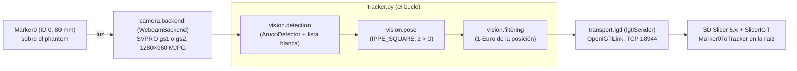
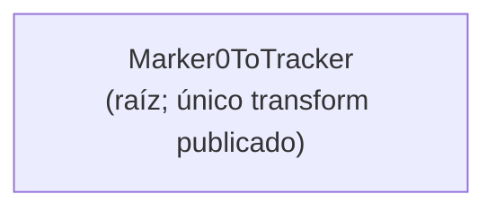
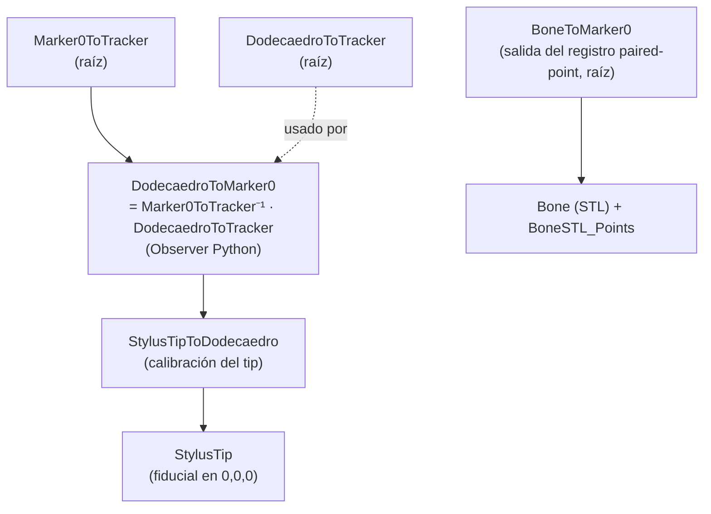

# ARCHITECTURE.md — Sistema de Navegación Quirúrgica (PoyectoNavegacion)

> **Qué es este documento (MVD 1 de 3):** describe **el sistema tal como es** hoy —
> topología, componentes, flujo de datos y convenciones. Es un documento **vivo**:
> se lee ANTES de tocar código y se actualiza cuando la arquitectura cambia.
> El *porqué* de las decisiones vive en `DECISIONS.md`; las *reglas y el estado
> operativo* viven en `CONTEXT.md`.
>
> _Última actualización: 2026-10-25 (§3.2 y §3.7: meta 003, fase 7b · Botones de tracker sin ventana y de vista previa para posicionar las cámaras, sin cámara: `tracker --stop-stdin`; el panel gana «Vista previa (colocar la cámara)», «Arrancar tracker sin ventana» y «Detener tracker», y detiene el tracker sin ventana por la entrada estándar; `identify_ids` con `--timeout` obligatorio, `--no-detect` y cierre en un `finally`; la verificación en vivo está pendiente). Antes, 2026-10-25 (§3.1, §3.2, §3.5 y §6: meta 003, fase 7 · Subir los fps con ventana, cerrada: la captura en un hilo con el último frame (`camera/grabber.py`), el envío sin esperar (0.02 ms en vivo) y la espera a Slicer con tope y aborto; ADR-028. Los perfiles gs1/gs2 siguen pidiendo 90 fps: pedir 60 dio 29, la cámara no tiene modo de 60 a 1280×960 MJPG; `clarify.md` P11). Antes, 2026-10-24 (§3.2, §3.7 y §6: meta 003, fase 6 · Dónde se va el tiempo por frame: `tracker --timing <json>` cronometra cada etapa del bucle con `diagnostics.pose_log.Stopwatch`, apagado por defecto; `diagnostics/measure_window.py` cronometra la ventana sin cámara). Antes, 2026-10-24 (§2, §3, §4, §6 y notas en §5, §7 y §8: meta 003, fase 5 · Documentación del paso 1: la topología, los componentes y la cadena se describen con la estructura nueva (`camera`, `vision`, `transport`, `profiles`, `gui`, `calibration`, `diagnostics`, `slicer`; `tracker.py` solo el bucle) y solo Marker0; lo del dodecaedro, la Femto y el contexto doctor queda como referencia archivada).
> Antes, 2026-10-24 (§6: meta 003, fase 4 · El tracker en piezas: `vision\` (detección, pose, 1-Euro, `MarkerTracker`) y `transport\` (`IgtlSender`); `tracker.py` queda solo con el bucle; la suite niega la cámara real y el servidor pyigtl). Antes, 2026-10-23 (§6: meta 003, fase 3 · La estructura nueva y el archivo: el código pasa de `codigo\iter4\` a paquetes por responsabilidad bajo `codigo\` (`camera`, `calibration`, `diagnostics`, `gui`, `profiles`, `data`; `tracker.py` suelto), se lanza con `python -m` y las rutas de un perfil son relativas a `codigo\` (ADR-027); el dodecaedro, la Femto y los perfiles viejos van a `codigo\historico\iter4\`; §3 y §4 se ponen al día en la fase 5). Antes, 2026-10-23 (§3.3, §4 y §6: meta 003, fase 2 · La cadena solo con Marker0: los perfiles gs1 y gs2 ya no definen `rigid_bodies`, el tracker publica solo `Marker0ToTracker` (ADR-026), `gui/estado.py` no exige la geometría si el perfil no la define, `codigo/slicer/receive_marker0.py` nuevo y el manual del dodecaedro en `documentos/historico/`). Antes, 2026-10-23 (§6: meta 003, fase 1 · Línea base de Marker0: `pose_log.py`, opciones de grabación del tracker y replay de Marker0). Antes, 2026-10-23 (§3.1, §3.3, §6 y §8: meta 002, fase 6 · Comparación contra P02 y archivo de los perfiles viejos: `tracker_config_doctor.yaml` y `globalshutter.yml` pasan a `iter4/data/historico/`; el tracker no cambió). 
> Antes, 2026-10-23 (§3.4, §3.7 y §6: meta 002, fase 5 · Calibración de la cámara 2: `intrinsecos_gs2_1280x960.yml`; la ventana de calibración del panel en tres pasos, `gui/calibracion.py` y `data/tablero_calibracion.yaml`; `comprobar_escala.py` juzga por medias y recalcula con `--desde-json`). Antes, 2026-10-22 (§3.4, §3.7 y §6: meta 002, fase 4: `calibrar_camara.py` reescrito y `comprobar_escala.py` nuevo; el `.yml` de intrínsecos de cada cámara y su veredicto; `intrinsecos_gs1_1280x960.yml`). Antes, 2026-10-22 (§6: meta 002, fase 3: `medir_modos.py` nuevo; los perfiles gs1/gs2 quedan en 1280×960 MJPG 90 fps y 0.977 ms). Antes, 2026-10-22 (§3.1 y §6: meta 002, fase 2b: `camera_backend.py` abre la webcam por el puerto, con marca, ajustes y comprobación de tamaño; perfiles `tracker_config_gs1.yaml` y `_gs2.yaml`; contrato de la aceleración HW de MSMF). Antes, 2026-10-21 (§6: meta 002, fase 2a: `ajustes_camara.py` nuevo; `camaras_uvc.py` identifica por la ruta del puerto USB; `sondear_camara.py` fija y lee por DSHOW). Antes, 2026-10-20 (§6: `camaras_uvc.py` y `sondear_camara.py`, meta 002, fase 1; corrección de la sonda: no escribe controles por MSMF ni si no se le pide). Antes, 2026-10-19 (§6: la suite y el replay, los diagnósticos fuera de `iter4\` y `PROJECT_BRIEF.md` y `briefs\` en `docs\history\`; §3.4: el respaldo de la punta). Estado: retomando tras pausa; vía activa =
> tracking óptico + registro **paired-point**. La rama de nube de puntos / Femto
> depth está **en stand by** (ver `CONTEXT.md` y `DECISIONS.md`)._

---

## 1. Propósito del sistema

Sistema de **navegación quirúrgica óptica** para cirugía ortopédica de columna
(vértebras L1–L5 + sacro). Trackea, con marcadores ArUco y una cámara, dos cosas
en el mismo espacio: un **instrumento** (stylus/puntero) y la **anatomía del
paciente** (un marcador de referencia pegado al hueso). Luego visualiza en **3D
Slicer** la coherencia espacial: un modelo 3D del hueso segmentado del CT del
paciente se alinea con el hueso físico, y al mover el stylus se ve en tiempo real
dónde está su punta respecto al modelo y a los cortes tomográficos.

Referencia visual del objetivo: demo de PerkLab (https://youtu.be/MOqh6wgOOYs).
Sistemas análogos comerciales: Brainlab, Navident, Medtronic StealthStation.

## 2. Topología (vista de alto nivel)

Hoy (2026-10-24, meta 003, fase 5): solo Marker0, con una de las dos SVPRO global shutter.



**Flujo en una frase:** la cámara ve Marker0 → `vision` lo detecta, estima su pose
y filtra la posición → `transport` la envía como `Marker0ToTracker` → Slicer la
recibe en la raíz de la escena. El instrumento con su punta, el registro con el
hueso y la navegación sobre los cortes se rehacen en sus metas (ADR-025, ADR-026;
B40, B41); lo que hacían antes está en §4 y en `documentos/historico/MANUAL_simplificado.md`.

## 3. Componentes

### 3.1 Cámara (sensor de entrada)

_Al día: 2026-10-25 (meta 003, fase 7)._ Paquete `codigo/camera/`.

Solo valen las dos **SVPRO AR0234 global shutter** (ADR-023, ADR-024, ADR-025), una por
perfil: `profiles/tracker_config_gs1.yaml` (puerto 1, marca `focus` 500) y
`profiles/tracker_config_gs2.yaml` (puerto 2, marca 332); 1280×960 MJPG 90 fps, exposición
0.977 ms. La cámara no tiene modo de 60 a 1280×960 MJPG: pedir 60 da ~29 (MSMF baja al de
30; fase 7 de la meta 003, 2026-10-25). Con poca luz la cámara baja sola a 22–31 fps (B50):
el tracking va con la caja de luz al máximo (`CONTEXT.md` §4.20). `camera.backend.create_backend(cfg_camera)` crea un `WebcamBackend`;
`camera_type: femtobolt` aborta diciendo que la Femto está archivada
(`codigo/historico/iter4/femto/`).

- `camera/backend.py` — `CameraBackend` (interfaz `open`, `read`, `get_intrinsics`,
  `close`) y `WebcamBackend`. La cámara se identifica por `camera.usb_port_windows`
  (ruta del puerto USB), no por el índice. `WebcamBackend.open()` hace, en orden:
  resolver el índice MSMF desde la ruta (`camera.uvc.resolver_indice`) → leer la
  `marca` (`focus`) por DSHOW y parar sin escribir nada si no coincide (cámaras
  intercambiadas) → aplicar `controls` (`camera.controls`, solo lo que difiere) →
  `VideoCapture` MSMF + MJPG → warmup → comprobar que el frame es del tamaño pedido y
  del `image_width`/`image_height` del `.yml` de `calibration_file`; si algo falla tras
  abrir, libera la cámara y relanza.
- `camera/uvc.py` — enumeración de cámaras (MSMF y DSHOW), ruta del puerto USB por
  CfgMgr32 y el apagado de la aceleración HW de MSMF (`describir_aceleracion_msmf`).
- `camera/controls.py` — los `controls` del perfil (nombres propios, exposición en ms)
  por DSHOW (`CapaWindowsDShow`).

**Contrato:** `OPENCV_VIDEOIO_MSMF_ENABLE_HW_TRANSFORMS=0` tiene que estar puesta antes
del primer `import cv2` del proceso (la apertura pasa de 43–51 s a ~0.4–4 s;
`CONTEXT.md` §4.18). `camera/__init__.py` importa `camera.uvc`, que la pone; todo punto
de entrada que abre la cámara hace `import camera` antes que `import cv2` (también
`tracker.py` lanzado a mano, B28) y el panel la pasa a sus procesos
(`gui.processes.entorno_hijo`).

### 3.2 Backend de tracking (`codigo/tracker.py`, `codigo/vision/`, `codigo/profiles/`)

_Al día: 2026-10-24 (meta 003, fases 3 y 4; ADR-027)._ `python -m tracker --config
profiles\tracker_config_gsN.yaml` (desde `codigo\`; `--config` obligatorio). `tracker.py`
(212 líneas) solo tiene el bucle; las piezas tienen pruebas sin cámara.

- `profiles/__init__.py` — `CODE_ROOT` (= `codigo/`), `PROFILES_DIR`, `DATA_DIR`;
  `load(path)` lee el perfil y resuelve sus rutas (`calibration_file: data/...`)
  relativas a `codigo/`, nunca al CWD; si una no existe, aborta con el perfil y la ruta
  (principio 7). `list_profiles()` da los `profiles/tracker_config*.yaml`.
- `vision/detection.py` — `create_detector(cfg_markers)`: `cv2.aruco.ArucoDetector`
  con el diccionario del perfil (**DICT_ARUCO_MIP_36h12**), `CORNER_REFINE_SUBPIX` y
  los parámetros de `markers.detector` (tuneados para ángulos rasantes);
  `detect(detector, gray, valid_ids)` detecta y aplica la lista blanca (solo los IDs
  de `markers.list`; hoy `[0]`).
- `vision/pose.py` — `estimate_single_pose(corners, size_mm, K, dist)`:
  `solvePnP` con **IPPE_SQUARE** y las esquinas en el orden de `build_object_points`;
  si la solución queda con `tvec[z] ≤ 0` (ambigüedad planar), ese marker no tiene pose en
  el frame; `rvec_tvec_to_matrix` da la 4×4 en mm.
- `vision/filtering.py` — `OneEuroFilter` y `PositionFilter` (un 1-Euro por eje de la
  posición; la orientación no se filtra), con `filtering.min_cutoff` y `beta` del perfil.
- `vision/tracking.py` — `MarkerTracker(cfg_markers, cfg_filtering)`: detector, lista
  blanca y un filtro por marker; `process_corners(detecciones, t, K, dist)` da una
  `MarkerPose` (id, nombre, lado, rvec, tvec, matriz, esquinas) por detección, en el
  orden del detector; `process(gray, t, K, dist)` hace además la detección. Lo usan
  `tracker.py`, el replay (`tests/replay_util.py`) y `diagnostics.measure_modes`.

Por frame, `tracker.main()`:

1. Pide el último frame al `FrameGrabber` (`camera/grabber.py`, §6): un hilo propio lee
   `cam.read()` y el bucle procesa siempre el último; los que no alcanza se saltan y se
   cuentan (`saltados`). 300 fallos seguidos de la cámara o 10 s sin frame y sale.
   `--sync-capture` deja la lectura en el bucle (`SyncGrabber`), para comparar. El tiempo
   del frame es la hora de captura por `time.perf_counter` (antes `time.time()`, de 15.6 ms
   de resolución; ADR-028, 2026-10-24, fase 7). En vivo (2026-10-25, caja al máximo,
   cámara a 90, con ventana): gs1 61.7 fps y gs2 55.2; el límite es el bucle (la detección
   sube a 8–10 ms porque el hilo decodifica los 90 frames/s).
2. Lo pasa a gris y detecta con la lista blanca (`MarkerTracker.detect`).
3. Estima la pose y filtra la posición (`MarkerTracker.process_corners`, con el tiempo
   del frame).
4. Envía cada pose como `<nombre>ToTracker` (`IgtlSender.send`, §3.5).
5. Con ventana, dibuja contorno y ejes (`draw_poses`), `imshow` y `waitKey(1)`; `q`
   sale. Cada 5 s escribe `[FPS] Promedio`.

Opciones, apagadas por defecto (sin ellas el bucle hace las mismas llamadas):
`--record <npz>` (graba tiempos, ids, esquinas y poses enviadas con
`diagnostics.pose_log.PoseLog`), `--save-frames <carpeta>` y `--frames-every N` (un frame
en gris cada N), `--no-window`, `--duration <s>` y, desde la fase 6 de la meta 003
(2026-10-24), `--timing <json>`: `diagnostics.pose_log.Stopwatch` (reloj `perf_counter`,
no el `time.time` del 1-Euro) mide cada frame por etapa (`capture`, `gray`, `detect`,
`pose_filter`, `send`, `record`, `draw`, `imshow`, `key` y `other`, lo no marcado) y el
JSON trae media, p50 y p95 por etapa, los ms frame a frame y el cociente entre la suma de
las etapas y el frame que da `[FPS] Promedio`. Desde la fase 7b (2026-10-25),
`--stop-stdin`: un hilo lee la entrada estándar y el bucle sale por el mismo camino que `q`
al leer una línea `q` o el fin de la entrada (`[Detener] …`); sin la opción no se lee la
entrada. La usa el panel con el tracker sin ventana (§3.7). `igtlink.send_video: true` aborta (P7).
Al salir, siempre: cierra la cámara, la ventana y el servidor, y escribe `[Salida limpia]`.
La pose multi-marker del dodecaedro está archivada en
`codigo/historico/iter4/dodecahedron/pose_rigid_body.py`.

### 3.3 Lo que se rastrea

_Al día: 2026-10-24._

- **Marker0** — un solo ArUco **ID 0** de **80 mm**, en los perfiles gs1 y gs2. El
  tracker publica `Marker0ToTracker`, el **único** transform de la cadena (ADR-026).
- **El dodecaedro (stylus, «v2 compartido», IDs 3–13, 14.6 mm)** se descartó en la meta
  003: desde la fase 2 los perfiles no definen `rigid_bodies` y desde la fase 3 su
  código, sus geometrías (calibrada por BA a 1.26 px) y sus puntas están en
  `codigo/historico/iter4/dodecahedron/` (índice en `codigo/historico/iter4/README.md`).
  El instrumento vuelve en otra meta con un transform de nombre nuevo (B40).

### 3.4 Artefactos de calibración (entradas al sistema)

_Al día: 2026-10-24._

| Artefacto | Archivo(s) | Qué fija |
|---|---|---|
| Intrínsecos de cámara | `data/intrinsecos_gs1_1280x960.yml`, `data/intrinsecos_gs2_1280x960.yml` (uno por cámara y modo; el perfil lo nombra en `camera.calibration_file`, relativo a `codigo/`) | matriz K + distorsión |
| Tablero de calibración | `data/tablero_calibracion.yaml` | casillas, lado (24.86 mm) y medidas del calibrador |

> **Archivado (meta 003, fase 3):** la geometría del dodecaedro
> (`reference_dodecaedro_v2_calibrado.txt`), la punta vigente de entonces
> (`StylusTipToDodecaedro_femto_dock`, ~201.8 mm, spread ~1.8 mm) y su respaldo
> versionado (`respaldo_puntas/`, ADR-021; sha256 del `.npy`
> `a3c832038d1ec408406bfe66ac5bb5a318b02ef1cc1f325b0f54dd62289a5ebf`) están en
> `codigo/historico/iter4/dodecahedron/data/`; los intrínsecos de la Femto y de la webcam
> vieja, en `codigo/historico/iter4/femto/` y `old_profiles/`.
>
> **Intrínsecos de las SVPRO (2026-10-22, meta 002 fase 4):** `calibration.calibrate_camera` (era `calibrar_camara.py`) abre la cámara por su perfil y escribe el `.yml` con K, distorsión de 5 coeficientes (`k1 k2 p1 p2 k3`), tamaño, RMS de reproyección, RMS de control sobre vistas apartadas, cobertura de la imagen (rejilla 4×3), el lado de la casilla con sus medidas de calibrador, el detector y su propio veredicto (`criterio_cumplido`: RMS ≤ 0.5 px con ≥ 15 vistas, control ≤ 0.75 px, cobertura ≥ 0.8). `camera.backend` comprueba que el tamaño real del frame coincide con el del `.yml`. Vigentes: cámara 1, `data/intrinsecos_gs1_1280x960.yml` (detector `sb`, RMS 0.167 px, control 0.146 px); cámara 2, `data/intrinsecos_gs2_1280x960.yml` (2026-10-23, fase 5; detector `sb`, RMS 0.154 px, control 0.150 px; cy 389.8, 90 px sobre el centro: vale mientras el lente no se mueva, B36). El lado de la casilla vive en `data/tablero_calibracion.yaml` (versionado: casillas, medidas del calibrador, cuadros por medida y lado, 24.86 mm); la ventana de calibración del panel lo lee y lo reescribe. `calibration.check_scale` (era `comprobar_escala.py`) mide la escala con la K del backend: desliza el tablero contra una regla entre posiciones que se repiten (ida y vuelta) y, desde P20 (2026-10-23), juzga la distancia entre las medias de las posiciones repetidas (1.0 mm por 100 mm); los pasos sueltos y la repetibilidad de cada grupo se guardan como información. `--desde-json` recalcula un JSON ya medido sin abrir la cámara.

### 3.5 Transporte — OpenIGTLink (`codigo/transport/`)

_Al día: 2026-10-24 (meta 003, fase 4)._ `transport/igtl.py`: `IgtlSender(port)` abre el
servidor `pyigtl.OpenIGTLinkServer` (TCP, **puerto 18944**, `igtlink.transforms_port`
del perfil); `send(device_name, matrix)` exige una 4×4 y la envía como
`TransformMessage`; `close()` para el servidor (`stop()`, con tope de 5 s) y libera el
puerto. Solo transforms: `send_video: true` aborta (enviar vídeo satura el pipeline,
`CONTEXT.md` §4.4).

_Fase 7 (2026-10-25, ADR-028):_ `send` encola con `send_message(wait=False)`: 0.02 ms por
frame en vivo (con `wait=True`, `pyigtl` esperaba su tic de 15.6 ms: 9–12.5 ms). Sin cliente (`is_connected()` falso) no encola, cuenta `dropped` y avisa.
`wait_for_client(timeout_s)` espera a Slicer: el tracker lo llama antes de abrir la cámara
(`--slicer-timeout`, 30 s) y, si no llega, sale con código 3 sin abrir la cámara. Slicer se
conecta ANTES de arrancar el tracker, o este aborta y lo dice. Los mensajes llegan en
ráfagas de 1–2 por tic del hilo de `pyigtl`; B48.

### 3.6 Aplicación — 3D Slicer + SlicerIGT (`codigo/slicer/`)

_Al día: 2026-10-24._ Slicer recibe `Marker0ToTracker` por el módulo **OpenIGTLink IF**
(conector cliente a `localhost:18944`). Lo versionado: `codigo/slicer/receive_marker0.py`
(crea o reutiliza el conector, espera el nodo, cuenta sus `TransformModifiedEvent` y da
los Hz, la última posición y si existe `DodecaedroToTracker`) y su `README.md` (cómo
pegarlo en la consola de Slicer). El registro paired-point (Fiducial Registration
Wizard), los cortes del CT (Volume Reslice Driver) y su runbook se rehacen con el
instrumento nuevo (B40, B41); el procedimiento anterior, con el dodecaedro, está en
`documentos/historico/MANUAL_simplificado.md`.

### 3.7 Panel de control (GUI) — `codigo/gui/`

_Al día: 2026-10-25 (meta 003, fases 3 y 7b)._ `python -m gui.panel` (desde `codigo\`, con el
venv). Panel de escritorio **PySide6** (brief-01 + brief-02) que **solo orquesta**
los scripts existentes — no reimplementa tracking ni calibración (ADR-017;
única excepción acotada: ADR-018):

- `status.py` (era `estado.py`) — semáforos leyendo el **estado real del repo**:
  entorno, config del perfil, intrínsecos, puerto 18944 y cámara. Un perfil con
  `rigid_bodies` o de la Femto queda en ROJO y no arranca el tracker. Usable por
  consola (`python -m gui.status --perfil profiles/tracker_config_gs1.yaml`).
- `recipes.py` (era `recetas.py`) — composición de comandos `python -u -m <módulo>`
  con **todos los args explícitos** (principio 7).
- `processes.py` (era `procesos.py`) — subprocesos (uno a la vez), stdout en vivo,
  Detener por el camino nativo con escalada a `terminate()` y `kill()`: dos caminos
  limpios, `'q'` a la ventana OpenCV por su título y, desde la fase 7b (2026-10-25), para
  las recetas con `stop_stdin` (el tracker sin ventana), `q` por la entrada estándar del
  hijo, que se lanza con ella en tubería y se cierra al detener (espera hasta
  `ESPERA_STDIN_S`, 8 s); `entorno_hijo` apaga la aceleración HW de MSMF en el hijo.
- `camera_probe.py` (era `sonda_camara.py`) — chequeo corto de cámara bajo demanda
  (subproceso con watchdog; nunca dentro del proceso GUI).
- `profile_editor.py` (era `perfil_editor.py`) — la única mutación de config
  permitida (ADR-018): edición quirúrgica de `camera.calibration_file` con backup.
- `calibration_window.py` (era `gui/calibracion.py`) — lo fijo de la ventana de
  calibración, sin Qt: el tablero guardado (`leer_tablero`, `validar_tablero`,
  `escribir_tablero`, escritura atómica), las salidas por perfil, las tres recetas
  (enfocar, calibrar, escala) y los textos de «Última».
- `panel.py` — ventana única: perfil, semáforos, «1 · Verificar / Preparar»
  (Verificar IDs, Vista previa (colocar la cámara), Probar cámara, Calibrar cámara…) y
  «2 · Operar» (Arrancar tracker, Arrancar tracker sin ventana, Detener tracker, Detener
  proceso), log en vivo. Desde la fase 7b (2026-10-25): la vista previa lanza
  `identify_ids --no-detect --timeout 600` y «Verificar IDs» `--timeout 600`; «Arrancar
  tracker sin ventana» lanza `tracker --no-window --stop-stdin`; «Detener tracker» se
  habilita solo con una de las dos recetas del tracker en marcha y la receta elige el
  camino (sin ventana, la entrada estándar; con ventana, `q` a la ventana); los dos
  botones del tracker preguntan antes por Slicer (el tracker lo espera 30 s y, si no
  llega, aborta con código 3). «Calibrar cámara (enfocar, tablero, escala)…» abre
  `VentanaCalibrarCamara`: tres pasos sin campos (1 Enfocar lente con
  `diagnostics.measure_modes --enfocar`, 2 Calibrar con tablero, 3 Comprobar escala con
  regla), el último resultado de cada uno y «Volver a medir el tablero…»
  (`DialogoMedirTablero`); textos llanos, sin jerga (P19, P21). `--selftest` abre,
  refresca, imprime estados y botones y cierra solo.

El asistente «dodecaedro nuevo», el monitor del BA y el diálogo del dock se archivaron
en `codigo/historico/iter4/dodecahedron/gui/` (meta 003, fase 3).

**Calibración y diagnóstico (fuera de `gui\`):**

- `calibration/calibrate_camera.py` (era `calibrar_camara.py`) — calibración intrínseca
  con tablero de ajedrez 8×5 (esquinas interiores; el lado de la casilla, medido con
  calibrador y obligatorio) y detector `clasico`, `sb` o `ambos`; exporta el `.yml` que
  lee el backend (§3.4). El panel lo lanza desde la ventana de tres pasos, con el tablero
  de `data/tablero_calibracion.yaml` y el detector `ambos`, y si cumple el criterio
  ofrece apuntar el perfil (ADR-018).
- `calibration/check_scale.py` (era `comprobar_escala.py`) — escala contra una regla
  (§3.4).
- `diagnostics/probe_camera.py` (sonda: modos, puertos, `--leer`, `--fijar`),
  `diagnostics/measure_modes.py` (`--enfocar`, exposiciones, modos, `--elegir`; el
  tracking que mide usa `MarkerTracker` con Marker0), `diagnostics/identify_ids.py`
  (los IDs que ve la cámara; con `--no-detect`, la vista previa para colocarla: imagen,
  cruz en el centro y fps de la cámara; `--timeout` obligatorio y cierre en un `finally`
  desde la fase 7b) y `diagnostics/pose_log.py` (`PoseLog` graba lo que envía el
  tracker con `--record`; `summarize` da frames, fps, fracción con pose, sd x/y/z, rango
  z, sd de la orientación y saltos > 5°; `Stopwatch` cronometra el bucle con `--timing`).
  Desde la fase 6 de la meta 003 (2026-10-24), `diagnostics/measure_window.py`
  cronometra, sin cámara y sobre un frame guardado, `imshow` + `waitKey(1)` frente a
  `imshow` + `pollKey()` (`--frame`, `--iterations`, `--timeout` obligatorios).

## 4. Flujo de datos y cadena de transforms en Slicer

_Al día: 2026-10-24 (meta 003, fase 5)._ **Hoy** el tracker emite un solo transform
crudo, en el frame de la cámara: `Marker0ToTracker` (ADR-026, principio 6), por
OpenIGTLink en el puerto 18944. En Slicer llega a la **raíz** de la escena y no cuelga
nada de él: el instrumento, su punta y el registro con el hueso vuelven en sus metas,
con nombres nuevos y su ADR (ADR-025; B40, B41).



**La cadena anterior, como referencia** (hasta la meta 002, con el dodecaedro y el
perfil Femto; su runbook es `documentos/historico/MANUAL_simplificado.md`). El tracker
emitía `Marker0ToTracker` y `DodecaedroToTracker`, y Slicer construía el resto:



Puntos clave de esa cadena (validados en iteraciones previas; valen para rehacerla):

- **`DodecaedroToMarker0`** se calcula con un **Observer Python**, NO con el
  Transform Processor (este último a veces deja de actualizarse). Fórmula:
  `Marker0ToTracker⁻¹ · DodecaedroToTracker`.
- **`BoneToMarker0`** (salida del registro) queda en la **raíz**, al mismo nivel
  que `Marker0ToTracker` y `DodecaedroToTracker`. El modelo **`Bone`** y
  **`BoneSTL_Points`** son **hijos** de `BoneToMarker0` (ambos; si solo se anida
  el modelo, los puntos quedan descolocados).
- **`Physical_Points`** (puntos tocados con el stylus) se queda en la raíz.

## 5. Registro paciente ↔ modelo (paired-point)

_Referencia: así se hacía hasta la meta 002, con el dodecaedro; se rehace con el
instrumento nuevo (ADR-025, B40, B41)._ Método: **paired-point** con el Fiducial
Registration Wizard.

1. Se marcan 6–9 puntos sobre el STL (`BoneSTL_Points`) en features reconocibles.
2. Se tocan los mismos features, en el mismo orden, con la punta del stylus →
   `Physical_Points`.
3. El wizard calcula la transform rígida `BoneToMarker0` y reporta el **RMS**.
4. Criterio: RMS < 1.5 mm excelente, 1.5–3 mm aceptable, > 5 mm hay error.

Métrica histórica de referencia: RMS **3.46 mm** (iter 1) → **2.80 mm** (iter 3).

## 6. Estructura del repositorio (verificada 2026-10-24, meta 003 fase 5; el código por responsabilidad desde la fase 3, ADR-027)

```
C:\Dev\OrtoMeta\PoyectoNavegacion\
├── CLAUDE.md, memory.md
├── docs\
│   ├── constitution.md, BACKLOG.md, PRUEBAS.md
│   ├── ARCHITECTURE.md  DECISIONS.md  CONTEXT.md   # ← los 3 MVD
│   └── history\                    # copia literal de lo hecho, no se edita (PROJECT_BRIEF.md y briefs\ desde 2026-10-19)
├── specs\                          # _plantilla\ (spec, plan, clarify, tasks) y una carpeta por meta: 001-limpieza, 002-calibracion-camaras, 003-arquitectura-tracker
├── .claude\
│   ├── settings.json               # permisos del método
│   ├── agents\                     # direccion, planificacion, desarrollo, pruebas
│   └── skills\                     # planear, fase, cerrar-fase
├── codigo\                         # desde 2026-10-23 (meta 003 fase 3, ADR-027): paquetes por responsabilidad; todo se lanza con `python -m <paquete>.<modulo>` desde codigo\
│   ├── .venv\                      # Python 3.11.9
│   ├── requirements.txt, readme.md, pytest.ini   # pytest.ini: pythonpath = . (codigo\ en sys.path para la suite)
│   ├── tracker.py                  # solo el bucle (357 líneas desde la fase 7: `--slicer-timeout`, `--sync-capture`; `python -m tracker --config profiles\...`, --config obligatorio): cámara → `MarkerTracker.process_corners` → `IgtlSender.send` → ventana; opciones apagadas --record, --no-window, --save-frames, --frames-every, --duration y --timing (fase 6); importa `camera` antes que `cv2` (B28); `send_video: true` aborta (2026-10-24, fase 4)
│   ├── vision\                     # detection.py (diccionario, parámetros del detector, `create_detector`, `detect` con lista blanca), pose.py (`build_object_points`, `estimate_single_pose` IPPE_SQUARE y z > 0, `rvec_tvec_to_matrix`), filtering.py (`OneEuroFilter`, `PositionFilter`), tracking.py (`MarkerPose`, `MarkerTracker.process_corners/process/reset`) (2026-10-24, fase 4)
│   ├── transport\                  # igtl.py: `IgtlSender(port)` con `send(device_name, matrix 4×4)` (sin esperar, con guarda de conexión), `is_connected`, `wait_for_client(timeout_s)`, `close` (para el servidor pyigtl con tope de 5 s) (2026-10-24, fases 4 y 7)
│   ├── profiles\                   # __init__.py: CODE_ROOT, PROFILES_DIR, DATA_DIR, resolve_path, load (rutas del perfil relativas a codigo\; aborta si faltan), list_profiles
│   │   └── tracker_config_gs1.yaml, _gs2.yaml  # perfiles de las dos SVPRO, sin `rigid_bodies` (solo Marker0): puerto USB, marca focus, controles, 1280×960 MJPG 90 fps, 0.977 ms, `calibration_file: data/intrinsecos_gsN_1280x960.yml`
│   ├── data\                       # intrinsecos_gs1/gs2_1280x960.yml y tablero_calibracion.yaml (nada más)
│   ├── camera\                     # grabber.py (`FrameGrabber`: hilo de captura con el último frame; `SyncGrabber`; fase 7); __init__ importa camera.uvc (apaga la aceleración HW de MSMF); backend.py (WebcamBackend: puerto, marca, controles, tamaño; `femtobolt` aborta: archivada), uvc.py (enumeración y ruta del puerto USB), controls.py (camera.controls por DSHOW)
│   ├── calibration\                # calibrate_camera.py (intrínsecos con tablero, detectores clasico|sb|ambos), check_scale.py (escala contra regla)
│   ├── diagnostics\                # probe_camera.py (sonda: modos, puertos, --fijar), measure_modes.py (--enfocar, exposiciones, modos, --elegir), identify_ids.py, pose_log.py (graba y resume poses; `Stopwatch` para --timing), measure_window.py (la ventana sin cámara; fase 6)
│   ├── gui\                        # panel PySide6 (`python -m gui.panel`): panel.py, recipes.py (argv con -m), processes.py, status.py (semáforos: entorno, config, intrínsecos, puerto, cámara), calibration_window.py, profile_editor.py, camera_probe.py
│   ├── slicer\                     # scripts para la consola Python de Slicer: receive_marker0.py (cuenta los Hz de Marker0ToTracker y avisa si existe DodecaedroToTracker) y README.md (2026-10-23, meta 003 fase 2)
│   ├── tests\                      # suite pytest; conftest.py da rutas (PROFILES_DIR, DATA_DIR, HISTORICO_DIR…) y el fixture autouse `no_real_camera` (niega `cv2.VideoCapture`, la enumeración de cámaras, `WebcamBackend.open` sin `abrir` falso y el servidor pyigtl; B34); synthetic.py: Marker0 proyectado, cámara y emisor falsos (2026-10-24, fase 4)
│   │   ├── test_*.py                           # vision, transport, tracker_loop, profiles, no_real_camera, compilan (con avisos como errores), gui_headless (selftest del panel), replay_marker0, pose_log, timing (fase 6), status, camaras_uvc, ajustes_camara, sondear_camara, camera_backend, aceleracion_msmf, calibrar_camara, comprobar_escala, medir_modos, panel/ventana de calibración (sin cámara)
│   │   ├── replay_util.py                      # replay de Marker0 (reference-marker0, copy-frames; `python -m tests.replay_util`); pasa las esquinas grabadas por `MarkerTracker.process_corners` (el replay del dodecaedro se archivó, fase 4)
│   │   └── data\                               # marker0_gs1/gs2: grabación en vivo, referencia y 3 frames (2.17 MB, versionados)
│   └── historico\                  # snapshots de iteraciones previas; no se mantienen (iter1, iter2, iter2_callejones_sin_salida, iter3 y:)
│       ├── iter4\                  # el dodecaedro (scripts, geometrías, puntas, asistente del panel, sus pruebas y el replay del dodecaedro), la Femto Bolt (backend, perfil, diagnósticos d2c) y los perfiles viejos; índice en su README.md (2026-10-23, meta 003 fase 3)
│       └── iter4_diagnosticos\     # diagnósticos y legacy de iter4 (test_pivote, test_jitter…), sin mantener (2026-10-19)
├── femto_pruebas\                  # rama nube de puntos (EN STAND BY)
├── stl\                            # dodecaedro, placas dock/divot, BaseMarcador, STL del hueso
├── herramientas\                   # pivotes/offsets legacy (.h5)
└── documentos\
    ├── historico\MANUAL_simplificado.md  # runbook del contexto doctor con el dodecaedro; archivado el 2026-10-23 (meta 003 fase 2); se rehace
    ├── MANUAL_webcam.md, MANUAL_femtobolt.md, GUIA_calibrar_dodecaedro_propio.md, convencion_dodecaedro_compartido.md  # del contexto viejo (B42)
    └── ...
```

> **Nota de reestructuración:** el código de tracking vivió en `codigo\` (raíz) en las
> iteraciones 1–3 y en `codigo\iter4\` (carpeta plana) hasta la meta 003; desde su fase 3
> (2026-10-23, ADR-027) vive en los paquetes de arriba y `codigo\iter4\` ya no existe. La
> raíz del proyecto es `C:\Dev\OrtoMeta\PoyectoNavegacion` (antes
> `C:\Dev\Dr.Milton\PoyectoNavegacion` y `C:\Dev\PoyectoNavegacion`). Los 3 MVD se movieron
> de la raíz a `docs\` el 2026-10-19.

> **La suite:** `codigo\.venv\Scripts\python.exe -m pytest codigo\tests -q` corre en
> segundos sin cámara ni Slicer. Desde la meta 003 (fase 3, 2026-10-23) la comprobación de
> «no cambió» es la suite, el selftest del panel y el replay de Marker0
> (`tests\test_replay_marker0.py`): sobre las esquinas grabadas en vivo con gs1 y gs2, la pose
> individual, el 1-Euro de la posición y la matriz dan las que se enviaron, 0.0 mm y 0.0°, y la
> detección sobre 3 frames da las esquinas grabadas, 0.0 px. El replay del dodecaedro
> (`test_replay.py`, con el perfil Femto) se archivó con su código en `codigo\historico\iter4\`.
> La referencia no se regenera sola (`python -m tests.replay_util reference-marker0 ... --overwrite`,
> a propósito y visible en `git diff`).

## 7. Frames de coordenadas y convenciones

- **Frame del tracker** = frame de la cámara. Todo lo crudo del tracker vive ahí.
- **Frame del dodecaedro** (archivado en la meta 003) = frame del rigid body del stylus
  (origen ~centro del dodecaedro). La calibración de la punta se expresaba aquí.
- **Frame de Marker0** = frame del paciente. El registro deja el hueso aquí.
- **Convención de esquinas del marcador:** `c0=TL c1=TR c2=BR c3=BL`.
- **LPS↔RAS:** Slicer carga STL con conversión LPS→RAS (voltea X,Y). Relevante
  cuando una transform se calcula sobre vértices crudos fuera de Slicer (era el
  caso de la rama por superficie; en paired-point el wizard maneja el frame).

## 8. Decisiones de configuración (confirmadas 2026-08-13)

> _Reemplazadas (nota del 2026-10-24):_ desde ADR-025 solo valen las dos SVPRO global
> shutter (§3.1) y desde ADR-026 solo se publica Marker0, de 80 mm (§3.3); la Femto, el
> contexto doctor y la punta por dock están archivados en `codigo/historico/iter4/`. Lo de
> abajo queda como registro.

1. **Cámara principal = Femto Bolt** (solo RGB), config canónica
   `tracker_config.yaml`. En **paralelo**, el contexto "doctor" usa una webcam
   **global shutter** (`data/historico/tracker_config_doctor.yaml`, ADR-016; archivado el 2026-10-23). Ambas conviven.
2. **Marker0 del paciente = 80 mm** en el contexto Femto (60 mm en el contexto
   doctor).
3. **Calibración de la punta = usar la existente**
   `StylusTipToDodecaedro_femto_dock` (dodecaedro v2, ~1.8 mm de spread), sin
   recalibrar por ahora.

### Duda menor aún abierta

- **Dos equipos/ensambles:** memoria registra un "equipo del doctor" en máquina
  aparte (marker 16.58 mm). Este documento describe la máquina **BigDaddy** con el
  dodecaedro **v2 (IDs 3–13)**; si el otro equipo sigue vivo, se documenta aparte.
  (Confirmar cuando aplique — no bloquea.)
