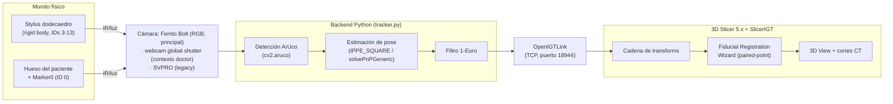
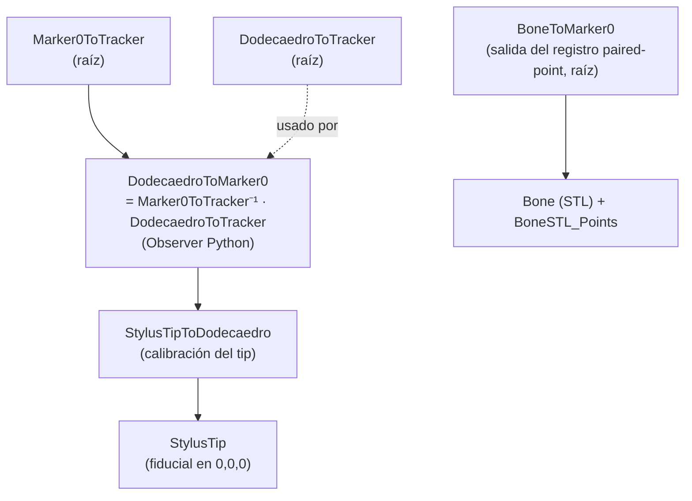

# ARCHITECTURE.md — Sistema de Navegación Quirúrgica (PoyectoNavegacion)

> **Qué es este documento (MVD 1 de 3):** describe **el sistema tal como es** hoy —
> topología, componentes, flujo de datos y convenciones. Es un documento **vivo**:
> se lee ANTES de tocar código y se actualiza cuando la arquitectura cambia.
> El *porqué* de las decisiones vive en `DECISIONS.md`; las *reglas y el estado
> operativo* viven en `CONTEXT.md`.
>
> _Última actualización: 2026-10-22 (§3.1 y §6: meta 002, fase 2b: `camera_backend.py` abre la webcam por el puerto, con marca, ajustes y comprobación de tamaño; perfiles `tracker_config_gs1.yaml` y `_gs2.yaml`; contrato de la aceleración HW de MSMF). Antes, 2026-10-21 (§6: meta 002, fase 2a: `ajustes_camara.py` nuevo; `camaras_uvc.py` identifica por la ruta del puerto USB; `sondear_camara.py` fija y lee por DSHOW). Antes, 2026-10-20 (§6: `camaras_uvc.py` y `sondear_camara.py`, meta 002, fase 1; corrección de la sonda: no escribe controles por MSMF ni si no se le pide). Antes, 2026-10-19 (§6: la suite y el replay, los diagnósticos fuera de `iter4\` y `PROJECT_BRIEF.md` y `briefs\` en `docs\history\`; §3.4: el respaldo de la punta). Estado: retomando tras pausa; vía activa =
> tracking óptico + registro **paired-point**. La rama de nube de puntos / Femto
> depth está **en stand by** (ver `CONTEXT.md` y `DECISIONS.md`)._

---

## 1. Propósito del sistema

Sistema de **navegación quirúrgica óptica** para cirugía ortopédica de columna
(vértebras L1–L5 + sacro). Trackea, con marcadores ArUco y una cámara, dos cosas
en el mismo espacio: un **instrumento** (stylus/puntero) y la **anatomía del
paciente** (un marcador de referencia pegado al hueso). Luego visualiza en **3D
Slicer** la coherencia espacial: un modelo 3D del hueso segmentado del CT del
paciente se alinea con el hueso físico, y al mover el stylus se ve en tiempo real
dónde está su punta respecto al modelo y a los cortes tomográficos.

Referencia visual del objetivo: demo de PerkLab (https://youtu.be/MOqh6wgOOYs).
Sistemas análogos comerciales: Brainlab, Navident, Medtronic StealthStation.

## 2. Topología (vista de alto nivel)



**Flujo en una frase:** la cámara ve los marcadores → el backend Python detecta y
estima poses → las envía por OpenIGTLink como transforms → 3D Slicer las encadena,
resuelve el registro paciente↔modelo y dibuja la punta del stylus sobre la
anatomía.

## 3. Componentes

### 3.1 Cámara (sensor de entrada)

El backend `webcam | femtobolt` se elige con `camera.camera_type`
(`camera_backend.py::create_backend`). Hay **dos cámaras en uso, en contextos
distintos**, más una legacy:

- **`femtobolt` — Orbbec Femto Bolt** (RGB 1920×1080; también ToF depth 640×576),
  vía `pyorbbecsdk` (paquete `pyorbbecsdk2`). Intrínsecos de fábrica del SDK.
  **Cámara principal / config canónica `tracker_config.yaml`** (contexto BigDaddy,
  Marker0 80 mm). Se usa **solo su RGB**: la rama de *depth* / nube de puntos está
  **en stand by**.
- **`webcam` global shutter — contexto "doctor"** (`tracker_config_doctor.yaml`,
  `source: 1`, intrínsecos `data/globalshutter.yml` @ 640×480, Marker0 60 mm).
  Sensor **global shutter** (sin skew de rolling shutter cuando el objeto se
  mueve). Es la cámara que maneja hoy el runbook
  `documentos/MANUAL_simplificado.md`. Reemplazó a la SVPRO en ese path (ADR-016).
- **`webcam` SVPRO** (AR0234, rolling shutter) — legacy de iter 1–3. Backend
  **MSMF** + códec **MJPG** obligatorio (si no, FPS ~5). Intrínsecos estilo MRPT.

- **`webcam` SVPRO global shutter, un perfil por cámara** (2026-10-22, meta 002,
  fase 2b): `tracker_config_gs1.yaml` y `tracker_config_gs2.yaml`. La cámara se
  identifica por `camera.usb_port_windows` (ruta del puerto USB), no por el
  índice. `WebcamBackend.open()` hace, en orden: resolver el índice MSMF desde la
  ruta (`camaras_uvc.resolver_indice`) → leer la `marca` (`focus`) por DSHOW y
  parar sin escribir nada si no coincide (cámaras intercambiadas) → aplicar
  `controls` (`ajustes_camara`, solo lo que difiere) → `VideoCapture` MSMF + MJPG
  → warmup → comprobar que el frame es del tamaño pedido y, si hay
  `calibration_file`, del `image_width`/`image_height` del `.yml`; si falla algo
  tras abrir, libera la cámara y relanza. Sin `usb_port_windows`, `controls` ni
  `marca` (Femto, doctor) abre como antes, salvo la comprobación del tamaño.
  **Contrato:** `OPENCV_VIDEOIO_MSMF_ENABLE_HW_TRANSFORMS=0` tiene que estar
  puesta antes del primer `import cv2` del proceso (apertura de 43–51 s a ~4 s):
  quien abre MSMF importa `camaras_uvc` antes que `cv2` y el panel la pasa por
  `procesos.entorno_hijo`; `tracker.py` a mano no (B28; `CONTEXT.md` §4.18).

> Las dos cámaras activas (Femto y global shutter) **conviven en contextos
> distintos**; no es un conflicto. La geometría del dodecaedro v2 es
> cámara-independiente (propiedad física), así que se comparte entre ambos
> contextos. `min_markers: 3`, `send_video: false` y el filtro 1-Euro son iguales
> en las dos configs.

### 3.2 Backend de tracking (`codigo/iter4/`)

`tracker.py` es el proceso principal. Por frame:

1. Adquiere imagen del backend de cámara (`camera_backend.py`).
2. Detecta marcadores ArUco (`cv2.aruco`, diccionario **DICT_ARUCO_MIP_36h12**,
   parámetros de detector tuneados para ángulos rasantes).
3. Estima poses: **IPPE_SQUARE** (o `solvePnPGeneric`) para marcadores
   individuales; para el rigid body multi-marcador (≥2 caras), resuelve la pose del
   cúmulo con las esquinas visibles vía **`SOLVEPNP_ITERATIVE` + refinamiento LM y
   rechazo de outliers**. Filtro `tvec[z] ≤ 0` para eliminar la ambigüedad planar.
4. Suaviza posición con **filtro 1-Euro** (`filtering` en el config).
5. Publica transforms por OpenIGTLink.

### 3.3 Cuerpos rígidos rastreados

- **Dodecaedro (stylus)** — cúmulo de marcadores multi-cara sobre un dodecaedro
  impreso. Versión vigente = **"v2 compartido", IDs 3–13**, lado de marcador
  **14.6 mm**, geometría en `data/reference_dodecaedro_v2_calibrado.txt`
  (calibrada por *bundle adjustment*, validada a 1.26 px de reproyección). El
  tracker publica `DodecaedroToTracker`.
- **Marker0 (referencia del paciente)** — un solo ArUco **ID 0**, pegado a la base
  del hueso. Tamaño **según contexto**: **80 mm** en la config Femto
  (`tracker_config.yaml`), **60 mm** en la config doctor/global-shutter
  (`tracker_config_doctor.yaml`). El tracker publica `Marker0ToTracker`.

### 3.4 Artefactos de calibración (entradas al sistema)

| Artefacto | Archivo(s) | Qué fija |
|---|---|---|
| Intrínsecos de cámara | `data/camera_calibration_webcam.yml` (webcam) / fábrica SDK (Femto) | matriz K + distorsión |
| Geometría del rigid body | `data/reference_dodecaedro_v2_calibrado.txt` | posición 3D de cada marcador en el frame del dodecaedro |
| Calibración de la punta | `data/StylusTipToDodecaedro_*.npy` (+`.txt`, `.h5`) | offset de la punta en el frame del dodecaedro |

> **Calibración de punta vigente:** `data/StylusTipToDodecaedro_femto_dock.npy`
> (corresponde a la geometría v2, magnitud ~201.8 mm, spread ~1.8 mm). Se usa
> **esta** por ahora (decidido 2026-08-13).
>
> **Respaldo de la punta vigente (2026-10-19, ADR-021):** copia byte a byte, versionada, en `data/respaldo_puntas/StylusTipToDodecaedro_femto_dock.npy` (sha256 `a3c832038d1ec408406bfe66ac5bb5a318b02ef1cc1f325b0f54dd62289a5ebf`, igual al original) y su `.txt` (cabecera con el sha16 `11b0846fc5b5d43f` de la geometría v2; git lo guarda con EOL LF, así que su sha256 en un checkout limpio es el del texto normalizado, no el del original con CRLF). La subcarpeta queda fuera del glob no recursivo `StylusTipToDodecaedro*.npy` del snippet de Slicer (`MANUAL_simplificado.md` §4.2) y de `estado.listar_puntas()`: no cambia qué punta se carga. El original en `data/` sigue fuera de git (por equipo). Para restaurarla, se copia el `.npy` de vuelta a `data/` y se comprueba su sha256.
>
> **Acople crítico:** geometría del rigid body y calibración de la punta son del
> **mismo ensamble físico**. No se mezclan geometrías (ver `DECISIONS.md` y
> `CONTEXT.md`).

### 3.5 Transporte — OpenIGTLink

`pyigtl` sobre TCP, **puerto 18944**. Solo transforms (`send_video: false`; enviar
video satura el pipeline). El tracker **se bloquea si Slicer no está conectado**:
Slicer se conecta ANTES de arrancar el tracker.

### 3.6 Aplicación — 3D Slicer + SlicerIGT

Visualización y registro. Recibe los transforms por el módulo **OpenIGTLink IF**,
arma la cadena de transforms (§4), corre el **Fiducial Registration Wizard**
(paired-point) para alinear modelo↔paciente, y opcionalmente conduce los cortes
del CT con el **Volume Reslice Driver**. El procedimiento paso a paso está en
`documentos/MANUAL_simplificado.md`.

### 3.7 Panel de control (GUI) — `codigo/iter4/gui/`

Panel de escritorio **PySide6** (brief-01 + brief-02) que **solo orquesta**
los scripts existentes — no reimplementa tracking ni calibración (ADR-017;
única excepción acotada: ADR-018):

- `estado.py` — semáforos leyendo el **estado real del repo** (config del
  perfil, geometría calibrada, intrínsecos, punta y su coherencia por sha16,
  puerto 18944, entorno). Usable por consola (`--perfil ... [--puntas]`).
- `recetas.py` — composición de comandos con **todos los args explícitos**
  (neutraliza los defaults del stylus viejo, CONTEXT §4.13–17).
- `procesos.py` — subprocesos (uno a la vez), stdout en vivo, Detener por el
  camino nativo (`'q'` a la ventana OpenCV) con escalada a `terminate()`.
- `sonda_camara.py` — chequeo corto de cámara bajo demanda (subproceso con
  watchdog; nunca dentro del proceso GUI).
- `asistente.py` — alta de dodecaedro: [teórica existente | GENERAR desde IDs
  nuevos] → captura → chequeo de cobertura → BA con monitor de estancamiento
  y auto-corte (`corregir_giro_esquinas.py` documentado como escape manual).
- `ba_monitor.py` — cobertura del dataset (frames/marker, pares únicos y
  débiles) y detector de estancamiento del BA (umbrales visibles, calibrados
  con datos reales; los pares de caras antípodas nunca son co-visibles).
- `perfil_editor.py` — la única mutación de config permitida (ADR-018):
  edición quirúrgica de `camera.calibration_file` con backup.
- `panel.py` — ventana única: perfil, semáforos, acciones (Verificar /
  Calibrar / Operar), diálogos de intrínsecos y dock, log en vivo.

Script nuevo fuera de `gui\`: **`iter4/calibrar_camara.py`** — calibración
intrínseca con tablero de ajedrez 8×5 @ 25 mm (alternativa OpenCV a MRPT,
readme §8; exporta el YAML que leen los backends).

Lanzamiento: `python iter4\gui\panel.py` (desde `codigo\`, con el venv).

## 4. Flujo de datos y cadena de transforms en Slicer

El tracker emite dos transforms crudos (frame del tracker/cámara):
`Marker0ToTracker` y `DodecaedroToTracker`. Slicer construye el resto:



Puntos clave de la cadena (validados en iteraciones previas):

- **`DodecaedroToMarker0`** se calcula con un **Observer Python**, NO con el
  Transform Processor (este último a veces deja de actualizarse). Fórmula:
  `Marker0ToTracker⁻¹ · DodecaedroToTracker`.
- **`BoneToMarker0`** (salida del registro) queda en la **raíz**, al mismo nivel
  que `Marker0ToTracker` y `DodecaedroToTracker`. El modelo **`Bone`** y
  **`BoneSTL_Points`** son **hijos** de `BoneToMarker0` (ambos; si solo se anida
  el modelo, los puntos quedan descolocados).
- **`Physical_Points`** (puntos tocados con el stylus) se queda en la raíz.

## 5. Registro paciente ↔ modelo (paired-point)

Método activo: **paired-point** con el Fiducial Registration Wizard.

1. Se marcan 6–9 puntos sobre el STL (`BoneSTL_Points`) en features reconocibles.
2. Se tocan los mismos features, en el mismo orden, con la punta del stylus →
   `Physical_Points`.
3. El wizard calcula la transform rígida `BoneToMarker0` y reporta el **RMS**.
4. Criterio: RMS < 1.5 mm excelente, 1.5–3 mm aceptable, > 5 mm hay error.

Métrica histórica de referencia: RMS **3.46 mm** (iter 1) → **2.80 mm** (iter 3).

## 6. Estructura del repositorio (verificada 2026-08-13; método de trabajo, 2026-10-19)

```
C:\Dev\OrtoMeta\PoyectoNavegacion\
├── CLAUDE.md, memory.md
├── docs\
│   ├── constitution.md, BACKLOG.md, PRUEBAS.md
│   ├── ARCHITECTURE.md  DECISIONS.md  CONTEXT.md   # ← los 3 MVD
│   └── history\                    # copia literal de lo hecho, no se edita (PROJECT_BRIEF.md y briefs\ desde 2026-10-19)
├── specs\_plantilla\               # plantilla de una meta (spec, plan, clarify, tasks)
├── .claude\
│   ├── settings.json               # permisos del método
│   ├── agents\                     # direccion, planificacion, desarrollo, pruebas
│   └── skills\                     # planear, fase, cerrar-fase
├── codigo\
│   ├── .venv\                      # Python 3.11.9
│   ├── requirements.txt, readme.md, pytest.ini
│   ├── tests\                      # suite pytest (2026-10-19): conftest.py pone iter4\ y gui\ en sys.path
│   │   ├── test_*.py                           # 3 de mayo repuntados + compilan, gui_headless, replay; camaras_uvc, ajustes_camara, sondear_camara, camera_backend y aceleracion_msmf (sin cámara, 2026-10-21/22)
│   │   ├── replay_util.py                      # replay sin cámara de estimar_pose_rigid_body (CLI recortar/referencia)
│   │   └── data\                               # recorte de captura_ba.npz y su referencia de poses (versionados)
│   ├── iter4\                      # ← CÓDIGO ACTIVO
│   │   ├── tracker.py                          # tracker principal
│   │   ├── camera_backend.py                   # webcam | femtobolt; la webcam abre por puerto, comprueba marca, aplica controles y comprueba el tamaño (§3.1, 2026-10-22)
│   │   ├── tracker_config.yaml                 # config Femto (default)
│   │   ├── tracker_config_doctor.yaml          # config webcam (paired-point)
│   │   ├── tracker_config_gs1.yaml, _gs2.yaml  # perfiles de las dos SVPRO: puerto USB, marca focus, controles, 640×480 MJPG 90 fps provisional; sin intrínsecos hasta las fases 4 y 5 (2026-10-22, meta 002 fase 2b)
│   │   ├── captura_calibracion.py              # dataset para BA
│   │   ├── calibrar_rigid_body.py              # bundle adjustment
│   │   ├── calibrar_tip_divot.py               # calibración por dock/divot
│   │   ├── calibrar_camara.py                  # intrínsecos desde el panel (brief-02)
│   │   ├── identificar_ids.py                  # verificar IDs/orientación
│   │   ├── camaras_uvc.py                      # enumera las cámaras de Media Foundation y de DirectShow (COM por ctypes) y da la ruta física de su puerto USB (CfgMgr32: LocationPaths del nodo padre); resolver_indice(puerto) por igualdad de ruta (2026-10-21, meta 002 fase 2a)
│   │   ├── ajustes_camara.py                   # formato de camera.controls independiente del sistema (exposición en ms), validar/comparar, CapaWindowsDShow (escribe solo lo que difiere, relee, para si no coincide), capa_para_plataforma; Linux sin escribir (2026-10-21, meta 002 fase 2a); desde la fase 2b lo usa el backend, y `aplicar(..., forzar=True)` escribe aunque la lectura coincida
│   │   ├── sondear_camara.py                   # sonda de una cámara: modos (antes de tocar controles), identidad; --controles no|leer|probar; fase 2a: --puertos, --leer, --fijar, --tras-msmf, --verificar-orden --backend MSMF|DSHOW (2026-10-21, meta 002); fase 2b: --fijar ... --forzar (alta de la marca); no la usa el tracker
│   │   ├── calibrar_topologia.py, limpiar_captura_fantasmas.py, corregir_giro_esquinas.py, generar_reference_dodecaedro.py
│   │   ├── gui\                                # panel de control PySide6 (brief-01)
│   │   └── data\                               # reference_*, capturas, tips, calibraciones
│   │       ├── respaldo_puntas\                # copia versionada de la punta vigente (§3.4, ADR-021)
│   │       └── historico\                      # configs webcam y stylus impreso, retirados del panel (2026-10-19)
│   └── historico\                  # snapshots de iteraciones previas
│       └── iter4_diagnosticos\     # diagnósticos y legacy de iter4 (test_pivote, test_jitter…), sin mantener (2026-10-19)
├── femto_pruebas\                  # rama nube de puntos (EN STAND BY)
├── stl\                            # dodecaedro, placas dock/divot, BaseMarcador, STL del hueso
├── herramientas\                   # pivotes/offsets legacy (.h5)
└── documentos\
    ├── MANUAL_simplificado.md      # runbook operativo del doctor (autoritativo)
    ├── MANUAL_webcam.md, MANUAL_femtobolt.md
    └── ...
```

> **Nota de reestructuración:** el código de tracking se movió de `codigo\` (raíz)
> a `codigo\iter4\`, y la raíz del proyecto es `C:\Dev\OrtoMeta\PoyectoNavegacion`
> (antes `C:\Dev\Dr.Milton\PoyectoNavegacion` y `C:\Dev\PoyectoNavegacion`). Los 3
> MVD se movieron de la raíz a `docs\` el 2026-10-19.

> **La suite (2026-10-19):** `codigo\.venv\Scripts\python.exe -m pytest codigo\tests -q`
> corre en segundos sin cámara ni Slicer. La comprobación de «no cambió» es la suite
> más el replay (`tests\test_replay.py`): el recorte `tests\data\replay_v2_femto.npz`
> (302 frames de `captura_ba.npz`, paso 6) pasado por `tracker.estimar_pose_rigid_body`
> con `iter4\tracker_config.yaml` da, frame a frame, las poses de
> `replay_v2_femto_referencia.npz` (tolerancia 1e-6 mm y 1e-6°). La referencia no se
> regenera sola: `replay_util.py referencia ... --sobrescribir`, a propósito y visible
> en `git diff`. El filtro 1-Euro no entra (B18).

## 7. Frames de coordenadas y convenciones

- **Frame del tracker** = frame de la cámara. Todo lo crudo del tracker vive ahí.
- **Frame del dodecaedro** = frame del rigid body del stylus (origen ~centro del
  dodecaedro). La calibración de la punta se expresa aquí.
- **Frame de Marker0** = frame del paciente. El registro deja el hueso aquí.
- **Convención de esquinas del marcador:** `c0=TL c1=TR c2=BR c3=BL`.
- **LPS↔RAS:** Slicer carga STL con conversión LPS→RAS (voltea X,Y). Relevante
  cuando una transform se calcula sobre vértices crudos fuera de Slicer (era el
  caso de la rama por superficie; en paired-point el wizard maneja el frame).

## 8. Decisiones de configuración (confirmadas 2026-08-13)

1. **Cámara principal = Femto Bolt** (solo RGB), config canónica
   `tracker_config.yaml`. En **paralelo**, el contexto "doctor" usa una webcam
   **global shutter** (`tracker_config_doctor.yaml`, ADR-016). Ambas conviven.
2. **Marker0 del paciente = 80 mm** en el contexto Femto (60 mm en el contexto
   doctor).
3. **Calibración de la punta = usar la existente**
   `StylusTipToDodecaedro_femto_dock` (dodecaedro v2, ~1.8 mm de spread), sin
   recalibrar por ahora.

### Duda menor aún abierta

- **Dos equipos/ensambles:** memoria registra un "equipo del doctor" en máquina
  aparte (marker 16.58 mm). Este documento describe la máquina **BigDaddy** con el
  dodecaedro **v2 (IDs 3–13)**; si el otro equipo sigue vivo, se documenta aparte.
  (Confirmar cuando aplique — no bloquea.)
