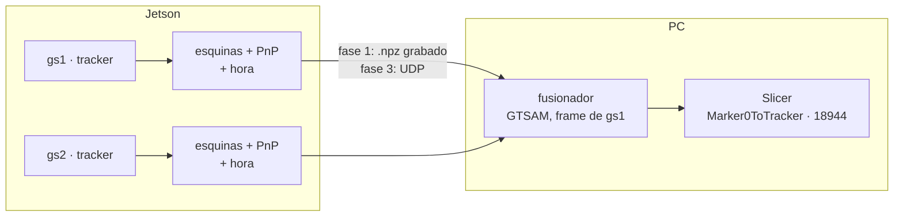

# Plan — Meta 006 · Grafo de factores óptico-inercial (primero, las dos cámaras)

Escrito por el agente de planificación el 2026-10-29 y **rehecho el 2026-11-05** para la arquitectura «la Jetson detecta, el PC fusiona» (P22) y la grabación ya hecha con lo que existe (P23), por encargo de la dirección (`Claude outputs/fases/006/replan-encargo.md`). Lo que el autor autoriza es este archivo. La versión del 2026-10-29 está en git (`db9c8ef`); no se borró nada de `clarify.md`.

**Qué cambió respecto a la versión del 2026-10-29:**
- Ya no se comparan dos arquitecturas en el PC (P9): P22 las sustituye. Las dos cámaras las abre la Jetson, cada una en su tracker; el PC no abre ninguna cámara. Salen del plan `fusion/capture.py`, `feeds.py`, `collector.py`, `clockcheck.py`, `archcompare.py` y las fases 2, 3, 4 y 4b de entonces.
- La fase 1 es **verlo**: un experimento fuera de línea en el PC sobre la grabación de la Jetson, con un informe en HTML. Lo en vivo (la Jetson envía, el PC fusiona, Slicer) va después y se replanea con los números de la fase 1 antes de empezarlo.
- Se reaprovecha del plan anterior: el modelo del grafo (pose por instante, factores de pose con covarianza por la jacobiana, factor de movimiento, ventana fija), los extrínsecos por dos métodos (P12), el formato de los extrínsecos (P18), la medida del 30 % (P14), los dos métodos de sincronía (P13) y el frame de gs1 (P11).
- Preguntas nuevas: P24 a P28. P8–P16, P18, P21–P23 no se reabren; P17, P19 y P20 se proponen como cerradas en P28.

## Lo leído

- HEAD: `052703c Añade a CLAUDE.md la calibración epistémica`. Árbol: `CLAUDE.md`, `memory.md`, `spec.md` y `clarify.md` de esta meta modificados; el PDF sin seguimiento.
- Completos: `docs/constitution.md`, `memory.md`, `spec.md` (con «Al retomarla»), `clarify.md` (P1–P23), `tasks.md` y `plan.md` de esta meta; el encargo `replan-encargo.md`; `Claude outputs/fases/006/grabacion/grabacion.md`, `reporte.md` y los nombres de segmento de `correr.ps1`; `Claude outputs/fases/007/por-que-atorados-7b.md`.
- `docs/CONTEXT.md` §4 (trampas 1–21). Índices de `docs/BACKLOG.md` (hasta B93; leídas B35, B36, B54, B77, B78, B80, B82–B91), `docs/DECISIONS.md` (hasta ADR-034; la meta 007 usa nombres provisionales «ADR J…») y `docs/PRUEBAS.md` (P01–P05). `specs/003-arquitectura-tracker/resultados.md`: sd x/y/z por cámara.
- Código: `tracker.py` (418 líneas: `--record` graba con `PoseLog.add(t_now, ids, corners, poses, gray)`; la pose enviada lleva el 1-Euro, porque los dos perfiles tienen `filtering.enabled: true`; `metadata_json` guarda `t_start` = `time.time()` y `t_loop_start` = `perf_counter`, tomados seguidos), `diagnostics/pose_log.py` (entero: tablas, `load_recording`, `summarize`), `vision/pose.py` (`estimate_single_pose` con IPPE_SQUARE y z > 0), `vision/tracking.py` (la orientación no se filtra; la posición sí), `camera/grabber.py` (la hora es `perf_counter` al volver `cam.read()`, después de decodificar), `diagnostics/clock_offset.py` (eco UDP con cuatro marcas), `linux/guardian.py` (verbos, `MODULOS`, `_args_py`, `traer`), `codigo/requirements.txt`, `requirements-jetson.txt` (gtsam 4.3.0 solo en `~/.venvs/prueba-gtsam`), `profiles/tracker_config_gs1.yaml` (Marker0 id 0, 80 mm), `data/intrinsecos_gs1_1280x960.yml` (distorsión de 5 coeficientes), `tests/synthetic.py` y `tests/replay_util.py` (firmas).
- En el PC: no hay conda, mamba ni miniforge; `wsl.exe` existe pero WSL no está instalado (`REGDB_E_CLASSNOTREG`). En `.venv`: matplotlib 3.10.9 (declarado en `requirements.txt`).
- Índices de paquetes (consulta de solo lectura, 2026-11-05, solo el nombre del paquete): **PyPI no tiene rueda de gtsam para Windows en ninguna versión** (4.3.0: macOS universal2, manylinux x86_64 y aarch64); **conda-forge sí**: `win-64/gtsam-4.3.0-np2py311hb224945_1.conda` (Python 3.11, numpy 2). Confirma P8.
- Context7 (solo preguntas de API; no salió ninguna ruta ni dato del proyecto):
  - `/borglab/gtsam` (4.3a1): `IncrementalFixedLagSmoother(lag, ISAM2Params())` con `update(factores, valores, {clave: tiempo})`, `calculateEstimate()` y `getISAM2()` para las marginales; `Marginals.marginalCovariance(clave)`; `GenericProjectionFactorCal3_S2(medida, ruido, clave_pose, clave_punto, K, body_P_sensor)`, con error `project(P·S, L) − z` (S, la pose fija del sensor en el frame del cuerpo); `CustomFactor(ruido, claves, función_de_error)`. Del plan anterior siguen valiendo `PriorFactorPose3`, `BetweenFactorPose3`, `noiseModel.Robust.Create(mEstimator.Huber(k), Gaussian.Covariance(S))` y la tangente de `Pose3` `[ω, ρ]` con retracción por la derecha.
  - `/opencv/opencv`: no documenta que `CAP_PROP_POS_MSEC` dé la hora del buffer de V4L2; `CAP_PROP_PTS` es solo del backend FFmpeg. Lo de V4L2 queda como hipótesis que se mide en vivo (fase 3).
  - `/mermaid-js/mermaid`: un HTML estático con `<pre class="mermaid">` y `import mermaid from 'https://cdn.jsdelivr.net/npm/mermaid@11/dist/mermaid.esm.min.mjs'; mermaid.initialize({ startOnLoad: true })` (la página `como-funciona-tracking.html` de la meta 007 ya usa `mermaid@11`).
  - `/scipy/scipy`: `Rotation.mean` (desde 1.4), `from_rotvec`/`as_rotvec`, y `least_squares(fun, x0, jac=…, method=…, loss=…)` con `result.jac` para la covarianza.
  - Python `socket` (UDP) y `struct`: los consultó la meta 007 para `clock_offset.py` (2026-11-03); el formato de la fase 3 sigue ese patrón.

## La idea en una línea

Antes de tocar nada en vivo, se mide sobre la grabación de la Jetson (P23) lo que la fusión daría: los extrínsecos de gs2, si las dos cámaras coinciden, cuánto baja el jitter fusionando por instante y con un grafo, y qué pasa al tapar una; el autor lo ve en un HTML. Si sirve, la Jetson manda por UDP, por cámara, las esquinas y la pose cruda con su hora; un fusionador en el PC (GTSAM) las junta y publica `Marker0ToTracker` en el frame de gs1 por el 18944, como hoy.

## Las preguntas del encargo y del spec, contestadas

- **Qué viaja de la Jetson al PC (P24, abierta; recomendada (a)).** Por cámara y por frame: las esquinas de Marker0 (4×2 px), la pose cruda de IPPE (sin 1-Euro) con su error de reproyección, la otra solución de IPPE si la hay, la hora de captura y un número de secuencia. Unos 200 bytes por datagrama, ~25 KB/s con las dos a 63 fps: nada para la LAN.
  - **Por qué las esquinas:** dejan usar factores de reproyección (sin la aproximación gaussiana del PnP ni su ambigüedad) y salvar una pose con la otra solución de IPPE. La fase 1 mide si eso cambia el número; si no lo cambia, las esquinas siguen viajando (cuestan poco) pero el fusionador usa factores de pose.
  - **Por qué UDP** (biblioteca estándar, el patrón de `clock_offset.py`): sin dependencia nueva, sin bloqueo en cabeza de línea ni Nagle, y la pérdida se ve en la secuencia. OpenIGTLink solo lleva la matriz (en float32) y el cliente de `pyigtl` guarda el último mensaje de cada nombre (Context7, plan anterior): perdería medidas en ráfaga y no lleva esquinas. MQTT necesita un broker (mosquitto) que instalar y mantener en una de las dos máquinas, `paho-mqtt` como dependencia en las dos y un salto más por TCP; da varios suscriptores, que hoy no hacen falta. Las latencias de UDP y MQTT en esta LAN no están medidas: el número de UDP sale en la fase 3, contra los 7.6 ms añadidos p95 de OpenIGTLink de la meta 007 (fase 6).
  - **El coste de (a):** una opción nueva en `tracker.py` (la cadena, principio 6), un formato versionado y una regla de entrada en el cortafuegos del PC para ese puerto UDP (la pone el autor, como administrador).
- **Dónde instala `gtsam` (P25, abierta; recomendada (a)).** No hay rueda de PyPI para Windows (comprobado hoy); conda-forge tiene `gtsam 4.3.0` win-64 py311. Propuesta: un entorno de miniforge **solo para la fusión**, fuera del repo, con Python 3.11, gtsam, numpy, scipy, opencv-python, pyyaml, pyigtl, matplotlib y pytest; `.venv` no se toca y sigue siendo el del tracker, el panel y la suite. El PC no tiene miniforge: lo instala el autor (instalador por usuario, sin administrador; hipótesis, se ve al instalar). Las partes de la fase 1 que no necesitan gtsam corren en `.venv`, así que el autor ve el primer informe sin esperar al entorno. La alternativa de correrlo en la Jetson (gtsam 4.3.0 ya está en `~/.venvs/prueba-gtsam`) obliga a cambiar el guardián, que solo lanza su lista blanca en el venv del tracker, y a reinstalarlo con sudo, con la CPU ya al 95.5 % (B91).
- **El desfase entre las dos cámaras sin hora de hardware.**
  - **El reloj es el mismo.** Los dos trackers corren en la misma Jetson y su hora es `perf_counter`, que la documentación de Python llama «system-wide» (en Linux, `CLOCK_MONOTONIC`: conocimiento previo, sin comprobar en la Jetson). La fase 1 lo comprueba con los datos: el ancla `t_start − t_loop_start` de los dos `.npz` de un segmento tiene que coincidir a ≤ 1 ms (la Jetson no está sincronizada por NTP, B87, así que su `time.time()` no salta entre los dos arranques). Para emparejar, el reloj del PC no hace falta: solo para medir latencia (`clock_offset`, B87).
  - **Lo que el reloj no resuelve:** cada cámara tarda distinto del final de la exposición a `perf_counter` (USB, decodificación MJPG, el planificador con la CPU al 95.5 %). Ese desfase δ se mide con el segmento en movimiento (S4): se busca el corrimiento de la trayectoria de gs2 (llevada a gs1 e interpolada) que minimiza la diferencia con la de gs1, con paso de 0.5 ms en ±20 ms. En reposo, δ no cambia nada.
  - **La hora del buffer de V4L2:** el kernel sella cada buffer al terminar de llegar, antes de decodificar. OpenCV no documenta cómo leerla (Context7); la hipótesis es que el backend V4L2 la devuelve en `CAP_PROP_POS_MSEC`. Se comprueba en vivo en la fase 3 (comparándola con `CLOCK_MONOTONIC` frame a frame); si sirve, viaja como un campo más (`t_buffer`) y se mide si reduce el jitter de δ. Si no, al BACKLOG.
- **Lo viejo (P28, abierta).** P17 era de Windows: con P22 el PC no abre cámaras, así que queda sin objeto (si un día vuelve, es B5 de la meta 007). P19 preguntaba qué hacer con `--feed` si perdía la arquitectura de dos trackers: no hay comparación que perder; el envío nuevo es la vía. P20: se recomienda (a), el 30 % siempre por instante (P14), gane el método de sincronía que gane.
- **El modelo del grafo (del plan anterior, sin cambios de fondo).** Una variable `X_k = T_gs1←Marker0` por instante. Por cada cámara que vio Marker0, o un factor de pose (`PriorFactorPose3(X_k, T_gs1←cam · Z_cam)` con `Σ = σ_px² (JᵀJ)⁻¹`, J la jacobiana de la reproyección de las 4 esquinas por la derecha) o cuatro factores de reproyección (las esquinas sin distorsión con `cv2.undistortPoints` y `Cal3_S2`, porque `Cal3DS2` no tiene el k3 de los intrínsecos; en GTSAM, la variable es la pose de gs1 en el frame del marker y gs2 entra con `body_P_sensor = T_gs1←gs2`). Entre instantes, `BetweenFactorPose3` de identidad con ruido q·√Δt. Huber en todos. Ventana fija `IncrementalFixedLagSmoother` de 0.1 s. Compuerta de Mahalanobis χ²₆(0.999) = 22.5 con la otra solución de IPPE como rescate.
- **El frame común (P11).** «Tracker» es el frame de gs1. Lo que cambia con (b) es quién publica `Marker0ToTracker`: el fusionador del PC en vez del tracker. Es un ADR (G4) y una verificación en vivo con Slicer (fase 5).

## Qué se espera según el ángulo entre las cámaras

La fusión por instante pesa cada cámara por su información: `Σ_f = (Σ_1⁻¹ + R Σ_2⁻¹ Rᵀ)⁻¹`, con R la rotación de gs2 a gs1. Cada cámara mide mal su profundidad: en la meta 003, sd x/y/z de 0.009/0.009/0.043 mm (gs1) y 0.010/0.007/0.039 (gs2), es decir z unas 4–5 veces peor (son poses filtradas; las crudas se miden en la fase 1). Con ruido independiente, anisotropía 4.5 y las cámaras giradas θ alrededor del eje vertical, la reducción de la sd frente a la mejor cámara sola es (cálculo con esas suposiciones, no medida):

| θ entre ejes ópticos | 0° (paralelas) | 10° | 20° | 30° | 45° | 60° | 90° |
|---|---|---|---|---|---|---|---|
| sd 3D, mismo ruido | 29 % | 34 % | 42 % | 50 % | 59 % | 64 % | 67 % |
| sd z de gs1, mismo ruido | 29 % | 34 % | 45 % | 55 % | 66 % | 73 % | 78 % |
| sd 3D, gs2 con 1.5× la varianza | 23 % | 27 % | 36 % | 45 % | 55 % | 60 % | 63 % |

- **Paralelas, el techo es 1 − 1/√2 = 29 %**, justo debajo del 30 % del criterio 2. Con un ángulo, la profundidad de una la fija el lateral de la otra y la mejora crece, sobre todo en z.
- **Lo que baja el número medido frente al predicho:** el ruido común a las dos (un temblor real del soporte, la luz o la red eléctrica, B24) no se promedia; la deriva lenta de gs1 por V4L2 (B77) tampoco es ruido independiente.
- **Cómo se reporta:** el informe da θ (de los extrínsecos), la covarianza cruda de cada cámara medida en el reposo, la reducción **predicha** con ellas y la **medida**; la diferencia entre las dos se reporta como «parte común». Si θ < ~10°, el informe dice de entrada que el criterio 2 no se puede cumplir con ese montaje, para que el autor lo tenga en cuenta al diseñar su estructura (P6).

## Archivos

Se crean (fase 1, salvo donde se dice):

- `codigo/fusion/__init__.py` — el paquete; no importa gtsam al cargarse (solo `fusion.graph` lo hace).
- `codigo/fusion/dataset.py` — lee los dos `.npz` de un segmento (con `diagnostics.pose_log.load_recording`), comprueba el ancla de reloj, la calibración (sha256 frente a `data/`) y el solape; rehace la pose cruda desde las esquinas con `vision.pose.estimate_single_pose` y las dos soluciones de IPPE.
- `codigo/fusion/geometry.py` — SE(3) en numpy y scipy: inversa, log y exp, la covarianza de la pose por la jacobiana, llevar una covarianza de un frame a otro, la fusión por instante de N poses (Gauss-Newton en SE(3)) y el PnP conjunto de las dos cámaras por reproyección (`scipy.optimize.least_squares`).
- `codigo/fusion/extrinsics.py` — los extrínsecos por Marker0 en N posiciones, la validación cruzada dejando una fuera, y leer y escribir el `.yml` con el sha256 de los dos intrínsecos (P18).
- `codigo/fusion/pairing.py` — emparejar por hora dentro de una tolerancia, y estimar δ con el movimiento.
- `codigo/fusion/metrics.py` — coincidencia por posición, sd en reposo (3D, por eje y sin deriva), mejora predicha, saltos al tapar, tiempos.
- `codigo/fusion/report.py` — el informe HTML de un solo archivo: tablas, gráficas de matplotlib en PNG embebido (base64) y diagramas Mermaid.
- `codigo/fusion/experiment.py` — CLI del experimento: segmentos → números → `resultados.json` e `informe.html`.
- `codigo/fusion/graph.py` — fase 1, parte B: el grafo con GTSAM (por instante y con ventana fija; factores de pose o de reproyección; emparejado o un nodo por medida).
- `codigo/fusion/environment.yml` — fase 1, parte B: el entorno de la fusión (conda-forge), con versiones fijadas y su porqué.
- `codigo/tests/test_fusion_dataset.py`, `test_fusion_geometry.py`, `test_fusion_extrinsics.py`, `test_fusion_pairing.py`, `test_fusion_metrics.py`, `test_fusion_report.py`, `test_fusion_experiment.py` — sin cámara: dos cámaras sintéticas con verdad conocida (sobre `tests/synthetic.py`) y `.npz` sintéticos en el formato de `PoseLog`. `test_fusion_graph.py` (parte B) hace `pytest.importorskip("gtsam")`: en `.venv` se salta con su motivo; en el entorno de la fusión corre.
- `codigo/tests/data/fusion_gs1_gs2/` — un recorte corto de un segmento real (~10 s, sin frames, < 1 MB) y su referencia, para que la suite fije el experimento sobre datos reales. Solo poses y esquinas de Marker0: sin datos de paciente.
- Fase 2: `codigo/calibration/calibrate_extrinsics.py` y `test_calibrate_extrinsics.py`; `codigo/data/extrinsecos_gs1_gs2_pinzas.yml`.
- Fase 3: `codigo/transport/feed.py` y `test_feed.py`.
- Fase 4: `codigo/fusion/run.py`, `codigo/profiles/fusion_gs1_gs2.yaml`, `test_fusion_run.py`.
- Fuera de git, en `Claude outputs/fases/006/`: el informe y los JSON de cada corrida, y los `correr.ps1` de las sesiones en vivo.

Se modifican:

- `codigo/tracker.py` — fase 3: `--feed HOST:PUERTO` y `--feed-name`; sin ellas, el bucle no cambia.
- `codigo/requirements.txt` — fase 1, parte B: una nota que remite a `fusion/environment.yml` (gtsam no entra en `.venv`).
- `codigo/tests/test_tracker_loop.py` — fase 3: casos nuevos para `--feed`; los de hoy, sin tocar.
- Al cerrar (fase 6): `docs/ARCHITECTURE.md` §2, §3 y §6, `docs/CONTEXT.md` §3 y §6, `codigo/readme.md`. Los ADR y el BACKLOG, la dirección; `docs/PRUEBAS.md`, el agente `pruebas`.

No se tocan: `vision/`, `camera/` (salvo que la fase 3 confirme la hora del buffer: entonces se replanea con su porqué), `transport/igtl.py`, los perfiles gs1 y gs2, los intrínsecos, `codigo/slicer/`, `gui/` (el botón de la fusión, al BACKLOG) ni `linux/guardian.py`.

## Funciones y clases

`fusion/dataset.py`
- `@dataclass class CameraTrack` — `name: str`, `t: np.ndarray` (N, s, `perf_counter` de la Jetson), `T_raw: np.ndarray` (N×4×4, NaN sin pose), `T_alt: np.ndarray` (la otra solución de IPPE o NaN), `corners: np.ndarray` (N×4×2, NaN sin detección), `reproj_px: np.ndarray`, `T_sent: np.ndarray` (lo que se envió, con 1-Euro), `K`, `dist`, `size_mm`, `meta: dict`.
- `load_segment(folder: Path, segment: str, cameras: tuple[str, ...] = ("gs1", "gs2"), attempt: str | None = None) -> dict[str, CameraTrack]` — `<segmento>_<cámara>.npz`; con `attempt=None` toma el último intento (`_r2`, `_r3`) y lo dice; aborta si falta uno.
- `check_segment(tracks: dict[str, CameraTrack], intrinsics: dict[str, Path], expected_s: float) -> dict` — ancla de reloj (|Δ| ms), solape (s), fracción con pose, sha256 de la calibración, y que la rotación rehecha coincida con la enviada.
- `ippe_solutions(corners: np.ndarray, size_mm: float, K, dist) -> list[tuple[np.ndarray, float]]` — las dos soluciones con su error (`solvePnPGeneric`, IPPE_SQUARE); la primera es la del tracker.

`fusion/geometry.py`
- `inv(T) -> np.ndarray`; `log_se3(T) -> np.ndarray` (6, `[ω, ρ]`); `exp_se3(xi) -> np.ndarray`; `adjoint(T) -> np.ndarray` (6×6).
- `pose_covariance(T_cam_marker, size_mm, K, dist, sigma_px: float) -> np.ndarray` — 6×6 por la derecha.
- `transport_covariance(T_ref_cam: np.ndarray, cov: np.ndarray) -> np.ndarray` — la covarianza de una medida llevada al frame de referencia (por la derecha no cambia; la función lo deja explícito y probado).
- `fuse_poses(poses: list[np.ndarray], covs: list[np.ndarray], iters: int = 10, tol: float = 1e-12) -> tuple[np.ndarray, np.ndarray]` — media ponderada en SE(3) por Gauss-Newton, con su covarianza.
- `joint_pnp(observations: list[tuple[np.ndarray, np.ndarray, np.ndarray, np.ndarray]], size_mm: float, T0: np.ndarray, sigma_px: dict[str, float]) -> tuple[np.ndarray, np.ndarray, float]` — cada observación es `(esquinas, K, dist, T_ref_cam)`; devuelve `T_ref_marker`, su covarianza y el RMS en px.

`fusion/extrinsics.py`
- `@dataclass(frozen=True) class Extrinsics` — `T_ref_other: np.ndarray` (4×4, mm), `reference: str`, `other: str`, `method: str` (`"marker0"` | `"tablero"`), `mount: str`, `intrinsics_sha256: dict[str, str]`, `angle_deg: float` (entre ejes ópticos), `validation: dict`, `alternative: dict | None`.
- `from_marker_positions(pairs_per_position: list[tuple[np.ndarray, np.ndarray]]) -> dict` — por posición, `T_gs1←gs2 = mean(T_gs1←M) · mean(T_gs2←M)⁻¹`; luego la media (rotación con `Rotation.mean`) y la dispersión entre posiciones (mm y °).
- `leave_one_out(pairs_per_position) -> list[dict]` — para cada posición, los extrínsecos de las otras cuatro y la coincidencia en ella.
- `load_extrinsics(path: Path, intrinsics_files: dict[str, Path]) -> Extrinsics` — aborta si un sha256 no coincide; `save_extrinsics(path: Path, ext: Extrinsics) -> Path` — no pisa uno que exista.

`fusion/pairing.py`
- `pair_by_time(t_a: np.ndarray, t_b: np.ndarray, tolerance_s: float, offset_s: float = 0.0) -> np.ndarray` — índices (M×2) de las parejas más cercanas, sin repetir ninguna.
- `estimate_offset(track_a: CameraTrack, track_b: CameraTrack, T_a_b: np.ndarray, search_ms: float = 20.0, step_ms: float = 0.5) -> dict` — δ, la curva de error y su mínimo; exige movimiento (si la velocidad media es < 5 mm/s, lo dice y no da δ).

`fusion/metrics.py`
- `agreement(tracks, T_ref_other, pairs) -> dict` — diferencia media y su sd (mm, °) entre gs1 y gs2 llevada a gs1.
- `rest_sd(positions: np.ndarray, t: np.ndarray, detrend_window_s: float = 1.0) -> dict` — sd 3D (√ traza), sd por eje, y las mismas sin la media móvil de 1 s.
- `predicted_reduction(cov_a: np.ndarray, cov_b_in_a: np.ndarray) -> dict` — la reducción que da la fórmula, 3D y por eje.
- `occlusion_events(track: CameraTrack, min_gap_s: float = 1.0) -> list[tuple[float, float]]` — los tramos sin detección de la cámara tapada.
- `jumps(fused_t, fused_p, events, window_s: float = 0.25) -> list[dict]` — por transición, |media 0.25 s después − media 0.25 s antes| y el paso máximo entre frames en ±1 s; y la fracción de frames con pose fusionada donde al menos una cámara ve el marker.

`fusion/report.py`
- `write_report(results: dict, figures: dict[str, bytes], mermaid: dict[str, str], path: Path) -> Path` — un HTML con las tablas de criterios (número, umbral, «cumple» o «no cumple»), las gráficas y los diagramas; no pisa uno que exista.
- `figures_for(results: dict, tracks: dict) -> dict[str, bytes]` — las gráficas en PNG.

`fusion/experiment.py`
- `run_experiment(data_dir: Path, intrinsics: dict[str, Path], sigma_px: dict[str, float] | None, engines: tuple[str, ...]) -> dict` — `engines` ⊂ {`"numpy_pose"`, `"numpy_reproj"`, `"gtsam_pose"`, `"gtsam_reproj"`, `"gtsam_smoother"`}.
- `main(argv: list[str] | None = None) -> int` — `--datos <carpeta>` (obligatorio), `--intrinsecos gs1=<yml> gs2=<yml>` (obligatorio), `--salida <carpeta>` (obligatorio, no se pisa), `--motores …`, `--intento S2_pos3=r2` (opcional), `--timeout <s>` (obligatorio, principio 9). Código 0 si corrió entero; 1 si algún segmento no pasó la comprobación (lo dice y sigue con los demás); 2 si no pudo empezar.

`fusion/graph.py` (parte B; importa gtsam)
- `class FusionGraph(T_ref_cam: dict[str, np.ndarray], mode: str, factor: str, lag_s: float, huber_k: float, q_rot_deg_sqrt_s: float | None, q_mm_sqrt_s: float | None, gate: float = 22.5)` — `mode` ∈ {`"instante"`, `"ventana"`}; `factor` ∈ {`"pose"`, `"reproyeccion"`}; `update_pair(t, measurements: dict[str, dict]) -> dict | None` y `update_measurement(t, camera, measurement) -> dict | None` (un nodo por medida, P13 b); cada salida lleva `T`, `cov`, `used`, `rejected`, `rescued_ippe`, `update_ms`.

`fusion/run.py` (fase 4; se detalla en el replan)
- `main(argv) -> int` — `--fusion <perfil>`, `--duration`, `--stop-stdin`, `--record`, `--slicer-timeout`: espera a Slicer en el 18944 antes de escuchar el UDP (ADR-028), recibe, fusiona y publica `Marker0ToTracker` con `transport.igtl.IgtlSender`.

`transport/feed.py` (fase 3; se detalla en el replan)
- `pack_frame(camera_id: int, seq: int, t_capture_ns: int, t_buffer_ns: int, detections: list[dict]) -> bytes`; `unpack_frame(data: bytes) -> dict | None`; `class FeedSender(host: str, port: int)` con `send(...) -> bool` sin bloquear; `class FeedReceiver(port: int, timeout_s: float)` con `recv() -> dict | None` y contadores de recibidos, perdidos (por la secuencia) y desordenados.

`tracker.py` (fase 3)
- `parse_args(argv)` — `--feed HOST:PUERTO` y `--feed-name {gs1,gs2}` (las dos juntas o ninguna). Sin ellas, el `Namespace` tiene los campos de hoy más `feed=None`, `feed_name=None`.
- `main(argv)` — con `--feed`, cada frame manda por UDP las detecciones con la pose cruda; qué pasa con la espera a Slicer y el servidor del 18944 en ese modo es P24 y el ADR G3 (propuesta: el tracker no abre el 18944 y espera, con el mismo tope, el primer datagrama de «escucho» del fusionador, sin abrir la cámara antes). Sin `--feed`, las mismas llamadas de hoy.

## Fases

Cada fase se presenta al autor antes de lanzarla. «No cambió» es siempre: la suite en verde con su tiempo, el replay de Marker0 de gs1 y gs2 en 0.0 mm / 0.0° (detección 0.0 px) y `python -m gui.panel --selftest`. Lo que necesita cámara o Slicer se mide en sesión en vivo con el autor, con un `correr.ps1` que lo hace entero y los comandos de Slicer y de PowerShell juntos (regla del 2026-10-25), caja de luz al máximo, Marker0 de 80 mm (B55), a ~35–40 cm.

### Fase 1 · Verlo: el experimento fuera de línea sobre la grabación de la Jetson

Dos partes, cada una con su commit. La parte A no necesita gtsam y le da al autor el primer informe; la parte B añade el grafo.

**Parte A · Los números sin gtsam (pesada).**
- **Qué:** `fusion/` (dataset, geometry, extrinsics, pairing, metrics, report, experiment) y sus pruebas, en `.venv`. Se corre sobre `Claude outputs/fases/006/grabacion/datos/<fecha>/` y escribe `Claude outputs/fases/006/fase-1/informe.html` y `resultados.json`. Si los datos no han llegado, la parte A se implementa y se prueba con los sintéticos, y la corrida real se hace cuando lleguen.
- **La comprobación de la grabación (P23: se reutiliza si cumple):** por segmento, los dos `.npz` cargan; |Δ ancla| ≤ 1 ms; solape ≥ duración − 10 s; pose en ≥ 90 % de los frames de cada cámara (en S3, la tapada entre 60 y 95 %); la calibración de cada `.npz` con el sha256 de `data/`; la rotación rehecha desde las esquinas igual a la enviada (≤ 1e-6°: la orientación no la filtra el 1-Euro) y con pose en los mismos frames. El segmento que no cumple se dice y queda fuera; si cae S1 o más de una posición de S2, el informe pide grabar otra vez.
- **Lo que mide (cada número con su umbral del spec y «cumple» o «no cumple»):**
  - **Extrínsecos por Marker0 (P12 b):** T_gs1←gs2 de las 5 posiciones, su dispersión entre posiciones y el ángulo θ entre ejes ópticos.
  - **Criterio 1 (coincidencia), con validación cruzada (P27):** en cada posición, los extrínsecos de las otras cuatro y la diferencia media entre gs1 y gs2 llevada a gs1 sobre ≥ 2000 parejas (P16; a 63 fps salen ~2500 en 40 s); cuenta la peor; umbral < 0.5 mm y < 0.2°. Pose cruda, sin filtros.
  - **σ_px por cámara:** el que hace que la sd predicha por la jacobiana iguale la medida, ajustado en las posiciones de S2 (no en S1, para no pesar con el mismo dato que se mide).
  - **Criterio 2 (la fusión baja el jitter), en S1 y en cada posición de S2:** la sd fusionada por instante (P14: emparejado dentro de medio periodo, sin factor de movimiento ni 1-Euro) frente a la de la mejor cámara cruda, las dos en el frame de gs1, con dos motores: fusión de poses (`fuse_poses`) y PnP conjunto por reproyección (`joint_pnp`). La medida es la que fije P26 (recomendada: sd 3D, √ traza); aparte, por eje, sin deriva, la predicha (`predicted_reduction`) y la «parte común». Umbral ≥ 30 %.
  - **Criterio 3 por instante (sin factor de movimiento), en S3:** los tramos tapados detectados en los datos, la fracción de frames con pose fusionada y los cuatro saltos (tapar y destapar cada cámara); umbral ≤ 0.5 mm. Por instante, el salto es la diferencia entre la fusión y la cámara que queda: el número de la parte B, con el factor de movimiento, es el que cuenta para el criterio.
  - **δ (P13), en S4:** con paso de 0.5 ms; si S4 no se grabó o no hay movimiento, se dice.
  - **La otra solución de IPPE:** cuántas medidas solo se salvan con ella (dato para P24).
- **El informe:** una tabla de criterios arriba; ≥ 6 gráficas (posición de cada cámara y fusionada en S1, por eje; dispersión en el plano de las dos cámaras con sus elipses; coincidencia por posición con el umbral; reducción predicha frente a medida; los cuatro saltos de S3 en el tiempo; la curva de δ); ≥ 2 diagramas Mermaid (el camino de los datos y el grafo por instante). Mermaid por la CDN de jsdelivr, `mermaid@11`, como `como-funciona-tracking.html`: sin Internet, el texto del diagrama se ve igual dentro de su `<pre>`.
- **Criterio de la fase:** la suite en verde con su tiempo, con las pruebas nuevas: con dos cámaras sintéticas sin ruido, los extrínsecos se recuperan a < 0.01 mm y < 0.001°, la fusión a < 1e-6 mm, y la rotación rehecha a 0.0°; con ruido (Monte Carlo, 2000 muestras), la covarianza por la jacobiana coincide con la empírica a ±10 % y la reducción medida con la predicha a ±3 puntos; el recorte real de `tests/data/fusion_gs1_gs2/` reproduce su referencia. La corrida real: `python -m fusion.experiment` termina con código 0 o 1 en ≤ 5 min (tope 600 s) y dos corridas seguidas dan el mismo `resultados.json`. Los números de los criterios del spec **son el resultado, no el criterio de la fase**: la fase cierra aunque alguno no cumpla, y el informe lo dice.
- **Cadena:** no se toca (archivos nuevos). «No cambió» completo.

**Parte B · El grafo con GTSAM (pesada).**
- **Qué:** el entorno de la fusión (P25 a): el autor instala miniforge; `desarrollo` crea el entorno en una carpeta fuera del repo desde `fusion/environment.yml`, con tope. `fusion/graph.py`, los motores `gtsam_*` de `experiment.py` y `test_fusion_graph.py`. q y lag se ajustan sobre S4 y S1, no sobre S3.
- **Criterios:**
  - **El entorno:** `import gtsam` da 4.3.0 y las clases del plan existen; las pruebas `test_fusion_*` pasan en el entorno; la suite de `.venv` sigue igual (las de gtsam, saltadas con su motivo).
  - **GTSAM coincide con la parte A:** por instante, con factores de pose y de reproyección, la pose de cada pareja de S1 a ≤ 1e-6 mm y ≤ 1e-6° de la de numpy.
  - **Criterio 3, con el factor de movimiento (ventana de 0.1 s):** en S3, la pose no se pierde y ningún salto pasa de 0.5 mm.
  - **Criterio 2 con GTSAM:** el mismo número que la parte A (por instante); la sd publicada con la ventana, aparte y sin veredicto (P14).
  - **Sincronía (P13), los dos métodos:** en la suite, dos cámaras sintéticas con trayectoria y δ conocidos a 50, 100 y 200 mm/s: error RMS frente a la verdad de cada uno; en S4, el RMS de los residuos de cada cámara frente a la trayectoria fusionada. Gana el nodo por medida solo si baja los dos un 20 %, con p95 ≤ 2 ms y los criterios 2 y 3 cumplidos (regla del plan anterior); si no, el emparejado.
  - **Tiempo (P15):** la actualización en el PC con p95 ≤ 2 ms y máx. ≤ 5 ms, por motor.
  - El informe gana su sección de GTSAM con la misma tabla de criterios.
- **Si gtsam no instala:** la fase para con el paquete y el mensaje; el autor decide entre P25 b (la Jetson) y P25 c.
- **Cadena:** no se toca. «No cambió» completo.

### Fase 2 · Los extrínsecos por tablero, independientes de Marker0 (pesada)

- **Qué:** `calibration/calibrate_extrinsics.py` (con `--desde-vistas`, sin cámara) y su prueba; una sesión en vivo con el autor en la Jetson: el tablero de la meta 002 (9×6, 24.86 mm) quieto en ≥ 18 posiciones vistas por las dos (15 para el ajuste y 3 de control). Como el tablero está quieto, sus vistas no tienen que ser simultáneas: se graban con lo que ya hay (`--record --save-frames` de los dos trackers o `camara rafaga` de una y luego de la otra), con el `correr.ps1` que prepare `desarrollo`. Las cámaras, sin moverse desde la grabación de la fase 1; si se movieron, se repite también el segmento S2.
- **Criterio:** en la suite, R y T sintéticos a < 0.01 mm y < 0.001° sin ruido. En vivo: RMS de `stereoCalibrate` (`CALIB_FIX_INTRINSIC`) ≤ 0.5 px; reproyección de las 3 de control ≤ 0.75 px; distancia triangulada entre esquinas opuestas de las vistas de control a ≤ 0.3 mm de 198.88 mm. La comparación con los de Marker0: ΔR, Δt y lo que mueven un punto a 37 cm. El experimento de la fase 1 se repite con los del tablero: criterio 1 con extrínsecos independientes de Marker0. `data/extrinsecos_gs1_gs2_pinzas.yml` (P18) con el vigente (el del tablero si cumple, por ser independiente) y el otro en `alternativa`.
- **Cadena:** no se toca. «No cambió» completo.

### Fases 3 a 6 · Lo en vivo (se replanean antes de la fase 3)

Con los números de las fases 1 y 2, `planificacion` rehace estas fases (archivos, firmas y umbrales) y el autor las autoriza antes de empezar la 3. Lo que ya se sabe:

- **Fase 3 · La Jetson envía al PC (pesada; toca la cadena).** `transport/feed.py`, `--feed` en `tracker.py` y un receptor en el PC que graba lo que llega en el formato de la fase 1. En vivo: los dos trackers en la Jetson mandan al PC; se mide la pérdida (por la secuencia), la frecuencia por cámara y la latencia de la hora de captura a la llegada al PC (con `clock_offset` antes y después, B87), y la hora del buffer de V4L2. **Principio 6:** sin `--feed` el bucle hace las mismas llamadas (los casos de hoy de `test_tracker_loop.py`, el replay y el selftest); en vivo, gs1 sola en la Jetson sin opciones, con Slicer en el PC por la LAN: `Marker0ToTracker` en la raíz, sus ~84 Hz de la meta 007 (fase 6) y ningún nodo nuevo.
- **Fase 4 · El fusionador en el PC (pesada; toca la cadena).** `fusion/run.py` en el entorno de la fusión: espera a Slicer (ADR-028), recibe el UDP, fusiona con lo que eligió la fase 1 y publica `Marker0ToTracker` por el 18944. En la suite: con un emisor UDP falso que reproduce una grabación, lo que publica es lo que da el experimento sobre ella (0.0 mm / 0.0°); sin Slicer, código 3 sin escuchar el UDP.
- **Fase 5 · La fusión en vivo con Slicer (ligera).** Los criterios 2 y 3 en vivo, el tiempo real y la cadena: en Slicer, el mismo nodo `Marker0ToTracker` en la raíz, ningún nodo nuevo, y con el marker quieto la pose fusionada a < 0.5 mm y < 0.2° de la de gs1 sola. Los topes de tiempo real se revisan en el replan: P15 pedía ≥ 85 poses fusionadas/s con las cámaras a ≥ 85 fps, y en la Jetson cada bucle da 63.2 con las dos (B91).
- **Fase 5b · Extrínsecos sobre la estructura del autor (ligera; cuando llegue).** Repite la sesión de la fase 2 y el segmento S2 sobre la estructura, con `data/extrinsecos_gs1_gs2_estructura.yml`. Si llega después del cierre, al BACKLOG.
- **Fase 6 · Cierre (ligera).** `resultados.md` con todos los números; `docs/ARCHITECTURE.md`, `docs/CONTEXT.md` §3 y §6, `codigo/readme.md`, `memory.md`; 0 líneas de más de 2 000 caracteres.

## Lo que va al BACKLOG

- **El botón de la fusión en el panel** (media): lanzar los dos trackers de la Jetson con `--feed` y el fusionador del PC, y pararlos; depende de la fase 8 de la meta 007 (el panel lanza y para el tracker de la Jetson).
- **Un solo proceso para las dos cámaras en la Jetson** (media; ya está como opción en B91): bajaría la CPU; con el envío UDP, el fusionador no cambia.
- **La hora del buffer de V4L2** (baja), si la fase 3 no la confirma: otro camino (`v4l2` directo o GStreamer) para la hora antes de decodificar.
- **MQTT u otro bus con varios suscriptores** (baja): solo si hace falta un segundo consumidor (el panel, un registrador) del flujo de la Jetson.
- **Los extrínsecos como variable del grafo, o su incertidumbre en Σ** (baja).
- **Sincronía por hardware (disparo externo)** (baja): las SVPRO no lo dan.
- **El método de sincronía que pierda en la fase 1, parte B** (baja), con su número.
- **B87 · El reloj de la Jetson** (baja, al día): para emparejar las dos cámaras no hace falta, porque comparten el reloj de la Jetson; sigue haciendo falta para medir la latencia.
- **El montaje de las cámaras** (media; solo si la fase 1 da θ < ~10°): con las cámaras casi paralelas, el criterio 2 no se puede cumplir por geometría; es un requisito para la estructura del autor (P6), no para el código.

## ADR que se proponen

Con nombres provisionales («G»), como hizo la meta 007; los números los pone la dirección al escribirlos (el último es el ADR-034).

- **ADR G1 · La meta 006 es «la Jetson detecta, el PC fusiona»** (P22): las dos cámaras en la Jetson, la fusión en el PC; sustituye la comparación de dos arquitecturas de P9. Se escribe al autorizar este plan.
- **ADR G2 · GTSAM vive en un entorno de conda-forge solo para la fusión** (P8, P25): `.venv` no cambia y no importa gtsam; cambia `CLAUDE.md` §5 y `docs/EQUIPO.md`. Fase 1, parte B.
- **ADR G3 · Lo que viaja de la Jetson al PC** (P24): UDP, por cámara y por frame, con las esquinas, la pose cruda y la hora de captura; con `--feed` el tracker no abre el 18944 y espera al fusionador con el mismo tope que a Slicer. Fase 3.
- **ADR G4 · Con la fusión, «Tracker» es el frame de gs1 y quien publica `Marker0ToTracker` es el fusionador del PC** (P11, principio 6): el nombre, el puerto y la jerarquía no cambian, con su verificación en vivo con Slicer (fase 5).
- **ADR G5 · Los extrínsecos son un dato versionado por montaje** (P12, P18): el vigente, el otro como alternativa, el sha256 de los intrínsecos y su validación aparte del ajuste; si un intrínseco cambia, la fusión no arranca. Fase 2.

## Preguntas abiertas

P24 a P28, al final de `clarify.md`. Las de la fase 1 son P25, P26 y P27; P24 hace falta antes de la fase 3, pero conviene contestarla ya porque decide qué mira el informe; P28 limpia lo viejo. Los topes de tiempo real en vivo (P15 con la Jetson a 63 fps) y el lanzamiento (P10 con dos máquinas) se preguntan en el replan antes de la fase 3.

## Títulos de commit

- Fase 1, parte A: «Añade el experimento fuera de línea de las dos cámaras, sin gtsam (meta 006, fase 1, parte A)»
- Fase 1, parte B: «Fusiona las dos cámaras con GTSAM fuera de línea (meta 006, fase 1, parte B)»
- Fase 2: «Calibra los extrínsecos de gs2 por tablero y los compara con los de Marker0 (meta 006, fase 2)»
- Fase 3: «Envía de la Jetson al PC las esquinas y la pose de cada cámara por UDP (meta 006, fase 3)»
- Fase 4: «Añade el fusionador del PC, que publica Marker0ToTracker (meta 006, fase 4)»
- Fase 5: «Anota la fusión en vivo con Slicer (meta 006, fase 5)»
- Fase 5b: «Calibra los extrínsecos sobre la estructura de las cámaras (meta 006, fase 5b)»
- Fase 6: «Cierra la meta 006 · Grafo de factores con las dos cámaras»
