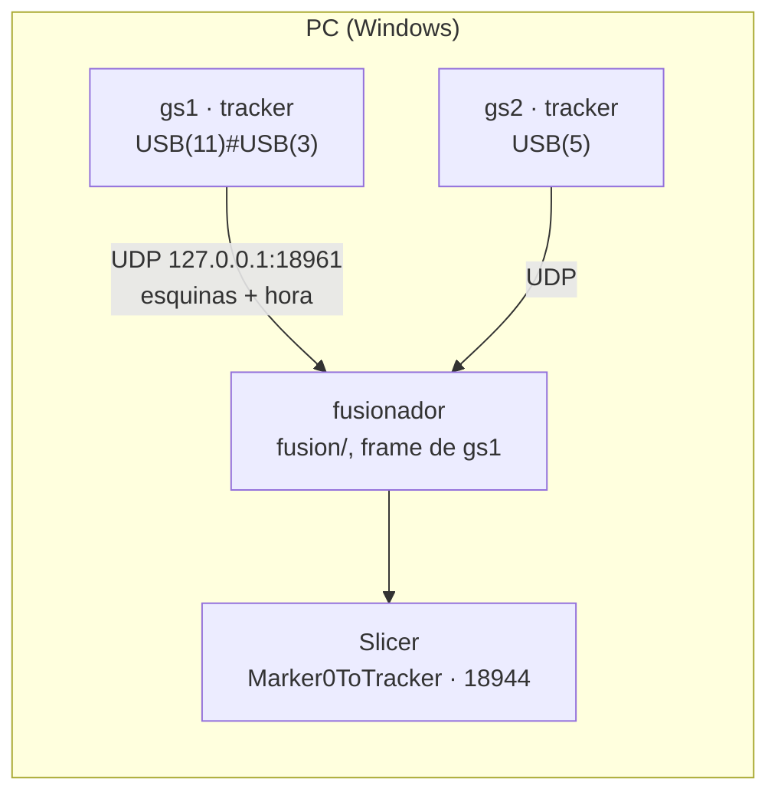

# Plan — Meta 006 · Grafo de factores óptico-inercial (primero, las dos cámaras)

Escrito por el agente de planificación el 2026-10-29, rehecho el 2026-11-05 para «la Jetson detecta, el PC fusiona» (P22) y **rehecho otra vez el 2026-11-05 (tarde) para «el PC detecta y fusiona» (P33)**, por encargo de la dirección. Lo que el autor autoriza es este archivo. Las versiones anteriores están en git (`db9c8ef` la del 2026-10-29; `b4c2206` la de la mañana del 2026-11-05). No se borró nada de `clarify.md`.

**Qué cambió respecto a la versión de la mañana (P33):**
- La Jetson sale de la meta por ahora. En Windows las dos cámaras van a la vez a ~90 fps con gs2 en `…#USB(5)` (P-7b5, `9d0a9fa`; `docs/CONTEXT.md` §4.21). Desaparece «Fase 3 · La Jetson envía al PC»: el envío pasa a ser local, de cada tracker del PC al fusionador del PC.
- El orden es el de P33 (2): primero S2 otra vez en Windows y B94; después la fusión en vivo con lo de la parte A (`codigo/fusion/`, sin GTSAM), publicando a Slicer; GTSAM y el tablero, al final.
- La Fase 1, parte A (`a1a714b`) queda hecha y no se rehace. Las fases se renumeran (tabla abajo).
- Lo que salía de la Jetson (V4L2, la hora del buffer, el guardián, `clock_offset` entre máquinas, la regla del cortafuegos) sale del plan.
- Preguntas nuevas: P34 a P39. P24 se revisa en P38 (qué viaja, ahora en local).

| Antes (mañana del 2026-11-05) | Ahora |
|---|---|
| Fase 1, parte A (hecha, `a1a714b`) | Fase 1, parte A (hecha) |
| — | **Fase 2 · S2 otra vez en Windows, y B94** |
| Fase 3 · La Jetson envía al PC | **Fase 3 · Cada tracker le envía sus esquinas al fusionador** (en local) |
| Fase 4 · El fusionador en el PC | **Fase 4 · El fusionador del PC, sin GTSAM** |
| Fase 5 · La fusión en vivo con Slicer | **Fase 5 · La fusión en vivo con Slicer** |
| Fase 1, parte B · El grafo con GTSAM | **Fase 6 · El grafo con GTSAM** |
| Fase 2 · Los extrínsecos por tablero | **Fase 7 · Los extrínsecos por tablero** |
| Fase 5b · La estructura del autor | **Fase 7b · Los extrínsecos sobre la estructura** |
| Fase 6 · Cierre | **Fase 8 · Cierre** |

## Lo leído

- HEAD: `b4c2206 Anota P33: Windows primero y la Jetson fuera de la meta 006 por ahora`. Árbol limpio salvo el PDF sin seguimiento.
- Completos: `docs/constitution.md`, `memory.md`, `docs/CONTEXT.md` (§4, trampas 1–21; §6), `spec.md`, `clarify.md` (P1–P28 y P33), `tasks.md` y `plan.md` de esta meta.
- Fuera de git: `Claude outputs/fases/006/fase-1a.md` y `fase-1a-implementa.md` (los números y los tiempos de la parte A), `encargo-b94-mirilla.md`, `grabacion-b94/protocolo.md` y `reporte.md` (lo preparado para la Jetson: mirilla, pos1 al principio y al final, 6 tramos), `fase-1/corrida-02/tiempos.json`; `Claude outputs/fases/007/p7b5/correr.ps1` (los pasos de Windows: puertos, marca por COM, perfiles temporales, listeners, PIDs) y su tabla `correr_20261105-193558_tabla.md`.
- `docs/BACKLOG.md`: índice (hasta B97) y B94, B95, B96. `docs/DECISIONS.md`: índice (hasta ADR-034). `docs/PRUEBAS.md`: índice (P01–P05). `docs/ARCHITECTURE.md`: índice. `specs/003-arquitectura-tracker/resultados.md`, fase 6 (tiempos por etapa).
- Código: `tracker.py` (418 líneas; `--record` graba `PoseLog.add(t_now, ids, corners, poses, gray)`; la hora es `perf_counter` del hilo de captura; el ancla `t_start` es `time.time()`), `vision/tracking.py` (`MarkerPose.rvec` sin filtrar, `tvec` y `matrix` con el 1-Euro), `transport/igtl.py` (`IgtlSender(port, iface)`, `wait_for_client`, `send`), `camera/grabber.py`, `diagnostics/clock_offset.py` (el patrón UDP con `struct`; tiene `_wall_ns_windows` porque `time.time` no es precisa en Windows), `diagnostics/igtl_rate.py` (`listen`), `linux/perfil_temporal.py` (sirve en Windows; claves `transforms_port` y `camera.usb_port_windows`), `gui/processes.py` (`entorno_hijo`), `profiles/tracker_config_gs2.yaml` (`USB(5)`, 18944, `filtering.enabled: true`), y de `fusion/`: `dataset.py` y `experiment.py` enteros, las firmas de `geometry.py`, `extrinsics.py`, `bundle.py`, `pairing.py` y `metrics.py`.
- Context7 (solo preguntas de API; no salió ninguna ruta ni dato del proyecto):
  - `/python/cpython/v3.11.14`: `time.perf_counter` «is system-wide» y `perf_counter_ns` en enteros: los dos trackers del PC comparten reloj aunque sean procesos distintos. UDP con `socket.SOCK_DGRAM`, `sendto` y `recv`; `select.select` con tope. La resolución de `time.time` en Windows no la da la documentación: el repo la midió en 15.6 ms (docstring de `tracker.py`, meta 003, fase 7).
  - `/opencv/opencv`: en Windows el paralelismo de OpenCV va por el Concurrency Runtime y `cv2.setNumThreads` lo limita; la documentación no dice si `detectMarkers` suelta el GIL de Python (hipótesis para la opción de un proceso, P34).
  - De la versión anterior siguen valiendo: `/borglab/gtsam` (`IncrementalFixedLagSmoother`, `PriorFactorPose3`, `BetweenFactorPose3`, `GenericProjectionFactorCal3_S2`, `noiseModel.Robust`), `/scipy/scipy` (`least_squares`, `Rotation.mean`) y `/mermaid-js/mermaid` (`mermaid@11`).
  - `pyigtl`: no se usa ninguna llamada nueva; el fusionador publica con `transport.igtl.IgtlSender`, como el tracker.

## La idea en una línea

Antes de fusionar en vivo se separan las dos hipótesis de B94 con una grabación de S2 en Windows (pos1 al principio y al final, las ventanas a la vista). Si las cámaras coinciden, cada tracker del PC manda por UDP local las esquinas de Marker0 con su hora; un fusionador en el PC rehace la pose, fusiona por instante con `codigo/fusion/` (sin GTSAM) y publica `Marker0ToTracker` en el frame de gs1 por el 18944, como hoy. GTSAM y el tablero llegan al final.

## Las preguntas del encargo, contestadas

### Cómo se graba en el PC lo que hoy salía de la Jetson

- **El formato no cambia.** Cada tracker graba con lo que ya existe, `--record <segmento>_<cámara>.npz` (`diagnostics.pose_log.PoseLog`): las esquinas, los ids, la hora de captura (`perf_counter`), lo enviado, K, dist y los metadatos (`t_start`, `t_loop_start`, sha256 del perfil y de la calibración). Son los mismos `.npz` que leyó la parte A: `fusion.dataset.load_segment` los lee sin cambio de formato.
- **Cómo corren:** dos procesos `python -m tracker` a la vez en el PC, gs1 con `profiles\tracker_config_gs1.yaml` (18944) y gs2 con un perfil temporal de `linux.perfil_temporal` con `--puerto 18946` (lo único distinto del perfil del repo). Cada uno tiene de cliente un listener `python -m diagnostics.igtl_rate listen` en su puerto, en lugar de Slicer (ADR-028: el cliente antes que el tracker). Es lo que hizo el P-7b5, más `--record`.
- **El reloj:** los dos procesos sellan con `perf_counter`, que en Windows es del sistema (Context7, arriba): la misma hora para las dos cámaras, sin red de por medio.
- **La trampa del ancla.** `check_segment` exige hoy que `t_start − t_loop_start` de los dos `.npz` coincida a ≤ 1 ms. En la Jetson pasó (0.023 ms), pero en Windows `t_start` es `time.time()`, con pasos de 15.6 ms: dos procesos con el mismo `perf_counter` pueden dar anclas a 15.6 ms y el segmento caería sin motivo. El plan añade una tolerancia explícita (`--tolerancia-ancla-ms`, 20 para las grabaciones del PC, 1 por defecto) y no toca `tracker.py` para esto.
- **Dónde:** `Claude outputs/fases/006/grabacion-pc/datos/<AAAAMMDD-HHmmss>/`, fuera de git, con los nombres de la parte A más `S2_pos1_fin`.

### Dos procesos o uno con las dos cámaras (P34)

| | (a) Dos trackers y un fusionador (tres procesos, un comando) | (b) Un proceso con las dos cámaras | (c) Dos trackers sin cambios y un fusionador cliente de OpenIGTLink |
|---|---|---|---|
| fps | cada tracker, su GIL y su bucle: ~90 fps cada uno medido a la vez (P-7b5, sin fusión) | detección 5.6–5.8 ms por frame (meta 003, fase 6): las dos en serie, ~12 ms por pareja, < 85/s; en paralelo, solo si `detectMarkers` suelta el GIL (sin documentar) y con los dos compartiendo el pool de OpenCV | como (a) |
| la cadena | `tracker.py` gana `--feed` (principio 6); sin la opción, el bucle de hoy | otro bucle de cámara (apertura, marca, warmup, atasco, grabación) que mantener junto al de `tracker.py` | `tracker.py` sin tocar; Slicer ve el puerto del fusionador |
| lo que llega | esquinas y hora de captura, sin filtro | todo, en memoria | solo la matriz con el 1-Euro (los perfiles lo llevan encendido), en float32, sin esquinas (no sirve `numpy_reproj`, −63 %, solo `numpy_pose`, −31.9 %, en el límite); la hora es la de llegada; `pyigtl` guarda el último mensaje de cada nombre |
| si una cámara falla | la otra sigue (el criterio 3 sale casi solo) | se cae el proceso con las dos | como (a) |
| arranque y parada | tres procesos que coordina el fusionador, por PID | uno | tres |
| la Jetson después (P33 b) | el mismo envío, con otra IP | se rehace | — |

**Recomendada (a).** Es la única que da las esquinas sin filtro a ~90 fps por cámara con lo ya medido, y no duplica el bucle. El coste es `--feed` en `tracker.py` (fase 3, con su «no cambió») y coordinar tres procesos. Se lanza con un solo comando, como pidió P10: `python -m tracker --fusion profiles\fusion_gs1_gs2.yaml` (excluyente con `--config`), que delega en `fusion.run` antes de leer ningún perfil. Con (b) el número que falta, cuántas parejas por segundo da un proceso, habría que medirlo antes de decidir.

### Qué viaja de cada tracker al fusionador (P38, revisa P24)

- **Recomendado:** por frame, aunque no vea nada: la cámara, una secuencia, la hora de captura en ns y las esquinas de Marker0 (o ninguna). Unos 50 bytes. El fusionador rehace las dos soluciones de IPPE desde las esquinas con `fusion.dataset.ippe_solutions`, como el experimento: lo que se fusiona en vivo es lo mismo que fuera de línea, y el tracker solo añade un envío (no calcula la pose cruda aparte: hoy `tvec` sale ya filtrada).
- P24 pedía además la pose cruda y la otra solución porque las calculaba la Jetson. En el PC sobran: el fusionador tiene los intrínsecos y la parte A midió 0 medidas salvadas por la otra solución.
- Por `127.0.0.1`: sin regla de cortafuegos [hipótesis alta: Windows no filtra el loopback]; puerto 18961 (el 18960 es de `clock_offset`; 18945–18950, de los perfiles temporales).
- **El apretón de manos:** con `--feed`, el tracker no abre el 18944; manda un `HOLA` y espera el `LISTO` del fusionador con `--feed-timeout` (30 s). Sin respuesta, aborta con código 3 y lo dice, sin abrir la cámara (como ADR-028 con Slicer). El fusionador solo responde cuando Slicer ya está conectado.

### La verificación de la cadena (principio 6)

- **Fase 3 (`--feed` en `tracker.py`):** sin `--feed`, el `Namespace` tiene los campos de hoy más `feed=None`, `feed_name=None`, `feed_timeout=30.0`, y el bucle hace las mismas llamadas: los casos de hoy de `test_tracker_loop.py` sin tocar, el replay de Marker0 de gs1 y gs2 en 0.0 mm / 0.0° / 0.0 px, el selftest del panel. Con `--feed`, en la suite: ni `IgtlSender` ni el 18944. En vivo: gs1 sola sin opciones con su listener da los mensajes por segundo del P-7b5 (≥ 85).
- **Fase 4 (el fusionador):** en la suite, un emisor falso reproduce una grabación por UDP y lo que publica el fusionador es lo que da el experimento por instante sobre ella; sin Slicer, código 3 sin lanzar ningún tracker. El nombre `Marker0ToTracker` y el 18944 no cambian.
- **Fase 5 (en vivo con Slicer):** el mismo nodo `Marker0ToTracker` en la raíz y ningún nodo nuevo; con el marker quieto, la pose fusionada a < 0.5 mm y < 0.2° de la de gs1 sola; y la cadena de hoy, `python -m tracker --config profiles\tracker_config_gs1.yaml` sin opciones con Slicer, igual que antes (Hz de B54). Es la verificación del ADR G4.

### Los topes de tiempo real, revisados para el PC (P37)

P15 (2026-10-29) suponía GTSAM en un proceso con las dos cámaras. Para el fusionador sin GTSAM de las fases 4 y 5, recomendados:

| Qué | Tope | De dónde |
|---|---|---|
| cámara, cada una | ≥ 85 fps | P-7b5: 89.5–90.0 |
| bucle de cada tracker con `--feed`, sin ventana | ≥ 85 fps | P-7b5: listeners a 88.6–89.4 mensajes/s |
| bucle de cada tracker con ventana (dos ventanas) | ≥ 45 fps | meta 003, una ventana: 61.7 y 55.2; con dos, sin medir |
| fusión por pareja (`numpy_reproj` o `numpy_pose`) | p95 ≤ 5 ms, máx. ≤ 15 ms | parte A en el PC: p50 2.9–3.3 ms, p95 20.5 ms con el BLAS en hilos (`fase-1a-implementa.md`); P15 pedía ≤ 3 ms con GTSAM |
| poses fusionadas publicadas | ≥ 85/s sin ventana; ≥ 45/s con ventana | P15: 85 y 50 |
| latencia añadida: hora de captura del frame más nuevo de la pareja → envío a Slicer, con el mismo `perf_counter` | p95 ≤ 12 ms | espera de la pareja ≤ medio periodo (5.6 ms) + fusión |
| pérdida por la secuencia UDP | ≤ 0.1 % | — |
| Slicer | ≥ 50 Hz | P15; su techo es ~65 (B54) |

Los de GTSAM (P15: p95 ≤ 2 ms fuera de línea, ≤ 3 ms en vivo, máx. 5 ms) siguen para la fase 6. Si la fusión numpy no llega a su tope, la fase 4 prueba una sola variable, `OPENBLAS_NUM_THREADS=1` en el entorno del fusionador, y si no basta para con el número.

## Qué se espera según el ángulo entre las cámaras

La parte A midió θ = 48.9° entre los ejes ópticos (base 192 mm): con ruido independiente, la reducción predicha frente a la mejor cámara sola es ~55–60 % (tabla de la versión anterior, en git). La medida fue −31.9 % con `numpy_pose` y −63.1 % con `numpy_reproj` (este, con 12.9 px de RMS porque las vistas no casaban: B94). Si al regrabar cambia el montaje, el informe vuelve a dar θ y la predicha; con θ < 10° avisa de que el 30 % no cabe por geometría.

## Archivos

Se crean:

- Fase 2 (fuera de git): `Claude outputs/fases/006/grabacion-pc/protocolo.md` y `correr.ps1`, desde `grabacion-b94/` (los tramos, los textos de las manos, la comparación de la primera y la última foto) y `007/p7b5/correr.ps1` (lo de Windows). `grabacion-b94/` (la de la Jetson) no se toca.
- Fase 2: `codigo/data/extrinsecos_gs1_gs2_pinzas.yml` (P18), **solo si el criterio 1 cumple**.
- Fase 3: `codigo/transport/feed.py` y `codigo/tests/test_feed.py`.
- Fase 4: `codigo/fusion/live.py` (la fusión causal, sin red ni procesos), `codigo/fusion/run.py` (el fusionador: Slicer, UDP, los dos trackers hijos, la publicación), `codigo/profiles/fusion_gs1_gs2.yaml`, `codigo/tests/test_fusion_live.py` y `test_fusion_run.py`.
- Fase 6: `codigo/fusion/graph.py`, `codigo/fusion/environment.yml`, `codigo/tests/test_fusion_graph.py` (con `pytest.importorskip("gtsam")`).
- Fase 7: `codigo/calibration/calibrate_extrinsics.py` y `codigo/tests/test_calibrate_extrinsics.py`.
- Fuera de git, en `Claude outputs/fases/006/`: los informes, los JSON y los `correr.ps1` de cada sesión en vivo.

Se modifican:

- Fase 2: `codigo/fusion/dataset.py` (`check_segment` con `anchor_tol_ms`), `codigo/fusion/experiment.py` (el segmento `S2_pos1_fin`, el veredicto de B94, `--tolerancia-ancla-ms`), `codigo/fusion/extrinsics.py` (la comparación de dos posiciones repetidas, las mitades de un tramo y la orden `guardar`), `codigo/fusion/report.py` (la sección de B94), y sus pruebas `test_fusion_dataset.py`, `test_fusion_extrinsics.py`, `test_fusion_experiment.py`, `test_fusion_report.py`.
- Fase 3: `codigo/tracker.py` (`--feed`, `--feed-name`, `--feed-timeout`) y `codigo/tests/test_tracker_loop.py` (casos nuevos; los de hoy, sin tocar).
- Fase 4: `codigo/tracker.py` (`--fusion` delega en `fusion.run.main` antes de `parse_args`).
- Fase 6: `codigo/fusion/experiment.py` (los motores `gtsam_*`), `codigo/requirements.txt` (una nota que remite a `fusion/environment.yml`).
- Al cerrar (fase 8): `docs/ARCHITECTURE.md` §2, §3 y §6, `docs/CONTEXT.md` §3 y §6, `codigo/readme.md`. Los ADR y el BACKLOG, la dirección; `docs/PRUEBAS.md`, el agente `pruebas`.

No se tocan: `vision/`, `camera/`, `transport/igtl.py`, los perfiles gs1 y gs2, los intrínsecos, `codigo/slicer/`, `gui/` (el botón de la fusión, al BACKLOG), `linux/` ni la Jetson.

## Funciones y clases

Las de la parte A (`fusion/dataset.py`, `geometry.py`, `extrinsics.py`, `bundle.py`, `pairing.py`, `metrics.py`, `report.py`, `experiment.py`) están hechas; aquí solo lo nuevo o cambiado.

`fusion/dataset.py` (fase 2)
- `check_segment(tracks, intrinsics, expected_s, occluded=None, rotation_tol_deg=ROTATION_TOL_DEG, anchor_tol_ms: float = ANCHOR_TOL_MS) -> dict` — la tolerancia del ancla pasa a ser un argumento; por defecto 1.0, como hoy.

`fusion/extrinsics.py` (fase 2)
- `half_split(Ta: np.ndarray, Tb: np.ndarray) -> dict` — los extrínsecos de la primera y la segunda mitad de un tramo y su diferencia (mm, °): el suelo de ruido y si algo se movió dentro del tramo.
- `repeat_check(first: tuple[np.ndarray, np.ndarray], last: tuple[np.ndarray, np.ndarray], tol_mm: float = 0.5, tol_deg: float = 0.2) -> dict` — los extrínsecos de pos1 y de pos1_fin, su diferencia en traslación (mm) y en giro (°), y `coinciden`.
- `main(argv) -> int` — orden `guardar --resultados <json> --metodo marker0|bundle --montaje pinzas --intrinsecos gs1=<yml> gs2=<yml> --salida <yml>`: escribe el `.yml` con `save_extrinsics` (no pisa) solo si el criterio 1 de ese `resultados.json` cumple; si no, código 1 y lo dice.

`fusion/experiment.py` (fase 2)
- `SEGMENTS` gana `"S2_pos1_fin": {"kind": "rest", "role": "S2_rep"}`: fuera de los extrínsecos y de la validación cruzada (si entrara, dejar fuera pos1 dejaría su gemelo y el número saldría optimista); entra en σ_px y en el criterio 2 como un reposo más.
- `b94_verdict(rest: dict, ext_segs: list[str], criterio_1: dict) -> dict` — `repeat_check(S2_pos1, S2_pos1_fin)`, `half_split` de cada tramo, las distancias invariantes del diagnóstico de consistencia, el desplazamiento del marker entre pos1 y pos1_fin visto por gs1, y el veredicto: `"sin_decidir"`, `"se_movio"`, `"cumple"` o `"sesgo_por_vista"` (regla en la fase 2).
- `run_experiment(..., anchor_tol_ms: float = 1.0)` y `main` con `--tolerancia-ancla-ms` (opcional, 1 por defecto; el informe dice cuál se usó).

`transport/feed.py` (fase 3; biblioteca estándar `socket`, `struct`, `select`)
- `FEED_VERSION = 1`; `pack_frame(camera: str, seq: int, t_capture_ns: int, detections: list[tuple[int, np.ndarray]]) -> bytes` y `unpack_frame(data: bytes) -> dict | None` (`None` si la magia, la versión o el tamaño no cuadran).
- `class FeedSender(host: str, port: int, camera: str)` — `handshake(timeout_s: float) -> bool` (`HOLA` y espera `LISTO`), `send(seq, t_capture_s, detections) -> bool` sin bloquear (`sent`, `errors`), `close()`.
- `class FeedReceiver(port: int, host: str = "127.0.0.1")` — `poll(timeout_s: float) -> list[dict]` (con `select`), responde `LISTO` a cada `HOLA` cuando `ready` es cierto; contadores por cámara: recibidos, perdidos y desordenados (por la secuencia), malformados; `close()`.
- `main(argv) -> int` — `python -m transport.feed escuchar --puerto 18961 --segundos <s> --timeout <s> --salida <json>`: el receptor de prueba de la fase 3 (fps por cámara, pérdida, intervalo entre llegadas).

`tracker.py` (fases 3 y 4)
- `parse_args(argv)` — `--feed HOST:PUERTO`, `--feed-name {gs1,gs2}` (las dos o ninguna) y `--feed-timeout` (30 s, > 0).
- `main(argv)` — si `argv` trae `--fusion`, devuelve `fusion.run.main(argv)` antes de `parse_args` y sin leer ningún perfil (fase 4). Con `--feed`: no crea `IgtlSender`; hace `handshake(feed_timeout)` donde hoy espera a Slicer (sin respuesta, código 3 y su mensaje, la cámara sin abrir); en cada frame, tras `detect`, manda las esquinas de los ids de la lista blanca con `t_now` y el número de frame; el resto del bucle (pose, 1-Euro, `--record`, ventana) igual. Sin `--feed`, las mismas llamadas de hoy.

`fusion/live.py` (fase 4)
- `@dataclass class FusedPose` — `t: float` (s, la hora de la pareja o de la cámara sola), `T: np.ndarray` (4×4, `T_gs1←M`), `used: tuple[str, ...]`, `t_newest: float`, `update_ms: float`.
- `class LiveFuser(T_ref_other: np.ndarray, cameras: dict[str, dict], size_mm: float, engine: str, sigma_px: dict[str, float], tolerance_s: float)` — `cameras[c]` lleva `K` y `dist`; `push(camera: str, t: float, corners: np.ndarray | None, now: float) -> list[FusedPose]` empareja por hora como `fusion.pairing.pair_by_time` pero de forma causal (una medida espera a su pareja como mucho `tolerance_s` desde su hora); `flush(now: float) -> list[FusedPose]` suelta lo que ya no tendrá pareja, como cámara sola (gs2 llevada a gs1; con `numpy_reproj`, el PnP por mínimos cuadrados de esa cámara). Usa `fuse_pair` del experimento, así que una pareja da lo mismo en vivo y fuera de línea.

`fusion/run.py` (fase 4)
- `main(argv) -> int` — `--fusion <perfil>` (obligatorio), `--slicer-timeout` (30), `--feed-timeout` (30), `--duration`, `--stop-stdin`, `--ventana`, `--record <carpeta> --segmento <nombre>`, `--resumen <json>`. Abre `IgtlSender(18944)` y espera a Slicer (sin él, código 3 sin lanzar nada); abre `FeedReceiver(18961)`; lanza los dos trackers hijos (`sys.executable -m tracker --config <perfil> --feed 127.0.0.1:18961 --feed-name <c> --no-window|… --stop-stdin [--record <carpeta>/<segmento>_<c>.npz]`, con `gui.processes.entorno_hijo`); recibe, fusiona con `LiveFuser` y publica `Marker0ToTracker`. Sale con `q`, Ctrl+C, `--duration` o si un hijo muere (código 4 y cuál); al salir, `q` a cada hijo, `terminate()` por su PID a los 5 s, y el resumen (fps publicados, latencia p50/p95/máx., `update_ms`, pérdida por cámara). Con `--record`, además `<segmento>_fusion.npz` (hora, pose, cámaras usadas, latencia).
- `load_fusion_profile(path: Path) -> dict` — valida el perfil (principio 7): los dos perfiles de cámara, los extrínsecos con el sha256 de los dos intrínsecos (`fusion.extrinsics.load_extrinsics`; si no coincide, no arranca), el motor, σ_px, la tolerancia, el puerto UDP y `filtering` después de la fusión (apagado por defecto, P14).

`fusion/graph.py` (fase 6; importa gtsam) — `class FusionGraph(...)` con la firma de la versión anterior (`mode`, `factor`, `lag_s`, `huber_k`, `q_*`, `gate`; `update_pair` y `update_measurement`).

`calibration/calibrate_extrinsics.py` (fase 7) — como en la versión anterior (`stereoCalibrate` con `CALIB_FIX_INTRINSIC`, `--desde-vistas`).

## Fases

Cada fase se presenta al autor antes de lanzarla. «No cambió» es siempre: la suite en verde con su tiempo, el replay de Marker0 de gs1 y gs2 en 0.0 mm / 0.0° (detección 0.0 px) y `python -m gui.panel --selftest`. Lo en vivo va en un `correr.ps1` que lo hace entero (`CLAUDE.md` §4), con caja de luz al máximo, Marker0 de 80 mm (B55) a ~35–40 cm, gs1 en el Genesys (`…#USB(11)#USB(3)`) y gs2 en `…#USB(5)` (§4.21), y los comandos de Slicer y de PowerShell juntos cuando hay Slicer (regla del 2026-10-25).

### Fase 1 · Verlo, parte A · Los números sin gtsam (pesada) — hecha

Hecha el 2026-11-05 y commiteada (`a1a714b`). Números en `tasks.md` y en `Claude outputs/fases/006/fase-1a.md`. No se rehace.

### Fase 2 · S2 otra vez en Windows, y B94 · Las dos cámaras no ven el Marker0 en el mismo sitio (pesada)

- **Qué, sin cámara:** en `fusion/`, el segmento `S2_pos1_fin`, `half_split`, `repeat_check`, `b94_verdict`, la tolerancia del ancla y la orden `guardar`; la sección de B94 en el informe; sus pruebas.
- **Qué, en vivo (el autor, con `grabacion-pc/correr.ps1`):** dos trackers con ventana a la vez y `--record`, con sus listeners. Antes: la raíz, el venv, 18944 y 18946 libres, ningún python del proyecto vivo, Slicer cerrado, `probe_camera --puertos` con las dos rutas de §4.21 y la marca `focus` por COM (500 y 332). Siete pasos:
  1. **M1, la mirilla:** las dos ventanas abiertas (contorno, ids y ejes de `draw_poses`) hasta que el autor pulsa Enter (tope 5 min), con una foto por cámara guardada (`--save-frames`, la marca de `diagnostics.explain_pose`, como en `grabacion-b94`).
  2. «Sujeta las dos cámaras (cinta o peso) y desde ahora no toques la mesa ni las cámaras; solo mueve el marker» y «Marca en la mesa dónde queda el soporte del marker (cinta)».
  3. **Seis tramos:** S2_pos1, pos2, pos3, pos4, pos5 (los textos de `grabacion/`) y S2_pos1_fin («pon el marker exactamente donde estaba en la pos1, con la misma orientación»). La duración la fija P35 (recomendada: 60 s con las ventanas a la vista). Antes de cada uno, la vista con las ventanas; cada tramo, con su comprobación: código 0 en los dos, pose ≥ 90 % y bucle ≥ 45 fps en cada cámara; si no, `r` repite (`_r2`), Enter sigue (anotado), `x` detiene.
  4. **M_final**, la foto de cada cámara, y la comparación con M1 (centro y lado en px, z, inclinación).
  5. Después: todo lo que lanzó, terminado; 18944 y 18946 libres; la tabla esperado / obtenido.
- **Qué, fuera de línea:** `python -m fusion.experiment --datos <grabacion-pc/datos/…> --tolerancia-ancla-ms 20 … --timeout 600`, y con su veredicto, `python -m fusion.extrinsics guardar` si toca.
- **La regla del veredicto de B94** (umbrales del criterio 1, 0.5 mm y 0.2°), en este orden:
  - **«sin decidir»** si el marker no volvió a su sitio: la pose de pos1_fin vista por gs1 está a > 5 mm o > 2° de la de pos1 (umbral propuesto, sin medir: con la vista cambiada, un sesgo por vista también cambiaría). Se repite la sesión con más cuidado en las marcas.
  - **«se movió»** si los extrínsecos de pos1 y pos1_fin difieren ≥ 0.5 mm o ≥ 0.2°, o si las dos mitades de algún tramo difieren eso. El autor fija el montaje y se repite la sesión (como mucho dos veces; después decide con P36).
  - **«cumple»** si no se movió y el criterio 1 (validación cruzada, la peor de las 5 posiciones, ≥ 2000 parejas cada una) da < 0.5 mm y < 0.2°. B94 se cierra con la causa (el montaje de la grabación de la Jetson) y se escribe `data/extrinsecos_gs1_gs2_pinzas.yml` (método `marker0`; el del ajuste conjunto, en `alternativa`).
  - **«sesgo por vista»** si no se movió y el criterio 1 no cumple: es la hipótesis (b) de B94, un error de la pose de una cámara sola que cambia con la vista. B94 sigue alta y el autor decide con P36.
- **Criterio de la fase:** en la suite, con dos cámaras sintéticas: sin mover nada, `repeat_check` da < 1e-6 mm y `half_split` < 1e-6; con gs2 desplazada 2.0 mm y girada 0.5° entre pos1 y pos1_fin, `repeat_check` lo recupera a < 0.01 mm y < 0.001° y el veredicto es «se movió»; con un sesgo de inclinación sintético que cambia con la vista y nada movido, «sesgo por vista». `S2_pos1_fin` no entra en los extrínsecos (prueba). Con la tolerancia por defecto, el experimento sobre la grabación de la Jetson (`20261105-120826`) da un `resultados.json` igual byte a byte al de `corrida-02` salvo las claves nuevas (una prueba lo fija con el recorte de `tests/data/fusion_gs1_gs2/`). En vivo: los 6 tramos con código 0 en las dos cámaras, pose ≥ 90 %, bucle ≥ 45 fps y ≥ 2000 parejas por tramo; el experimento termina con código 0 en ≤ 5 min y da uno de los cuatro veredictos. **El veredicto es el resultado, no el criterio**: la fase cierra con cualquiera, y el número va a B94; con «sin decidir» o «se movió», la sesión se repite dentro de la misma fase.
- **Cadena:** no se toca (`fusion/` y un script fuera de git). «No cambió» completo. Los trackers corren con los perfiles del repo y el temporal de gs2, que solo cambia el puerto.

### Fase 3 · Cada tracker le envía sus esquinas al fusionador (pesada; toca la cadena)

- **Qué:** `transport/feed.py` (formato v1, `FeedSender`, `FeedReceiver`, la orden `escuchar`) y `--feed`, `--feed-name` y `--feed-timeout` en `tracker.py`.
- **Criterio, en la suite:** `pack_frame`/`unpack_frame` ida y vuelta exacta (las esquinas en float32, la hora en ns), y `None` para un datagrama corto, otra magia u otra versión; por loopback real, 10 000 datagramas a 200/s entre `FeedSender` y `FeedReceiver` sin pérdida y con los contadores de perdidos y desordenados probados con secuencias saltadas; el apretón de manos con y sin respuesta (código 3, la cámara falsa sin abrir, en ≤ `--feed-timeout` + 1 s); `--feed` sin `--feed-name` falla en `argparse`.
- **Cadena (principio 6):** sin `--feed`, los casos de hoy de `test_tracker_loop.py` pasan sin tocarlos, y uno nuevo comprueba que no se crea ningún socket UDP; con `--feed`, que no se crea `IgtlSender`; el replay de Marker0 en 0.0 mm / 0.0° / 0.0 px y el selftest. `git diff` de `tracker.py` solo con lo de `--feed`.
- **Criterio, en vivo (el autor, `fase-3/correr.ps1`, sin Slicer):** (1) gs1 sola sin opciones con su listener `igtl_rate`: ≥ 85 mensajes/s, como el P-7b5; (2) los dos trackers con `--feed` y `python -m transport.feed escuchar` 60 s, sin ventana: ≥ 85 frames/s recibidos por cámara, pérdida ≤ 0.1 %, el 18944 sin abrir durante la corrida y los dos trackers con salida limpia.

### Fase 4 · El fusionador del PC, sin GTSAM (pesada; toca la cadena)

- **Qué:** `fusion/live.py`, `fusion/run.py`, `profiles/fusion_gs1_gs2.yaml` (el motor que fije P39, σ_px de la fase 2, la tolerancia de medio periodo, `filtering.enabled: false`) y `--fusion` en `tracker.py`.
- **Criterio, en la suite:** (1) `LiveFuser` con las parejas de un tramo real de `tests/data/fusion_gs1_gs2/` en el orden de llegada: empareja igual que `pair_by_time` en ≥ 99.9 % de las parejas y, en las que coinciden, la pose fusionada a ≤ 1e-9 mm y ≤ 1e-9° de `fuse_pair` del experimento; (2) con una cámara callada, cada medida de la otra sale sola en ≤ `tolerance_s` + 1 ms; (3) `fusion.run` con un emisor UDP falso que reproduce el recorte y un cliente OpenIGTLink falso: publica `Marker0ToTracker` y nada más, y lo publicado es (1); (4) sin Slicer, código 3 en ≤ `--slicer-timeout` + 1 s sin lanzar ningún hijo; (5) un hijo que muere da código 4 y el otro se para por su PID; (6) unos extrínsecos con otro sha256 de intrínsecos, el fusionador no arranca (código 2).
- **Tiempo, fuera de línea:** la fusión por pareja sobre la grabación de la fase 2 con p95 ≤ 5 ms y máx. ≤ 15 ms (P37); si no, `OPENBLAS_NUM_THREADS=1` y otra vez; si tampoco, la fase para con el número.
- **Cadena:** sin `--fusion`, `tracker.py` hace lo de la fase 3; «no cambió» completo. El fusionador publica el mismo nombre por el mismo puerto; lo que cambia es quién publica (ADR G4, en vivo en la fase 5).

### Fase 5 · La fusión en vivo con Slicer (ligera; verifica la cadena en vivo)

Solo si la fase 2 dio «cumple» (o el autor lo decide con P36).

- **Qué (el autor, `fase-5/correr.ps1`, con Slicer):** Slicer conectado al 18944; `python -m tracker --fusion profiles\fusion_gs1_gs2.yaml --record … --resumen …`, sin ventana y con ventana. Segmentos: S1 en reposo (60 s), S3 tapar gs1 y tapar gs2 (5 s cada vez, tres veces), S4 movimiento (vaivén ≥ 100 mm/s, para B96, informativo). Los Hz de Slicer los mira el autor y el script los pide por teclado.
- **Criterios (los del spec y P37):**
  - criterio 2: en S1, la sd 3D fusionada por instante ≥ 30 % menor que la de la mejor cámara cruda (P14, P26), del experimento sobre los `.npz` de los hijos; y lo publicado, aparte y sin veredicto;
  - criterio 3, por instante: en S3, la pose no se pierde (pose fusionada en todos los frames en que alguna cámara ve el marker) y ningún salto pasa de 0.5 mm; si no cumple solo por falta del factor de movimiento, el número se anota y lo cierra la fase 6;
  - tiempo real: los topes de P37, sin y con ventana;
  - cadena: en Slicer, el nodo `Marker0ToTracker` en la raíz y ningún nodo nuevo; con el marker quieto, la pose fusionada a < 0.5 mm y < 0.2° de la de gs1 sola; `python -m tracker --config profiles\tracker_config_gs1.yaml` sin opciones con Slicer, como antes.
- **Cadena:** no cambia código; es la verificación en vivo del ADR G4.

### Fase 6 · El grafo con GTSAM (pesada) — antes Fase 1, parte B

- **Qué:** el entorno de la fusión (P25 a): el autor instala miniforge; `desarrollo` crea el entorno fuera del repo desde `fusion/environment.yml`, con tope. `fusion/graph.py`, los motores `gtsam_*` del experimento y `test_fusion_graph.py`. Se corre sobre las grabaciones del PC (fases 2 y 5). q y lag se ajustan sobre S4 y S1, no sobre S3.
- **Criterios (los de la versión anterior):** `import gtsam` da 4.3.0 y las clases existen; las `test_fusion_*` pasan en el entorno y la suite de `.venv` sigue igual (las de gtsam, saltadas con su motivo); GTSAM por instante coincide con numpy a ≤ 1e-6 mm y ≤ 1e-6°; criterio 3 con el factor de movimiento (ventana de 0.1 s): ningún salto > 0.5 mm; los dos métodos de sincronía (P13) con la regla de la versión anterior; actualización con p95 ≤ 2 ms y máx. ≤ 5 ms (P15).
- **El modelo del grafo (sin cambios desde la versión del 2026-10-29).** Una variable `X_k = T_gs1←Marker0` por instante. Por cada cámara que vio Marker0, o un factor de pose (`PriorFactorPose3(X_k, T_gs1←cam · Z_cam)` con `Σ = σ_px² (JᵀJ)⁻¹`, J la jacobiana de la reproyección de las 4 esquinas por la derecha) o cuatro factores de reproyección (las esquinas sin distorsión con `cv2.undistortPoints` y `Cal3_S2`, porque `Cal3DS2` no tiene el k3 de los intrínsecos; la variable es la pose de gs1 en el frame del marker y gs2 entra con `body_P_sensor = T_gs1←gs2`). Entre instantes, `BetweenFactorPose3` de identidad con ruido q·√Δt. Huber en todos. Ventana fija `IncrementalFixedLagSmoother` de 0.1 s. Compuerta de Mahalanobis χ²₆(0.999) = 22.5 con la otra solución de IPPE como rescate. Un nodo por medida (P13 b) con `update_measurement`.
- **Lo en vivo con GTSAM** (el fusionador en el entorno de la fusión en vez de `.venv`) se replanea con estos números.
- **Si gtsam no instala:** para con el paquete y el mensaje; el autor decide entre P25 c y dejarlo.
- **Cadena:** no se toca. «No cambió» completo.

### Fase 7 · Los extrínsecos por tablero, independientes de Marker0 (pesada) — antes Fase 2

- Como en la versión anterior, ahora en Windows: `calibration/calibrate_extrinsics.py` (con `--desde-vistas`) y su prueba; el tablero de la meta 002 (9×6, 24.86 mm) quieto en ≥ 18 posiciones (15 de ajuste y 3 de control), grabado con los dos trackers del PC y `--record --save-frames` (no hace falta que sean simultáneas). Criterio: R y T sintéticos a < 0.01 mm y < 0.001°; RMS de `stereoCalibrate` ≤ 0.5 px; control ≤ 0.75 px; distancia triangulada a ≤ 0.3 mm de 198.88 mm; la comparación con los de Marker0 y el criterio 1 repetido con los del tablero; `data/extrinsecos_gs1_gs2_pinzas.yml` con el vigente y el otro en `alternativa`. Las cámaras, sin moverse desde la fase 2 (si se movieron, se repite S2).
- Si P36 la adelanta, va justo después de la fase 2 y la numeración no cambia.
- **Cadena:** no se toca.

### Fase 7b · Extrínsecos sobre la estructura del autor (ligera; cuando llegue)

Repite la fase 2 (S2 con pos1 al final) y la 7 sobre la estructura, con `data/extrinsecos_gs1_gs2_estructura.yml`. Si llega después del cierre, al BACKLOG.

### Fase 8 · Cierre (ligera)

`resultados.md` con todos los números; `docs/ARCHITECTURE.md`, `docs/CONTEXT.md` §3 y §6, `codigo/readme.md`, `memory.md`; 0 líneas de más de 2 000 caracteres.

## Lo que va al BACKLOG

- **El botón de la fusión en el panel** (media): lanzar y parar `tracker --fusion`; hasta entonces, por CLI.
- **La Jetson como fuente del fusionador** (baja; P33 b): el mismo `--feed` hacia la IP del PC, con la regla del cortafuegos, `clock_offset` (B87) y la hora del buffer de V4L2 que la versión anterior dejaba para la fase 3. Sustituye a «la hora del buffer de V4L2» y a «MQTT u otro bus» de la versión anterior.
- **Un proceso con las dos cámaras** (baja): solo si la CPU del PC no da con tres procesos; antes, medir cuántas parejas por segundo da (P34 b).
- **El ancla de reloj de los `.npz` con `time.time` en Windows** (baja): 15.6 ms de paso; `perf_counter` ya es del sistema y el emparejado no lo necesita, pero la comprobación del ancla en Windows solo detecta errores gruesos. Arreglarlo es tocar `tracker.py`.
- **La hora de captura en Windows antes de decodificar** (baja): hoy es `perf_counter` al volver `cam.read()`; si δ (B96) resulta grande, buscar la hora de la muestra de MSMF.
- **Los extrínsecos como variable del grafo, o su incertidumbre en Σ** (baja).
- **Sincronía por hardware** (baja): las SVPRO no la dan.
- **El método de sincronía que pierda en la fase 6** (baja), con su número.
- **El montaje de las cámaras** (media): si la fase 2 da «se movió» dos veces, es un requisito para la estructura del autor (P6), no para el código.

## ADR que se proponen

Con nombres provisionales («G»); los números los pone la dirección al escribirlos (el último es el ADR-034).

- **ADR G1 · La meta 006 es «el PC detecta y fusiona»; la Jetson sale por ahora** (P33): sustituye al G1 de la versión anterior (P22). Se escribe al autorizar este plan.
- **ADR G2 · GTSAM vive en un entorno de conda-forge solo para la fusión** (P8, P25): `.venv` no cambia. Fase 6.
- **ADR G3 · Lo que viaja de cada tracker al fusionador** (P34, P38): UDP por `127.0.0.1:18961`, por frame, la hora de captura y las esquinas; con `--feed` el tracker no abre el 18944 y espera al fusionador con su tope, sin abrir la cámara. Fase 3.
- **ADR G4 · Con la fusión, «Tracker» es el frame de gs1 y quien publica `Marker0ToTracker` es el fusionador** (P11, principio 6): el nombre, el puerto y la jerarquía no cambian; verificación en vivo con Slicer en la fase 5.
- **ADR G5 · Los extrínsecos son un dato versionado por montaje** (P12, P18): el vigente y el otro como alternativa, el sha256 de los intrínsecos y su validación aparte del ajuste; si un intrínseco cambia, la fusión no arranca. Fase 2 (el de Marker0) y fase 7 (el del tablero).
- **ADR G6 · Un comando, tres procesos** (P10, P34): `tracker --fusion` delega en `fusion.run`, que espera a Slicer, lanza los dos trackers con `--feed` y los para por su PID. Fase 4.

## Preguntas abiertas

P34 a P39, al final de `clarify.md`. Para la fase 2 hacen falta P35 y P36; para las fases 3 y 4, P34, P38 y P39; para la 5, P37.

## Títulos de commit

- Fase 2: «Graba S2 en Windows con la pos1 repetida y da el veredicto de B94 (meta 006, fase 2)»
- Fase 3: «Añade el envío de las esquinas de cada tracker por UDP local (meta 006, fase 3)»
- Fase 4: «Añade el fusionador del PC, que publica Marker0ToTracker (meta 006, fase 4)»
- Fase 5: «Anota la fusión en vivo con Slicer (meta 006, fase 5)»
- Fase 6: «Fusiona las dos cámaras con GTSAM fuera de línea (meta 006, fase 6)»
- Fase 7: «Calibra los extrínsecos de gs2 por tablero y los compara con los de Marker0 (meta 006, fase 7)»
- Fase 7b: «Calibra los extrínsecos sobre la estructura de las cámaras (meta 006, fase 7b)»
- Fase 8: «Cierra la meta 006 · Grafo de factores con las dos cámaras»
