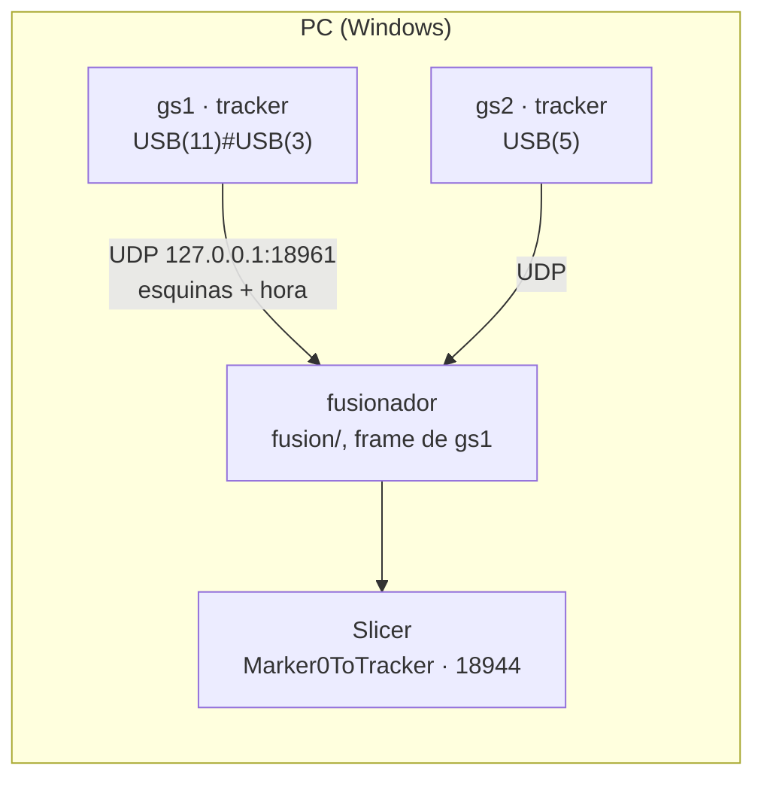

# Plan — Meta 006 · Grafo de factores óptico-inercial (primero, las dos cámaras)

Escrito por el agente de planificación el 2026-10-29, rehecho el 2026-11-05 para «la Jetson detecta, el PC fusiona» (P22) y **rehecho otra vez el 2026-11-05 (tarde) para «el PC detecta y fusiona» (P33)**, por encargo de la dirección. Lo que el autor autoriza es este archivo. Las versiones anteriores están en git (`db9c8ef` la del 2026-10-29; `b4c2206` la de la mañana del 2026-11-05). No se borró nada de `clarify.md`.

**Cambio del 2026-11-10 (P40 a), por encargo de la dirección (`Claude outputs/fases/006/fase-7/encargo_replan.md`):** la Fase 7 · Los extrínsecos por tablero se amplía con la **Fase 7a · El asistente de captura del tablero**, que va antes de lo en vivo de la Fase 7 y sustituye a `fase-7/correr.ps1` (el que abría las cámaras por turnos y se cortó en T04 por el tope de 15 min de la mano, `correr_20261110-180748`, 3 vistas casi iguales que no se reutilizan). Lo hecho de la Fase 7 sin cámara (`1cf90c3`) no cambia, ni su criterio de cálculo. Lo que cambia, en las secciones de siempre, va marcado «(7a)». Preguntas nuevas: P41 a P44. Nada más del plan cambia.

**Cambio del 2026-11-11 (P46, P47), por encargo de la dirección (`Claude outputs/fases/006/fase-7/encargo_replan_2.md`), marcado «(11-11)» en cada sección.** El diagnóstico sin cámara del 2026-11-11 (`fase-7/diagnostico-20261111/reporte.md`) mostró tres cosas: la S2 del 11-11 se grabó con el Marker0 de 100 mm (98.6) y el perfil en 80 (B55; corregida la escala, el criterio 1 pasa de 44.6 a 0.87–1.12 mm, pero los grados siguen en 5.4–6.6° con cualquier extrínseco, B95); los intrínsecos de gs2 se apartan de los de la meta 002 (fx +11, cx −9.5, cy −7.3 px; gs1, cy −6.5) con solo 0.83 de cobertura; y queda ~0.5 px por vista agrupado en el tiempo, que encaja con un montaje de pinzas que cede (el autor lo confirma). El autor decidió (P46 a) que el Marker0 de ~100 mm tenga su propio ID y su `size_mm` y se use desde ahora, y (P47) recalibrar gs1 y gs2 con una calibración de intrínsecos rápida y automática (B112). Este cambio añade tres fases antes de lo en vivo de la Fase 7, reabre su parte sin cámara para los residuos, el error epipolar y la rigidez, y revisa sus criterios. Lo hecho (Fases 1, 2, 7 sin cámara, 7a) no cambia. Preguntas nuevas: P48 a P56.

| Orden (11-11) | Fase | Peso | Cámara | Depende del montaje |
|---|---|---|---|---|
| 1 | **7c · El Marker0 con su propio ID (B55)** | pesada (la cadena) | sí, con Slicer | no |
| 2 | **7d · Los intrínsecos con el asistente de una cámara** | pesada | no | no |
| 3 | **7e · Recalibrar gs1 y gs2** | pesada (cambia `calibration_file`) | sí, con Slicer al final | no (los intrínsecos son de cada cámara) |
| 4 | **7 · Los extrínsecos por tablero** (reabierta: parte sin cámara 2, y lo en vivo con S2 en la misma sesión) | pesada | sí | sí (P53) |
| 5 | 7b · Sobre la estructura del autor | ligera | sí | es la estructura |
| 6 | 3, 4, 5, 6 y 8, como estaban | — | — | 3–5 van sobre el montaje de la Fase 7 vigente (P53) |

7c y 7d no dependen una de otra: 7d puede ir mientras el autor hace y mide el marker nuevo.

**Cambio del 2026-11-11, tarde (P48–P57 contestadas), por encargo de la dirección (`Claude outputs/fases/006/fase-7/encargo_replan_3.md`), marcado «(11-11 b)» en cada sección.** Siete respuestas van con la recomendada (P48, P49, P50, P52, P54, P55, P56) y no cambian lo escrito. Tres lo cambian:
- **P51 (ChArUco ahora):** la Fase 7d pasa a ser «El tablero ChArUco y los intrínsecos con el asistente de una cámara»: un generador del tablero en el repo (STL bicolor para la Bambu Lab A1, SVG y PNG), su archivo de medidas en `data/`, y `CharucoDetector` en el modo de una cámara del asistente y en `calibrate_camera`. Los extrínsecos con ChArUco se proponen en una fase propia, la **7f**, después de 7e (P58).
- **P53 (recalibrar y continuar):** los extrínsecos valen para la sesión en que se midieron. Nueva **Fase 7g · Recalibrar y continuar**: un comando de un paso (`python -m calibration.recalibrar`) que captura, calcula, comprueba (rigidez, epipolar, residuo, distancia triangulada, lado de la referencia) y, si cumple, escribe un archivo con fecha; el fusionador usa el más nuevo que cumplió. Los disparadores (la edad al arrancar; el RMS del PnP conjunto y el lado de la referencia en vivo, B110) van en la Fase 4 y se prueban en la 5. El botón del panel, en la **7h** (ligera). La **7b se retira**: la estructura, cuando llegue, es un montaje más que se recalibra con el mismo comando. «Provisionales» desaparece.
- **P57 (`Reference` y `ReferenceToTracker`):** cambia la cadena y el principio 6. La 7c se parte en dos (abajo, el porqué): **7c · La referencia con su propio ID** (ID 100 y su `size_mm`) y **7c2 · `Reference` y `ReferenceToTracker`** (el nombre en todo lo vivo), con una sola sesión en vivo con Slicer al final de la 7c2 que verifica las dos.

| Orden (11-11 b) | Fase | Peso | Cámara | Depende del montaje |
|---|---|---|---|---|
| 1 | **7c · La referencia con su propio ID (B55)** | pesada (la cadena) | no (su sesión es la de 7c2) | no |
| 2 | **7c2 · `Reference` y `ReferenceToTracker` (P57)** | pesada (la cadena) | sí, con Slicer (verifica 7c y 7c2) | no |
| 3 | **7d · El tablero ChArUco y los intrínsecos con el asistente de una cámara (P51)** | pesada | no; el autor imprime y mide el tablero | no |
| 4 | **7e · Recalibrar gs1 y gs2** (con ChArUco) | pesada (cambia `calibration_file`) | sí, con Slicer al final | no |
| 5 | **7 · parte sin cámara 2** (epipolar, residuo, rigidez, lado de la referencia) | pesada | no | — |
| 6 | **7f · ChArUco en los extrínsecos** (si P58 a) | pesada | no | — |
| 7 | **7g · Recalibrar y continuar (P53)** | pesada | no | — |
| 8 | **7 · sesión 2**: la primera recalibración con `calibration.recalibrar` y S2 en la misma sesión | pesada | sí | sí, el de ese día |
| 9 | **7h · El botón «Recalibrar extrínsecos» del panel** (si P63 a) | ligera | sí, una pulsación | — |
| 10 | 3, 4 (con los disparadores), 5 (con su prueba), 6 y 8 | — | — | sobre los extrínsecos vigentes de esa sesión |

7d puede ir en paralelo con 7c y 7c2 (no comparten archivos). **Por qué se parte la 7c:** son dos cambios de la cadena con riesgos distintos. El ID y el tamaño cambian qué pose sale (lógica, datos y la copia congelada para el replay, ~10 archivos); el nombre cambia qué nodo recibe Slicer y toca ~35 archivos casi todos de texto, más el mapa de `ARCHITECTURE.md` §9.1, que hay que reexportar. Separados, cada `git diff` se revisa solo y, si el replay se mueve, se sabe cuál fue. Lo en vivo es una sola sesión al final de la 7c2, para no gastar dos tardes del autor con Slicer.

**Cambio del 2026-11-11, noche (P66, P67), por encargo de la dirección (`Claude outputs/fases/006/encargo_replan_4.md`), marcado «(11-11 c)» en cada sección.** La Fase 7d midió que el detector de los perfiles (36h12, `errorCorrectionRate` 0.6 por defecto) lee IDs fantasma en los marcadores del tablero ChArUco (646 en 60 vistas sintéticas, el 100 en una; B39 en alta). El autor decidió (P66 b) una fase propia justo después de la 7d y antes de la 7e: la **Fase 7d2 · Los IDs falsos del tablero en el detector del tracker (B39)**. Pone `error_correction_rate` en los dos perfiles con un valor elegido por una regla fija sobre un barrido de grabaciones reales con la referencia, y se verifica en vivo en la misma sesión que la 7c2 (P68). Lo hecho no cambia. Preguntas nuevas: P68 a P71.

| Orden (11-11 c) | Fase | Peso | Cámara | Depende del montaje |
|---|---|---|---|---|
| 1 | 7c, 7c2, 7d: hechas sin cámara (`80e21a9`, `3b271df`, `7d35af1`) | — | — | — |
| 2 | **7d2 · Los IDs falsos del tablero en el detector del tracker (B39)**, parte sin cámara: el barrido y la sesión ampliada | pesada (la cadena) | no | no |
| 3 | **Sesión conjunta 7c2 + 7d2** (`fase-7c/correr.ps1` ampliado): primero lo de la 7c2 con los perfiles del repo; después el barrido real, la regla y la verificación con el valor elegido | — | sí, con Slicer (7c2) y con listener (7d2) | no |
| 4 | **7d2, cierre:** el valor en los perfiles, la prueba del criterio 9 sin `xfail` | pesada (la cadena) | no | no |
| 5 | 7e · Recalibrar gs1 y gs2 (su `verificar.ps1` ya con el ID 100 y el valor de la 7d2) | pesada | sí | no |
| 6 | 7 parte sin cámara 2, 7f, 7g, 7 sesión 2, 7h; después 3, 4, 5, 6 y 8 | — | — | como en (11-11 b) |

Requisitos de la sesión conjunta: el marker ID 100 impreso y sus 5 medidas en los perfiles (lo de la 7c2) y el tablero ChArUco impreso entero (no hace falta medirlo: para el barrido basta su imagen). Sin el tablero, la sesión corre con `-SinTablero`: hace la 7c2 y el barrido de la referencia, no elige valor, y lo del tablero (P6–P8) va al principio de la sesión de la 7e.

**Cambio del 2026-11-11, noche, segunda vuelta (P68–P71 contestadas), por encargo de la dirección, marcado «(11-11 d)» en cada sección.** P68, P69 y P71 van con la recomendada y no cambian lo escrito. **P70 = (b), no la recomendada:** en esta misma ronda, con un ID repetido en un frame el tracker no publica ese ID ese frame y lo cuenta en el resumen. Se hace como una fase propia, la **7d2b · Un ID repetido no se publica (B39 c)**, por la misma razón por la que se partió la 7c: son dos cambios de la cadena con riesgos distintos. La tasa (7d2) cambia qué ve el detector y vive en los perfiles; el filtro (7d2b) cambia qué se publica dado lo detectado y vive en `vision/tracking.py` y `tracker.py`. Separados, cada `git diff` se revisa solo, el replay de cada uno se lee solo y, en la sesión, cada paso mide una variable: los de la tasa leen lo que vio el detector (los PNG y las detecciones del `.npz`, que se graban antes del filtro); el del filtro, con el perfil del repo y sin tablero, pone dos referencias reales a la vista. Una sola sesión, la conjunta. Pregunta nueva: P72 (qué no se publica cuando el que se repite es un ID y hay otros) y P73 (cómo se fuerza un doble en vivo).

| Orden (11-11 d) | Fase | Peso | Cámara | Commit |
|---|---|---|---|---|
| 1 | **7d2 · parte sin cámara:** el barrido y la sesión ampliada (sin cambio respecto a (11-11 c), salvo los criterios de P7 y P8) | pesada (lógica nueva; no toca la cadena) | no | el suyo |
| 2 | **7d2b · Un ID repetido no se publica (P70 b):** `vision/tracking.py`, el resumen de `tracker.py` y `pose_log` | pesada (la cadena) | no | el suyo |
| 3 | **Sesión conjunta 7c2 + 7d2b + 7d2** (`fase-7c/correr.ps1`): P0–P4 la 7c2; PD1–PD2 el filtro (7d2b); P5–P8 la tasa (7d2) | — | sí, con Slicer (7c2) y con listener | — |
| 4 | **7d2, cierre:** la tasa en los perfiles; la prueba del criterio 9 sin `xfail`; los docs de la 7d2b y la 7d2 | pesada (la cadena) | no | el suyo |
| 5 | 7e y lo que sigue, como en (11-11 c) | — | — | — |

7d2 parte sin cámara y 7d2b no comparten archivos de código (`diagnostics/barrido_correccion.py` frente a `vision/tracking.py`, `tracker.py`, `pose_log.py`); van en ese orden para que el `correr.ps1` se escriba una vez, en la 7d2b, con los dos bloques. Requisito nuevo de la sesión: una segunda copia del ID 100, impresa en papel (P73).

**Qué cambió respecto a la versión de la mañana (P33):**
- La Jetson sale de la meta por ahora. En Windows las dos cámaras van a la vez a ~90 fps con gs2 en `…#USB(5)` (P-7b5, `9d0a9fa`; `docs/CONTEXT.md` §4.21). Desaparece «Fase 3 · La Jetson envía al PC»: el envío pasa a ser local, de cada tracker del PC al fusionador del PC.
- El orden es el de P33 (2): primero S2 otra vez en Windows y B94; después la fusión en vivo con lo de la parte A (`codigo/fusion/`, sin GTSAM), publicando a Slicer; GTSAM y el tablero, al final.
- La Fase 1, parte A (`a1a714b`) queda hecha y no se rehace. Las fases se renumeran (tabla abajo).
- Lo que salía de la Jetson (V4L2, la hora del buffer, el guardián, `clock_offset` entre máquinas, la regla del cortafuegos) sale del plan.
- Preguntas nuevas: P34 a P39. P24 se revisa en P38 (qué viaja, ahora en local).

| Antes (mañana del 2026-11-05) | Ahora |
|---|---|
| Fase 1, parte A (hecha, `a1a714b`) | Fase 1, parte A (hecha) |
| — | **Fase 2 · S2 otra vez en Windows, y B94** |
| Fase 3 · La Jetson envía al PC | **Fase 3 · Cada tracker le envía sus esquinas al fusionador** (en local) |
| Fase 4 · El fusionador en el PC | **Fase 4 · El fusionador del PC, sin GTSAM** |
| Fase 5 · La fusión en vivo con Slicer | **Fase 5 · La fusión en vivo con Slicer** |
| Fase 1, parte B · El grafo con GTSAM | **Fase 6 · El grafo con GTSAM** |
| Fase 2 · Los extrínsecos por tablero | **Fase 7 · Los extrínsecos por tablero** |
| Fase 5b · La estructura del autor | **Fase 7b · Los extrínsecos sobre la estructura** |
| Fase 6 · Cierre | **Fase 8 · Cierre** |

## Lo leído

- **(11-11 d) Para la segunda vuelta de la noche del 2026-11-11:** HEAD `7d35af1` (el mismo que en (11-11 c)); en el árbol, `plan.md`, `clarify.md` y `tasks.md` modificados (el replan (11-11 c) y las respuestas P68–P71) y el PDF sin seguimiento. Completos: `docs/constitution.md`, `memory.md`, P66–P71 de `clarify.md`, `tasks.md`, la cabecera, la 7d2, el BACKLOG, los ADR, las preguntas y los títulos de este plan; B39 entera en `docs/BACKLOG.md`. `docs/ARCHITECTURE.md`: índice y las líneas que nombran `process_corners` (§5, el árbol de §2, la tabla y el paso 3 de §9). `docs/PRUEBAS.md`: índice (P01–P05; nada del filtro). `docs/CONTEXT.md` §4: 1–21, ninguna sobre IDs repetidos.
- **(11-11 d) Código leído:** `vision/tracking.py` entero (`process_corners` recorre las detecciones en orden y, por cada una con su ID en `markers.list`, hace la pose y alimenta el 1-Euro de ese ID: con dos del 100 publica dos y alimenta el filtro dos veces en el mismo `t`); `vision/detection.py:detect` (lista blanca, sin mirar repetidos); `tracker.py` 300–418 (el bucle llama a `tracker.detect` y a `process_corners`, envía cada pose y pasa a `log.add` los `ids` y `corners` **del detector tras la lista blanca, antes de `process_corners`**; el resumen final son las líneas `[Grabacion]` y `[Captura]` y los metadatos del `.npz`); `diagnostics/pose_log.py` (`PoseLog.add` lo confirma en su docstring; `summarize` da `frames_with_two_sends` desde los envíos); los que construyen un `MarkerTracker`: `tests/replay_util.run_marker0_replay`, `diagnostics/explain_pose.py:201`, `diagnostics/measure_modes.py:312`, `tests/test_tracker_loop.py:109`, `tests/test_referencia_id.py:215`; `fusion/` no importa `vision.tracking` (grep). `gui/status.py` solo busca `[Salida limpia]` en la salida del tracker: una línea nueva no le estorba.
- **(11-11 d) Comprobado (una línea de Python con `pose_log.load_recording`, no la suite):** las 14 grabaciones de `tests/data/` (`marker0_gs1`, `marker0_gs2` y las 12 de `fusion_gs1_gs2/`) tienen **0 frames con un ID repetido en 4 882 frames**. Así que el replay 8/8 tiene que seguir en 0.0 sin excluir ningún frame, y el contador en 0.
- **(11-11 d) Context7** (solo la pregunta de API), `/websites/opencv`: `ArucoDetector.detectMarkers` devuelve `corners` e `ids` del mismo tamaño y en el mismo orden; la documentación no dice que los IDs salgan sin repetir, así que dos del mismo ID en un frame son posibles y el filtro no puede apoyarse en el detector. El filtro no usa ninguna API nueva (es Python sobre la lista de IDs); pyigtl, Slicer y PySide6: ninguna llamada nueva.
- **(11-11 c) Para el cambio de la noche del 2026-11-11:** HEAD `7d35af1 Anade el tablero ChArUco y el modo de una camara del asistente para los intrinsecos (meta 006, fase 7d · El tablero ChArUco y los intrinsecos)`; árbol limpio salvo el PDF sin seguimiento (`memory.md` aún dice «pendiente del commit» de la 7d: la dirección lo pone al día). Completos: `encargo_replan_4.md`, `docs/constitution.md`, `memory.md`, `spec.md`, `tasks.md`, P56–P67 de `clarify.md`, las secciones de 7c a 7e, BACKLOG, ADR, preguntas y títulos de este plan; `fase-7d-implementa.md` (punto 1), `fase-7c/protocolo.md`. `docs/BACKLOG.md`: índice y B39. `docs/CONTEXT.md` §4 (1–18 leídas; ninguna sobre el detector) y §6 (la 7d). `docs/PRUEBAS.md`: índice (P01–P05; nada de B39).
- **(11-11 c) Código leído:** `vision/detection.py` entero (`DETECTOR_PARAM_KEYS` ya mapea `error_correction_rate` → `errorCorrectionRate`; `create_detector` pone `CORNER_REFINE_SUBPIX` y aplica `markers.detector`); `vision/tracking.py` (`MarkerTracker.process_corners` publica dos detecciones del mismo ID, la opción (c) de B39); `profiles/tracker_config_gs1.yaml` entero y el `diff` con gs2 (el bloque `markers.detector` es igual en los dos y no fija la tasa); `diagnostics/identify_ids.make_detector` (el modo estricto por defecto usa su propia tasa, 0.35, y `--permisivo` usa la del perfil); `tests/test_charuco_board.py` (punto 9 y la prueba `xfail(strict=True)` sobre 3 de `VISTAS_8`); `tests/replay_util.py` (`profile_diff`, `compare_detection`); `tests/test_referencia_id.py:316` (`test_el_perfil_del_repo_solo_difiere_de_la_copia_en_markers`: dejará de valer cuando el perfil fije la tasa); `linux/perfil_temporal.py` (solo cambia claves que ya existen y su lista `CLAVES` es de la meta 007; no se usa); `tracker.py` (`--record --save-frames --frames-every`: guarda el gris que ve el detector). Grabaciones con frames: `grabacion-pc/datos/20261105-223853/M1*_frames` (~190 PNG reales del Marker0 de ID 0) y `fase-7/datos/20261110-180748/T0*_frames` (el tablero 8 × 5, sin ArUco); las S2 del 11-09 y del 11-11, sin frames. Con la referencia ID 100 no hay ninguna grabación: el barrido real se graba en la sesión.
- **(11-11 c) Comprobado en `.venv` (una línea de Python, no la suite):** OpenCV 4.11.0; `DICT_ARUCO_MIP_36h12` con `maxCorrectionBits = 12`, `markerSize = 6`, 250 IDs; `int(12 × tasa)` da 7, 6, 5, 4, 4, 3, 3, 2 bits para 0.60, 0.50, 0.45, 0.40, 0.35, 0.30, 0.25, 0.20. Que OpenCV trunque igual por dentro es hipótesis alta: casa con lo medido en la 7d (0.45 → 41 fantasmas; 0.30 y 0.25 → 0).
- **(11-11 c) Context7** (solo la pregunta de API; no salió ninguna ruta ni dato del proyecto), `/websites/opencv`: `DetectorParameters.errorCorrectionRate` (por defecto 0.6) escala `Dictionary.maxCorrectionBits`: los bits que se corrigen son `maxCorrectionBits × errorCorrectionRate`; la documentación lo da como el parámetro «para reducir la capacidad de corrección y evitar falsos positivos», y avisa de que un `maxCorrectionBits` alto da muchos falsos positivos. Actúa en la identificación del candidato, no en el refinado de esquinas: que las esquinas de un marker leído con las dos tasas sean idénticas es hipótesis alta (el detector agrupa contornos cercanos y prueba otro si el primero no se identifica); la fase lo mide. pyigtl, Slicer y PySide6: ninguna llamada nueva.
- **(11-11 b) Para el cambio de la tarde del 2026-11-11:** HEAD `efe2653 Anota el diagnostico de la sesion del tablero: B55 a alta, P45 a P47 y B116 a B118 (meta 006, fase 7 · Los extrinsecos por tablero)`; en el árbol, `plan.md`, `clarify.md` y `tasks.md` modificados (el replan de la mañana y P48–P57) y el PDF sin seguimiento. Completos: `encargo_replan_3.md`, `docs/constitution.md`, `memory.md`, `spec.md`, `tasks.md`, `clarify.md` (P1–P57), `plan.md`, `docs/CONTEXT.md` §4 (1–21); `Claude outputs/tablero/generar_tablero.py` (el STL bicolor de la meta 002: dos mallas cerradas, el negro agrandado `comp_mm` por lado, base 2.4 y capa 0.6 mm). `docs/BACKLOG.md`: índice y B36, B55, B89, B110, B112, B118. `docs/DECISIONS.md`: índice (hasta ADR-034). `docs/ARCHITECTURE.md`: índice, §3.6 y §9.1 (el Mermaid nombra `Marker0ToTracker` y `slicer/receive_marker0.py`; `tests/test_como_funciona.py` ata sus referencias al código y el sha del Mermaid a la imagen exportada, ADR-032/033).
- **(11-11 b) Código leído:** grep de `Marker0` en `codigo/` fuera de `historico/` (46 archivos; el detalle, en la Fase 7c2); `tracker.py:334` publica `f"{p.name}ToTracker"`, así que el nombre sale del `name` de `markers.list`; `slicer/receive_marker0.py` (`NAME`, `LEGACY_NAME`, `run`, `LAST_REPORT`) y `slicer/README.md`; `fusion/dataset.py` (`MARKER_NAME`, `_marker`, `build_track`); `diagnostics/explain_pose.py` (`MARKER_NAME`), `pose_log.py`, `ruido_pose.py` e `igtl_rate.py` (el nombre por defecto o en la ayuda); `gui/status.py:111`; `gui/panel.py` (los botones), `gui/recipes.py` y `gui/calibration_window.py` (cómo el panel lanza la calibración y lee `data/tablero_calibracion.yaml`); `fusion/extrinsics.py` (`Extrinsics`, `FORMAT = 1`, `save_extrinsics`, `load_extrinsics`: sin fecha dentro); `calibration/calibrate_extrinsics.py` y `calibrate_camera.py` (funciones y argumentos); `codigo/requirements.txt` (`opencv-python>=4.7.0`); `Claude outputs/fases/006/grabacion-pc/correr.ps1` (pasa `--device Marker0ToTracker` y `pose_log --name Marker0`: la sesión 2 no puede usarlo tal cual).
- **(11-11 b) Comprobado en `.venv` (no es la suite; tres líneas de Python):** OpenCV 4.11.0; `CharucoBoard((9, 7), 26.0, 19.5, DICT_4X4_50)` tiene `getObjPoints`, `getChessboardCorners`, `getIds`, `generateImage`, `matchImagePoints`, `checkCharucoCornersCollinear` y `setLegacyPattern`; da 31 marcadores y 48 esquinas, y `CharucoDetector(board).detectBoard` encuentra las 48 en su propia imagen. `stereoCalibrate` con `CALIB_FIX_INTRINSIC` acepta vistas con distinto número de puntos (10 vistas sintéticas de 12 a 47 puntos: RMS 2.7e-05 px, T a 1.0e-05 mm). Es lo que hace posible ChArUco en los extrínsecos (cada vista con las esquinas que ven las dos).
- **(11-11 b) Context7** (solo preguntas de API; no salió ninguna ruta ni dato del proyecto), `/websites/opencv` (documentación 5.0; la API es la misma en 4.11, comprobado arriba):
  - `cv.aruco.CharucoBoard(size, squareLength, markerLength, dictionary[, ids])`: `size` en casillas; los marcadores van en las casillas blancas, con los primeros IDs del diccionario. `setLegacyPattern(bool)`, por defecto `false`: con un número par de filas, los tableros de antes de OpenCV 4.6 empiezan con casilla blanca; el generador y el detector del repo usan los dos el patrón nuevo y lo guardan en el archivo del tablero.
  - `generateImage(outSize, marginSize=0, borderBits=1)`: la imagen lista para imprimir, centrada y con sus proporciones; es la referencia contra la que se comprueba el STL.
  - `CharucoDetector(board, charucoParams, detectorParams, refineParams).detectBoard(img) -> charucoCorners, charucoIds, markerCorners, markerIds`: detecta los marcadores e interpola las esquinas (por homografía sin intrínsecos, por pose con ellos), con refinado subpíxel; **solo devuelve una esquina si encontró los dos marcadores que la rodean**. Buena práctica de la documentación (tutorial multivista): `charucoParams.tryRefineMarkers = True` y `cornerRefinementMethod = CORNER_REFINE_CONTOUR`; aceptar la vista con más de 3 esquinas.
  - `matchImagePoints(detectedCorners, detectedIds) -> objPoints, imgPoints`: los puntos del tablero de cada esquina detectada, para `calibrateCamera` y `solvePnP`. `checkCharucoCornersCollinear(ids)`: con esquinas en línea, la calibración y `solvePnP` fallan; se descarta la vista.
  - SlicerIGT y OpenIGTLink: no se usa ninguna llamada nueva (cambia solo el nombre del nodo, que pone el tracker); pyigtl, PySide6 y scipy, tampoco (el botón de la 7h repite el patrón de los botones de hoy).
- **(11-11) Para el cambio del 2026-11-11:** HEAD `238117e Anade el asistente que captura el tablero con las dos camaras a la vez (meta 006, fase 7a · El asistente de captura del tablero)`; en el árbol, `docs/BACKLOG.md` y `clarify.md` modificados (P45–P47, B55 en alta, B116–B118) y el PDF sin seguimiento. Completos: `encargo_replan_2.md`, `spec.md`, `tasks.md`, `memory.md`, `docs/constitution.md`, `plan.md`, P40–P47 de `clarify.md`, `docs/CONTEXT.md` §4 (1–21), el diagnóstico (`diagnostico-20261111/reporte.md`, `p3_intrinsecos.out.txt`, las cabeceras y firmas de `diag_comun.py`, `p2b_escala_marker0.py`, `p3_intrinsecos.py`, `p4_refinado.py`, `p5_residuos.py`, `p5b_epipolar_geometria.py`) y la tabla de la sesión `asistente/correr_20261111-124742_tabla.md`. `docs/BACKLOG.md`: índice y B36, B55, B89, B94, B95, B103–B118. `docs/DECISIONS.md`: índice (hasta ADR-034).
- **(11-11) Código leído:** los dos perfiles (`markers.list`: ID 0, `Marker0`, 80.0), `profiles/__init__.py` entero, `vision/tracking.py`, `vision/detection.py` y `vision/pose.py` enteros (la lista blanca son los IDs de `markers.list`; se publica `<name>ToTracker` por cada pose), `tracker.py` (envío y metadatos de `--record`), `tests/replay_util.py` (`marker0_params`, `run_marker0_replay`: leen el perfil del repo) y `tests/test_replay_marker0.py` (`test_dataset_es_el_registrado` compara el perfil con los `params` de la procedencia), `tests/synthetic.py` (`render_marker(marker_id=0, size_mm=80.0)`), las pruebas que nombran los perfiles del repo (grep: 24 archivos de `tests/`), `fusion/dataset.py` (`_marker` busca por nombre, `ippe_solutions`), `diagnostics/explain_pose.py` (busca por nombre, `alt_size_mm`), `calibration/calibrate_camera.py` (cabecera, `calibrar`, `celdas_cubiertas`, `evaluar_criterio`, argumentos), `calibration/calibrate_extrinsics.py` (constantes, firmas, `esquinas_de_posicion`, argumentos), `calibration/capture_stereo_board.py` (cabecera, constantes, firmas, argumentos), `codigo/requirements.txt` (scipy ya está).
- **(11-11) Context7** (solo preguntas de API; no salió ninguna ruta ni dato del proyecto), `/websites/opencv`:
  - `cv.aruco.generateImageMarker(dictionary, id, sidePixels[, img[, borderBits]]) -> img`: la imagen canónica, «lista para imprimir»; `sidePixels` debe ser proporcional a bits + borde (para `DICT_ARUCO_MIP_36h12`, 6 + 2 = 8 módulos) y el `id` válido en el diccionario. Es la base del generador de la Fase 7c.
  - `cv.calibrateCameraExtended(...) -> retval, cameraMatrix, distCoeffs, rvecs, tvecs, stdDeviationsIntrinsics, stdDeviationsExtrinsics, perViewErrors`: lo que ya usa `calibrate_camera.calibrar`; la sd de fx, fy, cx, cy sale de ahí (criterio de la Fase 7e).
  - `cv.stereoCalibrateExtended(...)` con `CALIB_FIX_INTRINSIC` por defecto y `CALIB_USE_INTRINSIC_GUESS` («K1, K2 traen valores iniciales válidos de fx, fy, cx, cy que se optimizan»): el refinado conjunto de la Fase 7 queda informativo, como en la prueba 4 del diagnóstico. `computeCorrespondEpilines` lo usa ya `p5_residuos.epipolar`, que pasa al repo.
  - `CharucoBoard(size, squareLength, markerLength, dictionary)`, `CharucoDetector(board, charucoParams, detectorParams[, refineParams]).detectBoard(img) -> charucoCorners, charucoIds, markerCorners, markerIds` y `CharucoBoard.matchImagePoints(...)`: un ChArUco se detecta con el tablero parcialmente fuera de la imagen (las esquinas llevan su ID), que es lo que cubre los bordes; pide un tablero nuevo impreso y medido. Es la base de P51; no se usa en este plan.
  - `scipy.optimize.least_squares` (el ajuste de la pose del tablero con K, d, R, T fijos para el residuo por vista) es el que ya consultó y usa `fusion/` (versión anterior de este plan); no se consultó otra vez.
- **(7a) Para el cambio del 2026-11-10:** HEAD `74317b0 Anota B106 a B110 y amplia B103: lo que salio al explicar el tracking y el fusionador (meta 006)`; en el árbol, `clarify.md` modificado (P40) y el PDF sin seguimiento. Completos: `encargo_replan.md`, `spec.md`, `tasks.md`, `memory.md`, `docs/constitution.md`, `docs/CONTEXT.md` §4 (1–21), P35–P40 de `clarify.md`, `fase-7/guia_posturas.md`, la tabla y el final del registro de `correr_20261110-180748`. Código: `calibration/calibrate_extrinsics.py` entero (el formato `<pos>_<cam>[_rN]_frames/frame_*.png`, `listar_posiciones`, `esquinas_de_posicion`, `pose_tablero`, `reordenar`), `calibration/calibrate_camera.py` (`detectar_esquinas`, `capturar_vistas`, `textos_ventana`, `construir_objp`), `camera/grabber.py` entero, `camera/backend.py` (`open`: identidad, marca y ajustes por COM antes del vídeo, warmup, intrínsecos del perfil), `tracker.py` (`main`, cómo abre la cámara y el `FrameGrabber`), `diagnostics/probe_camera._vigilante` (escribe el estado y `os._exit(2)`), `tests/conftest.py` (`no_real_camera`), `tests/tablero_sintetico.py` y las firmas de `tests/test_calibrate_extrinsics.py` y `tests/test_calibrar_camara.py` (`CamFalsa`, `sin_ventanas`). Las PNG de `fase-7/datos/20261110-180748/` existen (T01–T03, 8 por cámara, 1280×960, el tablero quieto): sirven para medir sin cámara.
- **(7a) Context7** (solo preguntas de API; no salió ninguna ruta ni dato del proyecto):
  - `/websites/opencv`: `findChessboardCornersSB(image, patternSize, flags)`: `NORMALIZE_IMAGE`, `EXHAUSTIVE` («búsqueda exhaustiva para subir la tasa de detección»), `ACCURACY` («sobremuestrea la imagen para la precisión subpíxel»); pide un borde blanco de una casilla; el origen común solo con `CALIB_CB_MARKER` (el tablero no lo tiene: de ahí que la variedad se mida sin depender del orden). `imshow` necesita `waitKey` o `pollKey` para procesar los eventos; `waitKey(delay)` espera al menos `delay` ms y da -1 sin tecla. `stereoCalibrate` no se toca (lo consultado en la Fase 7 sigue en el docstring de `calibrate_extrinsics.py`).
  - `/opencv/opencv`: `VideoCapture` es síncrona y no es thread-safe; con dos fuentes, la documentación (tutorial Orbbec) lee cada una en su hilo, que es lo que hace `FrameGrabber`. Si las llamadas de `cv2` sueltan el GIL no lo dice: hipótesis alta (el tracker con ventana ya mantenía la cámara a ~90 fps con el bucle a 55–61, meta 003), se mide en vivo.
  - `/python/cpython/v3.11.14`: `ThreadPoolExecutor` une sus hilos al salir el intérprete; por eso la comprobación de una ráfaga va en un `threading.Thread(daemon=True)`, no en un ejecutor (un `findChessboardCornersSB` colgado no debe impedir salir). `winsound.Beep` no salió en la consulta: es de la biblioteca estándar en Windows [hipótesis alta]; desarrollo lo comprueba con `help(winsound.Beep)` y, si no, el pitido es `print("\a")`.

- HEAD: `b4c2206 Anota P33: Windows primero y la Jetson fuera de la meta 006 por ahora`. Árbol limpio salvo el PDF sin seguimiento.
- Completos: `docs/constitution.md`, `memory.md`, `docs/CONTEXT.md` (§4, trampas 1–21; §6), `spec.md`, `clarify.md` (P1–P28 y P33), `tasks.md` y `plan.md` de esta meta.
- Fuera de git: `Claude outputs/fases/006/fase-1a.md` y `fase-1a-implementa.md` (los números y los tiempos de la parte A), `encargo-b94-mirilla.md`, `grabacion-b94/protocolo.md` y `reporte.md` (lo preparado para la Jetson: mirilla, pos1 al principio y al final, 6 tramos), `fase-1/corrida-02/tiempos.json`; `Claude outputs/fases/007/p7b5/correr.ps1` (los pasos de Windows: puertos, marca por COM, perfiles temporales, listeners, PIDs) y su tabla `correr_20261105-193558_tabla.md`.
- `docs/BACKLOG.md`: índice (hasta B97) y B94, B95, B96. `docs/DECISIONS.md`: índice (hasta ADR-034). `docs/PRUEBAS.md`: índice (P01–P05). `docs/ARCHITECTURE.md`: índice. `specs/003-arquitectura-tracker/resultados.md`, fase 6 (tiempos por etapa).
- Código: `tracker.py` (418 líneas; `--record` graba `PoseLog.add(t_now, ids, corners, poses, gray)`; la hora es `perf_counter` del hilo de captura; el ancla `t_start` es `time.time()`), `vision/tracking.py` (`MarkerPose.rvec` sin filtrar, `tvec` y `matrix` con el 1-Euro), `transport/igtl.py` (`IgtlSender(port, iface)`, `wait_for_client`, `send`), `camera/grabber.py`, `diagnostics/clock_offset.py` (el patrón UDP con `struct`; tiene `_wall_ns_windows` porque `time.time` no es precisa en Windows), `diagnostics/igtl_rate.py` (`listen`), `linux/perfil_temporal.py` (sirve en Windows; claves `transforms_port` y `camera.usb_port_windows`), `gui/processes.py` (`entorno_hijo`), `profiles/tracker_config_gs2.yaml` (`USB(5)`, 18944, `filtering.enabled: true`), y de `fusion/`: `dataset.py` y `experiment.py` enteros, las firmas de `geometry.py`, `extrinsics.py`, `bundle.py`, `pairing.py` y `metrics.py`.
- Context7 (solo preguntas de API; no salió ninguna ruta ni dato del proyecto):
  - `/python/cpython/v3.11.14`: `time.perf_counter` «is system-wide» y `perf_counter_ns` en enteros: los dos trackers del PC comparten reloj aunque sean procesos distintos. UDP con `socket.SOCK_DGRAM`, `sendto` y `recv`; `select.select` con tope. La resolución de `time.time` en Windows no la da la documentación: el repo la midió en 15.6 ms (docstring de `tracker.py`, meta 003, fase 7).
  - `/opencv/opencv`: en Windows el paralelismo de OpenCV va por el Concurrency Runtime y `cv2.setNumThreads` lo limita; la documentación no dice si `detectMarkers` suelta el GIL de Python (hipótesis para la opción de un proceso, P34).
  - De la versión anterior siguen valiendo: `/borglab/gtsam` (`IncrementalFixedLagSmoother`, `PriorFactorPose3`, `BetweenFactorPose3`, `GenericProjectionFactorCal3_S2`, `noiseModel.Robust`), `/scipy/scipy` (`least_squares`, `Rotation.mean`) y `/mermaid-js/mermaid` (`mermaid@11`).
  - `pyigtl`: no se usa ninguna llamada nueva; el fusionador publica con `transport.igtl.IgtlSender`, como el tracker.

## La idea en una línea

Antes de fusionar en vivo se separan las dos hipótesis de B94 con una grabación de S2 en Windows (pos1 al principio y al final, las ventanas a la vista). Si las cámaras coinciden, cada tracker del PC manda por UDP local las esquinas de Marker0 con su hora; un fusionador en el PC rehace la pose, fusiona por instante con `codigo/fusion/` (sin GTSAM) y publica `Marker0ToTracker` en el frame de gs1 por el 18944, como hoy. GTSAM y el tablero llegan al final.

**(11-11 b)** Desde la Fase 7c2, la referencia se llama `Reference` y la cadena publica `ReferenceToTracker` (P57): donde las fases 3, 4, 5 y 8 de este plan dicen `Marker0` o `Marker0ToTracker`, léase `Reference` y `ReferenceToTracker` (las líneas que deciden algo están corregidas). Las grabaciones y las fases ya hechas conservan «Marker0», que es lo que se grabó.

## Las preguntas del encargo, contestadas

### Cómo se graba en el PC lo que hoy salía de la Jetson

- **El formato no cambia.** Cada tracker graba con lo que ya existe, `--record <segmento>_<cámara>.npz` (`diagnostics.pose_log.PoseLog`): las esquinas, los ids, la hora de captura (`perf_counter`), lo enviado, K, dist y los metadatos (`t_start`, `t_loop_start`, sha256 del perfil y de la calibración). Son los mismos `.npz` que leyó la parte A: `fusion.dataset.load_segment` los lee sin cambio de formato.
- **Cómo corren:** dos procesos `python -m tracker` a la vez en el PC, gs1 con `profiles\tracker_config_gs1.yaml` (18944) y gs2 con un perfil temporal de `linux.perfil_temporal` con `--puerto 18946` (lo único distinto del perfil del repo). Cada uno tiene de cliente un listener `python -m diagnostics.igtl_rate listen` en su puerto, en lugar de Slicer (ADR-028: el cliente antes que el tracker). Es lo que hizo el P-7b5, más `--record`.
- **El reloj:** los dos procesos sellan con `perf_counter`, que en Windows es del sistema (Context7, arriba): la misma hora para las dos cámaras, sin red de por medio.
- **La trampa del ancla.** `check_segment` exige hoy que `t_start − t_loop_start` de los dos `.npz` coincida a ≤ 1 ms. En la Jetson pasó (0.023 ms), pero en Windows `t_start` es `time.time()`, con pasos de 15.6 ms: dos procesos con el mismo `perf_counter` pueden dar anclas a 15.6 ms y el segmento caería sin motivo. El plan añade una tolerancia explícita (`--tolerancia-ancla-ms`, 20 para las grabaciones del PC, 1 por defecto) y no toca `tracker.py` para esto.
- **Dónde:** `Claude outputs/fases/006/grabacion-pc/datos/<AAAAMMDD-HHmmss>/`, fuera de git, con los nombres de la parte A más `S2_pos1_fin`.

### Dos procesos o uno con las dos cámaras (P34)

| | (a) Dos trackers y un fusionador (tres procesos, un comando) | (b) Un proceso con las dos cámaras | (c) Dos trackers sin cambios y un fusionador cliente de OpenIGTLink |
|---|---|---|---|
| fps | cada tracker, su GIL y su bucle: ~90 fps cada uno medido a la vez (P-7b5, sin fusión) | detección 5.6–5.8 ms por frame (meta 003, fase 6): las dos en serie, ~12 ms por pareja, < 85/s; en paralelo, solo si `detectMarkers` suelta el GIL (sin documentar) y con los dos compartiendo el pool de OpenCV | como (a) |
| la cadena | `tracker.py` gana `--feed` (principio 6); sin la opción, el bucle de hoy | otro bucle de cámara (apertura, marca, warmup, atasco, grabación) que mantener junto al de `tracker.py` | `tracker.py` sin tocar; Slicer ve el puerto del fusionador |
| lo que llega | esquinas y hora de captura, sin filtro | todo, en memoria | solo la matriz con el 1-Euro (los perfiles lo llevan encendido), en float32, sin esquinas (no sirve `numpy_reproj`, −63 %, solo `numpy_pose`, −31.9 %, en el límite); la hora es la de llegada; `pyigtl` guarda el último mensaje de cada nombre |
| si una cámara falla | la otra sigue (el criterio 3 sale casi solo) | se cae el proceso con las dos | como (a) |
| arranque y parada | tres procesos que coordina el fusionador, por PID | uno | tres |
| la Jetson después (P33 b) | el mismo envío, con otra IP | se rehace | — |

**Recomendada (a).** Es la única que da las esquinas sin filtro a ~90 fps por cámara con lo ya medido, y no duplica el bucle. El coste es `--feed` en `tracker.py` (fase 3, con su «no cambió») y coordinar tres procesos. Se lanza con un solo comando, como pidió P10: `python -m tracker --fusion profiles\fusion_gs1_gs2.yaml` (excluyente con `--config`), que delega en `fusion.run` antes de leer ningún perfil. Con (b) el número que falta, cuántas parejas por segundo da un proceso, habría que medirlo antes de decidir.

### Qué viaja de cada tracker al fusionador (P38, revisa P24)

- **Recomendado:** por frame, aunque no vea nada: la cámara, una secuencia, la hora de captura en ns y las esquinas de Marker0 (o ninguna). Unos 50 bytes. El fusionador rehace las dos soluciones de IPPE desde las esquinas con `fusion.dataset.ippe_solutions`, como el experimento: lo que se fusiona en vivo es lo mismo que fuera de línea, y el tracker solo añade un envío (no calcula la pose cruda aparte: hoy `tvec` sale ya filtrada).
- P24 pedía además la pose cruda y la otra solución porque las calculaba la Jetson. En el PC sobran: el fusionador tiene los intrínsecos y la parte A midió 0 medidas salvadas por la otra solución.
- Por `127.0.0.1`: sin regla de cortafuegos [hipótesis alta: Windows no filtra el loopback]; puerto 18961 (el 18960 es de `clock_offset`; 18945–18950, de los perfiles temporales).
- **El apretón de manos:** con `--feed`, el tracker no abre el 18944; manda un `HOLA` y espera el `LISTO` del fusionador con `--feed-timeout` (30 s). Sin respuesta, aborta con código 3 y lo dice, sin abrir la cámara (como ADR-028 con Slicer). El fusionador solo responde cuando Slicer ya está conectado.

### La verificación de la cadena (principio 6)

- **Fase 3 (`--feed` en `tracker.py`):** sin `--feed`, el `Namespace` tiene los campos de hoy más `feed=None`, `feed_name=None`, `feed_timeout=30.0`, y el bucle hace las mismas llamadas: los casos de hoy de `test_tracker_loop.py` sin tocar, el replay de Marker0 de gs1 y gs2 en 0.0 mm / 0.0° / 0.0 px, el selftest del panel. Con `--feed`, en la suite: ni `IgtlSender` ni el 18944. En vivo: gs1 sola sin opciones con su listener da los mensajes por segundo del P-7b5 (≥ 85).
- **Fase 4 (el fusionador):** en la suite, un emisor falso reproduce una grabación por UDP y lo que publica el fusionador es lo que da el experimento por instante sobre ella; sin Slicer, código 3 sin lanzar ningún tracker. El nombre `Marker0ToTracker` y el 18944 no cambian.
- **Fase 5 (en vivo con Slicer):** el mismo nodo `Marker0ToTracker` en la raíz y ningún nodo nuevo; con el marker quieto, la pose fusionada a < 0.5 mm y < 0.2° de la de gs1 sola; y la cadena de hoy, `python -m tracker --config profiles\tracker_config_gs1.yaml` sin opciones con Slicer, igual que antes (Hz de B54). Es la verificación del ADR G4.

### Los topes de tiempo real, revisados para el PC (P37)

P15 (2026-10-29) suponía GTSAM en un proceso con las dos cámaras. Para el fusionador sin GTSAM de las fases 4 y 5, recomendados:

| Qué | Tope | De dónde |
|---|---|---|
| cámara, cada una | ≥ 85 fps | P-7b5: 89.5–90.0 |
| bucle de cada tracker con `--feed`, sin ventana | ≥ 85 fps | P-7b5: listeners a 88.6–89.4 mensajes/s |
| bucle de cada tracker con ventana (dos ventanas) | ≥ 45 fps | meta 003, una ventana: 61.7 y 55.2; con dos, sin medir |
| fusión por pareja (`numpy_reproj` o `numpy_pose`) | p95 ≤ 5 ms, máx. ≤ 15 ms | parte A en el PC: p50 2.9–3.3 ms, p95 20.5 ms con el BLAS en hilos (`fase-1a-implementa.md`); P15 pedía ≤ 3 ms con GTSAM |
| poses fusionadas publicadas | ≥ 85/s sin ventana; ≥ 45/s con ventana | P15: 85 y 50 |
| latencia añadida: hora de captura del frame más nuevo de la pareja → envío a Slicer, con el mismo `perf_counter` | p95 ≤ 12 ms | espera de la pareja ≤ medio periodo (5.6 ms) + fusión |
| pérdida por la secuencia UDP | ≤ 0.1 % | — |
| Slicer | ≥ 50 Hz | P15; su techo es ~65 (B54) |

Los de GTSAM (P15: p95 ≤ 2 ms fuera de línea, ≤ 3 ms en vivo, máx. 5 ms) siguen para la fase 6. Si la fusión numpy no llega a su tope, la fase 4 prueba una sola variable, `OPENBLAS_NUM_THREADS=1` en el entorno del fusionador, y si no basta para con el número.

## Qué se espera según el ángulo entre las cámaras

La parte A midió θ = 48.9° entre los ejes ópticos (base 192 mm): con ruido independiente, la reducción predicha frente a la mejor cámara sola es ~55–60 % (tabla de la versión anterior, en git). La medida fue −31.9 % con `numpy_pose` y −63.1 % con `numpy_reproj` (este, con 12.9 px de RMS porque las vistas no casaban: B94). Si al regrabar cambia el montaje, el informe vuelve a dar θ y la predicha; con θ < 10° avisa de que el 30 % no cabe por geometría.

## Archivos

Se crean:

- Fase 2 (fuera de git): `Claude outputs/fases/006/grabacion-pc/protocolo.md` y `correr.ps1`, desde `grabacion-b94/` (los tramos, los textos de las manos, la comparación de la primera y la última foto) y `007/p7b5/correr.ps1` (lo de Windows). `grabacion-b94/` (la de la Jetson) no se toca.
- Fase 2: `codigo/data/extrinsecos_gs1_gs2_pinzas.yml` (P18), **solo si el criterio 1 cumple**.
- Fase 3: `codigo/transport/feed.py` y `codigo/tests/test_feed.py`.
- Fase 4: `codigo/fusion/live.py` (la fusión causal, sin red ni procesos), `codigo/fusion/run.py` (el fusionador: Slicer, UDP, los dos trackers hijos, la publicación), `codigo/profiles/fusion_gs1_gs2.yaml`, `codigo/tests/test_fusion_live.py` y `test_fusion_run.py`.
- Fase 6: `codigo/fusion/graph.py`, `codigo/fusion/environment.yml`, `codigo/tests/test_fusion_graph.py` (con `pytest.importorskip("gtsam")`).
- Fase 7: `codigo/calibration/calibrate_extrinsics.py` y `codigo/tests/test_calibrate_extrinsics.py`.
- **Fase 7a:** `codigo/calibration/capture_stereo_board.py` (el asistente) y `codigo/tests/test_capture_stereo_board.py`. Fuera de git: `Claude outputs/fases/006/fase-7/asistente/protocolo.md` y `correr.ps1` (los de antes, `fase-7/correr.ps1` y `protocolo.md`, quedan como están, sin borrar).
- **(11-11) Fase 7c:** `codigo/diagnostics/marker_image.py` (el generador del marker para imprimir) y `codigo/tests/test_marker_image.py`; `codigo/tests/data/marker0_gs1_perfil.yaml` y `marker0_gs2_perfil.yaml`, copias literales de los perfiles de HEAD (ID 0, 80 mm, los intrínsecos de la meta 002): el perfil con el que se grabaron `marker0_gs{1,2}.npz` y las grabaciones de `tests/data/`, para que el replay siga comparando lo mismo; `codigo/tests/test_marker0_id.py` (las pruebas nuevas de B55). Fuera de git: `Claude outputs/fases/006/fase-7c/protocolo.md` y `correr.ps1`, y el marker generado.
- **(11-11) Fase 7d:** `codigo/tests/test_intrinsecos_asistente.py`. Ningún módulo nuevo: el modo de una cámara va en `capture_stereo_board.py` y la lectura de sus vistas en `calibrate_camera.py`.
- **(11-11) Fase 7e:** `codigo/data/intrinsecos_gs1_1280x960_<AAAAMMDD>.yml` y `intrinsecos_gs2_1280x960_<AAAAMMDD>.yml`, archivos nuevos con la fecha de la sesión (P56); los de la meta 002 se quedan, porque las grabaciones y las pruebas los citan por su sha256. Fuera de git: `Claude outputs/fases/006/fase-7e/protocolo.md`, `correr.ps1` (la captura y el cálculo) y `verificar.ps1` (la cadena con los intrínsecos nuevos).
- **(11-11) Fase 7, parte sin cámara 2:** `codigo/tests/test_calibrate_extrinsics_rigidez.py`. Fuera de git: `Claude outputs/fases/006/fase-7/sesion-2/protocolo.md` y `correr.ps1` (el asistente, S2 con el marker nuevo y el cálculo, en una sesión).
- **(11-11 b) Fase 7c:** lo de arriba, con `test_referencia_id.py` en vez de `test_marker0_id.py`.
- **(11-11 b) Fase 7c2:** `codigo/slicer/receive_reference.py`, por `git mv` de `receive_marker0.py` (P65 a); `codigo/tests/test_nombre_referencia.py` (la guarda de que ningún archivo vivo nombra `Marker0ToTracker` fuera de la lista de historia). Fuera de git: `Claude outputs/fases/006/fase-7c/protocolo.md` y `correr.ps1` (la sesión de 7c y 7c2).
- **(11-11 b) Fase 7d:** `codigo/calibration/charuco_board.py` (el tablero: definición, archivo de medidas, detección, imagen, SVG y STL bicolor), `codigo/calibration/stl_bicolor.py` (la malla de `generar_tablero.py` pasada al repo, para rectángulos cualesquiera), `codigo/tests/test_charuco_board.py`, `test_stl_bicolor.py` y `test_intrinsecos_asistente.py`; `codigo/tests/tablero_sintetico.py` gana `renderizar_charuco`. Cuando el autor lo mida: `codigo/data/tablero_charuco.yaml` (como `tablero_calibracion.yaml`). Fuera de git: `Claude outputs/fases/006/fase-7d/tablero/` (los STL, el SVG, la PNG y la muestra de prueba).
- **(11-11 b) Fase 7f:** `codigo/tests/test_extrinsecos_charuco.py`.
- **(11-11 b) Fase 7g:** `codigo/calibration/recalibrar.py` y `codigo/tests/test_recalibrar.py`; la carpeta `codigo/data/extrinsecos/<montaje>/` (P64 a), donde cada recalibración que cumple deja `<AAAAMMDD-HHMMSS>.yml`. Fuera de git: `Claude outputs/recalibraciones/<AAAAMMDD-HHMMSS>/` (los frames, el informe y el registro de cada recalibración) y `Claude outputs/fases/006/fase-7/sesion-2/protocolo.md` y `correr.ps1`.
- **(11-11 b) Fase 7h:** `codigo/tests/test_panel_recalibrar.py`.
- **(11-11 c) Fase 7d2:** `codigo/diagnostics/barrido_correccion.py` (el barrido de `error_correction_rate` sobre carpetas de frames, la regla de P69 y el perfil temporal con la tasa); `codigo/tests/escenas_b39.py` (las escenas sintéticas de B39, con semilla fija: la referencia ID 100 en las poses de la 7c y el tablero en las vistas de la 7d), `codigo/tests/test_barrido_correccion.py`. Fuera de git: `Claude outputs/fases/006/fase-7d2/sintetico.py` y `sinteticos.json` (el barrido sintético completo, que lee la sesión) y lo que deje la sesión en `fase-7c/correr_<fecha>/`.
- **(11-11 d) Fase 7d2b:** `codigo/tests/test_ids_repetidos.py` (las pruebas del filtro: la función pura, `process_corners`, la equivalencia con el 1-Euro, el bucle con la cámara falsa y `pose_log`).
- Fuera de git, en `Claude outputs/fases/006/`: los informes, los JSON y los `correr.ps1` de cada sesión en vivo.

Se modifican:

- Fase 2: `codigo/fusion/dataset.py` (`check_segment` con `anchor_tol_ms`), `codigo/fusion/experiment.py` (el segmento `S2_pos1_fin`, el veredicto de B94, `--tolerancia-ancla-ms`), `codigo/fusion/extrinsics.py` (la comparación de dos posiciones repetidas, las mitades de un tramo y la orden `guardar`), `codigo/fusion/report.py` (la sección de B94), y sus pruebas `test_fusion_dataset.py`, `test_fusion_extrinsics.py`, `test_fusion_experiment.py`, `test_fusion_report.py`.
- Fase 3: `codigo/tracker.py` (`--feed`, `--feed-name`, `--feed-timeout`) y `codigo/tests/test_tracker_loop.py` (casos nuevos; los de hoy, sin tocar).
- Fase 4: `codigo/tracker.py` (`--fusion` delega en `fusion.run.main` antes de `parse_args`).
- Fase 6: `codigo/fusion/experiment.py` (los motores `gtsam_*`), `codigo/requirements.txt` (una nota que remite a `fusion/environment.yml`).
- **(11-11) Fase 7c:** `codigo/profiles/tracker_config_gs1.yaml` y `_gs2.yaml` (solo `markers.list`: el ID de P48, `name: Marker0`, el `size_mm` medido, y su comentario); `codigo/profiles/__init__.py` (`load` valida `markers.list`); `codigo/tests/synthetic.py` (`render_marker` toma por defecto el ID y el tamaño del Marker0 del perfil gs1, no 0 y 80); `codigo/tests/replay_util.py` y las pruebas que leen grabaciones con el perfil del repo (`test_replay_marker0.py`, `test_explain_pose.py`, `test_como_funciona.py`, `test_timing.py` y las que salgan del grep) pasan a la copia congelada de `tests/data/`; las que comprueban el contenido del perfil (`test_profiles.py`, `test_camera_backend.py`) se ponen al día con el ID y el tamaño nuevos. Al cerrar la fase: `docs/ARCHITECTURE.md` (§3 y §9: el Marker0 de hoy y el del ejemplo grabado, que fue el ID 0 de 80 mm), `docs/CONTEXT.md` §6 y `codigo/readme.md`.
- **(11-11) Fase 7d:** `codigo/calibration/capture_stereo_board.py` (`--modo intrinsecos` con una cámara) y `codigo/calibration/calibrate_camera.py` (`--desde-asistente`, `--camara`, los criterios opcionales y `comparar_intrinsecos`); `codigo/tests/test_capture_stereo_board.py` y `test_calibrar_camara.py` solo ganan casos (los de hoy, sin tocar).
- **(11-11) Fase 7e:** `calibration_file` de los dos perfiles (a los `.yml` nuevos), sus comentarios y `docs/CONTEXT.md` §6; B36 se pone al día con el cy nuevo de gs2.
- **(11-11) Fase 7, parte sin cámara 2:** `codigo/calibration/calibrate_extrinsics.py` (error epipolar, residuo por vista, extrínsecos por vista y rigidez, lado de Marker0 triangulado, consistencia del PnP conjunto, refinado conjunto informativo y los criterios opcionales); `codigo/tests/test_calibrate_extrinsics.py` solo gana casos.
- **(11-11 b) Fase 7c:** como arriba, salvo que el `name` del perfil no cambia en esta fase (lo cambia la 7c2).
- **(11-11 b) Fase 7c2, lo que se renombra** (lo que corre hoy y lo que el autor ve en vivo): los dos perfiles (`name: Reference` y su comentario); `slicer/receive_reference.py` (`NAME = "ReferenceToTracker"`, `LEGACY_NAMES = ("DodecaedroToTracker", "Marker0ToTracker")`, y en `LAST_REPORT` `en_raiz` y `legacy_present` por nombre) y `slicer/README.md`; `profiles/__init__.py` (`REFERENCE_NAME`, `LEGACY_REFERENCE_NAMES`, `reference_marker`); `fusion/dataset.py` y `diagnostics/explain_pose.py` (`MARKER_NAME` pasa a `reference_marker`: una grabación con `Reference` o con `Marker0` se lee igual); `diagnostics/ruido_pose.py` (el nombre por defecto, el de `reference_marker`), `pose_log.py`, `igtl_rate.py`, `identify_ids.py` y `measure_modes.py` (ayudas, ejemplos y textos); `gui/status.py` (el texto); `tracker.py`, `transport/__init__.py`, `transport/igtl.py`, `vision/__init__.py` y `vision/filtering.py` (solo docstrings y la descripción de `argparse`: ninguna línea de código); `codigo/readme.md` y `codigo/linux/README.md`. Las pruebas que leen el perfil del repo o el script de Slicer: `test_tracker_loop.py`, `test_timing.py`, `test_profiles.py`, `test_camera_backend.py`, `test_vision.py` (la del perfil), `test_igtl_rate.py:502` y las que salgan del grep. Docs, en el mismo cambio: `docs/ARCHITECTURE.md` §3.3, §3.5, §3.6, §4, §6 y §9 (el Mermaid de §9.1, reexportado con `diagnostics/export_map.py` como en la meta 004; la tabla y el glosario), `docs/CONTEXT.md` (sus 9 menciones). La constitución, `DECISIONS.md`, `spec.md` y `memory.md` los escribe la dirección (ADR G7).
- **(11-11 b) Fase 7c2, lo que se queda como historia:** las grabaciones (`.npz` con `sent_name` «Marker0», `tests/data/marker0_*` y su referencia JSON, con sus nombres de archivo) y la copia congelada de los perfiles de la 7c (ID 0, 80 mm, `name: Marker0`), así que el replay sigue mandando `Marker0ToTracker` y comparando con lo grabado; `tests/test_replay_marker0.py` y `tests/replay_util.py` (sus nombres y el `name="Marker0"` por defecto, que es el de esas grabaciones); las pruebas sintéticas que usan «Marker0» como un nombre cualquiera (`test_transport.py`, `test_pose_log.py`, `test_fusion_dataset.py`); los docstrings de `fusion/` y `calibration/` que cuentan lo hecho en las fases 1, 2 y 7; el ejemplo de §9.3 (es la salida de `explain_pose` sobre la grabación vieja, con su nota); `docs/history/`, los ADR, los títulos del BACKLOG, `documentos/historico/`, `codigo/historico/` y los `correr.ps1` viejos de `Claude outputs/`.
- **(11-11 b) Fase 7d:** `codigo/calibration/capture_stereo_board.py` (`--modo intrinsecos` y `--patron ajedrez|charuco`), `codigo/calibration/calibrate_camera.py` (`--desde-asistente`, `--patron charuco --tablero-charuco`, los criterios opcionales y `comparar_intrinsecos`); `test_capture_stereo_board.py` y `test_calibrar_camara.py` solo ganan casos.
- **(11-11 b) Fase 7, parte sin cámara 2:** `lado_marker0_triangulado` se llama `lado_referencia_triangulado` y gana una variante sobre frames (`lado_referencia_en_frames`, para la recalibración).
- **(11-11 b) Fase 7f:** `codigo/calibration/calibrate_extrinsics.py` (`--patron charuco --tablero-charuco`; con ChArUco no hacen falta `reordenar` ni `emparejar_orden`) y `capture_stereo_board.py` (el modo estéreo con `--patron charuco`: cada cámara ve parte del tablero y la vista vale con las esquinas comunes).
- **(11-11 b) Fase 7g:** `codigo/fusion/extrinsics.py` (`FORMAT = 2`: `measured_at`, `criteria_passed`, `session`; lee también el 1), `codigo/fusion/__init__.py` (docstring).
- **(11-11 b) Fase 7h:** `codigo/gui/panel.py` (el botón y la línea de estado), `codigo/gui/recipes.py` (`receta_recalibrar`), `codigo/gui/status.py` (`estado_extrinsecos`).
- **(11-11 b) Fase 4:** además, `fusion/live.py` gana `VigiaCalibracion` y `fusion/run.py` la edad al arrancar y los avisos en vivo; el perfil del fusionador nombra la carpeta de extrínsecos, no un archivo.
- **(11-11 c) Fase 7d2, parte sin cámara:** `Claude outputs/fases/006/fase-7c/correr.ps1` y `protocolo.md` (fuera de git; los pasos P5–P8, `-SinTablero` y la comprobación de disco; la dirección los revisa otra vez). Ningún archivo de la cadena.
- **(11-11 c) Fase 7d2, cierre (tras la sesión):** `codigo/profiles/tracker_config_gs1.yaml` y `_gs2.yaml` (una línea, `error_correction_rate: <valor>` en `markers.detector`, y su comentario con los números); `codigo/tests/test_charuco_board.py` (la prueba del criterio 9 pierde el `xfail`, P67); `codigo/tests/test_referencia_id.py` (la prueba de la línea 316 acepta también `detector`, y solo con esa clave distinta); `docs/CONTEXT.md` §4 (la trampa, si P71 a) y §6; `docs/ARCHITECTURE.md` donde describa los parámetros del detector (desarrollo lo busca con grep). B39, a «Cerrados» si la sesión cumple.
- **(11-11 d) Fase 7d2, parte sin cámara:** sin cambio de archivos; `correr.ps1` y `protocolo.md` los amplía la 7d2b (abajo), así el script se escribe una vez con los dos bloques.
- **(11-11 d) Fase 7d2b:** `codigo/vision/tracking.py` (`ids_repetidos`, `MarkerTracker` con el contador, `process_corners` descarta el ID repetido; el docstring del módulo y el de `process_corners`, que hoy dicen que admite dos del mismo ID); `codigo/tracker.py` (la línea `[Repetidos]` del resumen final, `repeated` en los metadatos del `.npz` y una frase del docstring; ninguna opción nueva); `codigo/diagnostics/pose_log.py` (`summarize` gana `frames_with_repeated_detection` y `repeated_tracker`); `codigo/tests/test_tracker_loop.py` y `test_pose_log.py` solo ganan casos si hace falta (los de hoy, sin tocar). Docs, en el mismo cambio: `docs/ARCHITECTURE.md` §5 (`process_corners`), el árbol de §2 (la línea de `vision\`) y §9 (la tabla, fila «Pose», y el paso 3 de §9.2: una frase cada uno; **el Mermaid de §9.1 no cambia**, así que no se reexporta y `test_como_funciona.py` sigue en verde). Fuera de git: `Claude outputs/fases/006/fase-7c/correr.ps1` y `protocolo.md` (los pasos PD1–PD2 y P5–P8, `-SinTablero`, `-SinCopia` y la comprobación de disco; la dirección los revisa otra vez).
- **(11-11 d) Fase 7d2, cierre:** como en (11-11 c), y además `docs/CONTEXT.md` §6 cuenta también la 7d2b; B39 cierra su opción (c) con los números de PD1–PD2.
- Al cerrar (fase 8): `docs/ARCHITECTURE.md` §2, §3 y §6, `docs/CONTEXT.md` §3 y §6, `codigo/readme.md`. Los ADR y el BACKLOG, la dirección; `docs/PRUEBAS.md`, el agente `pruebas`.

No se tocan: `vision/`, `camera/`, `transport/igtl.py`, los perfiles gs1 y gs2, los intrínsecos, `codigo/slicer/`, `gui/` (el botón de la fusión, al BACKLOG), `linux/` ni la Jetson. **(7a)** Tampoco `tracker.py`, `calibration/calibrate_extrinsics.py` (su `--desde-vistas` lee lo que escribe el asistente sin cambio) ni `calibration/calibrate_camera.py`: el asistente los importa y no los modifica. **(11-11)** En 7c, 7d, 7e y la parte sin cámara 2 de la 7 tampoco se tocan `tracker.py`, `vision/`, `camera/`, `transport/` ni `codigo/slicer/`: B55 se resuelve en los perfiles (la lista blanca ya son los IDs de `markers.list`) y los intrínsecos en los datos. **(11-11 b)** Excepción, la 7c2: toca `codigo/slicer/` (el script se renombra) y el texto de `tracker.py`, `vision/` y `transport/` (solo docstrings: el nombre que se publica sale del perfil, y `git diff` lo comprueba). 7d, 7f, 7g y la parte sin cámara 2 no tocan `tracker.py`, `vision/`, `camera/`, `transport/`, `slicer/` ni `profiles/`. **(11-11 c)** La 7d2 toca solo `markers.detector` de los dos perfiles, y en su cierre; no toca `tracker.py`, `vision/` (la opción (c) de B39 va al BACKLOG si P70 a), `camera/`, `transport/`, `slicer/`, `linux/` ni las copias congeladas de `tests/data/`. **(11-11 d)** Excepción, la 7d2b (P70 b): toca `vision/tracking.py` y `tracker.py` (el filtro y su contador; ninguna opción de línea de órdenes nueva) y `diagnostics/pose_log.py`. No toca `vision/detection.py`, `vision/pose.py`, `vision/filtering.py`, `camera/`, `transport/`, `slicer/`, `profiles/`, `linux/` ni `tests/data/`.

## Funciones y clases

Las de la parte A (`fusion/dataset.py`, `geometry.py`, `extrinsics.py`, `bundle.py`, `pairing.py`, `metrics.py`, `report.py`, `experiment.py`) están hechas; aquí solo lo nuevo o cambiado.

`fusion/dataset.py` (fase 2)
- `check_segment(tracks, intrinsics, expected_s, occluded=None, rotation_tol_deg=ROTATION_TOL_DEG, anchor_tol_ms: float = ANCHOR_TOL_MS) -> dict` — la tolerancia del ancla pasa a ser un argumento; por defecto 1.0, como hoy.

`fusion/extrinsics.py` (fase 2)
- `half_split(Ta: np.ndarray, Tb: np.ndarray) -> dict` — los extrínsecos de la primera y la segunda mitad de un tramo y su diferencia (mm, °): el suelo de ruido y si algo se movió dentro del tramo.
- `repeat_check(first: tuple[np.ndarray, np.ndarray], last: tuple[np.ndarray, np.ndarray], tol_mm: float = 0.5, tol_deg: float = 0.2) -> dict` — los extrínsecos de pos1 y de pos1_fin, su diferencia en traslación (mm) y en giro (°), y `coinciden`.
- `main(argv) -> int` — orden `guardar --resultados <json> --metodo marker0|bundle --montaje pinzas --intrinsecos gs1=<yml> gs2=<yml> --salida <yml>`: escribe el `.yml` con `save_extrinsics` (no pisa) solo si el criterio 1 de ese `resultados.json` cumple; si no, código 1 y lo dice.

`fusion/experiment.py` (fase 2)
- `SEGMENTS` gana `"S2_pos1_fin": {"kind": "rest", "role": "S2_rep"}`: fuera de los extrínsecos y de la validación cruzada (si entrara, dejar fuera pos1 dejaría su gemelo y el número saldría optimista); entra en σ_px y en el criterio 2 como un reposo más.
- `b94_verdict(rest: dict, ext_segs: list[str], criterio_1: dict) -> dict` — `repeat_check(S2_pos1, S2_pos1_fin)`, `half_split` de cada tramo, las distancias invariantes del diagnóstico de consistencia, el desplazamiento del marker entre pos1 y pos1_fin visto por gs1, y el veredicto: `"sin_decidir"`, `"se_movio"`, `"cumple"` o `"sesgo_por_vista"` (regla en la fase 2).
- `run_experiment(..., anchor_tol_ms: float = 1.0)` y `main` con `--tolerancia-ancla-ms` (opcional, 1 por defecto; el informe dice cuál se usó).

`transport/feed.py` (fase 3; biblioteca estándar `socket`, `struct`, `select`)
- `FEED_VERSION = 1`; `pack_frame(camera: str, seq: int, t_capture_ns: int, detections: list[tuple[int, np.ndarray]]) -> bytes` y `unpack_frame(data: bytes) -> dict | None` (`None` si la magia, la versión o el tamaño no cuadran).
- `class FeedSender(host: str, port: int, camera: str)` — `handshake(timeout_s: float) -> bool` (`HOLA` y espera `LISTO`), `send(seq, t_capture_s, detections) -> bool` sin bloquear (`sent`, `errors`), `close()`.
- `class FeedReceiver(port: int, host: str = "127.0.0.1")` — `poll(timeout_s: float) -> list[dict]` (con `select`), responde `LISTO` a cada `HOLA` cuando `ready` es cierto; contadores por cámara: recibidos, perdidos y desordenados (por la secuencia), malformados; `close()`.
- `main(argv) -> int` — `python -m transport.feed escuchar --puerto 18961 --segundos <s> --timeout <s> --salida <json>`: el receptor de prueba de la fase 3 (fps por cámara, pérdida, intervalo entre llegadas).

`tracker.py` (fases 3 y 4)
- `parse_args(argv)` — `--feed HOST:PUERTO`, `--feed-name {gs1,gs2}` (las dos o ninguna) y `--feed-timeout` (30 s, > 0).
- `main(argv)` — si `argv` trae `--fusion`, devuelve `fusion.run.main(argv)` antes de `parse_args` y sin leer ningún perfil (fase 4). Con `--feed`: no crea `IgtlSender`; hace `handshake(feed_timeout)` donde hoy espera a Slicer (sin respuesta, código 3 y su mensaje, la cámara sin abrir); en cada frame, tras `detect`, manda las esquinas de los ids de la lista blanca con `t_now` y el número de frame; el resto del bucle (pose, 1-Euro, `--record`, ventana) igual. Sin `--feed`, las mismas llamadas de hoy.

`fusion/live.py` (fase 4)
- `@dataclass class FusedPose` — `t: float` (s, la hora de la pareja o de la cámara sola), `T: np.ndarray` (4×4, `T_gs1←M`), `used: tuple[str, ...]`, `t_newest: float`, `update_ms: float`.
- `class LiveFuser(T_ref_other: np.ndarray, cameras: dict[str, dict], size_mm: float, engine: str, sigma_px: dict[str, float], tolerance_s: float)` — `cameras[c]` lleva `K` y `dist`; `push(camera: str, t: float, corners: np.ndarray | None, now: float) -> list[FusedPose]` empareja por hora como `fusion.pairing.pair_by_time` pero de forma causal (una medida espera a su pareja como mucho `tolerance_s` desde su hora); `flush(now: float) -> list[FusedPose]` suelta lo que ya no tendrá pareja, como cámara sola (gs2 llevada a gs1; con `numpy_reproj`, el PnP por mínimos cuadrados de esa cámara). Usa `fuse_pair` del experimento, así que una pareja da lo mismo en vivo y fuera de línea.

`fusion/run.py` (fase 4)
- `main(argv) -> int` — `--fusion <perfil>` (obligatorio), `--slicer-timeout` (30), `--feed-timeout` (30), `--duration`, `--stop-stdin`, `--ventana`, `--record <carpeta> --segmento <nombre>`, `--resumen <json>`. Abre `IgtlSender(18944)` y espera a Slicer (sin él, código 3 sin lanzar nada); abre `FeedReceiver(18961)`; lanza los dos trackers hijos (`sys.executable -m tracker --config <perfil> --feed 127.0.0.1:18961 --feed-name <c> --no-window|… --stop-stdin [--record <carpeta>/<segmento>_<c>.npz]`, con `gui.processes.entorno_hijo`); recibe, fusiona con `LiveFuser` y publica `Marker0ToTracker`. Sale con `q`, Ctrl+C, `--duration` o si un hijo muere (código 4 y cuál); al salir, `q` a cada hijo, `terminate()` por su PID a los 5 s, y el resumen (fps publicados, latencia p50/p95/máx., `update_ms`, pérdida por cámara). Con `--record`, además `<segmento>_fusion.npz` (hora, pose, cámaras usadas, latencia).
- `load_fusion_profile(path: Path) -> dict` — valida el perfil (principio 7): los dos perfiles de cámara, los extrínsecos con el sha256 de los dos intrínsecos (`fusion.extrinsics.load_extrinsics`; si no coincide, no arranca), el motor, σ_px, la tolerancia, el puerto UDP y `filtering` después de la fusión (apagado por defecto, P14).

`fusion/graph.py` (fase 6; importa gtsam) — `class FusionGraph(...)` con la firma de la versión anterior (`mode`, `factor`, `lag_s`, `huber_k`, `q_*`, `gate`; `update_pair` y `update_measurement`).

`calibration/calibrate_extrinsics.py` (fase 7) — como en la versión anterior (`stereoCalibrate` con `CALIB_FIX_INTRINSIC`, `--desde-vistas`).

`calibration/capture_stereo_board.py` (fase 7a; importa `camera` antes que `cv2`, como `calibrate_camera`, CONTEXT §4.18). Reusa sin cambiarlos: `calibrate_camera.detectar_esquinas` y `construir_objp`; `calibrate_extrinsics.pose_tablero`, `reordenar`, `esquinas_de_posicion` y `listar_posiciones`; `camera.backend.create_backend` (puerto, marca y ajustes por COM y warmup, como el tracker); `camera.grabber.FrameGrabber` (un hilo por cámara); `profiles.load`; `diagnostics.probe_camera._vigilante`.
- Constantes: `UMBRAL_DEG = 10.0` y `UMBRAL_MM = 40.0` (variedad, P41), `QUIETO_S = 1.0`, `QUIETO_PX = 0.5` (la puerta de la vista previa; la comprobación final usa `MAX_MOVIMIENTO_PX = 0.3` de `calibrate_extrinsics`), `MIN_MUESTRAS_QUIETO = 8`, `FRAMES_POR_VISTA = 5` (el de `calibrate_extrinsics`), `OBJETIVO = 20` y `MINIMO = 18` (P42), `TOPE_COMPROBACION_S = 30.0`, `ESTANCADA_S = 5.0` (una cámara sin frames).
- `@dataclass(frozen=True) class Postura` — `codigo: str`, `texto: str` (sin acentos: la fuente Hershey de `putText` no los pinta), `cuna: str`. `POSTURAS: tuple[Postura, ...]`: las 20 de `fase-7/guia_posturas.md` para el montaje real (cámaras arriba mirando hacia abajo, el tablero sobre la mesa, cuñas de 5–6, 8–9.5 y 11 cm y una pila de 8 cm); las T01–T04 de la guía se rehacen como plano centro, plano desplazado a izquierda, a derecha y hacia atrás.
- `medidas_tablero(esquinas, objp, K, dist, cols: int, rows: int, square_mm: float) -> dict` — `T` (`T_cam←tablero`, por `pose_tablero`), `z_mm`, `inclinacion_deg` (como `detectar_posiciones`: `arccos|R33|`), `centro_mm` (el centro del tablero en la cámara) y `rms_pnp_px`.
- `diferencia_vistas(T_a, T_b, cols: int, rows: int, square_mm: float) -> tuple[float, float]` — (giro en grados, el menor entre el orden directo y el invertido, porque el detector puede dar el origen en cualquiera de las dos esquinas opuestas; distancia entre los centros del tablero en mm). Las dos son invariantes al cambio de cámara (un sólido rígido), así que se mide en gs1.
- `vista_mas_cercana(T, tomadas: list[np.ndarray], cols, rows, square_mm) -> tuple[int | None, float, float]` y `es_distinta(T, tomadas, cols, rows, square_mm, umbral_deg: float, umbral_mm: float) -> bool` — distinta si, frente a todas las tomadas, el giro ≥ `umbral_deg` o la distancia ≥ `umbral_mm`.
- `class Quietud(ventana_s: float, max_px: float, min_muestras: int, cols: int, rows: int)` — `push(t: float, esquinas: np.ndarray | None) -> None` (cada muestra puesta en el orden de la primera, como `esquinas_de_posicion`; una sin tablero vacía la ventana), `movimiento_px(t: float) -> float | None` (la mayor distancia de una esquina a su media en la ventana), `quieto(t: float) -> bool`, `progreso(t: float) -> float` (0–1, para la barra), `reset()`.
- `emparejar_por_hora(t_ref: list[float], t_otra: list[float]) -> list[dict]` — por cada frame de gs1, el de gs2 más cercano en hora (`i`, `j`, `dt_ms`).
- `siguiente_intento(carpeta: Path, posicion: str, camaras: tuple[str, ...]) -> str` — el sufijo libre (`""`, `"_r2"`, `"_r3"`…) para que ningún intento pise a otro; `listar_posiciones` ya se queda con el último que tenga las dos cámaras.
- `guardar_rafaga(carpeta: Path, posicion: str, sufijo: str, rafaga: dict[str, list[tuple[np.ndarray, float]]]) -> dict` — escribe, en gris, `<pos>_<cam><sufijo>_frames/frame_0000k.png` (el formato que lee `--desde-vistas`); no pisa (si la carpeta existe, `FileExistsError`); devuelve las carpetas, las horas de captura y `emparejar_por_hora`.
- `comprobar_rafaga(carpetas: dict[str, Path], cols, rows, n_frames: int, max_mov_px: float) -> dict` — `esquinas_de_posicion(..., "sb", ...)` en cada cámara, exactamente lo que hará el cálculo: `usable` y, si no, `motivo`; con las esquinas, `medidas_tablero` de cada cámara.
- `class Asistente(cols, rows, square_mm, intr: dict[str, dict], umbral_deg, umbral_mm, quieto_s, quieto_px, objetivo: int, minimo: int, posturas: tuple[Postura, ...])` — la máquina de estados, sin E/S ni reloj propio: `observar(t: float, vistas: dict[str, dict | None]) -> str` (devuelve `"capturar"` cuando las dos cámaras ven el tablero entero, llevan `quieto_s` quietas y la vista es distinta; si no, `"nada"`), `aceptar(posicion: str, medidas: dict) -> None`, `rechazar(posicion: str, motivo: str) -> None`, `saltar_postura() -> None`; y `estado` (`"sin_tablero"`, `"moviendo"`, `"quieto"`, `"repetida"`, `"comprobando"`), `postura`, `tomadas`, `rechazadas`, `posicion_siguiente` (`T01`, `T02`…, solo avanza al aceptar) y `terminado` (al llegar a `objetivo`).
- `componer_ventana(frames: dict[str, np.ndarray], vistas: dict[str, dict | None], asistente: Asistente, fps: dict[str, float], restante_s: float, ancho_vista: int = 640) -> np.ndarray` — las dos vistas reducidas lado a lado con las esquinas (`drawChessboardCorners`) y, por cámara, `z` e inclinación; debajo, una franja con «Vistas: n de objetivo (minimo m)», el estado y la barra de quietud, la vista más cercana (giro y distancia), la postura siguiente con su cuña, los fps de cada cámara, el tiempo restante y las teclas (`q` terminar, `n` saltar postura). Texto sin acentos.
- `capturar_sesion(fuentes: dict[str, object], intr: dict[str, dict], asistente: Asistente, carpeta: Path, limite: float, n_frames: int, max_mov_px: float, clock=time.perf_counter, leer_tecla=None, mostrar=None, pitido=None, detector_previa: str = "clasico", escala_previa: float = 0.5) -> dict` — el bucle. `fuentes[c]` tiene la interfaz de `FrameGrabber` (`next_frame(timeout)`, `failed`, `frames_read`); en las pruebas, una fuente falsa con reloj falso. Por vuelta: el último frame de cada cámara; la vista previa (`detectar_esquinas(..., rapido=True)` a `escala_previa`, esquinas reescaladas); `asistente.observar`; con `"capturar"`, la ráfaga (`n_frames` frames nuevos de cada cámara, alternando, con su hora), `guardar_rafaga` y `comprobar_rafaga` en un hilo `daemon` (la ventana sigue viva; el asistente en `"comprobando"`), y al volver, `aceptar` o `rechazar` y el pitido. Sale con `asistente.terminado`, `q`, `limite` (el tope de la sesión, P43) o una cámara estancada `ESTANCADA_S` (código 4 y cuál). Escribe `sesion.json` en la carpeta tras cada ráfaga (a un temporal y `os.replace`): las vistas tomadas y rechazadas con su motivo, sus medidas por cámara, el emparejado por hora, los fps de cada cámara por tramo de 5 s, los sha256 de los perfiles y de los intrínsecos.
- `medir_desde_vistas(carpeta: Path, intr: dict[str, dict], cols, rows, square_mm) -> dict` — sin cámara, sobre frames ya grabados (`<pos>_<cam>_frames`): el tiempo por frame de cada opción de vista previa (`clasico` y `sb` rápidos, a escala 1 y 0.5) y si detecta, el ruido de sus esquinas con el tablero quieto (`Quietud.movimiento_px`) y el tiempo de `comprobar_rafaga`. Es la medida de la fase 7a para fijar `detector_previa`, `escala_previa` y `QUIETO_PX`.
- `main(argv) -> int` — `--config gs1=<perfil> gs2=<perfil>` (obligatorio; los intrínsecos salen del `calibration_file` de cada perfil, que tiene que existir y ser del tamaño de la cámara), `--cols`, `--rows`, `--square-mm`, `--salida <carpeta>` (nueva; si existe y no está vacía, código 2), `--objetivo`, `--minimo`, `--umbral-deg`, `--umbral-mm`, `--quieto-s`, `--quieto-px`, `--frames-por-vista`, `--max-movimiento-px`, `--detector-previa`, `--escala-previa`, `--sin-pitido`, `--reporte <json>` y `--timeout` (obligatorio, el tope de la sesión; el vigilante, a `--timeout` + 60 s). Con `--medir-desde <carpeta>` no abre ninguna cámara y hace `medir_desde_vistas`. Abre gs1 y después gs2 (si la segunda falla, cierra la primera y sale con 2, sin ventana); al salir, en un `finally`: `stop()` de cada `FrameGrabber`, `close()` de cada cámara, `destroyAllWindows`. Códigos: 0 con ≥ `minimo` vistas tomadas; 1 si terminó (por `q` o por el tope) con menos; 2 si no pudo empezar; 4 si una cámara dejó de dar frames. Imprime al final el comando de `calibrate_extrinsics` con esa carpeta.

**(11-11) Fase 7c · El Marker0 con su propio ID**

`profiles/__init__.py`
- `check_markers(cfg: dict, profile_name: str) -> None` — `markers.list` no vacía, IDs y nombres sin repetir, `size_mm` > 0; si no, `ValueError` con el perfil y la entrada (principio 7). `load` la llama tras leer el YAML. Con dos entradas de nombre `Marker0` el tracker mandaría dos `Marker0ToTracker` por frame: esto lo impide.

`diagnostics/marker_image.py` (nuevo; importa `cv2` y `numpy`, nada de cámara)
- `modulos(dictionary: str, marker_id: int, border_bits: int = 1) -> np.ndarray` — la matriz de módulos del marker (8×8 para `DICT_ARUCO_MIP_36h12`), con `cv2.aruco.generateImageMarker(dict, id, n_modulos, borderBits)` a un píxel por módulo.
- `marker_svg(dictionary: str, marker_id: int, side_mm: float, margin_mm: float, label: str) -> str` — el SVG en mm exactos (`width="…mm"`, un `rect` por módulo negro), un margen blanco, una regla de 50 mm y el texto (`ID <n> · <lado> mm nominal · DICT_ARUCO_MIP_36h12`) fuera del margen.
- `marker_png(dictionary: str, marker_id: int, side_mm: float, margin_mm: float, ppp: int) -> np.ndarray` — lo mismo en píxeles, para verlo o imprimirlo a `ppp`.
- `main(argv) -> int` — `python -m diagnostics.marker_image --diccionario DICT_ARUCO_MIP_36h12 --id <n> --lado-mm 100 --margen-mm 15 --ppp 600 --salida <carpeta nueva> --timeout 60`; escribe `marker_<n>_<lado>mm.svg` y `.png`; no pisa (código 2 si la carpeta tiene algo).

`tests/synthetic.py`
- `MARKER0_ID`, `MARKER0_MM` — leídos del perfil gs1 del repo al importar; `render_marker(tz, tx, marker_id=MARKER0_ID, size_mm=MARKER0_MM, …)`. Las pruebas que dibujaban el ID 0 de 80 mm siguen al perfil sin tocar sus números.

`tests/replay_util.py`
- `marker0_params(profile)` y `run_marker0_replay(dataset, profile, name)` sin cambio de firma; quien las llama con una grabación pasa la copia congelada (`tests/data/marker0_<cam>_perfil.yaml`). Nueva: `profile_diff(a: Path, b: Path) -> dict` — las claves de `marker0_params` y `camera.calibration_file` que difieren entre dos perfiles.

**(11-11) Fase 7d · Los intrínsecos con el asistente de una cámara**

`calibration/capture_stereo_board.py` (el modo de una cámara; el estéreo no cambia)
- Constantes: `MODOS = ("estereo", "intrinsecos")`, `OBJETIVO_INTR = 40` y `MINIMO_INTR = 30` (P52), `CELDAS_FINAS = (8, 6)`, `MIN_CELDAS_NUEVAS = 2`, `COBERTURA_FINA_MIN = 0.85`.
- `POSTURAS_INTR: tuple[Postura, ...]` — la guía de los intrínsecos (orienta, P44): plano en el centro, en las cuatro esquinas y los cuatro bordes de la imagen (el tablero sobre la mesa o en la mano, cerca del borde del campo), inclinado ~30° hacia cada lado con cuña y ~45° hacia dos lados, cerca (pila de 8 cm) y lejos; textos sin acentos.
- `class Asistente(…, camaras: tuple[str, ...] = (REF, OTHER), modo: str = "estereo", celdas: tuple[int, int] = CELDAS_FINAS, min_celdas_nuevas: int = 0, shape: tuple[int, int] | None = None)` — con `modo="intrinsecos"` y una cámara: `observar` pide solo esa cámara; una vista es distinta si `es_distinta` (P41, medida con la K aproximada) **o** si añade ≥ `min_celdas_nuevas` celdas de la rejilla fina (`calibrate_camera.celdas_cubiertas(…, celdas)`, que ya existe); nuevas `cobertura_gruesa` (4×3) y `cobertura_fina` (8×6). En `"estereo"`, lo de hoy.
- `componer_ventana(…)` — en modo intrínsecos, una vista y la rejilla 8×6 (celdas cubiertas en verde, la más cercana sin cubrir resaltada), «Vistas: n de 40 (minimo 30)», las dos coberturas y la postura de la guía.
- `capturar_sesion(…)` — sin cambio de firma: `fuentes` con una clave; `sesion.json` gana `modo`, `k_aproximada` (la K del `calibration_file` del perfil, solo para la variedad y la ventana: el cálculo no la usa) y las dos coberturas.
- `main(argv)` — `--modo estereo|intrinsecos` (por defecto `estereo`, para que el `correr.ps1` de la 7a siga valiendo; no apunta a nada viejo), `--celdas 8 6`, `--min-celdas-nuevas`. Con `intrinsecos`, exactamente un `--config CAM=perfil` (si no, código 2); con `estereo`, exactamente gs1 y gs2. Imprime al final el comando de `calibrate_camera --desde-asistente`.

`calibration/calibrate_camera.py`
- `vistas_del_asistente(carpeta: Path, camara: str, cols: int, rows: int, detector: str, n_frames: int, max_mov_px: float) -> dict` — por posición (`calibrate_extrinsics.listar_posiciones(carpeta, (camara,))`, el último intento), las esquinas medias de la ráfaga (`calibrate_extrinsics.esquinas_de_posicion`), los nombres, el tamaño de la imagen y las apartadas con su motivo. Importa `calibrate_extrinsics` dentro de la función (ese módulo importa este: sin ciclo al cargar).
- `evaluar_criterio(resultado, cob, criterio=CRITERIO, cob_fina: float | None = None, cob_fina_min: float | None = None, max_std_px: float | None = None) -> list[str]` — sin los argumentos nuevos, lo de hoy; con ellos, además cobertura fina ≥ `cob_fina_min` y sd de fx, fy, cx, cy ≤ `max_std_px`.
- `comparar_intrinsecos(nuevo: dict, viejo: dict) -> dict` — por parámetro (fx, fy, cx, cy, k1, k2, p1, p2, k3) la diferencia y, si los dos traen su sd, la diferencia en σ combinadas (lo de `p3_intrinsecos.py`).
- `main(argv)` — `--desde-asistente <carpeta> --camara <cam>` (excluyente con `--desde-vistas` y con la cámara), `--celdas-finas 8 6`, `--cobertura-fina-min`, `--max-std-px`, `--comparar-con <yml>`, `--frames-por-vista`, `--max-movimiento-px`. `--output` sigue obligatorio y no se pisa nada que no se nombre (B89 sigue abierta: ver BACKLOG).

**(11-11) Fase 7, parte sin cámara 2** (`calibration/calibrate_extrinsics.py`; lo que valió del diagnóstico, con sus pruebas)
- `epipolar(img_a, img_b, K_a, d_a, K_b, d_b, R, T, nombres: list[str]) -> dict` — de `p5_residuos.epipolar`: las esquinas sin distorsión en píxeles de su cámara (`undistortPointsIter` con P = K), F, `computeCorrespondEpilines` y la distancia con signo; mediana y p95 por cámara, y por vista.
- `residuo_por_vista(objp, img_a, img_b, K_a, d_a, K_b, d_b, R, T, nombres) -> list[dict]` — por vista, la pose del tablero que mejor casa con las dos cámaras a la vez con todo lo demás fijo (`scipy.optimize.least_squares`, 6 parámetros, desde la de gs1); por cámara, la media del residuo (vector, px), su módulo y el RMS. Un desplazamiento rígido por vista es lo que vio el diagnóstico (62–68 % de la varianza).
- `extrinsecos_por_vista(objp, img_a, img_b, K_a, d_a, K_b, d_b) -> np.ndarray` — `T_b←a` de cada vista sola (`pose_tablero` en cada cámara): (N, 4, 4).
- `rigidez(T_vistas: np.ndarray, T_ref: np.ndarray, orden: list[int]) -> dict` — de cada vista frente a `T_ref`: giro (°) y traslación (mm); la desviación máxima respecto a su mediana, la sd, el mayor salto entre vistas consecutivas en el orden de toma (`Tnn`, el de aceptación del asistente) y la correlación de rangos con ese orden (ρ de Spearman con `numpy`, sin dependencia nueva).
- `lado_marker0_triangulado(data_dir: Path, R, T, intrinsics: dict[str, Path], tolerancia_ancla_ms: float) -> dict` — de `p2b_escala_marker0.py`: por posición de S2, las 4 esquinas de Marker0 trianguladas con los extrínsecos del tablero (no dependen del tamaño del marker) y su lado medio frente al `size_mm` de los metadatos de la grabación. Es la comprobación de B55 en cada sesión.
- `consistencia_conjunta(data_dir: Path, T_ref_other, intrinsics, tolerancia_ancla_ms) -> dict` — por posición de S2, el RMS de `fusion.geometry.joint_pnp` de cada pareja con los extrínsecos del tablero (mediana y p95): cuánto casan las dos cámaras en lo que publicará el fusionador (P54).
- `refinado_conjunto(…) -> dict` — `stereoCalibrateExtended` con `CALIB_USE_INTRINSIC_GUESS`: RMS, control, distancia triangulada y cuánto se mueven fx, fy, cx, cy; solo al reporte, nunca al `.yml` (prueba 4 del diagnóstico).
- `evaluar_criterio(r, tri_control, criterio=CRITERIO, extra: dict | None = None)` — sin `extra`, lo de hoy; con él, los umbrales de P55 y el lado de Marker0.
- `main(argv)` — `--epipolar-mediana-px`, `--epipolar-p95-px`, `--residuo-vista-px`, `--rigidez-max-deg`, `--rigidez-rho`, `--lado-marker0-tol-mm`, `--consistencia` y `--refinado-conjunto` (informativo). Sin ellas, el cálculo, el reporte y el `.yml` de hoy (prueba).
- **(11-11 b)** `lado_referencia_triangulado(data_dir, R, T, intrinsics, tolerancia_ancla_ms) -> dict` (el nombre nuevo de `lado_marker0_triangulado`; busca la referencia con `profiles.reference_marker`) y `lado_referencia_en_frames(frames: dict[str, list[np.ndarray]], intr: dict[str, dict], R, T, marker: dict, detector_cfg: dict, max_mov_px: float) -> dict` — la misma cuenta sobre unos frames de las dos cámaras (la detección del perfil, `vision.detection`, sin tocarla): las esquinas medias de la referencia en cada cámara, trianguladas; lado medio, sus 4 lados y la diferencia con `size_mm`. Es la comprobación de B55 en cada recalibración.

**(11-11 b) Fase 7c · La referencia con su propio ID.** Las firmas de arriba («Fase 7c · El Marker0 con su propio ID») no cambian; `test_marker0_id.py` se llama `test_referencia_id.py`, y `synthetic.MARKER0_ID` y `MARKER0_MM` pasan a `REFERENCE_ID` y `REFERENCE_MM` en la 7c2.

**(11-11 b) Fase 7c2 · `Reference` y `ReferenceToTracker`**

`profiles/__init__.py`
- `REFERENCE_NAME = "Reference"`, `LEGACY_REFERENCE_NAMES = ("Marker0",)`.
- `reference_marker(markers: list[dict]) -> dict` — la entrada de `markers.list` (o de `metadata.markers` de una grabación) que se llama `Reference` o, si no hay, `Marker0`; si no hay ninguna o hay las dos, `ValueError` con lo que encontró. Es lo que usan `fusion.dataset`, `explain_pose`, `ruido_pose` y la parte sin cámara 2: una grabación vieja y una nueva se leen igual.
- `check_markers(cfg, profile_name)` (de la 7c) gana: el perfil tiene exactamente una entrada `Reference` (o una `Marker0`, en las copias congeladas).

`slicer/receive_reference.py` (el `git mv` de `receive_marker0.py`; corre en la consola de Slicer)
- `NAME = "ReferenceToTracker"`, `LEGACY_NAMES = ("DodecaedroToTracker", "Marker0ToTracker")`; `run(seconds, host, port, name)` sin cambio de firma; `LAST_REPORT` gana `en_raiz` (el nodo no tiene padre: `GetParentTransformNode() is None`) y `legacy_present` pasa a `{nombre: bool}`. El log dice «ReferenceToTracker en la raíz» y, por cada nombre viejo, «no existe en la escena (correcto)».

`tests/test_nombre_referencia.py`
- Un grep con `ast` y texto: ningún `.py`, `.yaml` ni `.md` de `codigo/` fuera de `historico/` nombra `Marker0ToTracker` salvo los de una lista explícita de historia (los de «lo que se queda», arriba), y la lista no tiene archivos que ya no lo nombran. Así un `Marker0ToTracker` nuevo en lo vivo falla en la suite.

**(11-11 b) Fase 7d · El tablero ChArUco y los intrínsecos con el asistente de una cámara**

`calibration/stl_bicolor.py` (sin `cv2`; la lógica de `Claude outputs/tablero/generar_tablero.py`, que no se toca)
- `malla_altura(xs, ys, z_bajo, z_alto) -> list[tuple]` — la de `generar_tablero.py`, tal cual.
- `piezas(negros: list[tuple[float, float, float, float]], ancho_mm: float, alto_mm: float, comp_mm: float, base_mm: float, capa_mm: float) -> tuple[list, list]` — el blanco y el negro como dos mallas cerradas a partir de una lista de rectángulos negros cualesquiera (casillas y módulos de los marcadores), cada uno agrandado `comp_mm` por lado; la unión la resuelve la rejilla de cortes, como hoy.
- `comprobar_cerrada(tri) -> int` (la de `generar_tablero.py`) y `escribir_stl(ruta, tri, nombre)` (no pisa).

`calibration/charuco_board.py` (importa `camera` antes que `cv2`, como los demás de `calibration/`)
- `@dataclass(frozen=True) class TableroCharuco` — `casillas: tuple[int, int]` (x, y), `casilla_mm: float` (la medida con calibrador), `marcador_mm: float`, `diccionario: str`, `legacy: bool = False`; `board() -> cv2.aruco.CharucoBoard` (con `setLegacyPattern(legacy)`); `esquinas_interiores -> int`.
- `leer_tablero_charuco(ruta: Path) -> TableroCharuco` y `escribir_tablero_charuco(ruta, t, medidas_mm: list[float], casillas_por_medida: int, fecha: str, fuente: str) -> Path` — `data/tablero_charuco.yaml`, con el formato y la regla de medida de `tablero_calibracion.yaml` (de la orilla de arriba de una casilla negra a la misma orilla de otra, para que el engrosamiento se cancele); no pisa; valida (principio 7).
- `rectangulos_negros(t: TableroCharuco, margen_mm: float) -> list[tuple]` — las casillas negras y los módulos negros de cada marcador (`generateImageMarker` a un píxel por módulo), en mm, en el sitio que les da `board.getObjPoints()`.
- `imagen(t, margen_mm: float, ppmm: float) -> np.ndarray` — la de `board.generateImage` a esa escala; `rasterizar(rects, ancho_mm, alto_mm, ppmm) -> np.ndarray` — la de los rectángulos. Las dos tienen que coincidir (prueba): así el STL es el tablero que OpenCV detecta, con el patrón (legacy o no) incluido.
- `detector(t: TableroCharuco, K: np.ndarray | None = None, dist: np.ndarray | None = None) -> cv2.aruco.CharucoDetector` — con `tryRefineMarkers = True` y `CORNER_REFINE_CONTOUR` (Context7, arriba).
- `detectar_charuco(gray, det, t, min_esquinas: int) -> tuple[np.ndarray, np.ndarray] | None` — las esquinas (N, 2) y sus IDs (N,); `None` si hay menos de `min_esquinas` o están en línea (`checkCharucoCornersCollinear`).
- `puntos_objeto(t, ids) -> np.ndarray` — los (N, 3) en mm, por `matchImagePoints`.
- `esquinas_charuco_de_posicion(dir_frames: Path, t, det, n_frames: int, max_mov_px: float, min_esquinas: int) -> dict` — como `calibrate_extrinsics.esquinas_de_posicion`, pero con los IDs: las esquinas que salen en todos los frames de la ráfaga, su media y su movimiento máximo; `usable` o `motivo`.
- `main(argv) -> int` — `python -m calibration.charuco_board generar --casillas 9 7 --casilla-mm 26 --marcador-mm 19.5 --diccionario DICT_4X4_50 --margen-mm 8 --comp-mm 0.40 --base-mm 2.4 --capa-mm 0.6 --salida <carpeta nueva> --timeout 120` escribe `<nombre>_blanco.stl`, `<nombre>_negro.stl`, `.svg`, `.png` y `tablero.json`; con `--muestra` solo un trozo de 3×3 casillas con su marcador (la prueba de impresión, como la `mini_2x2` de la meta 002); para si el tablero con margen no cabe en la cama (> 250 mm por lado: la A1 tiene 256). `registrar --tablero <tablero.json> --medidas <mm …> --casillas-por-medida 8 --salida data/tablero_charuco.yaml --timeout 30` escribe el archivo de medidas. `detectar --config gs1=<perfil> --tablero <tablero.json o yaml> --segundos 15 --salida <json> --timeout 60` abre una cámara como el asistente (`create_backend`, `FrameGrabber`), enseña lo que lee (IDs y esquinas) y escribe por frame cuántas esquinas y qué IDs; código 0 si leyó en ≥ 90 % de los frames las esquinas que la pieza tiene (la prueba de la muestra impresa), 1 si no. Con `--imagen <png>` hace lo mismo sobre un archivo, sin cámara.

`calibration/capture_stereo_board.py` (además de lo de la 7d de la mañana)
- `--patron ajedrez|charuco` (sin valor por defecto en el modo `intrinsecos`; en `estereo`, `ajedrez` hasta la 7f) y `--tablero-charuco <yaml>`. Con `charuco`: la vista previa con `detectar_charuco` (la escala, medida en la fase), la quietud sobre los IDs comunes entre frames (`Quietud` gana `push_ids(t, ids, esquinas)`), y la variedad con la pose de `solvePnP` sobre `puntos_objeto` (la K aproximada del perfil, como en el modo de una cámara). `sesion.json` gana `patron` y el tablero (su archivo y su sha256).

`calibration/calibrate_camera.py` (además de lo de la 7d de la mañana)
- `vistas_del_asistente(…, patron: str = "ajedrez", tablero: TableroCharuco | None = None, min_esquinas: int = 12)` — con `charuco`, por posición `esquinas_charuco_de_posicion` y `puntos_objeto`: listas de distinto largo por vista, que `calibrar` ya acepta (`calibrateCameraExtended`).
- `main(argv)` — `--patron charuco --tablero-charuco data/tablero_charuco.yaml --min-esquinas 12`; con `charuco`, `--cols`, `--rows` y `--square-mm` sobran (los da el archivo; si se pasan, código 2).

**(11-11 b) Fase 7f · ChArUco en los extrínsecos** (`calibration/calibrate_extrinsics.py`)
- `vistas_charuco(carpeta, t, det, n_frames, max_mov_px, min_comunes: int = 12) -> list[dict]` — por posición, las esquinas que ven las dos cámaras (la intersección de IDs), sus puntos del tablero y las dos listas de imagen.
- `calibrar_par(...)`, `epipolar`, `residuo_por_vista`, `extrinsecos_por_vista`, `rigidez`, `triangular` y `control_cruzado` reciben listas de distinto largo por vista (hoy suponen todas del mismo tamaño; la prueba de las dos cosas va en la fase).
- `distancias_trianguladas_charuco(img_a, img_b, ids, t, K_a, d_a, K_b, d_b, R, T) -> dict` — por vista de control, la distancia entre las dos esquinas comunes más alejadas, triangulada, frente a la del tablero (`getChessboardCorners`): el equivalente de los 200.43 mm del 8×5.
- `main(argv)` — `--patron charuco --tablero-charuco <yaml> --min-comunes 12`; con `ajedrez`, lo de hoy, byte a byte.

**(11-11 b) Fase 7g · Recalibrar y continuar**

`fusion/extrinsics.py`
- `FORMAT = 2`; `Extrinsics` gana `measured_at: str` (ISO 8601 con zona), `criteria_passed: bool`, `session: str` (la carpeta de la recalibración); `save_extrinsics` escribe el 2; `load_extrinsics` lee el 1 y el 2 (el 1 sin fecha cuenta como «edad desconocida»).
- `vigentes(carpeta: Path, intrinsics_files: dict[str, Path]) -> tuple[Extrinsics, Path]` — el `.yml` más nuevo de la carpeta con `criteria_passed` y los sha256 de los intrínsecos de hoy; si no hay ninguno, `FileNotFoundError` con el comando para recalibrar.
- `edad(ext: Extrinsics, ahora: datetime) -> dict` — horas, si es de otro día (fecha local) y el veredicto de P61: `"vale"`, `"recalibrar"` o `"desconocida"`.

`calibration/recalibrar.py` (importa `camera` antes que `cv2`)
- Constantes (P60, P61): `OBJETIVO = 12`, `MINIMO = 10`, `N_CONTROL = 2`, `FRAMES_POR_VISTA = 3`, `REFERENCIA_S = 10.0`, `LADO_TOL_MM = 0.5`, `TOPE_S = 600`.
- `recalibrar(fuentes, perfiles: dict[str, dict], intr: dict[str, dict], tablero: TableroCharuco | None, montaje: str, carpeta: Path, ahora, clock=time.perf_counter, leer_tecla=None, mostrar=None, pitido=None) -> dict` — los cinco pasos, sin abrir nada (las fuentes y el reloj se le pasan, como a `capturar_sesion`): (1) el asistente estéreo (`capturar_sesion` con `OBJETIVO` y `MINIMO`); (2) «pon la referencia a la vista de las dos, quieta» y `REFERENCIA_S` de frames; (3) el cálculo (`calibrar_par`, `epipolar`, `residuo_por_vista`, `rigidez`, la distancia triangulada) con los criterios de P55; (4) `lado_referencia_en_frames`; (5) el veredicto: `"cumple"`, `"el montaje se mueve"` (rigidez), `"revisar intrinsecos"` (epipolar o residuo fuera con la rigidez dentro: la firma de P62) o `"no cumple"` con el criterio que falló.
- `escribir_si_cumple(r: dict, destino: Path, intr_rutas: dict[str, Path], montaje: str) -> Path | None` — solo con `"cumple"`, `data/extrinsecos/<montaje>/<AAAAMMDD-HHMMSS>.yml` (formato 2, `save_extrinsics`, no pisa).
- `historial(raiz: Path, n: int = 2) -> list[dict]` — los veredictos de las últimas recalibraciones (de sus `informe.json` en `Claude outputs/recalibraciones/`); con dos `"revisar intrinsecos"` seguidos, el informe pide recalibrar los intrínsecos (P62).
- `main(argv) -> int` — `python -m calibration.recalibrar --montaje pinzas --config gs1=profiles\tracker_config_gs1.yaml gs2=profiles\tracker_config_gs2.yaml --tablero-charuco data\tablero_charuco.yaml --timeout 600`. Lo demás lo fijan las constantes (un solo paso, P63). Antes de abrir las cámaras dice qué extrínsecos valen hoy y su edad. Abre gs1 y gs2 como el asistente; en un `finally`, las cierra. Escribe `Claude outputs/recalibraciones/<AAAAMMDD-HHMMSS>/` (frames, `informe.json`, `informe.md`, registro) y, si cumple, el `.yml`. Códigos: 0 cumple y escrito; 1 no cumple (y por qué, con lo que hay que hacer); 2 no pudo empezar; 4 una cámara dejó de dar frames. Imprime al final la línea que hay que leer: «Extrínsecos de <fecha hora>: valen desde ahora» o «No se escribió nada: <motivo>. <qué hacer>».

**(11-11 b) Fase 4 · los disparadores en vivo** (`fusion/live.py` y `fusion/run.py`)
- `class VigiaCalibracion(size_mm: float, ventana_s: float = 2.0, sostenido_s: float = 5.0, max_rms_px: float = 1.0, lado_tol_mm: float = 1.0)` — `push(t, rms_px: float | None, lado_mm: float | None) -> str | None`: la mediana móvil del RMS del PnP conjunto (B110) y del lado de la referencia triangulado con los extrínsecos vigentes; si una de las dos pasa su umbral durante `sostenido_s`, devuelve el aviso (una vez por episodio) y `estado` pasa a `"recalibrar"`; vuelve a `"ok"` tras `sostenido_s` dentro.
- `fusion.run.main` — al arrancar, `vigentes` y `edad` (P61): si el veredicto es `"recalibrar"` o `"desconocida"`, código 2 y la línea con el comando de recalibrar, salvo `--aceptar-extrinsecos-viejos` (queda en el log y en el resumen). En vivo, cada aviso de `VigiaCalibracion` va al log con su hora y al resumen (cuántos, cuándo, el valor); la pose se sigue publicando (P61 a).

**(11-11 b) Fase 7h · El botón del panel** (`gui/`)
- `recipes.receta_recalibrar(montaje: str) -> Receta` — el comando de la 7g con los perfiles del repo.
- `status.estado_extrinsecos(carpeta: Path, intr_rutas: dict[str, Path], ahora) -> tuple[str, str]` — (semáforo, texto): «Extrínsecos de hoy 10:42 (hace 2 h)» en verde; «de ayer» o «sin extrínsecos» en rojo con «Recalibra».
- `panel.py` — el botón «Recalibrar extrínsecos (gs1 + gs2)» y la línea de estado; `--selftest` lo cubre.

**(11-11 c) Fase 7d2 · El barrido de `error_correction_rate`** (`diagnostics/barrido_correccion.py`; reusa `vision.detection.create_detector`, no lo copia)
- `TASAS = (0.60, 0.50, 0.45, 0.40, 0.30, 0.20)` — 7, 6, 5, 4, 3 y 2 bits con 36h12; `BASE = 0.60` (la de hoy); `PERDIDA_MAX = 0.01` (P69); `CATEGORIAS = ("referencia", "tablero", "tablero_con_referencia")`.
- `bits_efectivos(diccionario: str, tasa: float) -> int` — `int(maxCorrectionBits × tasa)`, leído del diccionario; `ValueError` si la tasa no está en (0, 1].
- `detector_con_tasa(cfg_markers: dict, tasa: float) -> cv2.aruco.ArucoDetector` — una copia de `cfg_markers` con `detector.error_correction_rate = tasa`, pasada a `create_detector`; no cambia el dict de entrada.
- `leer_frame(gray: np.ndarray, detector, id_ref: int) -> dict` — `{"n_ref": int, "esquinas_ref": list[np.ndarray], "ajenos": list[int]}`, sin lista blanca (cuenta todo lo que el detector lee).
- `barrer(grupos: Mapping[str, Iterable[tuple[str, np.ndarray]]], cfg_markers: dict, id_ref: int, tasas: Sequence[float] = TASAS) -> dict` — por categoría y tasa: frames, frames con la referencia una vez, con la referencia dos o más veces, fantasmas (IDs ajenos) y cuántos son `id_ref` en «tablero»; frente a `BASE`, frames perdidos y ganados y la diferencia máxima de esquinas en los frames que leen las dos. Los frames entran por nombre, para que el informe diga cuáles.
- `barrer_carpetas(carpetas: Mapping[str, Sequence[Path]], cfg_markers: dict, id_ref: int, tasas: Sequence[float], tope_s: float) -> dict` — lee `frame_*.png` en gris y llama a `barrer`; si pasa el tope, para con lo hecho y lo dice (principio 9).
- `elegir(real: dict, sintetico: dict | None, perdida_max: float = PERDIDA_MAX) -> tuple[float | None, list[str]]` — la regla de P69: la tasa más alta con 0 fantasmas en todos los frames del tablero (reales y sintéticos), 0 dobles de `id_ref` y pérdida ≤ `perdida_max` en «referencia» real; `None` si ninguna; la lista dice por qué cae cada tasa.
- `perfil_con_tasa(base: Path, tasa: float, salida: Path) -> Path` — copia el texto del perfil, pone o cambia `error_correction_rate` en `markers.detector` (con su comentario), comprueba con `profiles.load` que lo único distinto es esa clave; código 2 si `salida` existe o cae dentro de `codigo/profiles/`.
- `main(argv) -> int` — dos órdenes. `barrer --config --id --referencia DIR... --tablero DIR... --tablero-con-referencia DIR... [--sinteticos JSON] [--tasas ...] [--perdida-max] --salida DIR --timeout S`: escribe `barrido.json` y `barrido.md` (la tabla tasa × categoría y la elegida con su porqué); códigos 0 eligió, 1 ninguna cumple, 2 entrada mala o salida existente, 4 tope. `perfil --base PERFIL --tasa T --salida YAML`: el perfil temporal de `perfil_con_tasa`; códigos 0 o 2.

**(11-11 c) Fase 7d2 · Las escenas sintéticas** (`tests/escenas_b39.py`; semilla fija)
- `poses_referencia(n: int, semilla: int = 0) -> Iterator[tuple[str, np.ndarray]]` — la referencia ID 100 (98.6 mm) con `synthetic.render_marker` en las poses de B39 (350–550 mm, ±40 mm de lado, hasta ±40° en dos ejes; K fx 800, 640 × 480).
- `vistas_tablero(n: int, con_referencia: bool, semilla: int = 0) -> Iterator[tuple[str, np.ndarray]]` — el ChArUco de la 7d con `tablero_sintetico.renderizar_charuco` (1280 × 960, K y distorsión de gs1, 30–60 cm, hasta ~34°, la mitad con ruido de sd 3); con `con_referencia`, la referencia al lado como en el punto 9.

**(11-11 d) La regla de P69 mide el detector, no lo publicado.** `barrido_correccion` cuenta los dobles del 100 con `leer_frame`, que llama a `detectMarkers` del detector de `detector_con_tasa` sin lista blanca ni `MarkerTracker`: el filtro de la 7d2b no le llega. Para que siga así, `barrido_correccion.py` no importa `vision.tracking` y una prueba lo comprueba (criterio 7 de la 7d2). En vivo, lo de la tasa se lee de los PNG y de las detecciones del `.npz` (`marker_ids` por frame), que `PoseLog.add` graba antes de `process_corners`; nunca de los envíos.

**(11-11 d) Fase 7d2b · Un ID repetido no se publica** (`vision/tracking.py`, `tracker.py`, `diagnostics/pose_log.py`)
- `vision.tracking.ids_repetidos(ids: Iterable[int], validos: Container[int]) -> set[int]` — los IDs de `validos` que salen dos o más veces en `ids`; los que no están en `validos` no cuentan.
- `MarkerTracker.__init__(self, cfg_markers: dict, cfg_filtering: dict | None, *, descartar_repetidos: bool = True)` — el comportamiento de antes queda con `descartar_repetidos=False`, solo para las pruebas y para comparar fuera de línea; el tracker no lo expone (ninguna opción de línea de órdenes).
- `MarkerTracker.frames_con_repetido: int` y `MarkerTracker.repetidos_por_id: dict[int, int]` — frames con algún ID repetido y, por ID, en cuántos frames salió repetido. Se cuentan siempre, también con `descartar_repetidos=False`. `reset()` los pone a cero junto con los filtros (es el estado al arrancar).
- `MarkerTracker.process_corners(...)` (cambia por dentro; firma igual) — materializa las detecciones, calcula `ids_repetidos` con `self.markers`, cuenta, y con `descartar_repetidos` salta todas las detecciones de cada ID repetido: ni pose ni 1-Euro (el filtro de ese ID se queda como si ese frame no lo hubiera visto). Los demás IDs del frame se publican (P72 a). La primera vez que un ID sale repetido imprime una línea, `[Repetidos] ID 100 dos veces en un frame: no se publica ese frame (se cuenta; B39)`; después, solo cuenta.
- `MarkerTracker.resumen_repetidos(self) -> dict` — `{"frames": int, "por_id": {str(id): int}}`, lo que va a los metadatos.
- `tracker.main` — al salir, antes de `[Captura]` y siempre que haya frames: `[Repetidos] N frames con un ID repetido, sin publicar ese ID (por ID: {...})`, también con N = 0 (el script lo lee); `"repeated": tracker.resumen_repetidos()` en los metadatos del `.npz`.
- `pose_log.summarize(npz_path, name)` — gana `frames_with_repeated_detection` (frames cuyo `marker_ids` grabado trae el ID de `name` dos o más veces; el ID sale de `metadata["markers"]` por nombre, `None` si no está) y `repeated_tracker` (`metadata.get("repeated")`, `None` en las grabaciones de antes). `frames_with_two_sends` se queda: tras la 7d2b tiene que dar 0.

## Fases

Cada fase se presenta al autor antes de lanzarla. «No cambió» es siempre: la suite en verde con su tiempo, el replay de Marker0 de gs1 y gs2 en 0.0 mm / 0.0° (detección 0.0 px) y `python -m gui.panel --selftest`. Lo en vivo va en un `correr.ps1` que lo hace entero (`CLAUDE.md` §4), con caja de luz al máximo, Marker0 de 80 mm (B55; **(11-11)** desde la Fase 7c, el Marker0 nuevo con su ID y su `size_mm` medido; **(11-11 b)** desde la 7c2 se llama `Reference`, y el «no cambió» es el replay de la copia congelada, que sigue llamándose Marker0) a ~35–40 cm, gs1 en el Genesys (`…#USB(11)#USB(3)`) y gs2 en `…#USB(5)` (§4.21), y los comandos de Slicer y de PowerShell juntos cuando hay Slicer (regla del 2026-10-25).

### Fase 1 · Verlo, parte A · Los números sin gtsam (pesada) — hecha

Hecha el 2026-11-05 y commiteada (`a1a714b`). Números en `tasks.md` y en `Claude outputs/fases/006/fase-1a.md`. No se rehace.

### Fase 2 · S2 otra vez en Windows, y B94 · Las dos cámaras no ven el Marker0 en el mismo sitio (pesada)

- **Qué, sin cámara:** en `fusion/`, el segmento `S2_pos1_fin`, `half_split`, `repeat_check`, `b94_verdict`, la tolerancia del ancla y la orden `guardar`; la sección de B94 en el informe; sus pruebas.
- **Qué, en vivo (el autor, con `grabacion-pc/correr.ps1`):** dos trackers con ventana a la vez y `--record`, con sus listeners. Antes: la raíz, el venv, 18944 y 18946 libres, ningún python del proyecto vivo, Slicer cerrado, `probe_camera --puertos` con las dos rutas de §4.21 y la marca `focus` por COM (500 y 332). Siete pasos:
  1. **M1, la mirilla:** las dos ventanas abiertas (contorno, ids y ejes de `draw_poses`) hasta que el autor pulsa Enter (tope 5 min), con una foto por cámara guardada (`--save-frames`, la marca de `diagnostics.explain_pose`, como en `grabacion-b94`).
  2. «Sujeta las dos cámaras (cinta o peso) y desde ahora no toques la mesa ni las cámaras; solo mueve el marker» y «Marca en la mesa dónde queda el soporte del marker (cinta)».
  3. **Seis tramos:** S2_pos1, pos2, pos3, pos4, pos5 (los textos de `grabacion/`) y S2_pos1_fin («pon el marker exactamente donde estaba en la pos1, con la misma orientación»). La duración la fija P35 (recomendada: 60 s con las ventanas a la vista). Antes de cada uno, la vista con las ventanas; cada tramo, con su comprobación: código 0 en los dos, pose ≥ 90 % y bucle ≥ 45 fps en cada cámara; si no, `r` repite (`_r2`), Enter sigue (anotado), `x` detiene.
  4. **M_final**, la foto de cada cámara, y la comparación con M1 (centro y lado en px, z, inclinación).
  5. Después: todo lo que lanzó, terminado; 18944 y 18946 libres; la tabla esperado / obtenido.
- **Qué, fuera de línea:** `python -m fusion.experiment --datos <grabacion-pc/datos/…> --tolerancia-ancla-ms 20 … --timeout 600`, y con su veredicto, `python -m fusion.extrinsics guardar` si toca.
- **La regla del veredicto de B94** (umbrales del criterio 1, 0.5 mm y 0.2°), en este orden:
  - **«sin decidir»** si el marker no volvió a su sitio: la pose de pos1_fin vista por gs1 está a > 5 mm o > 2° de la de pos1 (umbral propuesto, sin medir: con la vista cambiada, un sesgo por vista también cambiaría). Se repite la sesión con más cuidado en las marcas.
  - **«se movió»** si los extrínsecos de pos1 y pos1_fin difieren ≥ 0.5 mm o ≥ 0.2°, o si las dos mitades de algún tramo difieren eso. El autor fija el montaje y se repite la sesión (como mucho dos veces; después decide con P36).
  - **«cumple»** si no se movió y el criterio 1 (validación cruzada, la peor de las 5 posiciones, ≥ 2000 parejas cada una) da < 0.5 mm y < 0.2°. B94 se cierra con la causa (el montaje de la grabación de la Jetson) y se escribe `data/extrinsecos_gs1_gs2_pinzas.yml` (método `marker0`; el del ajuste conjunto, en `alternativa`).
  - **«sesgo por vista»** si no se movió y el criterio 1 no cumple: es la hipótesis (b) de B94, un error de la pose de una cámara sola que cambia con la vista. B94 sigue alta y el autor decide con P36.
- **Criterio de la fase:** en la suite, con dos cámaras sintéticas: sin mover nada, `repeat_check` da < 1e-6 mm y `half_split` < 1e-6; con gs2 desplazada 2.0 mm y girada 0.5° entre pos1 y pos1_fin, `repeat_check` lo recupera a < 0.01 mm y < 0.001° y el veredicto es «se movió»; con un sesgo de inclinación sintético que cambia con la vista y nada movido, «sesgo por vista». `S2_pos1_fin` no entra en los extrínsecos (prueba). Con la tolerancia por defecto, el experimento sobre la grabación de la Jetson (`20261105-120826`) da un `resultados.json` igual byte a byte al de `corrida-02` salvo las claves nuevas (una prueba lo fija con el recorte de `tests/data/fusion_gs1_gs2/`). En vivo: los 6 tramos con código 0 en las dos cámaras, pose ≥ 90 %, bucle ≥ 45 fps y ≥ 2000 parejas por tramo; el experimento termina con código 0 en ≤ 5 min y da uno de los cuatro veredictos. **El veredicto es el resultado, no el criterio**: la fase cierra con cualquiera, y el número va a B94; con «sin decidir» o «se movió», la sesión se repite dentro de la misma fase.
- **Cadena:** no se toca (`fusion/` y un script fuera de git). «No cambió» completo. Los trackers corren con los perfiles del repo y el temporal de gs2, que solo cambia el puerto.

### Fase 3 · Cada tracker le envía sus esquinas al fusionador (pesada; toca la cadena)

- **Qué:** `transport/feed.py` (formato v1, `FeedSender`, `FeedReceiver`, la orden `escuchar`) y `--feed`, `--feed-name` y `--feed-timeout` en `tracker.py`.
- **Criterio, en la suite:** `pack_frame`/`unpack_frame` ida y vuelta exacta (las esquinas en float32, la hora en ns), y `None` para un datagrama corto, otra magia u otra versión; por loopback real, 10 000 datagramas a 200/s entre `FeedSender` y `FeedReceiver` sin pérdida y con los contadores de perdidos y desordenados probados con secuencias saltadas; el apretón de manos con y sin respuesta (código 3, la cámara falsa sin abrir, en ≤ `--feed-timeout` + 1 s); `--feed` sin `--feed-name` falla en `argparse`.
- **Cadena (principio 6):** sin `--feed`, los casos de hoy de `test_tracker_loop.py` pasan sin tocarlos, y uno nuevo comprueba que no se crea ningún socket UDP; con `--feed`, que no se crea `IgtlSender`; el replay de Marker0 en 0.0 mm / 0.0° / 0.0 px y el selftest. `git diff` de `tracker.py` solo con lo de `--feed`.
- **Criterio, en vivo (el autor, `fase-3/correr.ps1`, sin Slicer):** (1) gs1 sola sin opciones con su listener `igtl_rate`: ≥ 85 mensajes/s, como el P-7b5; (2) los dos trackers con `--feed` y `python -m transport.feed escuchar` 60 s, sin ventana: ≥ 85 frames/s recibidos por cámara, pérdida ≤ 0.1 %, el 18944 sin abrir durante la corrida y los dos trackers con salida limpia.

### Fase 4 · El fusionador del PC, sin GTSAM (pesada; toca la cadena)

- **Qué:** `fusion/live.py`, `fusion/run.py`, `profiles/fusion_gs1_gs2.yaml` (el motor que fije P39, σ_px de la fase 2, la tolerancia de medio periodo, `filtering.enabled: false`) y `--fusion` en `tracker.py`.
- **Criterio, en la suite:** (1) `LiveFuser` con las parejas de un tramo real de `tests/data/fusion_gs1_gs2/` en el orden de llegada: empareja igual que `pair_by_time` en ≥ 99.9 % de las parejas y, en las que coinciden, la pose fusionada a ≤ 1e-9 mm y ≤ 1e-9° de `fuse_pair` del experimento; (2) con una cámara callada, cada medida de la otra sale sola en ≤ `tolerance_s` + 1 ms; (3) `fusion.run` con un emisor UDP falso que reproduce el recorte y un cliente OpenIGTLink falso: publica `ReferenceToTracker` (antes de la 7c2, `Marker0ToTracker`) y nada más, y lo publicado es (1); (4) sin Slicer, código 3 en ≤ `--slicer-timeout` + 1 s sin lanzar ningún hijo; (5) un hijo que muere da código 4 y el otro se para por su PID; (6) unos extrínsecos con otro sha256 de intrínsecos, el fusionador no arranca (código 2).
- **Tiempo, fuera de línea:** la fusión por pareja sobre la grabación de la fase 2 con p95 ≤ 5 ms y máx. ≤ 15 ms (P37); si no, `OPENBLAS_NUM_THREADS=1` y otra vez; si tampoco, la fase para con el número.
- **Cadena:** sin `--fusion`, `tracker.py` hace lo de la fase 3; «no cambió» completo. El fusionador publica el mismo nombre por el mismo puerto; lo que cambia es quién publica (ADR G4, en vivo en la fase 5).
- **(11-11 b) Los disparadores (P53, P61; B110), en la suite:** (7) el perfil del fusionador nombra `extrinsics_dir: data/extrinsecos/<montaje>` y `vigentes` elige el más nuevo con `criteria_passed` y los intrínsecos de hoy (con tres `.yml` sintéticos: uno que no cumplió, uno de otros intrínsecos y uno bueno más viejo, elige el bueno; sin ninguno, código 2 y el comando de recalibrar); (8) con unos extrínsecos de ayer, el fusionador no arranca (código 2, sin lanzar ningún hijo) y con `--aceptar-extrinsecos-viejos` sí, y lo dice en el log y el resumen; (9) `VigiaCalibracion` con el recorte de `tests/data/fusion_gs1_gs2/` y unos extrínsecos buenos no avisa nunca; con gs2 girada 0.5° a mitad del recorte (las esquinas reproyectadas), avisa una vez en ≤ `sostenido_s` + 1 s de datos, y vuelve a `"ok"` si se deshace; con el `size_mm` cambiado un 2 %, avisa por el lado. La pose publicada es la misma con y sin vigía (≤ 1e-12 mm): el vigía solo mira. Lo que publica el fusionador es `ReferenceToTracker` (7c2).

### Fase 5 · La fusión en vivo con Slicer (ligera; verifica la cadena en vivo)

Solo si la fase 2 dio «cumple» (o el autor lo decide con P36).

- **Qué (el autor, `fase-5/correr.ps1`, con Slicer):** Slicer conectado al 18944; `python -m tracker --fusion profiles\fusion_gs1_gs2.yaml --record … --resumen …`, sin ventana y con ventana. Segmentos: S1 en reposo (60 s), S3 tapar gs1 y tapar gs2 (5 s cada vez, tres veces), S4 movimiento (vaivén ≥ 100 mm/s, para B96, informativo). Los Hz de Slicer los mira el autor y el script los pide por teclado.
- **Criterios (los del spec y P37):**
  - criterio 2: en S1, la sd 3D fusionada por instante ≥ 30 % menor que la de la mejor cámara cruda (P14, P26), del experimento sobre los `.npz` de los hijos; y lo publicado, aparte y sin veredicto;
  - criterio 3, por instante: en S3, la pose no se pierde (pose fusionada en todos los frames en que alguna cámara ve el marker) y ningún salto pasa de 0.5 mm; si no cumple solo por falta del factor de movimiento, el número se anota y lo cierra la fase 6;
  - tiempo real: los topes de P37, sin y con ventana;
  - cadena: en Slicer, el nodo `ReferenceToTracker` (**(11-11 b)**; antes `Marker0ToTracker`) en la raíz y ningún nodo nuevo; con el marker quieto, la pose fusionada a < 0.5 mm y < 0.2° de la de gs1 sola (**(11-11)** los grados, según P54: con un marker por cámara, la orientación de gs1 sola no es una referencia de 0.2°, B95); `python -m tracker --config profiles\tracker_config_gs1.yaml` sin opciones con Slicer, como antes.
- **Cadena:** no cambia código; es la verificación en vivo del ADR G4.
- **(11-11 b) Con los nombres de la 7c2 y la recalibración de la 7g:** el nodo es `ReferenceToTracker` en la raíz y `Marker0ToTracker` no existe (`receive_reference.py`, `en_raiz` y `legacy_present`); la sesión empieza con `python -m calibration.recalibrar` si los extrínsecos vigentes no son de ese día (el fusionador no arranca sin ellos, P61). **El disparador en vivo, al final de la sesión (S5, 60 s):** con el marker quieto, el autor gira o empuja gs2 en su pinza a propósito (unos milímetros, unos grados); se espera el aviso de `VigiaCalibracion` en ≤ 10 s desde que la mueve (la hora la marca el script con Enter) y ninguno en S1–S4. Después, la sesión termina: los extrínsecos ya no valen y la siguiente empieza con una recalibración.

### Fase 6 · El grafo con GTSAM (pesada) — antes Fase 1, parte B

- **Qué:** el entorno de la fusión (P25 a): el autor instala miniforge; `desarrollo` crea el entorno fuera del repo desde `fusion/environment.yml`, con tope. `fusion/graph.py`, los motores `gtsam_*` del experimento y `test_fusion_graph.py`. Se corre sobre las grabaciones del PC (fases 2 y 5). q y lag se ajustan sobre S4 y S1, no sobre S3.
- **Criterios (los de la versión anterior):** `import gtsam` da 4.3.0 y las clases existen; las `test_fusion_*` pasan en el entorno y la suite de `.venv` sigue igual (las de gtsam, saltadas con su motivo); GTSAM por instante coincide con numpy a ≤ 1e-6 mm y ≤ 1e-6°; criterio 3 con el factor de movimiento (ventana de 0.1 s): ningún salto > 0.5 mm; los dos métodos de sincronía (P13) con la regla de la versión anterior; actualización con p95 ≤ 2 ms y máx. ≤ 5 ms (P15).
- **El modelo del grafo (sin cambios desde la versión del 2026-10-29).** Una variable `X_k = T_gs1←Marker0` por instante. Por cada cámara que vio Marker0, o un factor de pose (`PriorFactorPose3(X_k, T_gs1←cam · Z_cam)` con `Σ = σ_px² (JᵀJ)⁻¹`, J la jacobiana de la reproyección de las 4 esquinas por la derecha) o cuatro factores de reproyección (las esquinas sin distorsión con `cv2.undistortPoints` y `Cal3_S2`, porque `Cal3DS2` no tiene el k3 de los intrínsecos; la variable es la pose de gs1 en el frame del marker y gs2 entra con `body_P_sensor = T_gs1←gs2`). Entre instantes, `BetweenFactorPose3` de identidad con ruido q·√Δt. Huber en todos. Ventana fija `IncrementalFixedLagSmoother` de 0.1 s. Compuerta de Mahalanobis χ²₆(0.999) = 22.5 con la otra solución de IPPE como rescate. Un nodo por medida (P13 b) con `update_measurement`.
- **Lo en vivo con GTSAM** (el fusionador en el entorno de la fusión en vez de `.venv`) se replanea con estos números.
- **Si gtsam no instala:** para con el paquete y el mensaje; el autor decide entre P25 c y dejarlo.
- **Cadena:** no se toca. «No cambió» completo.

### Fase 7 · Los extrínsecos por tablero, independientes de Marker0 (pesada) — antes Fase 2

- Como en la versión anterior, ahora en Windows: `calibration/calibrate_extrinsics.py` (con `--desde-vistas`) y su prueba; el tablero de la meta 002 (9×6, 24.86 mm) quieto en ≥ 18 posiciones (15 de ajuste y 3 de control). Criterio: R y T sintéticos a < 0.01 mm y < 0.001°; RMS de `stereoCalibrate` ≤ 0.5 px; control ≤ 0.75 px; distancia triangulada a ≤ 0.3 mm de **200.43 mm** (corregido en la parte sin cámara: la diagonal de 7×4 casillas, no 198.88); la comparación con los de Marker0 y el criterio 1 repetido con los del tablero; `data/extrinsecos_gs1_gs2_pinzas.yml` con el vigente y el otro en `alternativa`. Las cámaras, sin moverse desde la fase 2 (si se movieron, se repite S2).
- **La parte sin cámara está hecha** (`1cf90c3`, números en `tasks.md`). **Lo en vivo ya no se graba con los dos trackers por turnos** (`fase-7/correr.ps1`), sino con el asistente de la **Fase 7a**, que va antes; el criterio de cálculo de arriba no cambia. La sesión en vivo (abajo, «Lo en vivo de las fases 7a y 7») da a la vez los números del asistente (7a) y los del cálculo (7). La Fase 7 se cierra con su casilla y su commit propio cuando el cálculo da su número.
- Si P36 la adelanta, va justo después de la fase 2 y la numeración no cambia.
- **Cadena:** no se toca.

### Fase 7a · El asistente de captura del tablero (pesada) — nueva, P40 (a)

- **Qué:** `calibration/capture_stereo_board.py` y `tests/test_capture_stereo_board.py` (las firmas, arriba); `fase-7/asistente/protocolo.md` y `correr.ps1`, fuera de git.
- **Cómo funciona, en una línea por paso:**
  1. Abre las dos cámaras en un proceso por sus perfiles, como el tracker (`create_backend` → identidad por `usb_port_windows`, marca `focus` y ajustes por COM sin vídeo, MSMF + MJPG, warmup, intrínsecos del `calibration_file`), primero gs1 y después gs2 (el orden del P-7b5), y un `FrameGrabber` por cámara.
  2. Cada vuelta del bucle: el último frame de cada una; la vista previa del tablero a la escala medida; `z` e inclinación por cámara (`pose_tablero`); la quietud de la vista previa en la última `QUIETO_S`; la variedad frente a las ya tomadas.
  3. Cuando las dos ven el tablero entero, llevan 1 s quietas (vista previa ≤ `QUIETO_PX`) y la vista es distinta (P41): la ráfaga de 5 frames por cámara, alternando, con su hora; se guarda con el nombre de la posición siguiente y se comprueba con `esquinas_de_posicion` (`sb`, ≤ 0.3 px, lo mismo que el cálculo). Si vale, pitido y la postura siguiente; si no, la carpeta queda como intento (`_r2`…, nunca se borra) con su motivo en la ventana y en `sesion.json`.
  4. Termina sola al llegar a `--objetivo`, o con `q` (código 0 si hay ≥ `--minimo`), o en el tope de la sesión (P43). No hay tope por postura.
- **Pruebas sin cámara (en la suite), con dos fuentes falsas de frames sintéticos a 640×480 (`tablero_sintetico.renderizar_vista` con dos cámaras como las de `test_calibrate_extrinsics`) y un reloj falso:**
  1. Un guion de 8 tramos (en movimiento, quieto 1.2 s en la pose A, moviéndose, quieto en B, quieto otra vez en A, quieto en C con el tablero fuera de la vista de gs2, quieto 0.6 s en D, quieto 1.2 s en E): toma exactamente A, B y E (3 vistas, `T01`–`T03`), ninguna durante el movimiento, ni la A repetida, ni C, ni D (no llegó a 1 s); 5 PNG por cámara y vista; `calibrate_extrinsics.detectar_posiciones` las lee todas como usables.
  2. De punta a punta: 20 poses distintas por el asistente y después `calibrate_extrinsics.main --desde-vistas` sobre su carpeta: código 0 y R, T recuperados a < 0.01 mm y < 0.001°, como la prueba de la Fase 7. Es la prueba de que el formato no cambió. Si con 5 frames por vista se pasa del tiempo de la suite, esta prueba usa 2 (`--frames-por-vista 2` en los dos lados) y lo dice.
  3. Una ráfaga en la que el tablero se mueve 1 px: se rechaza con el motivo de `esquinas_de_posicion`, la carpeta queda como `T04_*`, la repetición va a `T04_*_r2` y `listar_posiciones` se queda con la `_r2`.
  4. `diferencia_vistas`: la misma pose con las esquinas en orden invertido da 0° y 0 mm; 12° de inclinación, distinta; 39 mm de desplazamiento sin girar, repetida; 41 mm, distinta. `Quietud`: con 0.1 px de ruido, quieta tras 1.0 s; con una deriva de 1 px/s, nunca; un frame sin tablero la vacía; un frame con el orden invertido no la rompe. `emparejar_por_hora` da los `dt_ms` del guion.
  5. Topes y salidas: con el reloj falso, el tope de la sesión termina con código 1 (< `minimo`) y `sesion.json` escrito; una fuente que deja de dar frames, código 4 y las dos cámaras cerradas; la segunda cámara que no abre, código 2, la primera cerrada y ninguna ventana; `--salida` que ya tiene algo, código 2; `q` con ≥ `minimo`, código 0. El estado que escribiría el vigilante es JSON.
  6. Ninguna prueba abre una cámara real (`no_real_camera`, más la fixture `sin_camara_real` de `test_calibrar_camara.py` copiada) ni una ventana (`sin_ventanas`). La suite crece ≤ 25 s.
- **Medida sin cámara (fuera de la suite, la corre desarrollo):** `python -m calibration.capture_stereo_board --medir-desde "..\Claude outputs\fases\006\fase-7\datos\20261110-180748" --config gs1=… gs2=… --cols 8 --rows 5 --square-mm 24.86 --timeout 300` sobre las 48 PNG de 1280×960 de la sesión cortada. Fija `--detector-previa` y `--escala-previa` (la opción más rápida que vea el tablero en las 48) y `QUIETO_PX` (≥ 2× el p95 del ruido de la vista previa con el tablero quieto; si sale > 1.0 px, la fase para con el número). **Criterio:** la vista previa de las dos cámaras con p95 ≤ 50 ms por vuelta (la ventana a ≥ ~15 Hz con el resto) y `comprobar_rafaga` (5 + 5 frames, `sb` completo) en ≤ 5 s de p95; si `comprobar_rafaga` pasa de 5 s, no para la fase (ya va en un hilo), pero el número va al protocolo como la espera tras cada captura.
- **Peso:** pesada (lógica nueva, dos cámaras en un proceso por primera vez).
- **Cadena (principio 6):** no se toca. Comprobación: `git diff --stat` vacío en `tracker.py`, `camera/`, `vision/`, `transport/`, `slicer/`, `profiles/`, `calibration/calibrate_extrinsics.py` y `calibration/calibrate_camera.py`; «no cambió» completo (suite, replay de Marker0 de gs1 y gs2 en 0.0 mm / 0.0° / 0.0 px y el selftest del panel). Si para que funcione hiciera falta tocar `camera/` (p. ej. `FrameGrabber`), desarrollo para y lo dice: no entra en esta fase.

### Lo en vivo de las fases 7a y 7 (el autor, `fase-7/asistente/correr.ps1`)

- **El script** (reglas de `CLAUDE.md` §4; la dirección lo revisa antes de dárselo): `-Simular` primero; sin él, el plan y «s».
  1. **Antes:** la raíz y el venv; ningún python del proyecto vivo; Slicer y AMCap cerrados; `python -m diagnostics.probe_camera --puertos` con las dos rutas de CONTEXT §4.21 (gs1 en `USB(11)#USB(3)`, gs2 en `USB(5)`), tope 60 s; la carpeta de salida nueva, con la fecha.
  2. **La mano** (tope 30 min, con el texto exacto): «Caja de luz al máximo. Tablero sobre la mesa, en el centro, con su borde blanco a la vista. Ten a mano las cuñas de la guía (5–6, 8–9.5 y 11 cm) y la pila de 8 cm. No toques las cámaras durante toda la sesión. Enter cuando esté.»
  3. **El asistente:** `python -m calibration.capture_stereo_board --config gs1=profiles\tracker_config_gs1.yaml gs2=profiles\tracker_config_gs2.yaml --cols 8 --rows 5 --square-mm 24.86 --salida <datos>\<fecha> --objetivo 20 --minimo 18 --umbral-deg 10 --umbral-mm 40 --quieto-s 1.0 --frames-por-vista 5 --max-movimiento-px 0.3 --detector-previa <medido> --escala-previa <medida> --reporte <…>.json --timeout 2700`, tope del proceso 2700 + 120 s. El autor mira la ventana y coloca el tablero; no hay más manos en el script.
  4. **El cálculo**, sin `--output`: el comando de `calibrate_extrinsics` de la tabla de `correr_20261110-180748` con la carpeta nueva (`--comparar-con` la `corrida-pc-01` de la fase 2, `--criterio-1-datos` la `20261109-163350`, `--tolerancia-ancla-ms 20`), tope 600 + 60 s.
  5. **Después:** todo lo que lanzó, terminado (por su PID si pasó su tope); ninguna cámara tomada (`probe_camera --puertos` otra vez); la tabla esperado / obtenido y, impreso, el comando con `--output data\extrinsecos_gs1_gs2_pinzas.yml`, que se corre aparte cuando la dirección lo revise.
- **Lo que se espera (7a, el asistente):** código 0 al abrir las dos cámaras en un proceso; fps de cámara ≥ 85 en cada una (mediana por tramos de 5 s; se anota el mínimo, y si alguno baja de 85 con la caja al máximo, va al BACKLOG con B50 y la nota de gs2 a 41.4 fps en T03 de la sesión cortada); la ventana a ≥ 10 Hz (mediana); ≥ 18 vistas tomadas (objetivo 20) en ≤ 30 min de asistente; rechazadas ≤ 25 % de las ráfagas; en cada vista, el emparejado por hora con `dt` máx. ≤ 11.1 ms (un periodo a 90 fps); variedad de lo tomado, en gs1: inclinación de ≤ 10° a ≥ 30° y `z` con ≥ 60 mm de recorrido (lo que dan la guía y sus cuñas); la salida con código 0 y nada tomado al terminar.
- **Lo que se espera (7, el cálculo):** el criterio de la Fase 7, sin cambios: RMS ≤ 0.5 px con ≥ 15 vistas, control ≤ 0.75 px, distancia triangulada a ≤ 0.3 mm de 200.43 mm, la comparación con los de Marker0 y el criterio 1 con los del tablero, como números; con eso, el veredicto de B94.
- **Si el asistente no abre las dos cámaras en un proceso** (un `0x800718CF` como el de CONTEXT §4.21, o una cámara a < 20 fps): la sesión para con ese número y la dirección replantea (la alternativa es la (b) de P40, arreglar el `correr.ps1` por turnos). No se prueba otra cosa en la misma sesión.
- **(11-11) Lo que dio la sesión del 2026-11-11** (`asistente/correr_20261111-124742`): el asistente cumplió (20 vistas en 8.6 min, 90 fps, 2 de 22 ráfagas rechazadas) salvo el desfase entre cámaras (13.56 ms frente a ≤ 11.1), que con el tablero quieto no cambia la vista (B118): **desde ahora es informativo**, porque la comprobación de cada ráfaga (≤ 0.3 px entre frames en cada cámara) ya garantiza que el tablero no se movió. El cálculo no cumplió (0.548 / 1.611 px / 0.908 mm) y el diagnóstico dio las causas de arriba. Lo en vivo de la Fase 7 se repite en la sesión 2 (abajo), después de 7c y 7e.

### Fase 7c · La referencia con su propio ID (B55) (pesada; toca la cadena) — nueva, P46 (a); antes «El Marker0 con su propio ID»

- **(11-11 b) Lo contestado:** ID 100 (P48), solo el nuevo en el perfil (P49), el generador del repo (P50). En esta fase el `name` sigue siendo `Marker0` (lo cambia la 7c2) y lo en vivo de abajo se hace en la sesión de la 7c2, con el nombre nuevo: la 7c cierra su casilla con la parte sin cámara y su número en vivo llega con la 7c2.
- **Qué, sin cámara:** `diagnostics/marker_image.py`; `check_markers` en `profiles.load`; las copias congeladas de los perfiles en `tests/data/` y las pruebas que leen grabaciones pasadas a ellas; `synthetic.render_marker` al Marker0 del perfil; `test_marker0_id.py`. Los perfiles cambian al final, con el ID de P48 y el `size_mm` que mida el autor.
- **Qué hace el autor antes de la sesión** (P50): genera el marker (`python -m diagnostics.marker_image … --id <P48> --lado-mm 100 …`), lo hace como los de ahora (negro mate, CONTEXT §4.6, sobre un soporte plano) y lo mide con calibrador: 5 medidas del lado exterior negro, la media es `size_mm` (como el 98.6 del de ahora). Retira o marca los dos Marker0 de ID 0.
- **Cómo conviven (P49, recomendada a):** el perfil lista solo el marker nuevo, con `name: Marker0`. El ID 0 sale de la lista blanca: ni el de 80 ni el de 100 viejo (los dos son ID 0) pueden dar una pose. Si se ven los dos, el tracker publica solo el nuevo, un `Marker0ToTracker` por frame, como hoy. `check_markers` impide dos entradas con el mismo nombre.
- **Criterio, en la suite:**
  1. Con un frame sintético con el ID 0 de 80 mm y el ID nuevo con su tamaño, el tracker (perfil del repo) hace un solo envío `Marker0ToTracker` por frame y su pose es la del nuevo (≤ 1e-9 mm frente a `estimate_single_pose` de esas esquinas con ese tamaño); con solo el ID 0 a la vista, 0 envíos.
  2. Escala: las mismas esquinas con 80 y con el `size_mm` nuevo, sin filtro, dan `t` en la razón `size_mm / 80` (error relativo ≤ 1e-9) y el mismo giro (≤ 1e-9°): el cambio es exactamente de escala.
  3. `check_markers`: dos entradas con el mismo nombre, el mismo ID o un `size_mm` ≤ 0 dan `ValueError` con el nombre del perfil; los dos perfiles del repo la pasan.
  4. `marker_image`: la PNG generada la detecta el detector del perfil como el ID pedido (y solo ese) y sus módulos son los de `generateImageMarker`; el SVG mide `lado + 2·margen` mm; la carpeta con algo da código 2.
  5. `profile_diff(copia congelada, perfil del repo)`: difieren solo `markers` (el ID y el `size_mm`); diccionario, detector y filtro iguales.
- **Cadena (principio 6), «no cambió»:** el replay de Marker0 de gs1 y gs2 con la copia congelada en 0.0 mm / 0.0° / 0.0 px y `test_dataset_es_el_registrado` en verde contra ella (los `params` de la procedencia no cambian); la suite en verde con su tiempo y ninguna tolerancia cambiada (`git diff` de `tests/` solo cambia rutas de perfil, el ID y el tamaño por defecto de los sintéticos); el selftest del panel; `git diff --stat` vacío en `tracker.py`, `vision/`, `camera/`, `transport/` y `codigo/slicer/`.
- **Criterio, en vivo (el autor, `fase-7c/correr.ps1`, con Slicer; los comandos de Slicer y de PowerShell juntos):**
  1. `diagnostics.identify_ids` con cada perfil, 30 s: el marker nuevo sale con el ID de P48 en las dos cámaras.
  2. Slicer conectado al 18944; `python -m tracker --config profiles\tracker_config_gs1.yaml --no-window --stop-stdin` 60 s y después gs2: en Slicer, `Marker0ToTracker` en la raíz y ningún nodo nuevo; Slicer ≥ 50 Hz (el autor lo lee; techo ~65, B54); tracker ≥ 85 fps.
  3. Solo un Marker0 viejo (ID 0) a la vista, 15 s: 0 envíos (el contador `sent` del resumen del tracker no crece).
  4. «Se mueve 50 mm» (como la fase 8c de la meta 003, que dio 40.28 con el marker cambiado): el marker nuevo sobre una regla, 10 s en A y 10 s en A + 50 mm, con `--record` y un listener `igtl_rate`; la distancia entre las medias es **50 ± 1.0 mm** en gs1 y en gs2.
- **Si P48–P50 no están contestadas o el marker no está hecho,** la parte sin cámara se hace igual con el ID de P48 en las pruebas y los perfiles se quedan como están hasta la sesión.
- **(11-11 b)** El estado de los perfiles antes de la sesión de la 7c2 es `id: 100`, `name: Reference`, `size_mm: <la media medida>`. Si el autor aún no lo midió al cerrar la 7c, el cambio de ID y tamaño del perfil lo hace desarrollo al preparar esa sesión, con el número que dé el autor, y el «no cambió» se repite entonces.

### Fase 7c2 · `Reference` y `ReferenceToTracker` (P57) (pesada; toca la cadena) — nueva

- **Qué, sin cámara:** lo de «Se modifican» (7c2): el nombre en los perfiles, `reference_marker` en `profiles/` y quien buscaba «Marker0» por nombre, el `git mv` del script de Slicer y su `NAME`, los textos y docstrings, las pruebas que leen el perfil del repo, `test_nombre_referencia.py`, y en el mismo cambio `docs/ARCHITECTURE.md` (§9.1 reexportado con `python -m diagnostics.export_map` y el `mmdc` por `npx`, como en la meta 004; si `npx` no puede bajar `mermaid-cli`, la fase para con el mensaje) y `docs/CONTEXT.md`.
- **Criterio, en la suite:**
  1. Con el perfil del repo, el bucle del tracker (las pruebas de `test_tracker_loop.py` y `test_timing.py`) manda solo `ReferenceToTracker`, un envío por frame con la referencia a la vista, y la matriz es la misma, byte a byte, que mandaba como `Marker0ToTracker` antes del cambio (la misma prueba en HEAD y después: solo cambia el nombre).
  2. El replay con la copia congelada sigue en 0.0 mm / 0.0° / 0.0 px y manda `Marker0ToTracker`, como lo grabado; `test_dataset_es_el_registrado`, en verde.
  3. `reference_marker`: con `Reference` lo da; con `Marker0` (una grabación vieja) lo da; con los dos o con ninguno, `ValueError`. `fusion.experiment` sobre el recorte de `tests/data/fusion_gs1_gs2/` da el mismo `resultados.json` byte a byte que antes del cambio.
  4. `test_nombre_referencia.py` en verde, y en rojo si se le añade a un archivo vivo un `Marker0ToTracker` (la prueba se prueba a sí misma con un árbol falso en `tmp_path`).
  5. `test_como_funciona.py` en verde: las referencias de §9 existen (incluido `slicer/receive_reference.py:run`) y el sha del Mermaid es el de la imagen reexportada.
  6. `test_igtl_rate.py` lee del script nuevo `NAME == "ReferenceToTracker"` y `PORT == 18944`.
- **Cadena (principio 6), «no cambió» salvo el nombre:** la suite en verde con su tiempo y ninguna tolerancia cambiada; el replay de la copia congelada; el selftest del panel; `git diff` de `tracker.py`, `vision/` y `transport/` solo en docstrings y en la descripción de `argparse` (desarrollo lo comprueba con `git diff -U0` y lo pone en el reporte); el puerto 18944 y «solo transforms», sin tocar.
- **Criterio, en vivo (la sesión de 7c y 7c2; el autor, `fase-7c/correr.ps1`, con Slicer; los comandos de Slicer y de PowerShell juntos, una línea por vez):** antes, *File → Close Scene* (una escena nueva) y `exec(open(r"C:\Dev\OrtoMeta\PoyectoNavegacion\codigo\slicer\receive_reference.py", encoding="utf-8").read())`.
  1. `diagnostics.identify_ids` con cada perfil, 30 s: la referencia sale con el ID 100 en las dos cámaras.
  2. `run(seconds=30)` en Slicer y después `python -m tracker --config profiles\tracker_config_gs1.yaml --no-window --stop-stdin` 60 s; lo mismo con gs2. Se espera en `LAST_REPORT`: `node == "ReferenceToTracker"`, `en_raiz == True`, `legacy_present == {"DodecaedroToTracker": False, "Marker0ToTracker": False}`; Slicer ≥ 50 Hz (techo ~65, B54) y a ≤ 10 % del `[FPS] Promedio` del tracker si este baja de 65; tracker ≥ 85 fps.
  3. Solo un Marker0 viejo (ID 0) a la vista, 15 s: 0 envíos (el contador `sent` del resumen no crece) y ningún nodo nuevo en Slicer.
  4. «Se mueve 50 mm» (la fase 8c de la meta 003 dio 40.28 con el marker cambiado): la referencia sobre una regla, 10 s en A y 10 s en A + 50 mm, con `--record` y un listener `igtl_rate --device ReferenceToTracker`; la distancia entre las medias es **50 ± 1.0 mm** en gs1 y en gs2.
- **Lo que hace la dirección al cerrar:** el ADR G7 (con la enmienda del principio 6), la constitución, `spec.md` (el nombre en «Lo que no se toca» y en el criterio 4) y `memory.md`. El autor, si usa las skills de Claude Code fuera del repo que nombran `Marker0ToTracker`, las pone al día él (al BACKLOG).
- **La Jetson (meta 007, en pausa):** su clon publicará `ReferenceToTracker` cuando se actualice; no se toca ahora (al BACKLOG, para el retomar de la 007).

### Fase 7d · El tablero ChArUco y los intrínsecos con el asistente de una cámara (pesada) — nueva, P47 y B112; ChArUco por P51

**(11-11 b) Lo que cambia con P51 (ChArUco ahora).** Lo de abajo (el modo de una cámara, la variedad por celdas, P52) se queda; la detección del modo de una cámara pasa a ser ChArUco, y la fase gana el tablero:

- **El tablero (P59 a, recomendada):** 9 × 7 casillas de 26 mm (234 × 182 mm; con 8 mm de margen, 250 × 198 mm, en la cama de 256 × 256 de la A1), marcadores de 19.5 mm (0.75 de la casilla), `DICT_4X4_50` (31 marcadores, IDs 0–30), 48 esquinas interiores, patrón nuevo (`legacy = false`). Por qué esas medidas, con fx ≈ 850 px a 1280 × 960 (los intrínsecos de la meta 002): a 50 cm la casilla mide ~44 px y el módulo del marcador (4 × 4 bits más su borde = 6 módulos de 3.25 mm) ~5.5 px; a 30 cm, ~74 px y ~9 px; el tablero entero ocupa ~0.45 del ancho de la imagen a 40 cm, así que se puede llevar a los bordes y a las esquinas, y lo que quede fuera de la imagen no estorba (cada esquina lleva su ID). Que 5.5 px por módulo basten para detectar es una hipótesis alta (el detector de ArUco necesita unos pocos píxeles por bit); se mide en la fase con vistas sintéticas a 50 cm y en la 7e.
- **La impresión en 3D bicolor (como la meta 002):** `python -m calibration.charuco_board generar …` da `_blanco.stl` y `_negro.stl` (dos mallas cerradas, el negro agrandado `--comp-mm 0.40` por lado, como el tablero de 9 × 6 que salió bien), base 2.4 y capa 0.6 mm, y SVG y PNG para verlo. El módulo blanco más pequeño queda en 3.25 − 0.8 = 2.45 mm en el STL y se espera ~3.25 impreso (la misma cuenta que las casillas); con boquilla de 0.4 mm es hipótesis alta. Por eso, **antes del tablero, una muestra** (`--muestra`: 3 × 3 casillas con su marcador, como la `mini_2x2` de la meta 002): el autor la imprime, la pone delante de una cámara y `python -m calibration.charuco_board detectar --config gs1=… --tablero <su tablero.json> …` (en un `correr.ps1` corto) tiene que leer sus esquinas; si no, se ajusta `--comp-mm` antes de imprimir el grande.
- **Cómo se mide después (con calibrador):** como `tablero_calibracion.yaml`: de la orilla de arriba de una casilla negra a la misma orilla de otra 8 casillas más allá, en la misma fila (el engrosamiento se cancela), 5 medidas en filas distintas; `casilla_mm` = media / 8. El `marcador_mm` se queda en el nominal: OpenCV solo lo usa para interpolar las esquinas, y los puntos del tablero que entran en la calibración salen de la casilla (`matchImagePoints` da las esquinas del ajedrez, Context7). Además, la planitud: una regla de canto sobre las dos diagonales, sin luz debajo (si la hay, el número va al protocolo). `registrar` escribe `data/tablero_charuco.yaml`.
- **Lo que no se cruza con la referencia:** el tablero es `DICT_4X4_50` y la referencia `DICT_ARUCO_MIP_36h12` (6 × 6 bits): el tracker no lee los marcadores del tablero y el detector del tablero solo usa sus IDs y exige los dos vecinos de cada esquina. Se prueba (abajo, punto 9) con la referencia en la misma imagen.
- **Criterio, en la suite (además de los puntos 1–6 de abajo, ahora con el tablero ChArUco renderizado por `tablero_sintetico.renderizar_charuco`):**
  7. `charuco_board`: `rasterizar(rectangulos_negros(t))` y `imagen(t)` coinciden en ≥ 99.5 % de los píxeles a 10 px/mm (lo que difiere, solo en los bordes de los rectángulos); las dos piezas del STL son mallas cerradas (`comprobar_cerrada` = 0) y su planta mide 250 × 198 mm ± 0.01; con `--muestra`, 3 × 3 casillas; la carpeta con algo, código 2; un tablero de más de 250 mm, código 2.
  8. `detectar_charuco` en vistas sintéticas a 1280 × 960 con la K de gs1: a 30, 40 y 50 cm, de frente y a 45°, ≥ 40 de 48 esquinas a ≤ 0.1 px de las verdaderas (sin ruido); con un 40 % del tablero fuera de la imagen, las esquinas que quedan dentro y tienen sus dos vecinos; en línea, `None`. El tiempo por frame de `detectar_charuco` a escala 1 y 0.5 (p95) se anota y fija la escala de la vista previa: la más rápida que lea ≥ 40 esquinas a 50 cm, con p95 ≤ 40 ms por cámara.
  9. Con la referencia (ID 100, 36h12) en la misma imagen que el tablero: `detectar_charuco` da las mismas esquinas que sin ella, y el detector del perfil solo ve el ID 100.
  10. `calibrate_camera --patron charuco` sobre 40 vistas sintéticas parciales (el tablero llevado a los bordes): fx, fy, cx, cy a ≤ 0.5 px y cobertura 8×6 ≥ 0.95, y con esas mismas esquinas pasadas a `calibrar` a mano, la diferencia es 0.0.
  11. Lo de ajedrez, igual: las pruebas de hoy de `test_calibrar_camara.py` y `test_capture_stereo_board.py`, sin tocarlas.
- **Peso:** pesada. **La suite crece ≤ 40 s** (antes ≤ 30): el renderizado ChArUco es más caro; si se pasa, al BACKLOG con B115.
- **Lo que hace el autor en paralelo:** imprime la muestra, y después el tablero; lo mide con el calibrador; da los números a la dirección, y desarrollo corre `registrar` (o lo hace al preparar la 7e).

- **Qué:** el modo `intrinsecos` del asistente y `calibrate_camera --desde-asistente` (las firmas, arriba). Sin cámara.
- **Por qué este diseño:** el asistente estéreo ya captura solo, con quietud, variedad, ráfaga comprobada y topes (sesión del 11-11: 20 vistas en 8.6 min); con una cámara le falta lo que piden los intrínsecos: cubrir los bordes de la imagen (el diagnóstico: cobertura 0.83, sin esquinas en los ~150 px laterales) y más vistas (el jackknife de 20 vistas dio ±1.5–2.2 px en fx, fy, cx, cy). Se generaliza el módulo en vez de copiarlo: el modo estéreo queda guardado por sus 32 pruebas sin tocar. Alternativa descartada por ahora: sacar intrínsecos y estéreo de la misma sesión (cada cámara acepta sus vistas aunque la otra no vea el tablero): menos sesiones, pero una máquina de estados más difícil de probar (al BACKLOG).
- **Criterio, en la suite (fuentes falsas de una cámara con `tablero_sintetico`, K y distorsión conocidas, reloj falso):**
  1. Un guion de 40 poses que cubre la rejilla 8×6: el asistente las toma, `calibrate_camera --desde-asistente` termina con código 0 y recupera fx, fy, cx, cy a ≤ 0.5 px de los verdaderos con las esquinas detectadas en las vistas renderizadas; con esas mismas esquinas pasadas a `calibrar` a mano, la diferencia es 0.0 (el formato no cambió nada; es la lección de la 7a: la cota sobre vistas renderizadas mide el detector, no el formato).
  2. Variedad: una vista que solo añade 2 celdas nuevas, sin girar 10° ni moverse 40 mm, se toma; una que no añade ninguna y repite pose, no; `cobertura_fina` cuenta lo que dice el guion.
  3. `--modo intrinsecos` con dos `--config`, o `estereo` con uno: código 2. El tope de la sesión, la cámara que deja de dar frames (código 4) y `q` con ≥ `minimo` (código 0) como en la 7a.
  4. `calibrate_camera` sin las opciones nuevas: las pruebas de hoy de `test_calibrar_camara.py` pasan sin tocarlas; con `--max-std-px` y `--cobertura-fina-min`, una calibración con sd > umbral o cobertura baja sale con código 1 y lo dice.
  5. `comparar_intrinsecos` de un `.yml` consigo mismo da 0 y 0 σ; con fx +11 px y sd 0.6 / 1.1, da ~+8.9 σ, como `p3_intrinsecos.out.txt`.
  6. Las 32 pruebas de `test_capture_stereo_board.py` pasan sin tocarlas. La suite crece ≤ 30 s.
- **Cadena:** no se toca. `git diff --stat` vacío en `tracker.py`, `vision/`, `camera/`, `transport/`, `slicer/` y `profiles/`; «no cambió» completo.

### Fase 7d2 · Los IDs falsos del tablero en el detector del tracker (B39) (pesada; toca la cadena) — nueva, 11-11 c (P66 b, P67)

Premisa: el problema es de identificación, no de geometría. Con `errorCorrectionRate` 0.6, el detector acepta un candidato a 7 bits de un ID de 36h12, y cada marcador `DICT_4X4_50` del tablero es un candidato con borde negro. Bajar la tasa quita fantasmas y puede perder lecturas de la referencia real inclinada. Por eso el valor sale de un barrido sobre frames reales de la referencia y del tablero, con una regla fijada antes de mirar los números (P69), y se mide una variable: solo la tasa; el resto del detector, igual.

**Por qué en el perfil y no en `vision/`:** `DETECTOR_PARAM_KEYS` ya mapea `error_correction_rate`; el cambio es una línea por perfil y el código de la cadena no se toca. La opción (c) de B39 (que `MarkerTracker` no publique dos detecciones del mismo ID) no quita un fantasma del 100 cuando la referencia no está a la vista, y sí toca `vision/tracking.py`: se pregunta aparte (P70) y la recomendada la deja en el BACKLOG con el dato de la sesión. **(11-11 d)** P70 fue (b): la opción (c) se hace en esta ronda como la Fase 7d2b (abajo), con su propio commit, antes de la sesión. Esta fase sigue siendo solo la tasa.

**Parte sin cámara (desarrollo):**
- `diagnostics/barrido_correccion.py`, `tests/escenas_b39.py` y `tests/test_barrido_correccion.py` (las firmas, arriba).
- El barrido sintético completo, fuera de la suite, con `fase-7d2/sintetico.py`: 2028 poses de la referencia y 60 vistas del tablero solo y 60 con la referencia, las seis tasas. Escribe `sinteticos.json`, que lee la sesión. Con 0.60 tiene que salir del orden de lo medido en la 7c y la 7d (1824 de 2028 leídas como 100; 646 fantasmas en 60 vistas): si la semilla nueva da otro número, se anota el de ahora y vale ese.
- Lo real que ya hay, informativo: el barrido sobre los ~190 frames reales del Marker0 de ID 0 (`grabacion-pc/datos/20261105-223853/M1*_frames`, `--id 0`) y sobre los frames del tablero 8 × 5 (`fase-7/datos/20261110-180748/T0*_frames`). Es la primera cifra de pérdida con frames de cámara; con otro ID, así que no decide.
- La sesión: `fase-7c/correr.ps1` y `protocolo.md` ganan los pasos P5–P8 (abajo), el modificador `-SinTablero` y, en «antes», que haya ≥ 5 GB libres en el disco de `Claude outputs` (solo lee). La dirección revisa el script otra vez antes de dárselo al autor. **(11-11 d)** Este punto pasa a la 7d2b, que escribe el script una vez con los bloques del filtro y de la tasa.

**Criterio, en la suite (parte sin cámara):**
1. `bits_efectivos("DICT_ARUCO_MIP_36h12", t)` da 7, 6, 5, 4, 3, 2 para `TASAS`; 0 y 1.1 dan `ValueError`. `detector_con_tasa` da los mismos `DetectorParameters` que `create_detector` con el perfil del repo salvo `errorCorrectionRate`, atributo por atributo, y el dict de entrada sale igual.
2. `barrer` sobre las 8 vistas de `VISTAS_8` de la 7d: con 0.60, fantasmas > 0 (el número se anota); con 0.30, 0. Sobre 20 poses de `poses_referencia`, en los frames que leen la referencia con 0.60 y con 0.30, la diferencia máxima de esquinas es 0.0 px.
3. `elegir` con tablas hechas a mano: elige la más alta que cumple; un fantasma en un solo frame del tablero, real o sintético, la descarta; un doble del ID 100, también; una pérdida de 1.01 % la descarta y de 1.00 % no; si ninguna cumple, `None` y una razón por tasa.
4. `perfil_con_tasa` sobre los dos perfiles del repo: la copia carga con `profiles.load`, solo `markers.detector.error_correction_rate` difiere, y `create_detector` da esa tasa; con la salida existente o dentro de `codigo/profiles/`, código 2 y nada escrito.
5. «No cambió» con frames reales: `replay_util.compare_detection` sobre los frames guardados del replay de gs1 y gs2, con la copia congelada y la tasa de cada `TASAS` (un perfil temporal en `tmp_path`): `frames_ids_differ` 0 y `max_diff_px` 0.0.
6. `main`: carpetas sin `frame_*.png`, código 2; la salida existente, código 2; con un reloj falso, el tope da código 4 y escribe lo hecho. La suite crece ≤ 20 s.
7. **(11-11 d)** La regla mide el detector: `barrido_correccion.py` no importa `vision.tracking` (la prueba lee su AST), y `barrer` sobre una escena con dos copias del ID 100 a la vista da, con 0.60 y con 0.30, ese frame en «la referencia dos o más veces».

**Cadena (principio 6), parte sin cámara:** no se toca nada de la cadena. `git diff --stat` vacío en `tracker.py`, `vision/`, `camera/`, `transport/`, `slicer/`, `profiles/` y `tests/data/`; suite en verde con su tiempo, replay 8/8 en 0.0 mm / 0.0° / 0.0 px y selftest del panel. La prueba del criterio 9 sigue `xfail(strict=True)`. **(11-11 d)** `correr.ps1` y `protocolo.md` no se tocan en esta parte: los amplía la 7d2b con los dos bloques.

**La sesión conjunta (el autor; `fase-7c/correr.ps1` ampliado; P68).** P0–P4 son los de la 7c2, sin cambios y con los perfiles del repo (tasa 0.60 por defecto): así lo de la 7c2 se mide sin la variable nueva. El tablero, fuera de la vista hasta P6. Después, sin Slicer (cerrado en P4) y con `diagnostics.igtl_rate listen … --csv` haciendo de Slicer:
- **P5 · La referencia sola, inclinada** (por cámara, gs1 y después gs2; 60 s cada una): `tracker --config <perfil del repo> --no-window --duration 60 --record <npz> --save-frames <dir> --frames-every 9`. La mano: «Tablero fuera de la vista. Sostén la referencia a 30–55 cm de la cámara y, durante 60 s, inclínala despacio hacia los cuatro lados hasta unos 45°, y gírala en su plano. Que no salga de la imagen. Enter para empezar.»
- **P6 · El tablero solo** (30 s por cámara): lo mismo con «Retira la referencia. Pon el tablero ChArUco entero a la vista y muévelo despacio: de frente, inclinado, cerca (30 cm) y lejos (60 cm).»
- **P7 · El tablero con la referencia** (30 s por cámara): «La referencia quieta sobre la mesa, entera a la vista; mueve solo el tablero a su lado, sin taparla.» Aquí, con 0.60, el `.csv` del listener y `pose_log` dan la primera medida en vivo de B39: los frames con dos envíos y los envíos lejos de la referencia quieta.
- **El barrido y la regla:** `python -m diagnostics.barrido_correccion barrer --config profiles\tracker_config_gs1.yaml --id 100 --referencia <P5 gs1> <P5 gs2> --tablero <P6 gs1> <P6 gs2> --tablero-con-referencia <P7 gs1> <P7 gs2> --sinteticos "…\fase-7d2\sinteticos.json" --salida <correr_…\barrido> --timeout 900` (tope del proceso 960 s); con código 0, el script lee la tasa de `barrido.json` y hace los dos perfiles temporales con `barrido_correccion perfil --base profiles\tracker_config_gs{1,2}.yaml --tasa <la elegida> --salida <correr_…\perfiles\gs{1,2}.yaml>` (tope 60 s cada uno). Los dos perfiles tienen el mismo bloque `detector`, así que la tasa es una sola. Si sale 1 (ninguna cumple), la sesión acaba aquí con la tabla: lo de la 7c2 ya quedó medido.
- **P8 · La tasa elegida, en vivo** (por cámara, con el perfil temporal): `identify_ids --config <temporal> --permisivo --timeout 20` con el tablero y la referencia a la vista (la mano de P7, el tablero quieto en dos sitios); después `tracker --config <temporal> --no-window --duration 30 --record <npz>` con el listener.
- **Por qué P8 va con el listener y no con Slicer:** la tasa cambia qué detecta el tracker, no qué envía ni cómo; que `ReferenceToTracker` llega a la raíz de Slicer lo acaba de medir P2 en la misma sesión, y el `verificar.ps1` de la 7e lo repite con Slicer y el perfil ya con la tasa. Se ahorra una vuelta de Slicer al autor.
- **Frames:** con `--frames-every 9`, ~2400 PNG de 1280 × 960 en total; se estiman 0.7–2 GB (sin medir). Todo en la carpeta de la corrida; no se borra nada.

**(11-11 d) La sesión, con el filtro de la 7d2b ya commiteado.** Tres bloques, y cada paso mide una sola variable; el script los separa en el registro y en la tabla (columna «mide»: 7c2, filtro o tasa):
- **P0–P4 · la 7c2** (mide: 7c2): como estaban. Cada corrida del tracker tiene que imprimir `[Repetidos] 0 frames`: con una sola referencia y el tablero fuera, el filtro no actúa, así que la 7c2 se mide sin él. Si da > 0, se anota con el número y esa medida de la 7c2 se marca dudosa (algo de la escena da un doble).
- **PD1–PD2 · el filtro** (mide: filtro; los detalles, en la 7d2b): perfil del repo (tasa 0.60), tablero fuera, dos copias reales del ID 100. La tasa no entra: dos markers reales del 100 se leen con cualquier tasa de la lista.
- **P5–P8 · la tasa** (mide: tasa): como estaban, con dos cambios en lo que se lee, para que el filtro no tape la tasa: los dobles del 100 se cuentan en las detecciones grabadas (`pose_log.summarize` → `frames_with_repeated_detection`, y el barrido sobre los PNG), no en los envíos; y en P7 y P8, la línea `[Repetidos]` tiene que dar el mismo número que `frames_with_repeated_detection` (coherencia: el filtro ve lo mismo que el detector).

**Criterio, en vivo (lo lee la dirección en la tabla):**
1. La regla elige una tasa (código 0): en los frames reales del tablero (P6 y P7) y en los sintéticos, **0 fantasmas de cualquier ID** con ella; **0 frames con el ID 100 dos veces** en P5 y P7; y en P5, **pérdida ≤ 1.0 %** de los frames en que 0.60 lee la referencia (P69). Se anotan además, como números: los fantasmas y los dobles del 100 con 0.60 en P6 y P7 (B39 en vivo), los frames ganados, la diferencia máxima de esquinas en los frames comunes (se espera 0.0 px; si no, cuántos y cuánto) y la pérdida sintética en las 2028 poses.
2. P8, con la tasa elegida, por cámara: `identify_ids` código 0, el ID 100 en ≥ 90 % de las líneas `visibles` y **ningún otro ID en ninguna**; el tracker código 0 y `[FPS] Promedio` ≥ 85; en el `.csv`, solo `ReferenceToTracker`; en `pose_log`, **0 frames con dos envíos** y el 100 % de las posiciones enviadas a ≤ 2.0 mm de su mediana (la referencia está quieta: un fantasma sale lejos).
3. Si se corre con `-SinTablero`: P5 y la pérdida de cada tasa, como número; la fase no elige y P6–P8 pasan al principio de la sesión de la 7e.
4. **(11-11 d) Sustituye a la parte de «0 frames con dos envíos» del punto 2:** tras la 7d2b, dos envíos en un frame no pueden salir, así que no miden la tasa. En P8, por cámara: **0 frames con el ID 100 dos veces en las detecciones del `.npz`** (`frames_with_repeated_detection` 0) y `[Repetidos] 0 frames`; si la línea da > 0, la tasa no cumple aunque Slicer no haya recibido nada raro (el filtro lo tapó). Lo demás del punto 2 sigue: `identify_ids` sin otro ID, ≥ 85 fps, solo `ReferenceToTracker` en el `.csv`, y el 100 % de las posiciones enviadas a ≤ 2.0 mm de su mediana (un fantasma solo del 100, sin doble, sí se publicaría: eso lo mide este número).
5. **(11-11 d) En P7 (0.60, el tablero con la referencia),** los números de B39 en vivo salen de las detecciones: frames con el 100 dos veces (`frames_with_repeated_detection`), igual a la línea `[Repetidos]`, y `frames_with_two_sends` 0. Informativos; no deciden la tasa (eso lo hace la regla sobre los PNG).

**El cierre (desarrollo, tras la sesión, con la tabla revisada por la dirección):**
- `error_correction_rate: <la elegida>` en `markers.detector` de los dos perfiles, con un comentario corto: los bits, el número de fantasmas antes y después, la pérdida medida y la fecha de la sesión.
- La prueba del criterio 9 pierde el `xfail` y pasa (P67); `test_el_perfil_del_repo_solo_difiere_de_la_copia_en_markers` acepta `detector` y comprueba que la única clave distinta dentro es `error_correction_rate`; una prueba nueva: los dos perfiles fijan la misma tasa.
- **Cadena (principio 6), «no cambió» salvo la tasa:** suite en verde con su tiempo; replay 8/8 en 0.0 con las copias congeladas (no cambian); el criterio 5 de arriba con la tasa elegida; `profiles.load` del perfil temporal de la sesión igual, clave por clave, al del repo (lo verificado en vivo es lo que se commitea); `git diff -U0` de los perfiles, solo esas líneas; `git diff --stat` vacío en `tracker.py`, `vision/`, `camera/`, `transport/`, `slicer/` y `tests/data/`; selftest del panel.
- Docs: `docs/CONTEXT.md` §6 y la trampa de §4 (P71); `docs/ARCHITECTURE.md` donde nombre los parámetros del detector; B39 a «Cerrados» con los números, o abierta con ellos si la sesión no cumple.

**Si ninguna tasa cumple:** los perfiles no cambian, B39 sigue en alta con la tabla y la dirección replantea con la opción (c) de B39 (P70) o con otra variable del detector, una a la vez. **(11-11 d)** La opción (c) ya estará hecha (7d2b): si ninguna tasa cumple, el filtro sigue cubriendo los dobles, pero no un fantasma solo del 100; B39 sigue en alta por eso, y la regla de P71 (el tablero fuera) es lo que queda.

**Peso:** pesada (cambia qué detecta el tracker en vivo). **Lo que sigue:** la 7e, con la tasa en los perfiles; su `verificar.ps1` mide con Slicer lo de P2 y «se mueve 50 mm» con el perfil commiteado.

### Fase 7d2b · Un ID repetido no se publica (B39, opción c) (pesada; toca la cadena) — nueva, 11-11 d (P70 b)

Premisa: con una sola referencia física, dos detecciones del 100 en un frame son siempre un error, y no se sabe cuál es la buena. El tracker hoy publica las dos (y alimenta el 1-Euro dos veces en el mismo instante). Con el filtro, ese frame no publica el 100 y se cuenta. Es la defensa de abajo: no depende de la tasa y cubre el doble que la tasa no quite; no cubre un fantasma solo del 100 con la referencia fuera de la vista (eso, la tasa y la regla de P71). No cambia nombre, puerto ni jerarquía: cambia qué frames se publican. Va antes de la sesión para que la sesión lo verifique en vivo; va después de la parte sin cámara de la 7d2 para que el `correr.ps1` se escriba una vez.

**Sin cámara (desarrollo):** las firmas, arriba. El orden dentro de `process_corners`: primero la lista de detecciones, luego los repetidos (solo los de `markers.list`), luego la pose y el 1-Euro de los que quedan, en el orden del detector, como hoy. `explain_pose` sobre un frame con doble no cambia de comportamiento (ya fallaba con «el paso del tracker no dio la pose»: antes por dos envíos, ahora por cero); `measure_modes` y el replay heredan el filtro, que es lo que tienen que hacer: reproducen el tracker.

**Criterio, en la suite:**
1. `ids_repetidos`: `[100, 100]` → `{100}`; `[100, 87, 100]` con `{100}` → `{100}`; `[87, 87]` con `{100}` → vacío; `[]` → vacío; `[100]` → vacío.
2. `process_corners` con un frame de dos detecciones del 100: `[]`, `frames_con_repetido` 1 y `repetidos_por_id` `{100: 1}`, y el 1-Euro del 100 igual (estado interno) al de antes de ese frame; con un perfil temporal de dos markers (100 y otro ID) y el 100 doble, sale solo el otro (P72 a); con `descartar_repetidos=False`, las dos poses de antes, iguales byte a byte a las de hoy (la prueba guarda las de hoy antes del cambio); `reset()` pone los contadores a cero.
3. Equivalencia con el 1-Euro activo: sobre `tests/data/marker0_gs1.npz` con su copia congelada del perfil, se duplica la detección del 0 en 50 frames elegidos con semilla fija (la copia, corrida 3 px). Lo que publica el filtro es **igual byte a byte** a `run_marker0_replay` sobre la misma grabación con esos 50 frames vacíos de detecciones; el contador da 50; y los frames anteriores al primer doble, iguales a la grabación original (0.0 mm / 0.0°).
4. El bucle con la cámara falsa (`test_tracker_loop`, los `fakes`): 20 frames sintéticos, 5 con dos copias del ID 100 lado a lado (`synthetic.render_marker` dos veces sobre el mismo fondo, el detector las lee las dos como 100): `sender.sent` no tiene envío en esos 5 frames y tiene uno en cada uno de los otros 15; la salida trae `[Repetidos] 5 frames` y la línea de la primera vez; `repeated` en los metadatos es `{"frames": 5, "por_id": {"100": 5}}`; `pose_log.summarize(…, "Reference")` da `frames_with_repeated_detection` 5, `frames_with_two_sends` 0 y `repeated_tracker` igual a los metadatos. Con un `.npz` de antes (sin `repeated`), `repeated_tracker` es `None` y lo demás de `summarize`, igual.
5. «No cambió» en los frames sin doble: las tres corridas del bucle del criterio 1 de la 7c2 (hilo, `--sync-capture`, ventana; 8, 8 y 6 frames sin doble) dan el mismo sha256 de las matrices float32 antes y después; `[Repetidos] 0 frames` en las tres.
6. La suite crece ≤ 10 s.

**Cadena (principio 6), sin cámara:** suite en verde con su tiempo; **replay de Marker0 8/8 en 0.0 mm / 0.0° / 0.0 px sin excluir ningún frame** (las grabaciones del repo tienen 0 dobles en 4 882 frames, comprobado al planear; el replay comprueba además que el contador da 0 en gs1 y gs2); `test_como_funciona.py` en verde con el Mermaid sin tocar; selftest del panel; `git diff --stat` solo en `vision/tracking.py`, `tracker.py`, `diagnostics/pose_log.py`, las pruebas y `docs/ARCHITECTURE.md`; vacío en `vision/detection.py`, `pose.py`, `filtering.py`, `camera/`, `transport/`, `slicer/`, `profiles/` y `tests/data/`. `fusion/` no importa `vision.tracking` (grep), así que `fusion.experiment` no cambia y no se corre.

**La sesión: `fase-7c/correr.ps1` y `protocolo.md`** ganan, además de P5–P8 de la 7d2 (con los criterios (11-11 d)), el bloque del filtro, que va justo después de P4 (Slicer ya cerrado), con el listener `diagnostics.igtl_rate listen … --csv` haciendo de Slicer, el perfil del repo y el tablero fuera:
- **PD1 · Dos referencias** (por cámara, 20 s): `tracker --config <perfil del repo> --no-window --duration 20 --record <npz>`. La mano: «Tablero fuera de la vista. La referencia sobre la mesa, entera a la vista. Pon la copia de papel del ID 100 a su lado, entera a la vista y quieta, sin tapar la referencia. Enter para empezar.»
- **PD2 · Una referencia** (por cámara, 15 s): lo mismo con «Retira la copia de papel; deja solo la referencia.»
- `-SinCopia`: sin la copia de papel, PD1 se salta; PD2 corre igual (es la medida de que el filtro no actúa) y la verificación en vivo del filtro queda en «falta» en la tabla, para la sesión de la 7e.
- Tiempo: ~3 min más; la sesión entera, ~38 min.

**Criterio, en vivo (por cámara; lo lee la dirección en la tabla):**
1. PD1: tracker código 0; **la línea `[Repetidos]` da exactamente `frames_with_repeated_detection` del `.npz`**, y es ≥ 80 % de los frames (las dos copias a la vista casi siempre; el número se anota); **0 envíos de `ReferenceToTracker` en esos frames** (en el `.npz`, ningún `sent_frame` cae en un frame con doble) y `frames_with_two_sends` 0; en el `.csv` del listener, los mensajes recibidos son los enviados (±1).
2. PD2: `[Repetidos] 0 frames`, `frames_with_repeated_detection` 0, fracción con pose ≥ 95 % y `[FPS] Promedio` ≥ 85: con una referencia, el filtro no quita nada.
3. P0–P4 (7c2): `[Repetidos] 0 frames` en cada corrida del tracker (arriba, en la 7d2).
- **Por qué con el listener y no con Slicer:** el filtro cambia qué frames se envían, no el nombre, el puerto ni la jerarquía; que `ReferenceToTracker` llega a la raíz de Slicer lo mide P2 en la misma sesión, ya con el filtro en el código (y con el contador en 0); el `verificar.ps1` de la 7e lo repite con Slicer.

**Docs, en el mismo cambio que la fase:** `docs/ARCHITECTURE.md` §5 (`process_corners`: «un ID de la lista que sale dos o más veces en el frame no se publica ese frame y se cuenta»), la línea de `vision\` del árbol de §2 y §9 (la fila «Pose» de la tabla y el paso 3 de §9.2), una frase cada uno. `docs/CONTEXT.md` §6 y B39, en el cierre de la 7d2, con los números de PD1–PD2.

**Peso:** pesada (la cadena). **Si PD1 no cumple:** la 7d2b no se da por hecha; la tasa (P5–P8) se mide igual, porque no depende del filtro, y la dirección replantea el filtro con los números.

### Fase 7e · Recalibrar gs1 y gs2 (pesada; cambia los intrínsecos con los que publica el tracker) — nueva, P47

- **Captura y cálculo (el autor, `fase-7e/correr.ps1`, sin Slicer):** antes, lo de siempre (raíz, venv, nada vivo, `probe_camera --puertos` con las dos rutas de CONTEXT §4.21). La mano: «Caja de luz al máximo. Tablero en la mano o sobre la mesa con las cuñas; lleva el tablero a los bordes y las esquinas de la imagen, donde la ventana marque celdas sin cubrir. No toques las cámaras. Enter cuando esté.» Después, por cámara (gs1 y luego gs2): `python -m calibration.capture_stereo_board --modo intrinsecos --config gs1=profiles\tracker_config_gs1.yaml --cols 8 --rows 5 --square-mm 24.86 --salida <datos>\<fecha>_gs1 --objetivo 40 --minimo 30 --umbral-deg 10 --umbral-mm 40 --celdas 8 6 --min-celdas-nuevas 2 --quieto-s 1.0 --frames-por-vista 5 --max-movimiento-px 0.3 --reporte <…>.json --timeout 1500` (tope del proceso 1500 + 120 s) y `python -m calibration.calibrate_camera --config … --desde-asistente <datos>\<fecha>_gs1 --camara gs1 --detector sb --cols 8 --rows 5 --square-mm 24.86 --min-vistas 25 --n-control 5 --celdas-finas 8 6 --cobertura-fina-min 0.85 --max-std-px 1.0 --comparar-con data\intrinsecos_gs1_1280x960.yml --output "<salida>\intrinsecos_gs1_propuesta.yml" --reporte <…>.json --timeout 600`. La salida va a `Claude outputs/`, nunca a `data/` (B89).
- **Lo que se espera (P52):** por cámara, ≥ 30 vistas (objetivo 40) en ≤ 20 min de asistente; fps ≥ 85; RMS ≤ 0.5 px con ≥ 25 vistas de ajuste; control (5 vistas) ≤ 0.75 px; cobertura 4×3 = 1.00 y 8×6 ≥ 0.85; sd de fx, fy, cx, cy ≤ 1.0 px. Y como números: la diferencia con la meta 002 en σ (el diagnóstico dio gs2 fx +11.1, cx −9.5, cy −7.3 px) y con los «de hoy» del diagnóstico.
- **Si la cobertura fina no llega a 0.85 por los bordes,** la sesión para con el número y se decide ChArUco (P51 b) con él.
- **(11-11 b) Con ChArUco (P51):** el asistente y el cálculo van con `--patron charuco --tablero-charuco data\tablero_charuco.yaml` en vez de `--cols 8 --rows 5 --square-mm 24.86` (y `--detector sb`); el texto de la mano dice «Tablero ChArUco; llévalo a los bordes y las esquinas aunque una parte quede fuera de la imagen». Lo que se espera no cambia (P52). Si la cobertura fina no llega a 0.85 con ChArUco, la sesión para con el número y la dirección replantea (no hay otro patrón detrás). Requisito: `data/tablero_charuco.yaml` con las medidas del autor; sin él, `correr.ps1` no empieza. La verificación en vivo de `verificar.ps1` usa los nombres de la 7c2 (`ReferenceToTracker`, `receive_reference.py`).
- **Aceptar (desarrollo, cuando la dirección revisa la tabla):** el mismo cálculo con `--output data\intrinsecos_gs{1,2}_1280x960_<AAAAMMDD>.yml` (P56: archivos nuevos; no se pisa nada) y `calibration_file` de cada perfil apuntando al nuevo.
- **Cadena (principio 6), «no cambió» salvo los intrínsecos:** la suite, con el replay sobre la copia congelada (que guarda los intrínsecos de la meta 002) en 0.0; `profile_diff` entre la copia y el perfil, solo `markers` y `calibration_file`; el selftest. En vivo (`fase-7e/verificar.ps1`, con Slicer): lo de los puntos 2 y 4 de la 7c con los intrínsecos nuevos (`Marker0ToTracker` en la raíz, Slicer ≥ 50 Hz, tracker ≥ 85 fps, 50 ± 1.0 mm en las dos cámaras) y, como número, cuánto cambia la `z` del marker quieto frente a la de antes (el diagnóstico predice ~4.7 mm en gs2).
- **Lo que no se rehace:** las grabaciones viejas traen su K dentro (`--record`) y el experimento las usa; los extrínsecos guardan el sha256 de los intrínsecos (ADR G5), así que con los nuevos hay que calibrarlos otra vez: es la Fase 7, sesión 2.

### Fase 7 · Los extrínsecos por tablero: parte sin cámara 2 y sesión 2 (pesada) — reabierta el 2026-11-11

**(11-11 b) Lo que cambia:** la parte sin cámara 2 va como estaba, con «Marker0» → «la referencia» (`lado_referencia_triangulado`, que busca con `reference_marker` y lee igual la S2 vieja y la nueva) y `lado_referencia_en_frames` (su punto 3 se repite sobre frames sintéticos de las dos cámaras: el lado a ≤ 0.01 mm sin ruido y ≤ 0.1 mm con 0.1 px). **La sesión 2 cambia** (abajo, tras la 7g): ya no es «el asistente de 20 vistas y el cálculo a mano», sino la primera recalibración con `calibration.recalibrar` más S2 en la misma sesión; «provisionales» y el `.yml` único por montaje desaparecen (P53, P64).

- **Parte sin cámara 2 (qué):** en `calibrate_extrinsics.py`, `epipolar`, `residuo_por_vista`, `extrinsecos_por_vista`, `rigidez`, `lado_marker0_triangulado`, `consistencia_conjunta`, `refinado_conjunto` y los criterios opcionales (firmas, arriba). Lo que valió del diagnóstico pasa al repo con sus pruebas; los scripts de `diagnostico-20261111/` no se tocan.
- **Criterio, en la suite:**
  1. 20 vistas sintéticas sin mover nada: con esquinas exactas, epipolar < 1e-6 px, residuo por vista < 1e-6 px y rigidez < 1e-6°; con 0.1 px de ruido por esquina, se anota el suelo (epipolar mediana y p95, rigidez máx., |ρ|), que tiene que quedar **por debajo de la mitad** de cada umbral de P55; si no, la fase para con el número (los umbrales están mal puestos).
  2. Con gs2 girada 0.1° a partir de la vista 11 (un escalón) y 0.1 px de ruido: `rigidez` da el salto (≥ 0.08°) entre T10 y T11 y el criterio dice «el montaje se movió durante la sesión»; con una deriva lineal de 0.1° en las 20, |ρ| ≥ 0.8.
  3. `lado_marker0_triangulado` sobre una S2 sintética con un marker de 98.6 mm: el lado a ≤ 0.01 mm; con los metadatos en 80, el criterio lo marca (diferencia 18.6 mm).
  4. Sobre las vistas reales del 11-11 (`asistente/datos/20261111-124742`) con los intrínsecos de la meta 002: `epipolar` da gs2 mediana 0.58 y p95 1.87 px (±0.01) y `residuo_por_vista` el grupo T03–T06 de +1.1 a +2.0 px: el código del repo reproduce el diagnóstico.
  5. Sin las opciones nuevas, el `.json` y el `.yml` de la prueba de la Fase 7 iguales byte a byte salvo las claves nuevas.
- **Sesión 2 (el autor, `fase-7/sesion-2/correr.ps1`), sobre el montaje de P53, con el Marker0 nuevo y los intrínsecos de 7e:** (1) el asistente estéreo, como en la 7a (20 vistas, mínimo 18); (2) **S2 en la misma sesión, sin tocar nada** (`grabacion-pc/correr.ps1 -SinMirilla -SinVentana`, ~10 min; si se repite un tramo, B104); (3) el cálculo con las opciones de P55, `--criterio-1-datos` la S2 de esa misma sesión, `--intrinsecos` los nuevos, `--consistencia`, `--refinado-conjunto`, sin `--output`; (4) después, todo libre y la tabla.
- **Criterio del cálculo (revisado):** RMS ≤ 0.5 px con ≥ 15 vistas; control ≤ 0.75 px; distancia triangulada a ≤ 0.3 mm de 200.43; **el lado de Marker0 triangulado a ≤ 0.5 mm de su `size_mm`** (B55, en cada sesión); los de P55 (epipolar, residuo por vista y rigidez); el criterio 1 en mm (< 0.5) y en grados según P54; la comparación con los extrínsecos de Marker0, como número. Con eso, el veredicto de B94 y, si todo cumple, el `.yml` (`--output data\extrinsecos_gs1_gs2_<montaje>.yml`), que corre desarrollo cuando la dirección revisa.
- **Lo que se espera del asistente (7a):** lo de antes, con el desfase entre cámaras informativo (B118).
- **Si la rigidez no cumple,** el veredicto es «el montaje se mueve» y no se escribe ningún `.yml`: el número va a P53 (la estructura).
- **Cadena:** no se toca.

### Fase 7f · ChArUco en los extrínsecos (pesada; si P58 a) — nueva, 11-11 b

- **Por qué (recomendada, P58 a):** con un solo tablero para todo, la recalibración frecuente (P53) no pide que las dos cámaras vean el tablero entero. Hoy cada vista exige el 8 × 5 completo en las dos, y eso es lo que dejó fuera las inclinaciones fuertes y los bordes (el 11-11, las 5 vistas de ≥ 50° empeoraban el ajuste, y la cobertura fue 0.83); con ChArUco vale la parte que ven las dos. Además sobra la ambigüedad del orden de las esquinas (`reordenar`, `emparejar_orden`, B113, B114): cada esquina trae su ID.
- **Qué, sin cámara:** `vistas_charuco`, `distancias_trianguladas_charuco` y el `--patron charuco` de `calibrate_extrinsics` (firmas, arriba); el modo estéreo del asistente con `--patron charuco` (la vista vale si las dos cámaras ven ≥ 12 esquinas comunes no alineadas, está quieta y es distinta); `epipolar`, `residuo_por_vista`, `extrinsecos_por_vista` y `rigidez` con vistas de distinto largo.
- **Criterio, en la suite:**
  1. 20 vistas ChArUco sintéticas con las dos cámaras de `test_calibrate_extrinsics` y vistas parciales (en 8 de ellas una cámara ve menos de la mitad del tablero): con las esquinas exactas, R y T a < 0.01 mm y < 0.001°; con las detectadas en las vistas renderizadas, se anota el error (la lección de la 7a: mide el detector) y tiene que quedar por debajo del de las mismas poses con el 8 × 5 en las vistas que el 8 × 5 puede tomar.
  2. Con 0.1 px de ruido, el suelo de epipolar, residuo y rigidez queda por debajo de la mitad de los umbrales de P55, como en la parte sin cámara 2.
  3. `distancias_trianguladas_charuco` sin ruido a < 1e-6 mm de la del tablero.
  4. Con `--patron ajedrez` (o sin `--patron`), el `.json` y el `.yml` de la prueba de la Fase 7 iguales byte a byte; las 32 pruebas del asistente estéreo y las de `test_calibrate_extrinsics.py`, sin tocarlas.
  5. Las vistas reales del 11-11 (ajedrez) con `--patron ajedrez` dan lo mismo que en la parte sin cámara 2.
- **Cadena:** no se toca; `git diff --stat` vacío en `tracker.py`, `vision/`, `camera/`, `transport/`, `slicer/` y `profiles/`; «no cambió» completo.
- **Si P58 es (b):** la fase no se hace; la 7g usa el 8 × 5 (`tablero=None`) y lo de ChArUco en los extrínsecos va al BACKLOG.

### Fase 7g · Recalibrar y continuar (pesada; P53) — nueva, 11-11 b

- **Qué (sin cámara):** `calibration/recalibrar.py`, el formato 2 de los extrínsecos (`measured_at`, `criteria_passed`, `session`), `vigentes` y `edad` (firmas, arriba). Un paso: el autor lanza un comando (o el botón de la 7h) y, si todo cumple, la sesión sigue con extrínsecos de ese momento.
- **Cómo es la recalibración, en una línea por paso:**
  1. Dice qué extrínsecos valen hoy y su edad; abre gs1 y gs2 como el asistente.
  2. El asistente estéreo con ChArUco (P58 a): objetivo 12 vistas, mínimo 10 (P60 a), 3 frames por ráfaga; la ventana dice cuántas faltan y el tiempo.
  3. «Pon la referencia a la vista de las dos cámaras, quieta» (la ventana lo pide y espera a que las dos la vean quieta ≥ 1 s; después, 10 s de frames).
  4. Cierra las cámaras y calcula: `stereoCalibrate` con los intrínsecos fijos, control (2 vistas), distancia triangulada, epipolar, residuo por vista, rigidez y el lado de la referencia triangulado, con los criterios de P55 y la tolerancia del lado (≤ 0.5 mm de su `size_mm`).
  5. El veredicto: «cumple» escribe `data/extrinsecos/<montaje>/<AAAAMMDD-HHMMSS>.yml`; si no, nada, y la línea dice qué falló y qué hacer («el montaje se mueve: sujeta las cámaras y recalibra»; «revisar intrínsecos» si es la segunda seguida con esa firma, P62; «el lado de la referencia no casa: ¿es la referencia del perfil?»).
- **Los disparadores y qué hace el sistema (P61 a, recomendada):**

| Cuándo | Qué se mira | Qué hace |
|---|---|---|
| al arrancar la fusión (Fase 4) | la edad de los extrínsecos vigentes: de otro día o de más de 12 h | no arranca (código 2) y da el comando de recalibrar; `--aceptar-extrinsecos-viejos` lo salta y queda escrito |
| al arrancar la fusión | ningún `.yml` que cumpla con los intrínsecos de hoy (p. ej. tras la 7e) | no arranca y da el comando |
| en vivo (Fase 4) | la mediana de 2 s del RMS del PnP conjunto > 1.0 px durante 5 s (B110; el p95 de P54) | aviso en el log, en el resumen y, con el panel, en su línea de estado; sigue publicando |
| en vivo | el lado de la referencia triangulado con los extrínsecos, a > 1.0 mm de su `size_mm` durante 5 s | el mismo aviso |
| en cada recalibración | el lado de la referencia a > 0.5 mm, la rigidez, el epipolar, el residuo | no escribe el `.yml` y dice por qué |
| al terminar la sesión | — | nada automático: la regla de la edad hace que la siguiente empiece recalibrando |
| los intrínsecos (P62 a) | dos recalibraciones seguidas con «revisar intrínsecos»; o lente o enfoque tocados (CONTEXT §4.10, B36); o más de 30 días | el informe de la recalibración lo pide (el de los 30 días, como aviso); se hace con la 7e (`fase-7e/correr.ps1`), ~40 min |

- **Por qué estos umbrales:** 1.0 px es el p95 que el autor fijó para la coherencia del PnP conjunto (P54); en vivo se mira la mediana sostenida para no saltar con un frame malo. El lado en vivo va a 1.0 mm y no a 0.5 porque con una sola referencia y movimiento el ruido es mayor (hipótesis; se ajusta con lo que dé la Fase 5 en reposo, S1). Las 12 h y el «otro día» son la regla del autor («al cambiar de día»), con margen para una sesión larga.
- **Criterio, en la suite (fuentes falsas de dos cámaras con ChArUco, reloj falso):**
  1. De punta a punta con 12 poses y la referencia en la misma escena: código 0, el `.yml` en `data/extrinsecos/<montaje>/` de un `tmp_path`, con formato 2 y `criteria_passed: true`; R y T con las esquinas exactas a < 0.01 mm y < 0.001°; `vigentes` lo elige.
  2. Con 10 vistas (el mínimo) y 0.1 px de ruido, lo que mueven los extrínsecos un punto a 37 cm (`comparar_extrinsecos`) frente a los verdaderos ≤ 0.1 mm en la mediana de 20 semillas; si no, la fase para con el número y P60 se revisa (el mínimo sube).
  3. Con gs2 girada 0.1° a partir de la vista 6, «el montaje se mueve» y ningún `.yml`; con la referencia de 80 mm en la escena y el perfil en 98.6, «el lado de la referencia no casa» y ningún `.yml`; con una K de gs2 desplazada (cx +8 px) y nada movido, «revisar intrínsecos», y a la segunda seguida, el informe pide recalibrarlos.
  4. Tiempo: con el reloj falso al ritmo de la sesión del 11-11 (26 s por vista), la recalibración entera dura ≤ 6 min y el cálculo real (sin cámara, las 12 vistas renderizadas a 1280 × 960) ≤ 60 s en este PC.
  5. `load_extrinsics` lee un `.yml` de formato 1 (el de la prueba de la Fase 7) igual que hoy; `edad` lo da como «desconocida».
  6. Topes y salidas como el asistente: una cámara que deja de dar frames, código 4 y las dos cerradas; el tope, código 1 y nada escrito; `--montaje` que no existe, código 2.
- **Cadena:** no se toca: la recalibración no publica nada y el tracker no la usa. `git diff --stat` vacío en `tracker.py`, `vision/`, `camera/`, `transport/`, `slicer/` y `profiles/`; «no cambió» completo.

### Fase 7 · sesión 2: la primera recalibración y S2 en la misma sesión (pesada) — revisada, 11-11 b

- **El autor, `fase-7/sesion-2/correr.ps1`, sin Slicer**, con la referencia de la 7c, los intrínsecos de la 7e y el montaje del día: (1) `python -m calibration.recalibrar --montaje pinzas …` (el comando de la 7g, con su tope); (2) **S2 en la misma sesión, sin tocar nada**, con los nombres de la 7c2: el script nuevo no llama a `grabacion-pc/correr.ps1` (pasa `--device Marker0ToTracker` y `pose_log --name Marker0`), sino a su copia puesta al día en `sesion-2/` (`--device ReferenceToTracker`, `--name Reference`); (3) el cálculo de `calibrate_extrinsics` sobre las vistas de la recalibración con `--criterio-1-datos` esa S2, `--consistencia` y `--refinado-conjunto`, sin `--output` (los números de P54 y el criterio 1); (4) después, todo libre y la tabla.
- **Lo que se espera:** la recalibración con código 0 en ≤ 6 min de punta a punta (P60), ≥ 10 vistas, los criterios de P55 y el lado de la referencia a ≤ 0.5 mm; el criterio 1 en mm (< 0.5) con los extrínsecos de esa misma recalibración; P54 (mediana ≤ 0.5 px y p95 ≤ 1.0 px por posición); la comparación con los extrínsecos por la referencia, como número. Con eso, el veredicto de B94 y B118 se cierra.
- **Si la recalibración no cumple:** la sesión para con su veredicto (no se graba S2 sobre unos extrínsecos que no valen) y la dirección decide con el número; si es «el montaje se mueve», se sujetan las cámaras y se repite la recalibración una vez en la misma sesión.

### Fase 7h · El botón «Recalibrar extrínsecos» del panel (ligera; si P63 a) — nueva, 11-11 b

- **Qué:** `receta_recalibrar`, `estado_extrinsecos` y el botón con su línea de estado (firmas, arriba). El botón lanza el comando de la 7g con los perfiles del repo, como los demás botones (`gui.processes`, por PID, con su tope); la línea dice la edad de los vigentes.
- **Criterio, en la suite:** la receta es exactamente el comando de la 7g; `estado_extrinsecos` con un `.yml` de hoy, uno de ayer, ninguno y uno de otros intrínsecos da verde, rojo, rojo y rojo con su texto; el selftest del panel en verde; las pruebas de `test_gui_headless.py` y `test_status.py` de hoy, sin tocarlas.
- **Criterio, en vivo (el autor, una pulsación, ≤ 6 min):** el botón lanza la recalibración, termina con código 0 y la línea de estado pasa a «de hoy» sin reiniciar el panel. Puede ir en la misma tarde que la sesión 2 (la recalibración de la 7h vale como una más).
- **Cadena:** no se toca; «no cambió» completo.

### Fase 7b · Extrínsecos sobre la estructura del autor — retirada el 2026-11-11 (P53)

**(11-11 b)** Con «recalibrar y continuar» los extrínsecos valen para la sesión en que se midieron, y la estructura deja de ser condición: cuando llegue, es otro montaje (`--montaje estructura`) que se recalibra con el mismo comando, sin fase propia. Lo que sigue es la historia de la fase.

Repite la fase 2 (S2 con pos1 al final) y la 7 sobre la estructura, con `data/extrinsecos_gs1_gs2_estructura.yml`. Si llega después del cierre, al BACKLOG.

**(11-11)** Ahora es la sesión 2 de la Fase 7 sobre la estructura (el asistente, S2 en la misma sesión y el cálculo con la rigidez y el lado de Marker0), con los intrínsecos de 7e; los intrínsecos no se repiten si las cámaras no se tocaron al montarlas (si se giró o sacó un lente, 7e otra vez, B36). Con P53 (b), la sesión 2 de la Fase 7 se hace directamente aquí y la de las pinzas no se graba.

**(11-11) Sobre qué montaje va cada fase (P53):** 7c, 7d y 7e, sobre cualquiera (los intrínsecos y el marker no dependen del montaje). La sesión 2 de la Fase 7 y las fases 3, 4 y 5, sobre el montaje cuyos extrínsecos estén vigentes en `data/` (`extrinsecos_gs1_gs2_<montaje>.yml`, con su `montaje` dentro); el perfil del fusionador (Fase 4) nombra ese archivo, y si el montaje cambia, la fusión en vivo espera a sus extrínsecos. Con las pinzas, los extrínsecos se dan como **provisionales** (sirven para desarrollar 3–5, no para cerrar el criterio 1 del spec), y el número de la rigidez dice cuánto valen.

**(11-11 b) Sustituye al párrafo anterior (P53):** las fases 3, 4 y 5 van sobre los extrínsecos vigentes del día (`vigentes`, la carpeta del montaje), no sobre un archivo fijo; no hay «provisionales»: unos extrínsecos que cumplieron valen para la sesión en que se midieron, sobre el montaje que sea. El criterio 1 del spec se cierra con los extrínsecos de la misma sesión (la sesión 2 y la Fase 5).

### Fase 8 · Cierre (ligera)

`resultados.md` con todos los números; `docs/ARCHITECTURE.md`, `docs/CONTEXT.md` §3 y §6, `codigo/readme.md`, `memory.md`; 0 líneas de más de 2 000 caracteres.

## Lo que va al BACKLOG

- **El botón de la fusión en el panel** (media): lanzar y parar `tracker --fusion`; hasta entonces, por CLI.
- **La Jetson como fuente del fusionador** (baja; P33 b): el mismo `--feed` hacia la IP del PC, con la regla del cortafuegos, `clock_offset` (B87) y la hora del buffer de V4L2 que la versión anterior dejaba para la fase 3. Sustituye a «la hora del buffer de V4L2» y a «MQTT u otro bus» de la versión anterior.
- **Un proceso con las dos cámaras** (baja): solo si la CPU del PC no da con tres procesos; antes, medir cuántas parejas por segundo da (P34 b).
- **El ancla de reloj de los `.npz` con `time.time` en Windows** (baja): 15.6 ms de paso; `perf_counter` ya es del sistema y el emparejado no lo necesita, pero la comprobación del ancla en Windows solo detecta errores gruesos. Arreglarlo es tocar `tracker.py`.
- **La hora de captura en Windows antes de decodificar** (baja): hoy es `perf_counter` al volver `cam.read()`; si δ (B96) resulta grande, buscar la hora de la muestra de MSMF.
- **Los extrínsecos como variable del grafo, o su incertidumbre en Σ** (baja).
- **Sincronía por hardware** (baja): las SVPRO no la dan.
- **El método de sincronía que pierda en la fase 6** (baja), con su número.
- **El montaje de las cámaras** (media): si la fase 2 da «se movió» dos veces, es un requisito para la estructura del autor (P6), no para el código.
- **(7a) gs2 a 41.4 fps en un tramo de la sesión del tablero cortada** (baja): en T03 de `correr_20261110-180748` el bucle de gs2 grabó 4 frames a 41.4 fps (en el resto, 84–88), sin causa conocida (¿B50?). Qué haría falta: mirar si se repite en los fps por tramo que da el asistente; si se repite, medirlo con la caja al máximo y una sola variable. Si la sesión del asistente da algún tramo < 85 fps, la entrada sube a media con ese número.
- **(7a) El asistente para los intrínsecos** (baja): `capture_stereo_board` con una sola cámara sustituiría la captura por ESPACIO de `calibrate_camera.capturar_vistas`; solo si hay que recalibrar intrínsecos (B36, o la estructura del autor).
- **(7a) El orden de las esquinas y la coherencia de la vista, en vivo** (baja): el asistente no corre `emparejar_orden` durante la sesión; una vista incoherente (el tablero movido entre cámaras, imposible con la ráfaga simultánea salvo un golpe) la aparta el cálculo. Solo si el cálculo aparta más de 2.
- **(7a) Dos cámaras en un proceso** (dato para «Un proceso con las dos cámaras», baja): los fps de cámara y de la ventana del asistente son la primera medida de dos SVPRO en un proceso de Windows; se añaden a esa entrada.
- **(11-11) Las cifras en mm de las Fases 1 y 2 pueden estar a escala 0.81** (media): si la S2 del 2026-11-09 y la grabación de la Jetson también se hicieron con el Marker0 de 100 mm (la base por Marker0 coincide a 0.05 mm con la del 11-11, P46, nota de la dirección; sin comprobar), los mm de `tasks.md` (criterio 1 4.198 mm, 19.5 mm de B94, la sd del criterio 2, el umbral de `repeat_check`) están a esa escala. Qué haría falta: `fusion.experiment --size-mm <real>` (sustituye el de los metadatos y lo dice en el informe) y rehacer las dos corridas; o el lado triangulado de la Fase 7 sobre esas grabaciones, si hay extrínsecos de ese montaje (no los hay). Puede dar un resultado equivocado en lo ya escrito, no en lo que publica el tracker.
- **(11-11) Avisar si se ve un Marker0 viejo (ID 0)** (baja): tras la 7c el tracker lo descarta en silencio por la lista blanca; «Verificar IDs» lo enseña con su número. Solo si en una sesión alguien vuelve a poner el viejo.
- **(11-11) ChArUco para los bordes de la imagen** (media si P51 no es «ahora»): si el asistente de 7e no llega a 0.85 de cobertura fina con el tablero de ajedrez, o si la Fase 7 necesita vistas parciales; pide un tablero nuevo impreso y medido y `CharucoDetector` en los dos cálculos.
- **(11-11) Intrínsecos y estéreo de la misma sesión** (baja): que cada cámara acepte sus vistas aunque la otra no vea el tablero; una sesión en vez de tres. Solo si recalibrar se vuelve frecuente.
- **(11-11) La prueba de toque** (baja): el tablero quieto 60 s mientras alguien toca la mesa y las pinzas, con los extrínsecos por frame; separa «cede al tocar» de «cede al poner el tablero». Solo si la rigidez de la sesión 2 no cumple y la estructura tarda.
- **(11-11) B89 sigue abierta** (alta, sin cambio): 7e la esquiva (la propuesta va a `Claude outputs/` y se acepta a un archivo nuevo), pero la ventana de calibración del panel sigue pasando como `--output` el `.yml` del perfil. Se anota en B89 que 7e la rodeó.
- **Se cierran:** B55 con la 7c (el ID nuevo y su verificación en vivo), B112 con la 7d, B118 con la sesión 2 de la Fase 7 (el desfase pasa a informativo); B36 se pone al día con el cy de gs2 de 7e.
- **(11-11 b) Cambian:** «ChArUco para los bordes de la imagen» ya no va (P51: se hace en la 7d; en los extrínsecos, la 7f). B55 se cierra con la sesión de la 7c2 (ahí se verifica en vivo el ID 100). **B110 se cierra con la Fase 5** (el aviso en vivo, con su prueba de mover gs2); se anota en B110 que el umbral es el de P54. B113 y B114 se cierran con la 7f si P58 es (a) (con ChArUco no hay orden de esquinas que adivinar). «Intrínsecos y estéreo de la misma sesión» sigue en baja. «La prueba de toque» sigue en baja (con la recalibración frecuente, menos necesaria).
- **(11-11 b) Nuevas:**
  - **Las carpetas de las recalibraciones crecen** (baja): cada recalibración deja en `Claude outputs/recalibraciones/` ~70 MB de frames (12 vistas × 3 frames × 2 cámaras de 1280 × 960 en PNG, más los 10 s de la referencia; estimado, sin medir). Nadie las borra (las reglas del autor). Qué haría falta: medir lo que ocupan tras unas semanas y decidir con el autor si se archivan o se guardan solo las esquinas. Solo si estorba.
  - **El aviso en vivo podría dejar de publicar** (baja; P61 c): hoy el fusionador avisa y sigue. Si en uso un aviso llega tarde o se ignora, que deje de publicar o publique solo gs1. Pide su ADR (cambia qué recibe Slicer).
  - **Las skills de Claude Code fuera del repo nombran `Marker0ToTracker`** (baja): `surgical-nav-project-context`, `slicer-igt-workflow` y `surgical-navigation-aruco` son del autor y no las toca ningún agente; tras la 7c2 cuentan un nombre que ya no existe. Las pone al día el autor.
  - **La Jetson publicará `ReferenceToTracker`** (baja; meta 007 en pausa): al retomarla, su clon toma los perfiles nuevos (ID 100, `Reference`) y lo de la fase 6 de la 007 (Slicer en el PC por la LAN) se verifica con el nombre nuevo; `codigo/linux/README.md` ya lo dirá (7c2).
  - **Una sola ventana para la recalibración y la fusión** (baja): hoy la recalibración abre las cámaras y las cierra antes de que arranque la fusión; con el panel, recalibrar y lanzar podría ser un solo botón. Solo si el paso de uno a otro estorba.
- **(11-11 c) Cambian:** **B39 se cierra con el cierre de la 7d2** si la sesión cumple (con la tasa, los fantasmas antes y después y la pérdida); si no, sigue en alta con la tabla. **B40** (instrumento) gana una nota: los IDs del instrumento se eligen pasándolos antes por `barrido_correccion` con el detector del perfil (los siete IDs que se leen como otro en la 7c, descartados).
- **(11-11 c) Nuevas:**
  - **`MarkerTracker` publica dos detecciones del mismo ID** (media si P70 a; opción (c) de B39): con una sola referencia física, dos detecciones del 100 en un frame son siempre un error. Qué haría falta: con un ID repetido, no publicar ninguna ese frame y contarlo en el resumen; toca `vision/tracking.py` (la cadena): replay y verificación en vivo. Sube a alta si la sesión de la 7d2 ve un doble del 100 con la tasa elegida.
  - **«Verificar IDs» estricto usa su propia tasa, 0.35** (baja): `identify_ids.make_detector` sin `--permisivo` fija `errorCorrectionRate` 0.35 y otros cuatro parámetros a mano, distintos de los del perfil; tras la 7d2, el panel puede enseñar un ID que el tracker no lee, o al revés. Qué haría falta: que el modo estricto parta del perfil y endurezca solo lo demás. Solo si confunde en una sesión.
  - **Los frames de los barridos ocupan disco** (baja): la sesión de la 7d2 deja ~0.7–2 GB de PNG en `Claude outputs/fases/006/fase-7c/` (estimado). Nadie los borra; sirven para repetir el barrido con otra variable. Solo si estorba.
- **(11-11 d) Cambian:** «`MarkerTracker` publica dos detecciones del mismo ID» **no va al BACKLOG**: se hace en la 7d2b (P70 b). B39 cierra su opción (c) con el cierre de la 7d2, con los números de PD1–PD2; si la tasa no cumple, B39 sigue abierta solo por el fantasma suelto del 100.
- **(11-11 d) Nuevas:**
  - **Los repetidos no se ven en vivo** (baja): el contador sale al terminar (`[Repetidos]` y los metadatos) y una línea la primera vez; ni la línea `[FPS]` ni el panel lo enseñan mientras corre. Qué haría falta: añadirlo a `[FPS]` y a `gui/status.py`. Solo si en una sesión hace falta saberlo antes de parar.
  - **Un fantasma suelto del ID de la referencia** (media; lo que el filtro no cubre): con la referencia fuera de la vista, un solo 100 falso se publica. Lo cubren la tasa (7d2) y la regla de P71; un tercer cinturón sería un gate de plausibilidad (el lado en px frente a la distancia, o el salto frente a la pose anterior), que toca `vision/` y pide su ADR. Sube a alta si una sesión ve un envío lejos de la referencia con la tasa elegida.

## ADR que se proponen

Con nombres provisionales («G»); los números los pone la dirección al escribirlos (el último es el ADR-034).

- **ADR G1 · La meta 006 es «el PC detecta y fusiona»; la Jetson sale por ahora** (P33): sustituye al G1 de la versión anterior (P22). Se escribe al autorizar este plan.
- **ADR G2 · GTSAM vive en un entorno de conda-forge solo para la fusión** (P8, P25): `.venv` no cambia. Fase 6.
- **ADR G3 · Lo que viaja de cada tracker al fusionador** (P34, P38): UDP por `127.0.0.1:18961`, por frame, la hora de captura y las esquinas; con `--feed` el tracker no abre el 18944 y espera al fusionador con su tope, sin abrir la cámara. Fase 3.
- **ADR G4 · Con la fusión, «Tracker» es el frame de gs1 y quien publica `Marker0ToTracker` es el fusionador** (P11, principio 6): el nombre, el puerto y la jerarquía no cambian; verificación en vivo con Slicer en la fase 5.
- **ADR G5 · Los extrínsecos son un dato versionado por montaje** (P12, P18): el vigente y el otro como alternativa, el sha256 de los intrínsecos y su validación aparte del ajuste; si un intrínseco cambia, la fusión no arranca. Fase 2 (el de Marker0) y fase 7 (el del tablero).
- **ADR G6 · Un comando, tres procesos** (P10, P34): `tracker --fusion` delega en `fusion.run`, que espera a Slicer, lanza los dos trackers con `--feed` y los para por su PID. Fase 4.
- **(11-11) ADR G7 · El Marker0 es el de ~100 mm con su propio ID; el ID 0 sale de la lista blanca** (B55; P46, P48, P49): el nombre `Marker0ToTracker`, el puerto y la jerarquía no cambian; cambia el ID que se sigue y el `size_mm`; `profiles.load` impide dos markers con el mismo nombre; las grabaciones viejas se reproducen con la copia congelada de su perfil. Verificación en vivo con Slicer en la 7c. Se escribe al cerrar la 7c.
- **(11-11) ADR G8 · Los intrínsecos se calibran con el asistente y se aceptan a un archivo nuevo con su fecha** (P47, P52, P56): criterio con sd ≤ 1.0 px y cobertura fina; la propuesta va fuera de `data/` y los `.yml` viejos se quedan (las grabaciones y las pruebas los citan). Se escribe al cerrar la 7e.
- **(11-11) El G5 gana dos condiciones:** unos extrínsecos se escriben solo si el lado de Marker0 triangulado casa con su `size_mm` y la rigidez de la sesión cumple (P55); con las pinzas, como provisionales (P53).
- **(11-11)** Si el autor elige P54 (a) o (b), cambia un número del criterio 1 del spec: no es un ADR, lo escribe la dirección en `spec.md` con la fecha y P54.
- **(7a) Ninguno nuevo.** El asistente es una herramienta de calibración fuera de la cadena; lo que decide (variedad, cuántas vistas, topes) queda en `clarify.md` (P41–P44) y en su docstring. Si el autor quiere fijar «la calibración estéreo se captura con las dos cámaras en un proceso, no con el tracker» como regla, cabe en el G5 al escribirlo.
- **(11-11 b) ADR G7 (rehecho) · La referencia es el marker de ~100 mm con ID 100 y se llama `Reference`; la cadena publica `ReferenceToTracker`** (B55; P46, P48, P49, P57). **Enmienda el principio 6** (principio 10) y sustituye a ADR-026 en el nombre (el «solo un transform» de ADR-026 sigue). El texto que se propone para la constitución, primer punto del principio 6: «El tracker publica solo `ReferenceToTracker` por OpenIGTLink (TCP 18944, solo transforms); hasta el 2026-11 se llamó `Marker0ToTracker` (ADR-026, ADR-0xx).» y en el segundo, «En Slicer, `ReferenceToTracker` llega a la raíz de la escena». Dice también: el ID 0 sale de la lista blanca; `profiles.load` exige una sola referencia; las grabaciones viejas se leen con el alias `Marker0` y se reproducen con la copia congelada de su perfil; el script de Slicer es `receive_reference.py`. Verificación en vivo en la sesión de la 7c2. Lo escribe la dirección al cerrar la 7c2, con la constitución, `spec.md` y `memory.md`.
- **(11-11 b) ADR G4 (texto puesto al día):** con la fusión, quien publica `ReferenceToTracker` es el fusionador; lo demás igual.
- **(11-11 b) ADR G9 · El patrón de calibración es el tablero ChArUco del repo** (P51, P58, P59): 9 × 7 de 26 mm, marcadores de 19.5 mm, `DICT_4X4_50`, patrón nuevo; su generador (STL bicolor) y su archivo de medidas en `data/`; intrínsecos con ChArUco desde la 7e y extrínsecos desde la 7f. El 8 × 5 de la meta 002 queda como camino alterno probado (`--patron ajedrez`). Se escribe al cerrar la 7e (o la 7f).
- **(11-11 b) ADR G10 · Los extrínsecos valen para la sesión: «recalibrar y continuar»** (P53, P60–P64): sustituye a las dos condiciones que el G5 ganaba por la mañana («provisionales» con las pinzas) y al nombre fijo de P18: cada recalibración que cumple deja un `.yml` con fecha en `data/extrinsecos/<montaje>/` (formato 2); vale el más nuevo que cumplió con los intrínsecos de hoy; la fusión no arranca con unos de otro día (salvo la opción explícita) y avisa en vivo con el RMS del PnP conjunto y el lado de la referencia; los intrínsecos se rehacen por sus disparadores (P62). Se escribe al cerrar la 7g (los disparadores en vivo, al cerrar la Fase 5).
- **(11-11 c) Ninguno nuevo para la 7d2.** La tasa es un parámetro del detector, como los otros siete de `markers.detector` (P02), y el principio 6 deja cambiarlo con su plan: no cambia nombre, puerto ni jerarquía. Su porqué queda en el comentario del perfil, en B39 y en la tabla de la sesión. Si el autor quiere fijar como regla «todo ID nuevo se elige pasándolo por el barrido con el detector del perfil», cabe en un ADR corto al elegir los del instrumento (B40), no ahora. Si P70 fuera (b) o (c), sí haría falta uno (cambia qué publica el tracker con un ID repetido).
- **(11-11 d) ADR G11 · Un ID repetido en un frame no se publica ese frame** (P70 b, P72; B39 c; G8, G9 y G10 ya están tomados en este plan). Texto propuesto: «Si un ID de `markers.list` sale dos o más veces en un frame, el tracker no publica ese ID en ese frame ni alimenta su 1-Euro, y lo cuenta: la línea `[Repetidos]` al salir y `repeated` en los metadatos del `.npz`. Los demás IDs del frame se publican. Por qué: cada ID de la lista es un objeto físico único; dos detecciones son siempre un error y no hay forma fiable de saber cuál es la buena (B39: el tablero ChArUco dio un fantasma con el ID de la referencia). No cambia nombre, puerto ni jerarquía (principio 6). No cubre un fantasma suelto: eso lo cubre la tasa del detector (7d2). Verificado: replay 8/8 en 0.0 (0 dobles en las grabaciones del repo) y en vivo con dos copias del ID 100 (PD1–PD2 de la sesión de la 7c2).» Lo escribe la dirección al cerrar la 7d2 (tras la sesión), con los números de PD1–PD2.
- **(11-11 b) Para la dirección, en `spec.md`** (no es un ADR): en «Qué se construye» 1, la estructura deja de ser condición y la calibración se repite por sesión (P53); en «Lo que no se toca», el nombre pasa a `ReferenceToTracker` (con el G7); en el criterio 1, los extrínsecos son los de la misma sesión y los grados según P54.

## Preguntas abiertas

P34 a P39, al final de `clarify.md`. Para la fase 2 hacen falta P35 y P36; para las fases 3 y 4, P34, P38 y P39; para la 5, P37.

**(7a)** P41 a P44, al final de `clarify.md`, cada una con su recomendada; hacen falta todas antes de la fase 7a:
- **P41 · El umbral de variedad:** recomendada 10° o 40 mm frente a cada vista tomada.
- **P42 · Cuántas vistas:** recomendada objetivo 20 (termina sola) y mínimo 18 (con `q`).
- **P43 · Los topes:** recomendada 45 min de sesión, sin tope por postura, y la ventana dice los minutos desde la última captura.
- **P44 · Si la postura tiene que coincidir con la guía:** recomendada no: vale cualquier vista distinta; la guía orienta y el informe da la variedad lograda.

**(11-11)** P48 a P56, al final de `clarify.md`, cada una con su recomendada. Para la 7c hacen falta P48–P50; para la 7d, P51 y P52; para la 7e, P52 y P56; para la sesión 2 de la Fase 7, P53–P55.
- **P48 · El ID del Marker0 nuevo:** recomendada ID 100 (recuerda los 100 mm; libre: Marker0 es el 0, el dodecaedro 170–180, el stylus 181–191, y los fantasmas de B39 son 87 y 115).
- **P49 · Cómo conviven el nuevo y los de ID 0:** recomendada solo el nuevo en el perfil, con el nombre `Marker0`; el ID 0 fuera de la lista blanca.
- **P50 · Cómo se hace el marker nuevo:** recomendada con el generador del repo (SVG en mm exactos y PNG), hecho como los de ahora y medido con calibrador.
- **P51 · ChArUco:** recomendada después, solo si el asistente no cubre los bordes con el tablero de ajedrez.
- **P52 · Las vistas y el criterio de los intrínsecos:** recomendada objetivo 40, mínimo 30, ≤ 20 min por cámara; sd de fx, fy, cx, cy ≤ 1.0 px y cobertura 8×6 ≥ 0.85.
- **P53 · El montaje:** recomendada seguir con las pinzas sujetas mientras llega la estructura, con extrínsecos provisionales y la rigidez medida; y cuándo llega la estructura.
- **P54 · Los grados del criterio 1:** recomendada los mm se quedan (< 0.5); los grados de una cámara sola pasan a número informativo y se mide la coherencia del PnP conjunto (mediana ≤ 0.5 px, p95 ≤ 1.0 px).
- **P55 · Residuos, epipolar y rigidez en el criterio del tablero:** recomendada que cuenten: epipolar mediana ≤ 0.3 y p95 ≤ 0.75 px, residuo medio por vista ≤ 0.25 px, rigidez ≤ 0.05° y |ρ| < 0.5.
- **P56 · Dónde van los intrínsecos nuevos:** recomendada archivos nuevos con la fecha; los de la meta 002 se quedan.

**(11-11 b)** P48–P57 contestadas (P51, P53 y P57 cambiaron el plan). Nuevas: P58 a P65, al final de `clarify.md`, cerradas y con su recomendada. Para la 7c2 hace falta P65; para la 7d, P59; para la 7f, P58; para la 7g, P60, P61, P62 y P64; para la 7h, P63.
- **P58 · ChArUco también en los extrínsecos, y cuándo:** recomendada sí, en esta ronda, en una fase propia (7f) después de la 7e y antes de la recalibración rápida.
- **P59 · Las medidas y el diccionario del tablero ChArUco:** recomendada 9 × 7 casillas de 26 mm, marcadores de 19.5 mm, `DICT_4X4_50`, 250 × 198 mm con margen, con una muestra impresa antes.
- **P60 · Cuántas vistas y cuánto tiempo la recalibración rápida:** recomendada objetivo 12 y mínimo 10, ≤ 5 min de asistente y ≤ 6 min de punta a punta, tope 10 min.
- **P61 · Qué hace el sistema con cada disparador:** recomendada no arrancar la fusión con extrínsecos de otro día o de más de 12 h (salvo opción explícita); en vivo, avisar y seguir publicando.
- **P62 · Cuándo se recalibran los intrínsecos:** recomendada por eventos (dos recalibraciones seguidas con la firma de intrínsecos, o lente o enfoque tocados) y un aviso a los 30 días.
- **P63 · Cómo lo lanza el autor:** recomendada un comando de un paso y un botón del panel que lo lanza (7h, ligera).
- **P64 · Dónde van los extrínsecos de cada recalibración y cuál vale:** recomendada `data/extrinsecos/<montaje>/<fecha-hora>.yml`, versionados sin commit obligatorio por recalibración; vale el más nuevo que cumplió.
- **P65 · El script de Slicer con el nombre nuevo:** recomendada renombrarlo a `receive_reference.py` y reexportar el mapa de §9.1.

**(11-11 c)** P68 a P71, al final de `clarify.md`, cerradas y con su recomendada; hacen falta todas antes de la parte sin cámara de la 7d2 (P68 y P69 fijan lo que hace el script; P70 y P71, lo que se escribe al cerrar).
- **P68 · Juntar la sesión de la 7d2 con la de la 7c2:** recomendada un solo `correr.ps1` (el de `fase-7c/`, ampliado): primero lo de la 7c2 con los perfiles del repo, después el barrido, la regla y la verificación con un perfil temporal.
- **P69 · Cómo se elige la tasa y qué pérdida se acepta:** recomendada la tasa más alta de 0.60–0.20 con 0 fantasmas de cualquier ID en todos los frames del tablero (reales y sintéticos), 0 dobles del 100 y pérdida ≤ 1.0 % de las lecturas reales de la referencia frente a 0.60.
- **P70 · La opción (c) de B39, que el tracker no publique dos detecciones del mismo ID:** recomendada no en esta fase; al BACKLOG en media, y a alta si la sesión ve un doble del 100 con la tasa elegida.
- **P71 · La regla «el tablero fuera de la vista antes de arrancar el tracker», tras la 7d2:** recomendada que se quede en los protocolos y como trampa de `docs/CONTEXT.md` §4.

**(11-11 d)** P68–P71 contestadas (P70 = b cambió el plan: Fase 7d2b). Nuevas: P72 y P73, al final de `clarify.md`, cerradas y con su recomendada; hacen falta antes de la 7d2b (P72 fija el código; P73, el script).
- **P72 · Qué no se publica cuando un ID sale repetido y hay otros markers en el frame:** recomendada (a) solo el ID repetido; los demás se publican. Hoy la lista tiene un solo marker y las dos opciones hacen lo mismo; importa cuando llegue el instrumento (B40).
- **P73 · Cómo se fuerza un doble en vivo para verificar el filtro:** recomendada (a) una segunda copia del ID 100 impresa en papel, junto a la referencia (PD1–PD2), con `-SinCopia` si no la hay.

## Títulos de commit

- Fase 2: «Graba S2 en Windows con la pos1 repetida y da el veredicto de B94 (meta 006, fase 2)»
- Fase 3: «Añade el envío de las esquinas de cada tracker por UDP local (meta 006, fase 3)»
- Fase 4: «Añade el fusionador del PC, que publica Marker0ToTracker (meta 006, fase 4)»
- Fase 5: «Anota la fusión en vivo con Slicer (meta 006, fase 5)»
- Fase 6: «Fusiona las dos cámaras con GTSAM fuera de línea (meta 006, fase 6)»
- Fase 7 (parte sin cámara, ya hecha): «Calibra los extrínsecos de gs2 por tablero y los compara con los de Marker0, parte sin camara (meta 006, fase 7 · Los extrinsecos por tablero)» (`1cf90c3`)
- Fase 7a: «Añade el asistente que captura el tablero con las dos cámaras a la vez (meta 006, fase 7a · El asistente de captura del tablero)»
- Fase 7 (lo en vivo y el cálculo): «Graba el tablero con el asistente y da los extrínsecos por tablero (meta 006, fase 7 · Los extrínsecos por tablero)»
- **(11-11)** Fase 7c: «Da al Marker0 de ~100 mm su propio ID en los perfiles (meta 006, fase 7c · El Marker0 con su propio ID)»
- **(11-11)** Fase 7d: «Añade al asistente el modo de una cámara para los intrínsecos (meta 006, fase 7d · Los intrínsecos con el asistente)»
- **(11-11)** Fase 7e: «Recalibra los intrínsecos de gs1 y gs2 con el asistente (meta 006, fase 7e · Recalibrar gs1 y gs2)»
- **(11-11)** Fase 7, parte sin cámara 2: «Añade al cálculo del tablero el error epipolar, la rigidez y el lado de Marker0 (meta 006, fase 7 · Los extrínsecos por tablero)»
- **(11-11)** Fase 7, sesión 2: el título de «lo en vivo y el cálculo» de arriba.
- Fase 7b: «Calibra los extrínsecos sobre la estructura de las cámaras (meta 006, fase 7b)» — **(11-11 b)** retirada, sin commit.
- Fase 8: «Cierra la meta 006 · Grafo de factores con las dos cámaras»

**(11-11 b) Puestos al día** (sustituyen a los de la 7c, 7d, la parte sin cámara 2 y la sesión 2 de arriba, y añaden los nuevos):
- Fase 7c: «Da a la referencia de ~100 mm su propio ID en los perfiles (meta 006, fase 7c · La referencia con su propio ID)»
- Fase 7c2: «Renombra Marker0ToTracker a ReferenceToTracker en la cadena (meta 006, fase 7c2 · Reference y ReferenceToTracker)»
- Fase 7d: «Añade el tablero ChArUco y el modo de una cámara del asistente para los intrínsecos (meta 006, fase 7d · El tablero ChArUco y los intrínsecos)»
- Fase 7e: «Recalibra los intrínsecos de gs1 y gs2 con el tablero ChArUco (meta 006, fase 7e · Recalibrar gs1 y gs2)»
- Fase 7, parte sin cámara 2: «Añade al cálculo del tablero el error epipolar, la rigidez y el lado de la referencia (meta 006, fase 7 · Los extrínsecos por tablero)»
- Fase 7f: «Calibra los extrínsecos con el tablero ChArUco (meta 006, fase 7f · ChArUco en los extrínsecos)»
- Fase 7g: «Añade la recalibración de extrínsecos en un paso, con fecha y comprobaciones (meta 006, fase 7g · Recalibrar y continuar)»
- Fase 7, sesión 2: «Recalibra los extrínsecos y da el criterio 1 en la misma sesión (meta 006, fase 7 · Los extrínsecos por tablero)»
- Fase 7h: «Añade al panel el botón Recalibrar extrínsecos y la edad de la calibración (meta 006, fase 7h · El botón de recalibrar)»
- Fase 4: «Añade el fusionador del PC, que publica ReferenceToTracker y avisa si la calibración no casa (meta 006, fase 4)»

**(11-11 c) Nuevos, Fase 7d2** (dos commits, como la parte sin cámara y lo en vivo de la 7c):
- Parte sin cámara: «Añade el barrido de error_correction_rate y amplía la sesión de la 7c2 (meta 006, fase 7d2 · Los IDs falsos del tablero)»
- Cierre, tras la sesión: «Fija error_correction_rate en los perfiles y quita el fallo esperado del criterio 9 (meta 006, fase 7d2 · Los IDs falsos del tablero)»

**(11-11 d) Fase 7d2b** (uno, entre la parte sin cámara de la 7d2 y la sesión):
- «Deja de publicar un ID que sale repetido en un frame y lo cuenta en el resumen (meta 006, fase 7d2b · Un ID repetido no se publica)»
- **(11-11 d)** El de la parte sin cámara de la 7d2 cambia, porque ya no amplía la sesión: «Añade el barrido de error_correction_rate (meta 006, fase 7d2 · Los IDs falsos del tablero)». El del cierre no cambia.
